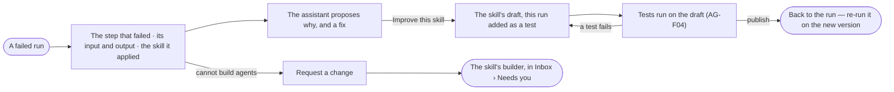

# AG-43 · Turn a failed run into a better skill

**As** an agent builder **I want** to go from a failed run to the skill behind it, fix the skill with that run as a
test, and come back to the run **so that** a bad run becomes a better skill.

Tasks: [task.md](task.md) · Feature: [AG-F03](../../feature.md)

## Who can

| Lens | Can | Otherwise sees |
|---|---|---|
| Admin | *Improve this skill* from any failed run | — |
| Operator | *Request a change* to the skill's builder, with the run attached | *Request a change* stands where *Improve this skill* would. With *Can build agents*: as Admin |

## Flow

## Acceptance criteria

| # | Given | When | Then |
|---|---|---|---|
| AG-43.1 | A failed run | a step that failed opens | it reads its input, output and the skill it applied, with *Improve this skill* |
| AG-43.2 | A failed step | the assistant reads it | it proposes why it failed and a fix to the skill, citing the step; *How it got here* shows its steps and sources |
| AG-43.3 | A builder | they press *Improve this skill* | the skill's draft opens with this run added as a test, and a way back to the run |
| AG-43.4 | The draft published | the builder goes back | the run reads that a newer version of its skill exists, with *Re-run* on it (AG-32) |
| AG-43.5 | A run whose skill already has a draft | *Improve this skill* is pressed | the run is added as a test to that draft; a second draft is never made |
| AG-43.6 | An Operator without *Can build agents* | they read a failed run | *Request a change* is in its place; it sends the skill's builder a request with the run attached, to *Needs you* |
| AG-43.7 | A failed run that applied no skill | the step opens | *Improve this skill* is absent |
| AG-43.8 | A proposed change to a skill from a failed run | it is shown | it names the change it recommends and why, beside the alternatives it weighed |

## Screens

| Surface | Lens | First use | Empty after a filter | Loading | Has data | Failed | Agent working or proposing | No access |
|---|---|---|---|---|---|---|---|---|
| A failed step on the run | Admin | — | — | agents.run · Loading | agents.run · Step failed | agents.run · Could not load | agents.run · Proposing a fix | — |
| A failed step on the run | Operator | — | — | agents.run · Loading | agents.run · Request a change | agents.run · Could not load | agents.run · Proposing a fix | agents.run · Request a change |
| The skill's draft, the run as a test | Admin | — | — | agents.skill · Loading | agents.skill · From a run | agents.skill · Test failed | agents.skill · Testing | — |
| The skill's draft, the run as a test | Operator | — | — | agents.skill · Loading | agents.skill · Read only | agents.skill · Test failed | — | agents.skill · Read only |
| The request in Needs you | Admin | — | — | inbox · Loading | inbox · Request a change | — | — | — |
| The request in Needs you | Operator | — | — | inbox · Loading | inbox · Request sent | — | — | inbox · Request sent |
