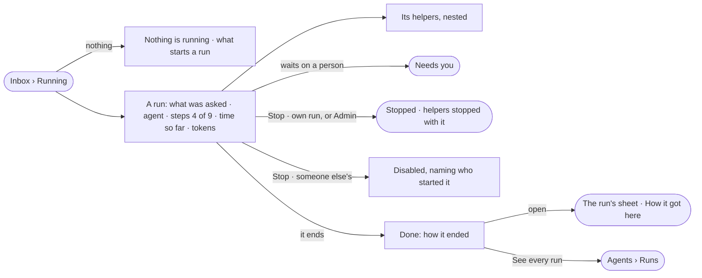

# AG-45 · See what is running and what just ran

**As** someone working in a Graph **I want** every run that is going, and the ones that just ended, in one place with
their helpers under them **so that** I know whether the work I am waiting for is moving, and can stop it, without
first knowing which product started it.

Tasks: [task.md](task.md) · Feature: [AG-F03](../../feature.md)

## Who can

| Lens | Can | Otherwise sees |
|---|---|---|
| Admin | Read every run in flight and every run ended today; stop any run | — |
| Operator | Read the runs they can open; stop a run they started | A run they cannot open is not listed; *Stop* on someone else's run is disabled, naming who started it |

## Flow

## Acceptance criteria

| # | Given | When | Then |
|---|---|---|---|
| AG-45.1 | Nothing is running and nothing ended today | the person opens Running | it reads *Nothing is running*, and that a question, a load, a task or a schedule starts a run |
| AG-45.2 | Runs in flight | Running opens | each lists what it was about — the question as typed, the query, or the dataset and where it loads — its agent, *steps N of M*, time so far and tokens; the reader's runs first |
| AG-45.3 | A run in flight | its steps arrive | the row updates in place and keeps its place; the list repaints at most four times a second |
| AG-45.4 | A run that delegated to a helper, or a step that fanned out | Running is read | each child sits under its run; past the second level they collapse, showing how many |
| AG-45.5 | A run still going whose helper failed | it is read | it shows the helper's failure beside its own *running*; neither hides the other |
| AG-45.6 | A run with helpers | its tokens are read | they include what its helpers spent, in tokens, never currency |
| AG-45.7 | A run waiting on a person | Running is read | it reads *waiting*, naming who it waits on, and opens the ask in Needs you |
| AG-45.8 | Interactive runs — a board expanding a node, a provider check | Running is read | they are hidden unless *Show interactive runs* is on |
| AG-45.9 | A run the reader started, or any run for an Admin | they press *Stop* | it ends *stopped*, each helper *stopped with its parent*, and a History row says who stopped it |
| AG-45.10 | An Operator on someone else's run | they reach *Stop* | it is disabled, naming who started the run |
| AG-45.11 | A run that ends | Running is open | it moves to Done with how it ended — served · cannot answer · out of tokens · out of time · stopped · failed — its time and its tokens |
| AG-45.12 | Runs ended today | Done opens | they list newest first; *See every run* opens Agents › Runs |
| AG-45.13 | A row | the person opens it | the run opens as its sheet (AG-23), and *How it got here* shows its steps and sources |
| AG-45.14 | Each run | it is read | it names where it came from — Explore, a task, a schedule, a delegation, the API — and who started it |
| AG-45.15 | A run the reader cannot open | Running and Done are read | it is not listed |
| AG-45.16 | A number the engine did not record | it is shown | it reads `—`, never `0` |
| AG-45.17 | *Mine* with none of the reader's runs going | Running is read | it reads *Nothing of yours is running*, with *Show everyone's* |
| AG-45.18 | The engine cannot read the runs | Running opens | it says what it could not read, with *Try again* |

## Screens

| Surface | Lens | First use | Empty after a filter | Loading | Has data | Failed | Agent working or proposing | No access |
|---|---|---|---|---|---|---|---|---|
| Inbox › Running | Admin | inbox · Running · Nothing is running | inbox · Running · Nothing of yours | inbox · Loading | inbox · Running | inbox · Could not load | inbox · Running | — |
| Inbox › Running | Operator | inbox · Running · Nothing is running | inbox · Running · Nothing of yours | inbox · Loading | inbox · Running · Not yours to stop | inbox · Could not load | inbox · Running | inbox · Running · Not yours to stop |
| Inbox › Done | Admin | inbox · Done · Nothing ended today | — | inbox · Loading | inbox · Done | inbox · Could not load | — | — |
| Inbox › Done | Operator | inbox · Done · Nothing ended today | — | inbox · Loading | inbox · Done | inbox · Could not load | — | inbox · Done |
| A run's sheet | Admin | — | — | agents.run · Loading | agents.run | agents.run · Failed | agents.run · Running | — |
| A run's sheet | Operator | — | — | agents.run · Loading | agents.run · Not yours to stop | agents.run · Failed | agents.run · Running | agents.run · Not found |
