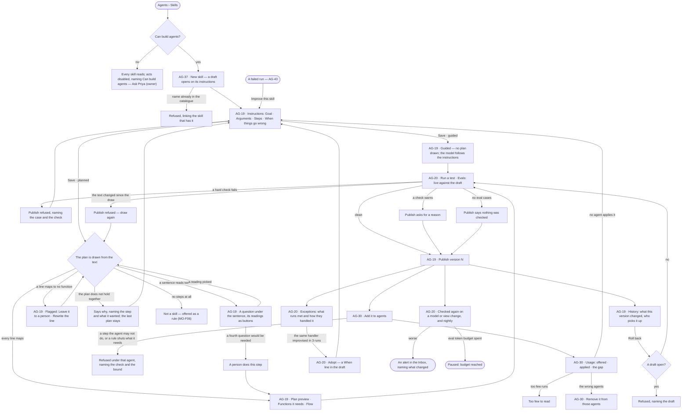
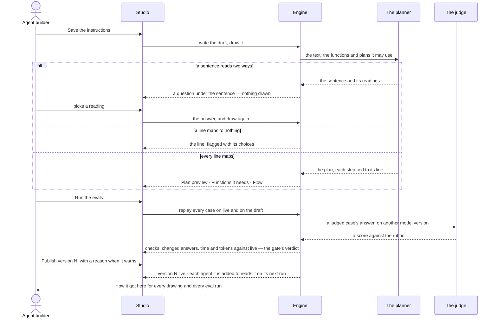

# Skills

> A skill is a playbook written once, as a `SKILL.md` folder — what to do and when to use it — that runs one of two
> ways: *planned*, drawn into a plan before anything runs, or *guided*, followed by the model with the functions its
> agent may use. Invana tests it against fixed questions before it publishes, offers it to the agents it is added to,
> and counts: offered against applied. The decisions it helps make: *is this playbook clear enough to run, is this change
> safe to publish, and is the skill actually used where it was meant to be?*

## User journey

Journeys this feature is a step of: [J04 · Build an agent and improve it from what runs teach](../../../../journeys/J04-build-an-agent-and-improve-it-from-what-runs-teach.md)

## Stories

| ID | Story | Status |
|---|---|---|
| AG-37 | [Build a skill once, for every agent that does the work](stories/AG-37-build-a-skill-once-for-every-agent-that-does-the-work/story.md) | idea |
| AG-19 | [Write a skill as a document and see the plan it becomes](stories/AG-19-write-a-skill-as-a-document-and-see-the-plan-it-becomes/story.md) | idea |
| AG-20 | [Test a skill, keep its eval cases and adopt what runs improvise](stories/AG-20-test-a-skill-keep-its-eval-cases-and-adopt-what-runs-improvise/story.md) | idea |
| AG-30 | [See which agents a skill is added to and whether they use it](stories/AG-30-see-which-agents-a-skill-is-added-to-and-whether-they-use-it/story.md) | idea |

## Access

| Act | Role (`.claude/team/TEAM.md` §7) | Everyone else sees |
|---|---|---|
| Read every skill — instructions, Flow, functions, agents, usage, exceptions, evals, tests, history | Operator — every member of the graph | — |
| Create a skill, edit its draft, answer the drawing's questions, publish, roll back | `builder` · shown as *Can build agents* · Admin | The editor reads; *New skill*, *Publish*, *Edit instructions* and *Roll back* are disabled, naming *Can build agents* — *Ask Priya (owner)* |
| Run a test; write, accept or delete eval cases; ask for proposed cases; run the evals | `builder` · *Can build agents* · Admin | Results and cases read; each act is disabled, naming *Can build agents* |
| Promote a run's answer to an eval case | `builder` · *Can build agents* · Admin | *Promote to eval* is disabled on the run, naming *Can build agents* |
| Adopt a handler | `builder` · *Can build agents* · Admin | *Adopt* is disabled, naming *Can build agents* |
| Add a skill to an agent, remove it | `builder` · *Can build agents* · Admin | The agents read; *Add to an agent* and *Remove* are disabled, naming *Can build agents* |
| Set the graph's eval token budget | Owner · Admin (open question) | The budget and what is spent read; editing is disabled, naming the Owner |
| Approve a function a skill needs from a library | Admin (AG-40) | The need reads *Waiting for an Admin* |
| Approve a script in a skill's `scripts/` | Admin (RT-F06) | The script reads *Waiting for an Admin* |
| Choose whether a skill runs guided or planned | `builder` · *Can build agents* · Admin | The choice reads; it is disabled, naming *Can build agents* |
| Allow a function a skill needs | `iam-admin` · shown as *Can manage people* · Admin, as an access rule (AC-F02) | The need reads, naming the access rule that would allow it |

## States

| State | What the person sees |
|---|---|
| First use | Skills with only the skills that ship with Invana, *New skill* and a line on what a skill is; a new draft with the four headings, *No functions yet* and *Nothing to draw yet*; Usage, Exceptions and Tests read *Not run yet*; Evals reads *No eval set — nothing checked* |
| Empty after a filter | — |
| Loading | The sheet's head and tabs drawn at once; the body loads in place; the Plan preview reads *Drawing…* over the last plan drawn |
| Has data | A skill as a sheet: its head, its state and *Guided* or *Planned*, then Instructions · Flow · Functions · Agents · Usage · Exceptions · Evals · Tests · History |
| Failed | The tab names what it could not read, in the engine's words; a refused publish, draw or add names its check where the act was |
| Agent working or proposing | The plan being drawn; the planner asking which reading a sentence means; the assistant proposing eval cases; an eval run with its cases filling in; an *Adopt* proposal |
| No access | Every tab reads; the editor is read-only and each act is disabled, naming *Can build agents* — *Ask Priya (owner)* |

## Rules

| Rule | Detail |
|---|---|
| A skill is a `SKILL.md` folder | The Agent Skills folder — `SKILL.md` with `name` and `description` in its front matter and the instructions as its body, `references/`, `scripts/` and `assets/` beside it; it is the source of truth for the version |
| Invana's fields ride under `metadata:` | When to use, how it runs, model version — every field the open format lacks sits under `metadata:` in `SKILL.md`; plans, evals and usage are kept beside the folder, never in it |
| Guided or planned | *Planned* draws the instructions into a plan before anything runs, each step a function; *guided* draws none, and the model follows the instructions with the functions its agent may use, each call checked as it is made. A new skill is planned |
| The plan is a cache | A planned version's plan is compiled from its text, its answers to the planner's questions and the function and library-plan versions it named; the same inputs compile the same plan. It is kept so runs reproduce, never edited, never exported, and never the source |
| Offered, not obeyed | A skill is offered to a step, which may use it; it is never forced on one, and no step is refused for ignoring it |
| A skill says when to use it | *When to use* is the trigger the planner matches on; a skill without one does not publish |
| One name in the catalogue | Lowercase, hyphenated, up to 64 characters, unique across the install |
| A published version never changes | Every edit is a draft of the next version; a run that named a version keeps resolving to it |
| A draft is offered to nothing | Agents read a skill's current published version when a run opens; a skill with only a draft is offered nowhere |
| A planned version has exactly one plan | The plan is drawn from the instructions; a planned version publishes with the plan drawn from its exact text, or not at all; a guided version has none |
| Nobody draws a plan by hand | A plan that reads wrong is fixed in the instructions or in the answer to a question; the next draw replaces the whole plan |
| The planner asks rather than guesses | A sentence that matches two or more functions or plans asks which; one that matches none is a person's step; at most three questions a draw |
| A catalogue gap never blocks publishing | In a planned skill, a line no function can do becomes *A person does this*, so every playbook can be drawn |
| No steps, no skill | A playbook that draws no step is a rule (MO-F06), and the draft says so |
| A skill declares needs, never grants | The functions it needs come from its plan; an access rule allows them (AC-F02); a need no access rule covers is refused before anything runs |
| The draw checks the plan; adding checks the agent | A plan that does not hold together is refused when drawn; whether an agent may run it is checked when the skill is added to that agent |
| A library plan is copied when drawn | Naming a library plan in the instructions copies its steps into this skill's plan at the draw; a later version of the library plan reaches the skill only through a redraw someone asks for |
| Publish passes the evals | A failed hard check on the draft refuses publishing; a warning needs a reason; with no eval case, publishing says nothing was checked |
| Rollout is the next run | Every agent the skill is added to reads the new version on its next run; a run in flight finishes on the version it opened with; nothing splits traffic |
| Roll back is a new version | It copies an earlier version's instructions, model version and plan into the next version, through the same evals |
| Adding is explicit | A skill reaches a step only through an agent it is added to; removing it reaches the next run, never one in flight |
| A helper's skills are named when it is made | Inside a run, by the agent that makes it (AG-F05); that is not a refusal point |
| Applied is the model's own report | The surface says so; Invana never claims a skill was applied well |
| Counts are per version | A new version's counts start at zero; earlier versions keep theirs |
| Evals spend their own tokens | A graph's eval token budget is apart from what its agents spend; at its ceiling, scheduled eval runs pause and say so, and a publish-time run still runs with a warning |
| Tokens, never currency | Every budget, cost and count of spend is in tokens; the size of what a skill adds to an ask is in characters |
| The engine counts | Offered, applied, the share applied, *too few to read*, change against live and every number on the sheet are the engine's; Studio formats them |
| Leans on | The catalogue (AG-F02) · import, export and approved functions (AG-F08) · skill scripts (RT-F06) · building an agent (AG-F01) · runs and *Improve this skill* (AG-F03 · AG-43) · helpers (AG-F05) · plans and functions (AG-F06) · rules (MO-F06) · access rules (AC-F02) · AI models (RT-F01) · the Inbox (AC-F05) |

## Data touched

| Record | Read or write |
|---|---|
| Skill — name, current version | Write · read |
| Skill version — its `SKILL.md` folder (name, description, instructions, `metadata:` with when to use, how it runs and model version), plan, published or draft | Write · read |
| A drawing's questions and their answers, on the version | Write · read |
| The plan of a planned version — a cache: steps, each tied to its line; handlers; library plans it copied; the inputs it was compiled from | Write (by the draw only) · read |
| Which agents a skill is added to — who added it, when | Write · read |
| Runs — skills offered and applied on each step, by version | Read |
| Eval set — cases, checks, judge's model version, rubric | Write · read |
| Eval runs and test runs — each case's checks, score, time, tokens | Write · read |
| The graph's eval token budget and what is spent | Write · read |
| History rows of every publish, roll back, add and remove (AC-F06) | Write · read |

## Decisions

| Decision | Detail |
|---|---|
| How it runs is in the head | *Guided* or *Planned* beside the state; a builder switches it on a draft. Switching to planned draws the plan; switching to guided drops the draft's plan, and Flow says the model follows the instructions |
| A skill is a sheet | Opened from Agents › Skills; its tabs are Instructions · Flow · Functions · Agents · Usage · Exceptions · Evals · Tests · History, and it opens on Instructions. A link reopens the same tab |
| The head says its state | The name, then *draft · empty*, *draft vN*, or *vN · published* with *draft vN+1* beside it; acts are *Run a test* and *Publish* on a draft, *Edit instructions* on a published skill with no draft |
| A skill is a document | Instructions is one editor (Edit · Preview) with two cards beside it — *Functions it needs* and *Plan preview* — over a console (Tests · Evals · Problems · Log) that folds to its tab strip |
| New skill opens on its instructions | An *untitled* draft with the four headings — Goal · Arguments · Steps · When things go wrong — since a draft has nothing else to show |
| Saving draws | Saving the draft draws the plan again; *Draw this* reads *Redraw* once the plan has been drawn, and neither asks to confirm |
| Functions it needs is the plan's | It lists the functions the draft's plan calls, each with its bound; *Add functions* picks from the functions the install has and writes a step line naming each — the act reads *Add N*, never *Allow* |
| A question sits under its sentence | Quoting it, with each reading as a button naming the step it would write; never a free-text box; answering draws again at once |
| A line that cannot map is flagged under the document | Naming its line, with *Leave it to a person* and *Rewrite the line*; the preview says why it cannot draw and keeps the last plan, marked *from an earlier text*; Publish waits |
| Flow reads; the instructions compose | Flow draws the plan top-down, one column of steps with handlers and gaps to their right, each step tied to its line; selecting a step shows its line, bound and side effect, and selecting a line selects its step. Its foot says it is drawn from the instructions, and that a run may replan within what the skill may use — the change shows on that run, never here |
| A copied library plan is marked, not boxed | Each copied step reads *from nl-single@1* on hover; *Composed* under the canvas names each library plan once, with what this skill tuned and *vN exists* when the library has published past it |
| A skill is named by its name and version | *Answer in natural language · v7*; only a library plan carries a `key@version` |
| History opens with what the publish changed | The plan's steps added, removed and changed against the version before, and *Who picks it up* — every agent it is added to, *next run* |
| Publish is in the head and on Evals | Both go through the same evals gate with a reason |
| Studio draws the gate's answer | A refused publish, roll back or model move is drawn where the act was, with *Run the evals* when the gate asks for a run; Studio never predicts it |
| A test is a real run marked *test* | One question replayed on the draft as an eval case is, paid from the eval token budget, listed in the console and on Tests; it counts in no agent's numbers |
| A judged score is labelled and kept apart | The judge is a model version other than the one under test; its score warns and never blocks, and is never added to a count of hard checks |
| The gate's thresholds | A failed hard check blocks; tokens or time more than 20% over live, or a judged score 0.5 below it, warns with the numbers |
| Proposed cases wait | The assistant proposes up to five cases from the instructions; each waits as *proposed* until a person accepts it |
| Promoting is a person's act | A good answer becomes a *passing* case, a bad one a *failing* case; an agent never promotes, and the case keeps its run |
| Drift is checked, not guessed | The live version's evals run again when its model version moves, the graph's model publishes, a view of the graph or a rule it reads changes, and nightly; fewer hard checks passing, or time or tokens past 1.5× the last run, raise an alert naming what changed |
| Adopt is a proposal | The same improvised handler in 3 runs is proposed as a *When* line; *Adopt* writes it into the draft and opens Instructions, gated by the evals like any edit |
| Exceptions reads what is stored | Runs · replanned · replans a run p95 · hit the limit, then each exception with where it happened and how it was handled; with none recorded it says *No exceptions recorded yet* |
| Adding is one click, refused where the click was | Adding binds as it is clicked — on the skill's Agents tab or the agent's skills (AG-21) — so a refusal names the one skill and the one agent. Both sides draw the same card from the same answer: which check refused it, the step and its bound, or the band a rule shuts with the plan's bands drawn and the shut one struck, and what was not checked |
| Agents reads three ways | Added · refused · not added, each agent with the refusal that stands |
| A draft added to an agent stays added | It is offered nothing and both sides say so; adding a draft is how a skill is readied for an agent |
| What added skills cost is in characters | *2 of 3 skills are offered — ~7,412 characters in every ask*, a draft named apart; never tokens, since the tokenizer is the model's |
| The gap is the headline | Usage reads offered · applied · the gap for the current version, captioned *vN · all time*, then per version, by agent and by run outcome, every row opening its runs |
| The four readings are drawn | Wrong agents → remove it · wrong trigger → rewrite *when to use* · wrong content → rewrite the instructions · it fits → leave it; drawn on the tab, not behind a hover |
| Neither empty reads as zero | *No data yet* reads `0 · 0 · —`; below the engine's floor a count reads *too few to read* with the gap `—`; both keep their caption, since a gap of 0 claims *applied every time* |
| The skills that ship are skills | *Answer in natural language* is a skill in every graph, never removed; a builder may publish a new version over it |

## Open questions

| Question | Who answers |
|---|---|
| Who sets a graph's eval token budget? The engine lets any member; recommend Owner · Admin, like every other graph limit | Ravi |
| Skills are built once for the install (AG-F02), yet evals, usage and the eval token budget are counted per graph. Recommend: the skill's evals and usage read across graphs on its sheet, the budget stays per graph | Ravi |
| *Adopt* needs runs to record which handler fired; they record replans only. Keep *Adopt* as a criterion until they do (recommend), or drop it for now? | Ravi |
| Who receives the alert when a skill's evals get worse — the skill's builder (as AG-43's *Request a change*), or the graph's Owner? Recommend the skill's builder | Ravi |

## Not building

| Item | Why not |
|---|---|
| Hand-drawn or hand-edited plans | Plans come from instructions; a plan editor beside the instructions would drift from them |
| A plan as the source of a skill | It is a cache of the text; the `SKILL.md` folder is what a skill is |
| A skill format of Invana's own | The open `SKILL.md` folder carries every field Invana needs under `metadata:` |
| A picker that copies a library plan in | A library plan is named in the instructions and copied when drawn |
| A plan that publishes when the instructions change | Editing a playbook would silently change what runs |
| Drawing on every keystroke | Half a sentence is not an instruction |
| Generating instructions from a plan | Two generators pointing at each other drift |
| A free-text answer to a question | It is a second way to write the playbook, outside the playbook |
| Skill categories, tags or groups added as a set | A graph's skills are few enough to read and to choose one by one |
| Skills written from runs by themselves | Invana suggests a change (EX-F07); a person writes and publishes |
| Priority between skills | Offering is not ranking |
| Adding a skill by relevance | Who is offered what is a decision worth making by hand |
| Adding a specific version to an agent | Pinning a version defeats publishing a better one |
| A skill granting functions | A skill declares needs; an access rule allows them |
| A quality score per skill | A score invites optimising the score |
| Checking that a skill was really applied | The model's report is what exists; pretending otherwise is worse |
| Comparing skills across graphs | Graphs are not comparable |
| Currency in eval spend | Tokens only |
| A judge on the model version under test | It would grade its own work |
| Judged scores in the gate | Prose quality warns; only facts block |
| Agents promoting eval cases | A person reads every promoted ask |
| Traffic splitting or canaries | A version reaches every agent it is added to on its next run |
| Rewriting history on roll back | A roll back is a new version |
| Previewing writes and sends on a test run | A test replays the ask as an eval case does; a send already asks first |
| Columns the engine does not count — an agent's *applied in 7 days* or *last applied*, a windowed *Offered*, a skills list's agent, function and eval counts, a step's runs | Studio never derives a number |
| A table of why a run passed a skill over | No run records why; the gap is a number |
