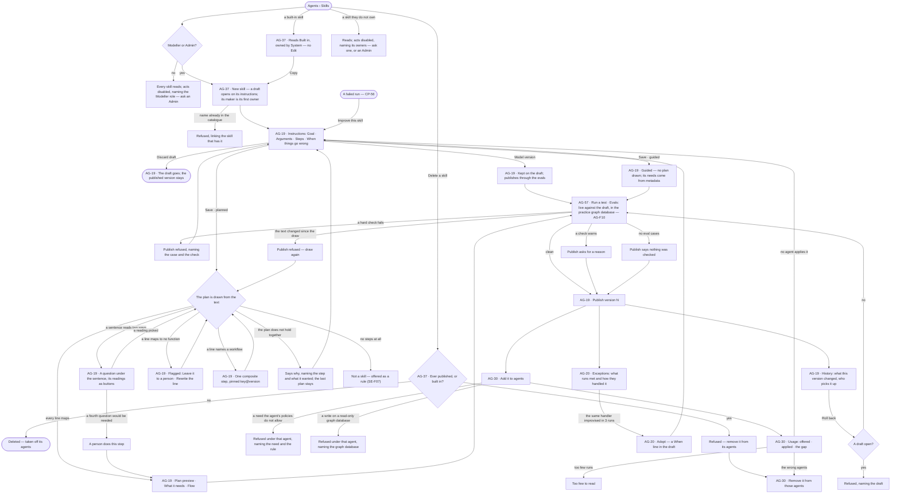
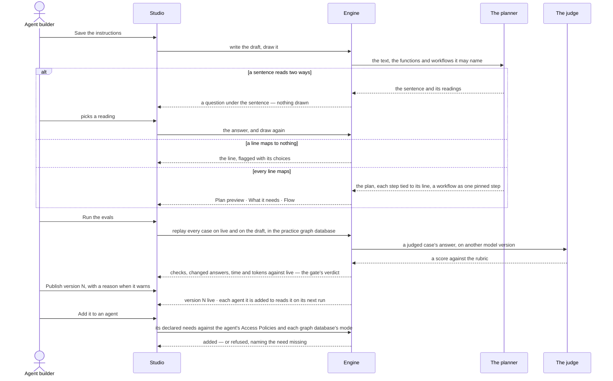

# Skills

> A skill is a playbook written once, as a `SKILL.md` folder — what to do and when to use it — that runs one of two
> ways: *planned*, drawn into a plan before anything runs, or *guided*, followed by the model with the functions its
> agent may use. It is the resource `skill/<name>`: it declares what it needs and grants nothing, and it is owned by the
> people who made it. Invana tests it against fixed questions before it publishes, offers it to the agents it is added
> to, and counts: offered against applied. The decisions it helps make: *is this playbook clear enough to run, is this
> change safe to publish, and is the skill actually used where it was meant to be?*

## User journey

Journeys this feature is a step of: [J04 · Build an agent and improve it from what runs teach](../../../../journeys/J04-build-an-agent-and-improve-it-from-what-runs-teach.md)

## Stories

| ID | Story | Status |
|---|---|---|
| AG-37 | [Build a skill once, for every agent that does the work](stories/AG-37-build-a-skill-once-for-every-agent-that-does-the-work/story.md) | idea |
| AG-19 | [Write a skill as a document and see the plan it becomes](stories/AG-19-write-a-skill-as-a-document-and-see-the-plan-it-becomes/story.md) | idea |
| AG-20 | [Adopt what runs improvise into a skill](stories/AG-20-adopt-what-runs-improvise-into-a-skill/story.md) | idea |
| AG-30 | [See which agents a skill is added to and whether they use it](stories/AG-30-see-which-agents-a-skill-is-added-to-and-whether-they-use-it/story.md) | idea |

## Access

Skills are *Reads* for Operator and *Acts* for Modeller and Admin in [the role table](../../../../os/access/features/AC-F02-access-policies/feature.md#the-role-table);
*Acts* is on the skills a person owns ([AC-F07](../../../../os/access/features/AC-F07-ownership/feature.md)), and an Admin acts on any.

| Act | Role | Everyone else sees |
|---|---|---|
| Read every skill — instructions, Flow, what it needs, owners, agents, usage, exceptions, evals, tests, history | Every signed-in person — Operator, Modeller, Admin | — |
| Create a skill — its maker is its first owner; copy a built-in skill — the copier owns the copy | Modeller · Admin | *New skill* and *Copy* are disabled, naming the role — *Needs the Modeller role — ask an Admin*; the command line refuses, naming it |
| Edit a draft, set its model version, choose guided or planned, answer the drawing's questions, discard the draft, publish, roll back, delete a skill that never published — in Studio or on the command line | An owner of the skill with the Modeller role · Admin. Never on a built-in skill | The editor reads; each act is disabled, naming the role, or the owners on a skill the reader does not own — *Only its owners or an Admin — ask Lee*; a built-in skill offers *Copy* instead |
| Adopt a handler | An owner of the skill with the Modeller role · Admin | Exceptions read; *Adopt* is disabled, naming the role or the owners |
| Keep its evals, run a test, run the evals | As [AG-F10](../AG-F10-test-an-agent-and-a-skill/feature.md#access) | As AG-F10 |
| Add a skill to an agent, remove it | An owner of the skill or of the agent, with the Modeller role · Admin | The agents read; *Add to an agent* and *Remove* are disabled, naming the role or the owners |
| Add a co-owner, hand a skill over | Its owners · Admin ([AC-F07](../../../../os/access/features/AC-F07-ownership/feature.md)) | The owners read |
| Approve a function a skill needs from a library | Admin (AG-40) | The need reads *Waiting for an Admin* |
| Approve a script in a skill's `scripts/` | Admin ([CP-F06](../../../../os/control/features/CP-F06-skill-scripts/feature.md)) | The script reads *Waiting for an Admin* |
| Allow what a skill needs — a rule on an Access Policy attached to the agent | Admin ([AC-F02](../../../../os/access/features/AC-F02-access-policies/feature.md)) | The need reads, naming the resource and verb a rule would have to allow |

## States

| State | What the person sees |
|---|---|
| First use | Skills with only the default skills, each marked *Built in*, owned by *System*; *New skill* and a line on what a skill is; a new draft with the four headings, *Nothing needed yet* and *Nothing to draw yet*; Usage, Exceptions and Tests read *Not run yet*; Evals reads *No eval set — nothing checked* |
| Empty after a filter | — |
| Loading | The sheet's head and tabs drawn at once; the body loads in place; the Plan preview reads *Drawing…* over the last plan drawn |
| Has data | A skill as a sheet: its head, its owners, its state and *Guided* or *Planned*, then Instructions · Flow · What it needs · Agents · Usage · Exceptions · Evals · Tests · History |
| Failed | The tab names what it could not read, in the engine's words; a refused publish, draw or add names its check where the act was |
| Agent working or proposing | The plan being drawn; the planner asking which reading a sentence means; the assistant proposing eval cases; an eval run with its cases filling in; an *Adopt* proposal |
| No access | Every tab reads; the editor is read-only and each act is disabled, naming the Modeller role — or, for a Modeller on a skill they do not own, its owners — *ask Lee*; a built-in skill offers *Copy* |

## Rules

| Rule | Detail |
|---|---|
| A skill is a `SKILL.md` folder | The Agent Skills folder — `SKILL.md` with `name` and `description` in its front matter and the instructions as its body, `references/`, `scripts/` and `assets/` beside it; it is the source of truth for the version |
| Invana's fields ride under `metadata:` | When to use, how it runs, model version and, for a guided skill, its `needs` list — every field the open format lacks sits under `metadata:` in `SKILL.md`; plans, evals and usage are kept beside the folder, never in it |
| A skill is a resource | `skill/<name>`. An agent runs a skill only when the Access Policies attached to it allow Run `skill/<name>` ([AC-F02](../../../../os/access/features/AC-F02-access-policies/feature.md#rules)) |
| A skill declares needs, never grants | Each need is a verb and a resource: Run `plugin/<name>` or `tool/<plugin>/<tool>` for each function it calls · Run `workflow/<key>` for each workflow it names · Read or Write `data/<graph database>/<kind>`. A planned version's needs are read from its plan, with the needs of each function and workflow on it; a guided version's from the `needs` list under `metadata:`. A rule allows a need; a need no rule allows is refused before anything runs ([AC-F04](../../../../os/access/features/AC-F04-what-an-agent-may-touch/feature.md#rules)) |
| Adding checks the agent | Adding a skill to an agent checks Run `skill/<name>` and every declared need against the agent's Access Policies, and every Write against the graph database's mode — a read-only graph database refuses it. A refusal names the need missing; each run checks again, for the person behind it |
| Owned by people | A skill has one or more owners, people only ([AC-F07](../../../../os/access/features/AC-F07-ownership/feature.md#rules)). Whoever creates it is its first owner; a skill an agent creates in a run is owned by the person behind the run |
| Built-in skills are copied, never edited | The default skills below and every skill a plugin ships ([CP-F02](../../../../os/control/features/CP-F02-plugins-and-outside-tools/feature.md#rules)) are owned by the system user, ship with their plan drawn, and are never edited or deleted; *Copy* makes a custom skill, under a new name, owned by the person who copied it |
| Guided or planned | *Planned* draws the instructions into a plan before anything runs, each step a function or a workflow; *guided* draws none, and the model follows the instructions with the functions its agent may use, each call checked as it is made. A new skill is planned |
| The plan is a cache | A planned version's plan is compiled from its text, its answers to the planner's questions and the function and workflow versions it named; the same inputs compile the same plan. It is kept so runs reproduce, never edited, never exported, and never the source |
| A planned version has exactly one plan | The plan is drawn from the instructions; a planned version publishes with the plan drawn from its exact text, or not at all; a guided version has none |
| A workflow is one pinned step | Naming a workflow in the instructions draws one `composite` step pinned to its `key@version`, with the arguments the line gives. A newer version of the workflow reaches the skill only through a redraw someone asks for. Composite steps, their depth limit, cycles and the pre-run check over the tree are [AG-F06](../AG-F06-plans-and-workflows/feature.md#rules)'s |
| Offered, not obeyed | A skill is offered to a step, which may use it; it is never forced on one, and no step is refused for ignoring it |
| A skill says when to use it | *When to use* is the trigger the planner matches on; a skill without one does not publish |
| One name in the catalogue | Lowercase, hyphenated, up to 64 characters, unique across the deployment |
| A published version never changes | Every edit is a draft of the next version; a run that named a version keeps resolving to it |
| A published skill is never deleted | Only a skill that never published is deleted; a published skill stops by being taken off every agent, and keeps its versions |
| A version may name its model | A skill version's model version publishes with it, through the evals like any edit; a step on its plan calls it before the agent's (AG-F01) |
| A draft is offered to nothing | Agents read a skill's current published version when a run opens; a skill with only a draft is offered nowhere |
| Nobody draws a plan by hand | A plan that reads wrong is fixed in the instructions or in the answer to a question; the next draw replaces the whole plan |
| The planner asks rather than guesses | A sentence that matches two or more functions or workflows asks which; one that matches none is a person's step; at most three questions a draw |
| A catalogue gap never blocks publishing | In a planned skill, a line no function can do becomes *A person does this*, so every playbook can be drawn |
| No steps, no skill | A playbook that draws no step is a rule (SE-F07), and the draft says so |
| The draw checks the plan | A plan that does not hold together is refused when drawn; whether an agent may run it is checked when the skill is added to that agent, and again at each step |
| Publish passes the evals | Every publish, roll back and model move passes the eval gate, in the practice graph database ([AG-F10](../AG-F10-test-an-agent-and-a-skill/feature.md#rules)) |
| Rollout is the next run | Every agent the skill is added to reads the new version on its next run; a run in flight finishes on the version it opened with; nothing splits traffic |
| Roll back is a new version | It copies an earlier version's instructions, model version and plan into the next version, through the same evals |
| Adding is explicit | A skill reaches a step only through an agent it is added to; removing it reaches the next run, never one in flight |
| A helper's skills are named when it is made | Inside a run, by the agent that makes it (AG-F05); that is not a refusal point — its own policies refuse a call at the step |
| Applied is the model's own report | The surface says so; Invana never claims a skill was applied well |
| Counts are per version, across the deployment | A new version's counts start at zero; earlier versions keep theirs; every count is over every run in the deployment |
| Tokens, never currency | Every budget, cost and count of spend is in tokens ([glossary › Token budget](../../../../glossary.md#what-may-happen)); the size of what a skill adds to an ask is in characters |
| The engine counts | Offered, applied, the share applied, *too few to read*, change against live and every number on the sheet are the engine's; Studio formats them |
| Leans on | The catalogue (AG-F02) · import, export and approved functions (AG-F08) · skill scripts (CP-F06) · building an agent (AG-F01) · runs and *Improve this skill* (CP-F10 · CP-56) · helpers (AG-F05) · plans and workflows (AG-F06) · suggested changes (AG-F09) · rules (SE-F07) · Access Policies (AC-F02) · declared needs and the gate (AC-F04) · ownership (AC-F07) · plugins (CP-F02) · graph databases (CP-F05) · evals and the eval gate (AG-F10) · AI models (CP-F01) |

The default skills — built in, owned by the system user, each added to its built-in agent at start:

| Skill | What it does | Added to |
|---|---|---|
| `answer-a-question` | Answers a question from the records, citing every record it relies on | Assistant |
| `profile-a-database` | Reads a graph database's kinds, properties and counts and says what it holds | Modeller |
| `draft-a-model` | Drafts a model from a profiled graph database, for a Modeller to change and publish | Modeller |
| `propose-identity-rules` | Proposes match rules that link the same thing across graph databases, for a Modeller to accept | Modeller |
| `check-quality` | Checks records against the model and its rules and lists what fails, with the records | Assistant |
| `weigh-the-evidence` | Weighs the findings for and against a question and says which way the evidence leans, citing each | Assistant |
| `weekly-digest` | Sums up the week — what ran, what changed, what waits on a person | Coordinator |
| `investigate-an-alert` | Follows an alert to the records behind it and opens a lead | Coordinator |
| `review-an-agents-access` | Reads what an agent may touch against what it used and proposes a tighter Access Policy for an Admin to save | Coordinator |

## Data touched

| Record | Read or write |
|---|---|
| Skill — name, origin, what it was copied from, current version | Write · read |
| Skill version — its `SKILL.md` folder (name, description, instructions, `metadata:` with when to use, how it runs, model version and a guided skill's needs), its declared needs, plan, published or draft | Write · read |
| A drawing's questions and their answers, on the version | Write · read |
| The plan of a planned version — a cache: steps, each tied to its line; handlers; the workflows it pins; the inputs it was compiled from | Write (by the draw only) · read |
| Owners of a skill ([AC-F07](../../../../os/access/features/AC-F07-ownership/feature.md)) | Write the first owner at creation and copy · read |
| Which agents a skill is added to — who added it, when | Write · read |
| The Access Policies attached to an agent and each graph database's mode — for adding | Read |
| Runs — skills offered and applied on each step, by version | Read |
| History rows of every publish, roll back, add and remove (AC-F06) | Write · read |

## Engine

### Records

| Table | Columns | Notes |
|---|---|---|
| `agents_skills` | `name` · `origin` (`custom` · `builtin` — Invana or a plugin ships it) · `plugin?` · `copied_from_id?` · `copied_from_version?` · `current_version_id?` | `name` unique across the deployment. `current_version_id` is null while the skill has only a draft. Owners live in `access_owners` ([AC-F07](../../../../os/access/features/AC-F07-ownership/feature.md#engine)), never a column here |
| `agents_skill_versions` | `skill_id` · `version` · `description` · `content` (the instructions) · `when_to_use` · `mode` (`planned` · `guided`) · `folder` (`references/`, `scripts/`, `assets/`, stored whole) · `metadata` (Invana's fields under `metadata:` in `SKILL.md`) · `needs` (a JSON list of `{verb, resource}`) · `model_pin?` · `plan_id?` · `drawn_digest` · `restored_from_version?` · `published_by_id?` · `published_at?` | `version` is assigned when the draft opens. `published_at` null is the draft — at most one per skill, the only row that changes. `plan_id` is unique, null on a guided version. `drawn_digest` is the sha256 of the text the plan was last drawn from. `needs` is written by each draw, or from `metadata.needs` on a guided save |
| `agents_skill_version_clarifications` | `skill_version_id` · `span` (the sentence) · `question` · `options` · `answer?` · `answered_by_id?` · `answered_at?` | Kept, so a redraw never asks again |
| `agents_skill_bindings` | `skill_id` · `agent_id` · `bound_by_id` · `bound_at` | Unique on the pair. A row the skill owns, never a list on the agent; it follows the current version and pins none |

### Reads

| Record | Owner |
|---|---|
| Runs and steps — `skills_offered` · `skills_applied` (skill version ids), `rule_version_id`s, outcome, `replans` | [CP-F10](../../../../os/control/features/CP-F10-runs-and-how-the-agents-are-doing/feature.md#engine) |
| An agent's `effort.max_replans`, `model_pin` | [AG-F01](../AG-F01-build-an-agent/feature.md#engine) |
| Plans — a version's plan, its steps, `origin = generated`, `uses`; workflows, their versions, arguments and needs; the function catalogue | [AG-F06](../AG-F06-plans-and-workflows/feature.md#engine) |
| The Access Policies attached to an agent and the one evaluator, `decide` | [AC-F02](../../../../os/access/features/AC-F02-access-policies/feature.md#engine) |
| Declared needs and the gate before each step | [AC-F04](../../../../os/access/features/AC-F04-what-an-agent-may-touch/feature.md#engine) |
| Owners of a skill and of an agent; a copy of a built-in | [AC-F07](../../../../os/access/features/AC-F07-ownership/feature.md#engine) |
| Plugins, their switches, the skills they ship and each function's declared needs | [CP-F02](../../../../os/control/features/CP-F02-plugins-and-outside-tools/feature.md#engine) |
| Graph databases and their mode | [CP-F05](../../../../os/control/features/CP-F05-graph-databases/feature.md#engine) |
| Eval sets, eval runs, test runs and the eval gate | [AG-F10](../AG-F10-test-an-agent-and-a-skill/feature.md#engine) |
| Functions approved from a library | [AG-F08](../AG-F08-portable-agents-and-skills/feature.md#engine) |
| Scripts in `scripts/` and their approval | [CP-F06](../../../../os/control/features/CP-F06-skill-scripts/feature.md#engine) |
| Rules in scope and their citations | [SE-F07 › Engine](../../../semantics/features/SE-F07-rules/feature.md#engine) |
| AI models offered | [CP-F01](../../../../os/control/features/CP-F01-ai-models/feature.md#engine) |
| History of every edit | [AC-F06](../../../../os/access/features/AC-F06-history/feature.md#engine) |

### Routes

| Route, after `/api/v1/agents` | Does | Story |
|---|---|---|
| `GET /skills` · `POST /skills` | List · create a draft, its first owner the caller | AG-37 |
| `GET /skills/{id}` | The current version's text flattened onto the skill, with `version` · `current_version_id` · `origin` · `built_in` · `owners[]` · `needs[]` · `is_draft` · `draft_version_id` · `plan` (a summary) | AG-37 · AG-19 |
| `PATCH /skills/{id}` · `DELETE /skills/{id}` | Change · delete a skill that never published | AG-37 |
| `GET /skills/{id}/draft` · `PATCH /skills/{id}/draft` · `DELETE /skills/{id}/draft` | The draft — `version` · `plan` · `needs` · `clarifications` · `open_clarification` · `drawing_run_id` · `refusal {run_id, reasons}` · `unmapped` · `drawn` · write it · discard it | AG-19 |
| `POST /skills/{id}/draft/draw` | `202 {run_id, stream_url}` — the drawing run | AG-19 |
| `POST /skills/{id}/draft/clarifications/{c}` | Answer a question; the next draw opens | AG-19 |
| `GET /skills/{id}/versions` · `GET /skills/{id}/versions/{v}` | Versions · one version | AG-19 |
| `GET /skills/{id}/versions/{v}/tasks` | The plan as steps and edges, each with `layer`, `form`, `source_span` and, on a `composite` step, the workflow's `key@version` and `newer_version?` | AG-19 |
| `GET /skills/{id}/versions/{v}/diff` | `against_version` (null for v1) · `fields[{field, changed, lines}]` as unified-diff lines | AG-19 |
| `POST /skills/{id}/versions` · `POST /skills/{id}/rollback` | Publish the draft · roll back as a new version — both through the eval gate | AG-19 |
| `GET /skills/{id}/agents` | Added · refused · not added, each agent with the refusal that stands | AG-30 |
| `GET /skills/{id}/usage` | `skill_id` · `current_version_id` · `versions[{skill_version_id, version, offered, applied, gap, enough_to_read, applied_rate}]` (newest first) · `by_agent[]` · `by_outcome[]` · `used_by` · `recent_steps[{step_id, run_id, label, task_key, skill_version_id, applied}]` | AG-30 |
| `GET /skills/{id}/exceptions?window=7d·30d·90d` | `days` · `since` · `runs` · `replanned` · `replans_p95` · `max_replans` (null) · `hit_limit` · `items[]` | AG-20 |
| `POST /agents/{id}/skills/{skill}` · `DELETE /agents/{id}/skills/{skill}` | Add a skill to an agent · remove it | AG-30 · AG-21 |

A built-in skill is copied through [AC-F07](../../../../os/access/features/AC-F07-ownership/feature.md#routes)'s `POST /copies`; owners are read and changed there.

### Events

| Event | When |
|---|---|
| `agents.skills.create` · `agents.skills.update` · `agents.skills.delete` | A skill is created or copied · its draft changes · a never-published skill is deleted |
| `agents.skills.publish` | A version publishes; a roll back carries `restored_from`, and each carries the gate's verdict and `why` |
| `agents.skills.apply` | A step reports applying a skill version |
| `agents.skill_bound` · `agents.skill_unbound` | A skill is added to an agent · removed |

### Refusals

| Status | When | Sentence | Criterion |
|---|---|---|---|
| 409 | A name another skill of the deployment has | *{name} is taken — open it.* | AG-37.3 |
| 422 | A name not lowercase and hyphenated, or over 64 characters | *A skill's name is lowercase, hyphenated, up to 64 characters.* | AG-37.3 |
| 422 | Publishing with no `when_to_use` | *A skill needs when to use it before it publishes.* | AG-37.4 |
| 422 | Editing, publishing, rolling back or deleting a built-in skill | *{skill} is built in — copy it to change it.* | AG-37.11 · AG-37.17 |
| 422 | Publishing a guided draft whose instructions name a function or workflow its `needs` list lacks | *{skill} names {thing} — add it to its needs.* | AG-37.21 |
| 409 | Publishing a planned draft whose `drawn_digest` is not its text's | *The plan was drawn from an earlier text — draw again.* | AG-19.15 |
| 409 | Rolling back to the current version, or with a draft open | *{skill} has a draft open.* · *There is nothing to restore.* | AG-19.19 |
| 409 | Deleting a skill that published | *{skill} has published versions — remove it from its agents.* | AG-37.19 |
| — | The eval gate's refusals on publish, roll back and a model move | [AG-F10 › Refusals](../AG-F10-test-an-agent-and-a-skill/feature.md#refusals) | AG-57.4 · AG-57.5 · AG-57.6 |
| 409 `skill_binding_refused` | Adding a skill whose Run `skill/<name>` or any declared need the agent's Access Policies do not allow | *{agent} may not {verb} {resource} — {rule} on {policy}.* · *{agent} may not {verb} {resource} — no rule allows it.* | AG-30.3 · AG-30.21 · AG-21.8 |
| 409 `skill_binding_refused` | Adding a skill that needs to write to a read-only graph database | *{database} is read-only — {skill} needs to write.* | AG-30.24 |
| — | A draw that does not hold together — a duplicate key, a binding to a step that does not run first, an output nothing declares, a function the catalogue lacks, a named workflow that is retired, given an argument it does not declare or a value of the wrong type, or that would nest past the depth limit or into a cycle, or no steps | Settles on the drawing run's result with each reason by name; nothing is written and the last plan stays | AG-19.9 · AG-19.10 · AG-19.27 |
| 403 | A write by someone whose role is not Modeller or Admin | *This needs the Modeller role — ask an Admin.* | AG-37.14 · AG-19.26 |
| 403 | A write on a skill by a Modeller who is not one of its owners — adding to or removing from an agent, by one who owns neither the skill nor the agent | *Only its owners or an Admin — ask {owners}.* | AG-37.20 · AG-19.28 · AG-30.26 |

### CLI

| Command | Does |
|---|---|
| `invana skills list` · `invana skills history` | List · a skill's versions |
| `invana skills push` | Write the draft from a file and draw it; a question exits `2` and is answered in Studio |
| `invana skills publish` · `invana skills rollback` | Through the eval gate |

### Mechanisms

| Mechanism | How |
|---|---|
| Owned at birth | `POST /skills` writes the caller's `access_owners` row (`via = made`) in the same transaction; a skill made in a run is owned by the person behind it; a built-in is the system user's ([AC-F07](../../../../os/access/features/AC-F07-ownership/feature.md#mechanisms)) |
| Built-in skills | Written from code and plugins at start, `origin = builtin`, owned by the system user, each with its plan drawn and its default agent added; a built-in planned skill whose text does not draw clean stops the start, naming it. A write to one is refused |
| A copy | `POST /copies` copies the built-in's current version — folder, answers, model pin and plan — into a new custom skill named by the copier, `copied_from_id` and `copied_from_version` set, owned `via = copied`, added to no agent |
| A draft opens over the current version | Its text, answers, model pin, plan, needs and `drawn_digest` are copied from it, so a redraw reads as a revision; a roll back carries that version's digest |
| A step records versions | `skill_version_id` and `rule_version_id`, never the bare id; a skill added to an agent gives its current version when the run opens |
| Discarding a draft | Deletes the draft row, its clarifications and its plan; nothing resolved to them |
| A draw is a run | `role = plan`, read in Runs like any run; it settles having asked, refused or written — it never waits. The planner gets the text and the functions and published workflows it may name |
| Candidates are counted | One per sentence → a step with its `source_span`; two or more → an `agents_skill_version_clarifications` row and the run settles, nothing written; none → a `form: human` step. At most three questions a draw |
| A draft is born with a plan | One person's step carrying the skill's name; every drawn plan is `origin = generated`, so *Redraw* is read off the rows |
| A workflow is a composite step | A sentence naming a workflow draws one `composite` step pinned to its newest published `key@version`, with the arguments the sentence gives checked against the workflow's declared ones; the plan's `uses` records it. The depth limit, cycles and the pre-run check over the tree are [AG-F06](../AG-F06-plans-and-workflows/feature.md#mechanisms)'s. A newer published version reads *vN exists* on the step, never applied |
| Declared needs | Each draw writes the version's `needs`: for each function step, its plugin's Run — `plugin/<name>`, or `tool/<plugin>/<tool>` for a tool — and the function's own declared needs ([CP-F02](../../../../os/control/features/CP-F02-plugins-and-outside-tools/feature.md#mechanisms)); for each composite step, Run `workflow/<key>` and the workflow's needs. A guided save copies `metadata.needs`, each a `{verb, resource}` in the policy grammar. A `form: human` step needs nothing |
| Handlers are read, never drawn | Every non-empty line under a *When things go wrong* heading, to the next level-one or level-two heading, list marker dropped, is a handler. It guards the first step whose dotted function it names as a whole word — the full name tried across every step first — else the first whose function's last segment it names; a line naming none is drawn under the last step with a null `step_id` |
| Unmapped | The sentences the last settled draw's `plan.draft` step could not map, verbatim; empty while a draw is in flight |
| A guided version | `plan_id` null; its needs are its `metadata.needs`; each call a run makes is checked as it is made |
| What reaches a step | In a fixed order — rules in scope, widest first → the agent's added and published skills — each its own item with its id, never concatenated, so it is cited, counted and diffed. A step reports `applied` skill version ids and cites rule version ids |
| Adding checks | Run `skill/<name>` and each of the current version's `needs` go through `decide(agent, person, verb, resource)` ([AC-F02](../../../../os/access/features/AC-F02-access-policies/feature.md#mechanisms)) with the rules that hold for everyone; each Write need on `data/<graph database>/…` is also held to that graph database's mode, and on `data/*/…` to every graph database the kind lives in. Deny, or no rule, refuses; Ask adds, the need marked *asks first*; a need a rule allows only for a team adds, marked *only for {team}*. Each step checks again for the person behind the run ([AC-F04](../../../../os/access/features/AC-F04-what-an-agent-may-touch/feature.md#mechanisms)) |
| A binding refusal | `409` · `error: skill_binding_refused` · `skill_id` · `skill_version_id` · `agent_id` · `needs[{verb, resource, met, effect?, rule?, policy?, team?, why (no_rule · denied · read_only)}]` · `message` naming the first need missing |
| Never refused at adding | A skill with no published version · a `form: human` step · a need under Ask or allowed for a team · a helper's skills named at spawn — its own policies refuse the call at the step |
| *Standings* | `GET /skills/{id}/agents` runs the same checks per agent without adding; an agent already added carries no refusal, and its needs read met or missing |
| `skill_ids` on an agent | `POST /agents` adds each through the same checks; `PATCH /agents/{id}` does not take it; `AgentRead` carries it read only |
| Usage is stored per version | Offered and applied are counted onto the version as each step settles; `enough_to_read` is a floor of 5 offers. `by_agent` (the run's agent) and `by_outcome` (`answered` · `conversed` · `cannot_answer` · `failed` · `cancelled`, null while running) are the current version's; counts are over every step in the deployment, never a page |
| Exceptions | Over the window's whole UTC days of root runs offered any published version, eval and test runs left out; `hit_limit` counts runs whose `replans` reached their own agent's `max_replans`; `items` fill once runs record which handler fired |
| The diff | Computed once in the engine for the API, the command line and Studio |

## System impact

| HLD section | Change | NFRs |
|---|---|---|
| § 6 Data and storage | Eight tables in Postgres; a version's `SKILL.md` folder stored whole; owners in `access_owners` | — |
| § 8 APIs and events | The routes, events and CLI above, under `/api/v1/agents` | — |
| § 9 Distributed execution | Draws are queued runs | — |
| § 10 AI and agents | A skill is offered, never enforced; it declares needs and grants nothing; a planned skill compiles to one plan per version, a workflow pinned as one composite step; the eval gate (AG-F10) guards every publish | — |

## Decisions

| Decision | Detail |
|---|---|
| How it runs is in the head | *Guided* or *Planned* beside the state; an owner switches it on a draft. Switching to planned draws the plan; switching to guided drops the draft's plan, and Flow says the model follows the instructions |
| A skill is a sheet | Opened from Agents › Skills; its tabs are Instructions · Flow · What it needs · Agents · Usage · Exceptions · Evals · Tests · History, and it opens on Instructions. A link reopens the same tab |
| The head says its state and owners | The name, then *draft · empty*, *draft vN*, or *vN · published* with *draft vN+1* beside it, and its owners — *System* on a built-in; acts are *Run a test* and *Publish* on a draft, *Edit instructions* on a published skill with no draft, *Copy* on a built-in |
| A skill is a document | Instructions is one editor (Edit · Preview) with two cards beside it — *What it needs* and *Plan preview* — over a console (Tests · Evals · Problems · Log) that folds to its tab strip |
| New skill opens on its instructions | An *untitled* draft with the four headings — Goal · Arguments · Steps · When things go wrong — since a draft has nothing else to show |
| Saving draws | Saving the draft draws the plan again; *Draw this* reads *Redraw* once the plan has been drawn, and neither asks to confirm |
| What it needs is the version's | It lists each function and workflow the draft's plan calls, each with its bound and the resources it needs — the plugin or tool it runs, the workflow, the kinds it reads or writes in which graph database; a guided skill lists its `metadata:` needs. *Add functions* picks from the functions the deployment has and writes a step line naming each — the act reads *Add N*, never *Allow* |
| A question sits under its sentence | Quoting it, with each reading as a button naming the step it would write; never a free-text box; answering draws again at once |
| A line that cannot map is flagged under the document | Naming its line, with *Leave it to a person* and *Rewrite the line*; the preview says why it cannot draw and keeps the last plan, marked *from an earlier text*; Publish waits |
| Flow reads; the instructions compose | Flow draws the plan top-down, one column of steps with handlers and gaps to their right, each step tied to its line; selecting a step shows its line, bound and side effect, and selecting a line selects its step. Its foot says it is drawn from the instructions, and that a run may replan within what the skill may use — the change shows on that run, never here |
| A workflow is one step, marked with its pin | A composite step reads the workflow's `key@version` and opens its own Flow ([AG-F06](../AG-F06-plans-and-workflows/feature.md#decisions)); *vN exists* sits on it when the workflow has published past the pin |
| A skill is named by its name and version | *answer-a-question · v7*; only a workflow carries a `key@version` |
| A skill reads as prose | A skill's row is its name in the body face over *when to use*, with offered and applied; a workflow's row is an address (AG-F06) |
| A draft says nothing is published | On a skill with only a draft, the version reads `draft`, never `v0`; *When to use* reads *nothing published yet — the draft's trigger is in the editor*; Flow *nothing published yet*; Usage's per-version band *nothing is published yet — there is no text for these counts to belong to* |
| The breakdowns are the current version's | By agent and by outcome are counted for the current version only, and the engine's answer says which; picking an older version on the version bar says *only the current version has a breakdown*, never showing the current one under the older label |
| History opens with what the publish changed | The plan's steps added, removed and changed against the version before, and *Who picks it up* — every agent it is added to, *next run* |
| Publish is in the head and on Evals | Both go through the same evals gate with a reason |
| Adopt is a proposal | The same improvised handler in 3 runs is proposed as a *When* line; *Adopt* writes it into the draft and opens Instructions, gated by the evals like any edit. It stays a criterion while runs learn to record which handler fired; until then Exceptions has no item to propose from |
| Exceptions reads what is stored | Runs · replanned · replans a run p95 · hit the limit, then each exception with where it happened and how it was handled; with none recorded it says *No exceptions recorded yet* |
| Adding is one click, refused where the click was | Adding adds as it is clicked — on the skill's Agents tab or the agent's skills (AG-21) — so a refusal names the one skill and the one agent. Both sides draw the same card from the same answer: every need with met or missing, and for a missing one the rule and policy that refuse it, *no rule*, or the read-only graph database |
| Agents reads three ways | Added · refused · not added, each agent with the refusal that stands |
| A draft added to an agent stays added | It is offered nothing and both sides say so; adding a draft is how a skill is readied for an agent |
| What added skills cost is in characters | *2 of 3 skills are offered — ~7,412 characters in every ask*, a draft named apart; never tokens, since the tokenizer is the model's |
| The gap is the headline | Usage reads offered · applied · the gap for the current version, captioned *vN · all time*, then per version, by agent and by run outcome, every row opening its runs |
| The four readings are drawn | Wrong agents → remove it · wrong trigger → rewrite *when to use* · wrong content → rewrite the instructions · it fits → leave it; drawn on the tab, not behind a hover |
| Neither empty reads as zero | *No data yet* reads `0 · 0 · —`; below the engine's floor a count reads *too few to read* with the gap `—`; both keep their caption, since a gap of 0 claims *applied every time* |
| Built-in skills are copied | The default skills and every skill a plugin ships read *Built in*, owned by *System*, with *Copy* in place of every edit; the copy is a custom skill the copier owns, added to no agent |
| Discarding is the draft's | *Discard draft* drops the draft, its answers and its plan; the published version is untouched, so nothing any agent is offered changes |
| Delete is for a skill that never published | *Delete* removes a draft-only skill and takes it off its agents; on a published or built-in skill it is refused, pointing to its Agents tab or *Copy* |

## Open questions

| Question | Who answers |
|---|---|

## Not building

| Item | Why not |
|---|---|
| Hand-drawn or hand-edited plans | Plans come from instructions; a plan editor beside the instructions would drift from them |
| A plan as the source of a skill | It is a cache of the text; the `SKILL.md` folder is what a skill is |
| A skill format of Invana's own | The open `SKILL.md` folder carries every field Invana needs under `metadata:` |
| A picker that adds a workflow | A workflow is named in the instructions and drawn as a pinned composite step |
| Copying a workflow's steps into a skill's plan | A pinned composite step keeps the workflow whole, its runs counted on it |
| Resolving a workflow's newest version at run time | A new version would silently change every skill that names it, and a version's plan would stop being the plan of its prose |
| A plan that publishes when the instructions change | Editing a playbook would silently change what runs |
| Drawing on every keystroke | Half a sentence is not an instruction |
| Generating instructions from a plan | Two generators pointing at each other drift |
| A free-text answer to a question | It is a second way to write the playbook, outside the playbook |
| Skill categories, tags or groups added as a set | The deployment's skills are few enough to read and to choose one by one |
| Skills written from runs by themselves | Invana suggests a change ([AG-F09](../AG-F09-thinking-graph-and-memory/feature.md)); a person writes and publishes |
| Editing a built-in skill | What Invana ships stays as shipped; *Copy* makes one to change |
| Priority between skills | Offering is not ranking |
| Adding a skill by relevance | Who is offered what is a decision worth making by hand |
| Adding a specific version to an agent | Pinning a version defeats publishing a better one |
| A skill granting access | A skill declares needs; a rule on an Access Policy allows them |
| A quality score per skill | A score invites optimising the score |
| Checking that a skill was really applied | The model's report is what exists; pretending otherwise is worse |
| Traffic splitting or canaries | A version reaches every agent it is added to on its next run |
| Rewriting history on roll back | A roll back is a new version |
| Columns the engine does not count — an agent's *applied in 7 days* or *last applied*, a windowed *Offered*, a skills list's agent, function and eval counts, a step's runs | Studio never derives a number |
| A table of why a run passed a skill over | No run records why; the gap is a number |
