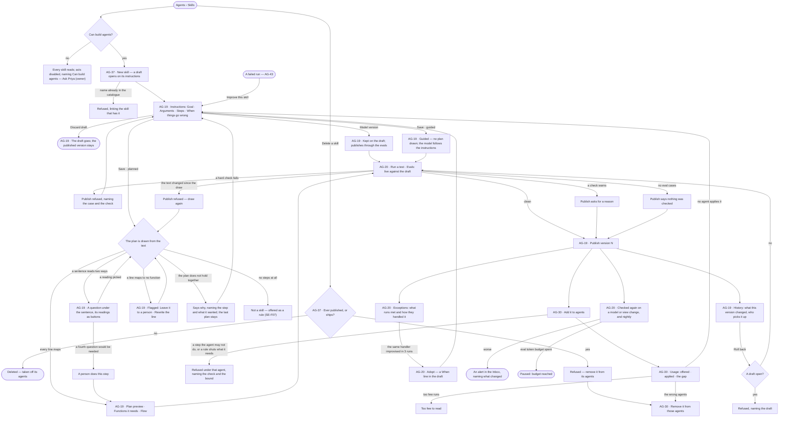
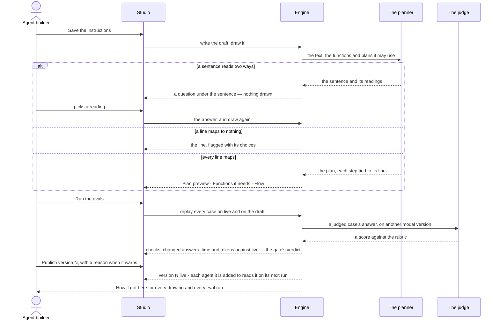

# Skills

> A skill is a playbook written once, as a `SKILL.md` folder — what to do and when to use it — that runs one of two
> ways: *planned*, drawn into a plan before anything runs, or *guided*, followed by the model with the functions its
> agent may use. Invana tests it against fixed questions before it publishes, offers it to the agents it is added to,
> and counts: offered against applied. The decisions it helps make: *is this playbook clear enough to run, is this change
> safe to publish, and is the skill actually used where it was meant to be?*

## User journey

Journeys this feature is a step of: [J04 · Build an agent and improve it from what runs teach](../../../../journeys/J04-build-an-agent-and-improve-it-from-what-runs-teach.md)

## Stories

| ID | Story | Status |
|---|---|---|
| AG-37 | [Build a skill once, for every agent that does the work](stories/AG-37-build-a-skill-once-for-every-agent-that-does-the-work/story.md) | idea |
| AG-19 | [Write a skill as a document and see the plan it becomes](stories/AG-19-write-a-skill-as-a-document-and-see-the-plan-it-becomes/story.md) | idea |
| AG-20 | [Test a skill, keep its eval cases and adopt what runs improvise](stories/AG-20-test-a-skill-keep-its-eval-cases-and-adopt-what-runs-improvise/story.md) | idea |
| AG-30 | [See which agents a skill is added to and whether they use it](stories/AG-30-see-which-agents-a-skill-is-added-to-and-whether-they-use-it/story.md) | idea |

## Access

| Act | Role (`.claude/team/TEAM.md` §7) | Everyone else sees |
|---|---|---|
| Read every skill — instructions, Flow, functions, agents, usage, exceptions, evals, tests, history | Operator — every member of the graph | — |
| Create a skill, edit its draft, set its model version, answer the drawing's questions, discard the draft, publish, roll back, delete a skill that never published — in Studio or on the command line | `builder` · shown as *Can build agents* · Admin | The editor reads; *New skill*, *Discard draft*, *Delete*, *Publish*, *Edit instructions* and *Roll back* are disabled, naming *Can build agents* — *Ask Priya (owner)*; the command line refuses, naming it |
| Run a test; write, accept or delete eval cases; ask for proposed cases; run the evals | `builder` · *Can build agents* · Admin | Results and cases read; each act is disabled, naming *Can build agents* |
| Promote a run's answer to an eval case | `builder` · *Can build agents* · Admin | *Promote to eval* is disabled on the run, naming *Can build agents* |
| Adopt a handler | `builder` · *Can build agents* · Admin | *Adopt* is disabled, naming *Can build agents* |
| Add a skill to an agent, remove it | `builder` · *Can build agents* · Admin | The agents read; *Add to an agent* and *Remove* are disabled, naming *Can build agents* |
| Set the graph's eval token budget | Owner · Admin (open question) | The budget and what is spent read; editing is disabled, naming the Owner |
| Approve a function a skill needs from a library | Admin (AG-40) | The need reads *Waiting for an Admin* |
| Approve a script in a skill's `scripts/` | Admin (RT-F06) | The script reads *Waiting for an Admin* |
| Choose whether a skill runs guided or planned | `builder` · *Can build agents* · Admin | The choice reads; it is disabled, naming *Can build agents* |
| Allow a function a skill needs | `iam-admin` · shown as *Can manage people* · Admin, as an access rule (AC-F02) | The need reads, naming the access rule that would allow it |

## States

| State | What the person sees |
|---|---|
| First use | Skills with only the skills that ship with Invana, *New skill* and a line on what a skill is; a new draft with the four headings, *No functions yet* and *Nothing to draw yet*; Usage, Exceptions and Tests read *Not run yet*; Evals reads *No eval set — nothing checked* |
| Empty after a filter | — |
| Loading | The sheet's head and tabs drawn at once; the body loads in place; the Plan preview reads *Drawing…* over the last plan drawn |
| Has data | A skill as a sheet: its head, its state and *Guided* or *Planned*, then Instructions · Flow · Functions · Agents · Usage · Exceptions · Evals · Tests · History |
| Failed | The tab names what it could not read, in the engine's words; a refused publish, draw or add names its check where the act was |
| Agent working or proposing | The plan being drawn; the planner asking which reading a sentence means; the assistant proposing eval cases; an eval run with its cases filling in; an *Adopt* proposal |
| No access | Every tab reads; the editor is read-only and each act is disabled, naming *Can build agents* — *Ask Priya (owner)* |

## Rules

| Rule | Detail |
|---|---|
| A skill is a `SKILL.md` folder | The Agent Skills folder — `SKILL.md` with `name` and `description` in its front matter and the instructions as its body, `references/`, `scripts/` and `assets/` beside it; it is the source of truth for the version |
| Invana's fields ride under `metadata:` | When to use, how it runs, model version — every field the open format lacks sits under `metadata:` in `SKILL.md`; plans, evals and usage are kept beside the folder, never in it |
| Guided or planned | *Planned* draws the instructions into a plan before anything runs, each step a function; *guided* draws none, and the model follows the instructions with the functions its agent may use, each call checked as it is made. A new skill is planned |
| The plan is a cache | A planned version's plan is compiled from its text, its answers to the planner's questions and the function and library-plan versions it named; the same inputs compile the same plan. It is kept so runs reproduce, never edited, never exported, and never the source |
| Offered, not obeyed | A skill is offered to a step, which may use it; it is never forced on one, and no step is refused for ignoring it |
| A skill says when to use it | *When to use* is the trigger the planner matches on; a skill without one does not publish |
| One name in the catalogue | Lowercase, hyphenated, up to 64 characters, unique across the install |
| A published version never changes | Every edit is a draft of the next version; a run that named a version keeps resolving to it |
| A published skill is never deleted | Only a skill that never published is deleted; a published skill stops by being taken off every agent, and keeps its versions |
| A version may name its model | A skill version's model version publishes with it, through the evals like any edit; a step on its plan calls it before the agent's (AG-F01) |
| A draft is offered to nothing | Agents read a skill's current published version when a run opens; a skill with only a draft is offered nowhere |
| A planned version has exactly one plan | The plan is drawn from the instructions; a planned version publishes with the plan drawn from its exact text, or not at all; a guided version has none |
| Nobody draws a plan by hand | A plan that reads wrong is fixed in the instructions or in the answer to a question; the next draw replaces the whole plan |
| The planner asks rather than guesses | A sentence that matches two or more functions or plans asks which; one that matches none is a person's step; at most three questions a draw |
| A catalogue gap never blocks publishing | In a planned skill, a line no function can do becomes *A person does this*, so every playbook can be drawn |
| No steps, no skill | A playbook that draws no step is a rule (SE-F07), and the draft says so |
| A skill declares needs, never grants | The functions it needs come from its plan; an access rule allows them (AC-F02); a need no access rule covers is refused before anything runs |
| The draw checks the plan; adding checks the agent | A plan that does not hold together is refused when drawn; whether an agent may run it is checked when the skill is added to that agent |
| A library plan is copied when drawn | Naming a library plan in the instructions copies its steps into this skill's plan at the draw; a later version of the library plan reaches the skill only through a redraw someone asks for |
| Publish passes the evals | A failed hard check on the draft refuses publishing; a warning needs a reason; with no eval case, publishing says nothing was checked |
| Rollout is the next run | Every agent the skill is added to reads the new version on its next run; a run in flight finishes on the version it opened with; nothing splits traffic |
| Roll back is a new version | It copies an earlier version's instructions, model version and plan into the next version, through the same evals |
| Adding is explicit | A skill reaches a step only through an agent it is added to; removing it reaches the next run, never one in flight |
| A helper's skills are named when it is made | Inside a run, by the agent that makes it (AG-F05); that is not a refusal point |
| Applied is the model's own report | The surface says so; Invana never claims a skill was applied well |
| Counts are per version | A new version's counts start at zero; earlier versions keep theirs |
| Evals spend their own tokens | A graph's eval token budget is apart from what its agents spend; at its ceiling, scheduled eval runs pause and say so, and a publish-time run still runs with a warning |
| Tokens, never currency | Every budget, cost and count of spend is in tokens ([glossary › Token budget](../../../../glossary.md#what-may-happen)); the size of what a skill adds to an ask is in characters |
| The engine counts | Offered, applied, the share applied, *too few to read*, change against live and every number on the sheet are the engine's; Studio formats them |
| Leans on | The catalogue (AG-F02) · import, export and approved functions (AG-F08) · skill scripts (RT-F06) · building an agent (AG-F01) · runs and *Improve this skill* (AG-F03 · AG-43) · helpers (AG-F05) · plans and functions (AG-F06) · rules (SE-F07) · access rules (AC-F02) · AI models (RT-F01) · the Inbox (AC-F05) |

## Data touched

| Record | Read or write |
|---|---|
| Skill — name, current version | Write · read |
| Skill version — its `SKILL.md` folder (name, description, instructions, `metadata:` with when to use, how it runs and model version), plan, published or draft | Write · read |
| A drawing's questions and their answers, on the version | Write · read |
| The plan of a planned version — a cache: steps, each tied to its line; handlers; library plans it copied; the inputs it was compiled from | Write (by the draw only) · read |
| Which agents a skill is added to — who added it, when | Write · read |
| Runs — skills offered and applied on each step, by version | Read |
| Eval set — cases, checks, judge's model version, rubric | Write · read |
| Eval runs and test runs — each case's checks, score, time, tokens | Write · read |
| The graph's eval token budget and what is spent | Write · read |
| History rows of every publish, roll back, add and remove (AC-F06) | Write · read |

## Engine

### Records

| Table | Columns | Notes |
|---|---|---|
| `agents_skills` | `name` · `origin` (`authored` · `builtin` — Invana or a plugin ships it) · `current_version_id?` | `name` unique across the install. `current_version_id` is null while the skill has only a draft |
| `agents_skill_versions` | `skill_id` · `version` · `description` · `content` (the instructions) · `when_to_use` · `mode` (`planned` · `guided`) · `folder` (`references/`, `scripts/`, `assets/`, stored whole) · `metadata` (Invana's fields under `metadata:` in `SKILL.md`) · `model_pin?` · `plan_id?` · `drawn_digest` · `restored_from_version?` · `published_by_id?` · `published_at?` | `version` is assigned when the draft opens. `published_at` null is the draft — at most one per skill, the only row that changes. `plan_id` is unique, null on a guided version. `drawn_digest` is the sha256 of the text the plan was last drawn from |
| `agents_skill_version_clarifications` | `skill_version_id` · `span` (the sentence) · `question` · `options` · `answer?` · `answered_by_id?` · `answered_at?` | Kept, so a redraw never asks again |
| `agents_skill_bindings` | `skill_id` · `agent_id` · `bound_by_id` · `bound_at` | Unique on the pair. A row the skill owns, never a list on the agent; it follows the current version and pins none |
| `agents_eval_sets` | `subject_kind` (`skill` · `agent`) · `subject_id` · `judge_model_pin?` · `rubric?` | Unique on (`subject_kind`, `subject_id`). An agent's tests are its set (AG-F01) |
| `agents_eval_cases` | `eval_set_id` · `question` · `checks` (a JSON list of `{kind, value}`) · `label` (`passing` · `failing`) · `status` (`proposed` · `active` · `retired`) · `source_run_id?` · `created_by_id` | A removed case is `retired`; the results it judged stay |
| `agents_eval_results` | `eval_run_id` · `eval_case_id` · `case_run_id?` · `side` (`live` · `draft`) · `hard` (each check's verdict) · `judged?` · `tokens` · `latency_ms` · `answer_digest` | One per case and side |
| `agents_eval_budgets` | `graph_id` · `monthly_tokens?` | The tokens tests and evals may spend a month; never an agent's month budget |

### Reads

| Record | Owner |
|---|---|
| Runs and steps — `skills_offered` · `skills_applied` (skill version ids), `rule_version_id`s, outcome, `replans`; an eval run's `params` and `result.eval` | [AG-F03](../AG-F03-runs-and-how-the-agents-are-doing/feature.md#engine) |
| An agent's `envelope`, `effort.max_replans`, `model_pin` | [AG-F01](../AG-F01-build-an-agent/feature.md#engine) |
| Plans — a version's plan, its nodes, `origin = generated`, `uses` and library plans; the function catalogue | [AG-F06](../AG-F06-plans-and-functions/feature.md#engine) |
| Functions approved from a library | [AG-F08](../AG-F08-portable-agents-and-skills/feature.md#engine) |
| Scripts in `scripts/` and their approval | [RT-F06](../../../../os/runtime/features/RT-F06-skill-scripts/feature.md#engine) |
| Rules in scope and their citations | [SE-F07 › Engine](../../../semantics/features/SE-F07-rules/feature.md#engine) |
| The bands of a view, its participants and the rules that shut them | [SE-F09 › Engine](../../../semantics/features/SE-F09-views-of-the-graph/feature.md#engine) |
| Criteria in scope | [PJ-F02 › Engine](../../../projects/features/PJ-F02-objectives-and-review/feature.md#engine) |
| AI models offered | [RT-F01](../../../../os/runtime/features/RT-F01-ai-models/feature.md#engine) |
| History of every edit | [AC-F06](../../../../os/access/features/AC-F06-history/feature.md#engine) |

### Routes

| Route, after `/api/v1/u/{u}/{g}/agents` | Does | Story |
|---|---|---|
| `GET /skills` · `POST /skills` | List · create a draft | AG-37 |
| `GET /skills/{id}` | The current version's text flattened onto the skill, with `version` · `current_version_id` · `origin` · `is_draft` · `draft_version_id` · `plan` (a summary) | AG-37 · AG-19 |
| `PATCH /skills/{id}` · `DELETE /skills/{id}` | Change · delete a skill that never published | AG-37 |
| `GET /skills/{id}/draft` · `PATCH /skills/{id}/draft` · `DELETE /skills/{id}/draft` | The draft — `version` · `plan` · `clarifications` · `open_clarification` · `drawing_run_id` · `refusal {run_id, reasons}` · `unmapped` · `drawn` · write it · discard it | AG-19 |
| `POST /skills/{id}/draft/draw` | `202 {run_id, stream_url}` — the drawing run | AG-19 |
| `POST /skills/{id}/draft/clarifications/{c}` | Answer a question; the next draw opens | AG-19 |
| `GET /skills/{id}/versions` · `GET /skills/{id}/versions/{v}` | Versions · one version | AG-19 |
| `GET /skills/{id}/versions/{v}/tasks` | The plan as nodes and edges, each node with `layer`, `form`, `source_span` and the library plan it was copied from | AG-19 |
| `GET /skills/{id}/versions/{v}/diff` | `against_version` (null for v1) · `fields[{field, changed, lines}]` as unified-diff lines | AG-19 |
| `POST /skills/{id}/versions` · `POST /skills/{id}/rollback` | Publish the draft · roll back as a new version — both through the eval gate | AG-19 · AG-20 |
| `GET /skills/{id}/agents` | Added · refused · not added, each agent with the refusal that stands | AG-30 |
| `GET /skills/{id}/usage` | `skill_id` · `current_version_id` · `versions[{skill_version_id, version, offered, applied, gap, enough_to_read, applied_rate}]` (newest first) · `by_agent[]` · `by_outcome[]` · `used_by` · `recent_steps[{step_id, run_id, label, task_key, skill_version_id, applied}]` | AG-30 |
| `GET /skills/{id}/exceptions?window=7d·30d·90d` | `days` · `since` · `runs` · `replanned` · `replans_p95` · `max_replans` (null) · `hit_limit` · `items[]` | AG-20 |
| `GET /skills/{id}/tests` · `POST /skills/{id}/tests` | Test runs, newest first — `id` · `question` · `tokens` · `duration_ms` · `outcome` · `status` · `finished_at` · `{question}` → `202 {run_id, stream_url}` | AG-20 |
| `POST /agents/{id}/skills/{skill}` · `DELETE /agents/{id}/skills/{skill}` | Add a skill to an agent · remove it | AG-30 · AG-21 |
| `GET /evals/{kind}/{id}` · `PUT /evals/{kind}/{id}` | A set — judge, rubric, cases · change it | AG-20 · AG-36 |
| `POST /evals/{kind}/{id}/cases` · `PATCH /evals/{kind}/{id}/cases/{case}` · `DELETE /evals/{kind}/{id}/cases/{case}` | Write, accept, retire a case | AG-20 · AG-36 |
| `POST /evals/{kind}/{id}/propose` | The starter set — up to five `proposed` cases | AG-20 |
| `POST /evals/{kind}/{id}/runs` | Run the set — `draft` beside live, or live only | AG-20 · AG-36 |
| `POST /evals/promote` | A run's answer as a `passing` or `failing` case | AG-20 |
| `POST /evals/drift` | Run drift now, naming what moved | AG-20 · AG-36 |
| `GET /evals/budget` · `PUT /evals/budget` | The Graph's eval token budget and what is spent this month | AG-20 |

### Events

| Event | When |
|---|---|
| `agents.skills.create` · `agents.skills.update` · `agents.skills.delete` | A skill is created · its draft changes · a never-published skill is deleted |
| `agents.skills.publish` | A version publishes; a roll back carries `restored_from`, and each carries the gate's verdict and `why` |
| `agents.skills.apply` | A step reports applying a skill version |
| `agents.skill_bound` · `agents.skill_unbound` | A skill is added to an agent · removed |
| `agents.eval_sets.update` · `agents.eval_cases.create` · `agents.eval_cases.update` · `agents.eval_cases.delete` | A set or a case changes |
| `agents.evals.run` · `agents.evals.degraded` | An eval run settles · drift found a worse result |
| `agents.eval_budgets.update` | The eval token budget changes |

### Refusals

| Status | When | Sentence | Criterion |
|---|---|---|---|
| 409 | A name another skill of the install has | *{name} is taken — open it.* | AG-37.3 |
| 422 | A name not lowercase and hyphenated, or over 64 characters | *A skill's name is lowercase, hyphenated, up to 64 characters.* | AG-37.3 |
| 422 | Publishing with no `when_to_use` | *A skill needs when to use it before it publishes.* | AG-37.4 |
| 409 | Publishing a planned draft whose `drawn_digest` is not its text's | *The plan was drawn from an earlier text — draw again.* | AG-19.15 |
| 409 | Rolling back to the current version, or with a draft open | *{skill} has a draft open.* · *There is nothing to restore.* | AG-19.19 |
| 409 | Deleting a skill that published or ships | *{skill} has published versions — remove it from its agents.* | AG-37.19 |
| 409 `eval_required` | Active cases and no settled eval run whose `params.candidate_digest` matches the candidate | *Run the evals first — {n} cases.* | AG-20.11 · AG-36.18 |
| 409 `eval_running` | That eval run has not settled | *The evals are still running.* | AG-20.11 · AG-36.18 |
| 409 `eval_failed` | A hard check failed on the draft side | *{case} failed {check}.* | AG-20.9 · AG-36.4 · AG-29.9 |
| 409 `eval_warned` | It warned and no `why` was given | *This warns — say why to publish.* | AG-20.10 · AG-36.5 |
| 409 `skill_binding_refused` | Adding a skill whose plan, or a guided skill's named functions, fall outside the agent's envelope, or need a band a rule shuts | *{skill} needs {step} — {bound}.* · *{band} is shut by {rule}.* | AG-30.3 · AG-30.4 · AG-30.21 · AG-21.8 |
| 422 | A judge set to the model version under test | *The judge cannot be the model it grades.* | AG-20.5 |
| — | A draw that does not hold together — a duplicate key, a binding to a step that does not run first, an output nothing declares, a function the catalogue lacks, a library plan copied with an undeclared argument, a wrong type, a one-off plan or no steps | Settles on the drawing run's result with each reason by name; nothing is written and the last plan stays | AG-19.9 · AG-19.10 · AG-19.27 |
| 403 | The eval token budget changed by anyone but the Owner or an Admin | *The eval budget is the Owner's — ask {owner}.* | AG-20.21 |
| 403 | Any other write without *Can build agents* | *This needs Can build agents — ask {owner}.* | AG-19.26 · AG-36.17 |

### CLI

| Command | Does |
|---|---|
| `invana skills list` · `invana skills history` | List · a skill's versions |
| `invana skills push` | Write the draft from a file and draw it; a question exits `2` and is answered in Studio |
| `invana skills publish` · `invana skills rollback` | Through the eval gate |
| `invana evals list` · `invana evals run [--draft] [--version N] [--pin <address>]` | Read a set and its runs · run it: live only, or with `--draft` the candidate beside live — a version a roll back would restore, or the address a pin move would set. Exits `1` when the gate blocks, `3` when it warns |
| `invana evals promote <run> --as passing · failing` | A run's answer as a case |
| `invana evals drift [--trigger]` | Run drift now, naming what moved |

### Mechanisms

| Mechanism | How |
|---|---|
| A draft opens over the current version | Its text, answers, model pin, plan and `drawn_digest` are copied from it, so a redraw reads as a revision; a roll back carries that version's digest |
| A step records versions | `skill_version_id` and `rule_version_id`, never the bare id; a binding gives the current version when the run opens |
| Discarding a draft | Deletes the draft row, its clarifications and its plan; nothing resolved to them |
| A draw is a run | `role = plan`, read in Runs like any run; it settles having asked, refused or written — it never waits. The planner gets the text and the functions and library plans it may use |
| Candidates are counted | One per sentence → a step with its `source_span`; two or more → an `agents_skill_version_clarifications` row and the run settles, nothing written; none → a `form: human` step. At most three questions a draw |
| A draft is born with a plan | One person's step carrying the skill's name; every drawn plan is `origin = generated`, so *Redraw* is read off the rows |
| A library plan is copied | Its steps are copied flat as siblings, each with `source_plan_key` · `source_step_key`; the plan's `uses` records the act. Each copied key takes the library plan's key with hyphens as underscores (`nl_single_translate_thought`), suffixed on a collision, and its `${steps.…}` bindings are rewritten to the new keys. A newer library version reads *vN exists* on the row, never applied |
| Handlers are read, never drawn | Every non-empty line under a *When things go wrong* heading, to the next level-one or level-two heading, list marker dropped, is a handler. It guards the first step whose dotted function it names as a whole word — the full name tried across every step first — else the first whose function's last segment it names; a line naming none is drawn under the last step with a null `step_id` |
| Unmapped | The sentences the last settled draw's `plan.draft` step could not map, verbatim; empty while a draw is in flight |
| A guided version | `plan_id` null; each call a run makes is checked as it is made |
| What reaches a step | In a fixed order — rules in scope, widest first → criteria in scope → the agent's bound and published skills — each its own item with its id, never concatenated, so it is cited, counted and diffed. A step reports `applied` skill version ids and cites rule version ids |
| Adding checks | The envelope check reads the current version's plan against `envelope.allow`; the lens check reads the Graph's and the agent's rules and the participant catalogue; a guided skill checks the functions its instructions name. Both run; every refusal carries `checked` and `not_checked` |
| A binding refusal | `409` · `error: skill_binding_refused` · `check` (`envelope` · `lens`) · `skill_id` · `skill_version_id` · `agent_id` · `checked` · `not_checked` · `message`; the envelope half adds `step_key` · `bound`; the lens half `layer` · `layers` (every band, in plan order) · `reason` (`denied_outright` · `closed_layer` · `every_participant_denied`) · `participant?` · `rule` |
| Never refused at adding | A skill with no published version · an agent with no envelope (unconfigured, not narrow) · a `form: human` step · a band with no participants and no rule · a helper's skills named at spawn — its narrower envelope refuses the call at dispatch. A band is refused only when every participant in it is denied or it is closed |
| *Standings* | `GET /skills/{id}/agents` runs the same checks per agent without adding; an agent already added carries no refusal |
| `skill_ids` on an agent | `POST /agents` adds each through the same checks; `PATCH /agents/{id}` does not take it; `AgentRead` carries it read only |
| Usage is stored per version | Offered and applied are counted onto the version as each step settles; `enough_to_read` is a floor of 5 offers. `by_agent` (the run's agent) and `by_outcome` (`answered` · `conversed` · `cannot_answer` · `failed` · `cancelled`, null while running) are the current version's; counts are over every step in the Graph, never a page |
| Exceptions | Over the window's whole UTC days of root runs offered any published version, eval and test runs left out; `hit_limit` counts runs whose `replans` reached their own agent's `max_replans`; `items` fill once runs record which handler fired |
| A test | A one-question eval replay of the draft, `role = evaluate`, labelled the skill's test |
| The eval gate | The candidate is the draft, a version a roll back would restore, or the same instructions on a new pin; `candidate_digest` is the sha256 of its text and pin. The gate reads the newest settled eval run whose `params.candidate_digest` matches — an eval run never runs inside the publish request. No active case passes with verdict `unchecked`. It returns `{verdict, eval_run_id, warnings}` |
| An eval run | A root run with `role = evaluate`, `flow_key = eval`, `params.trigger` · `params.candidate` · `params.candidate_digest`, `result.eval` per side and verdict `clean` · `warn` · `blocked`. A skill case replays as an ask offered every published skill with the subject's text swapped for the candidate's and its pin resolved first; an agent case replays as that agent with its draft instructions; nothing is written to a conversation. It reads a snapshot of the graph |
| Against live | `versus_live` is written when the run settles — `p95_ms` and `tokens_per_case` (rounded) as a ratio against live, flat within ±2%; a one-sided run carries `versus_live: null` |
| Check kinds | `cites_records` — cites at least one record · `names_world` — ran in the view named in `value` (*Everything* when none froze) · `cannot_answer` — ended *cannot answer* · `guardrail_holds` — no refusal overridden, no denied layer read · `expected_records` — every id in `value` cited · `max_tokens` · `max_latency_ms` — at most `value` |
| The judge | Reads the answer as text — prose verbatim, a table's first rows, a subgraph's counts — capped at 4,000 characters, and scores 0 to 5 against the rubric with one line of why; on the eval budget |
| The starter set | One AI model call on the subject's own pin, else the Graph's `decide` model, writes up to five cases with checks it can state without the graph (`cites_records` · `cannot_answer` · `guardrail_holds`); not an eval run, so not on the eval budget |
| Drift | The set runs again on live when its model version moves, the Graph's model publishes, a view or rule it reads changes, and nightly; a worse result emits `agents.evals.degraded` |
| The diff | Computed once in the engine for the API, the command line and Studio |

## System impact

| HLD section | Change | NFRs |
|---|---|---|
| § 6 Data and storage | Eight tables in Invana's own store; a version's `SKILL.md` folder stored whole | — |
| § 8 APIs and events | The routes, events and CLI above, under `agents` | — |
| § 9 Distributed execution | Draws, tests, eval runs and drift are queued runs; drift also runs nightly | — |
| § 10 AI and agents | A skill is offered, never enforced; a planned skill compiles to one plan per version; the eval gate guards every publish; the judge never grades its own model | — |
| § 14 Evaluation | Eval sets, the gate and drift are how an agent or skill change is measured before and after it ships | — |

## Decisions

| Decision | Detail |
|---|---|
| How it runs is in the head | *Guided* or *Planned* beside the state; a builder switches it on a draft. Switching to planned draws the plan; switching to guided drops the draft's plan, and Flow says the model follows the instructions |
| A skill is a sheet | Opened from Agents › Skills; its tabs are Instructions · Flow · Functions · Agents · Usage · Exceptions · Evals · Tests · History, and it opens on Instructions. A link reopens the same tab |
| The head says its state | The name, then *draft · empty*, *draft vN*, or *vN · published* with *draft vN+1* beside it; acts are *Run a test* and *Publish* on a draft, *Edit instructions* on a published skill with no draft |
| A skill is a document | Instructions is one editor (Edit · Preview) with two cards beside it — *Functions it needs* and *Plan preview* — over a console (Tests · Evals · Problems · Log) that folds to its tab strip |
| New skill opens on its instructions | An *untitled* draft with the four headings — Goal · Arguments · Steps · When things go wrong — since a draft has nothing else to show |
| Saving draws | Saving the draft draws the plan again; *Draw this* reads *Redraw* once the plan has been drawn, and neither asks to confirm |
| Functions it needs is the plan's | It lists the functions the draft's plan calls, each with its bound; *Add functions* picks from the functions the install has and writes a step line naming each — the act reads *Add N*, never *Allow* |
| A question sits under its sentence | Quoting it, with each reading as a button naming the step it would write; never a free-text box; answering draws again at once |
| A line that cannot map is flagged under the document | Naming its line, with *Leave it to a person* and *Rewrite the line*; the preview says why it cannot draw and keeps the last plan, marked *from an earlier text*; Publish waits |
| Flow reads; the instructions compose | Flow draws the plan top-down, one column of steps with handlers and gaps to their right, each step tied to its line; selecting a step shows its line, bound and side effect, and selecting a line selects its step. Its foot says it is drawn from the instructions, and that a run may replan within what the skill may use — the change shows on that run, never here |
| A copied library plan is marked, not boxed | Each copied step reads *from nl-single@1* on hover; *Composed* under the canvas names each library plan once, with what this skill tuned and *vN exists* when the library has published past it |
| A skill is named by its name and version | *Answer in natural language · v7*; only a library plan carries a `key@version` |
| A skill reads as prose | A skill's row is its name in the body face over *when to use*, with offered and applied; a plan's row is an address (AG-F06) |
| A draft says nothing is published | On a skill with only a draft, the version reads `draft`, never `v0`; *When to use* reads *nothing published yet — the draft's trigger is in the editor*; Flow *nothing published yet*; Usage's per-version band *nothing is published yet — there is no text for these counts to belong to* |
| The breakdowns are the current version's | By agent and by outcome are counted for the current version only, and the engine's answer says which; picking an older version on the version bar says *only the current version has a breakdown*, never showing the current one under the older label |
| History opens with what the publish changed | The plan's steps added, removed and changed against the version before, and *Who picks it up* — every agent it is added to, *next run* |
| Publish is in the head and on Evals | Both go through the same evals gate with a reason |
| Studio draws the gate's answer | A refused publish, roll back or model move is drawn where the act was, with *Run the evals* when the gate asks for a run; Studio never predicts it |
| A test is a real run marked *test* | One question replayed on the draft as an eval case is, paid from the eval token budget, listed in the console and on Tests; it counts in no agent's numbers |
| A judged score is labelled and kept apart | The judge is a model version other than the one under test; its score warns and never blocks, and is never added to a count of hard checks |
| The gate's thresholds | A failed hard check blocks; tokens or time more than 20% over live, or a judged score 0.5 below it, warns with the numbers |
| Proposed cases wait | The assistant proposes up to five cases from the instructions; each waits as *proposed* until a person accepts it |
| Promoting is a person's act | A good answer becomes a *passing* case, a bad one a *failing* case; an agent never promotes, and the case keeps its run. A sensitive ask is promoted the same way — by a person who has read it |
| An edit cannot ship a regression | Evals compare the draft with the published version on the same models; a case prefers a check the engine runs on the answer's query over a judged score; an answer that claims what it cites no record for fails its case (*cites records*). Each eval run reads a snapshot of the graph ([Engine › Mechanisms](#mechanisms)) |
| Drift is checked, not guessed | The live version's evals run again when its model version moves, the graph's model publishes, a view of the graph or a rule it reads changes, and nightly; fewer hard checks passing, or time or tokens past 1.5× the last run, raise an alert naming what changed |
| Adopt is a proposal | The same improvised handler in 3 runs is proposed as a *When* line; *Adopt* writes it into the draft and opens Instructions, gated by the evals like any edit |
| Exceptions reads what is stored | Runs · replanned · replans a run p95 · hit the limit, then each exception with where it happened and how it was handled; with none recorded it says *No exceptions recorded yet* |
| Adding is one click, refused where the click was | Adding binds as it is clicked — on the skill's Agents tab or the agent's skills (AG-21) — so a refusal names the one skill and the one agent. Both sides draw the same card from the same answer: which check refused it, the step and its bound, or the band a rule shuts with the plan's bands drawn and the shut one struck, and what was not checked |
| Agents reads three ways | Added · refused · not added, each agent with the refusal that stands |
| A draft added to an agent stays added | It is offered nothing and both sides say so; adding a draft is how a skill is readied for an agent |
| What added skills cost is in characters | *2 of 3 skills are offered — ~7,412 characters in every ask*, a draft named apart; never tokens, since the tokenizer is the model's |
| The gap is the headline | Usage reads offered · applied · the gap for the current version, captioned *vN · all time*, then per version, by agent and by run outcome, every row opening its runs |
| The four readings are drawn | Wrong agents → remove it · wrong trigger → rewrite *when to use* · wrong content → rewrite the instructions · it fits → leave it; drawn on the tab, not behind a hover |
| Neither empty reads as zero | *No data yet* reads `0 · 0 · —`; below the engine's floor a count reads *too few to read* with the gap `—`; both keep their caption, since a gap of 0 claims *applied every time* |
| The skills that ship are skills | *Answer in natural language* and every skill a plugin ships are skills in every graph, never removed; a builder may publish a new version over one. A plugin's skill starts as its instructions, its plan drawn when a builder draws it |
| Discarding is the draft's | *Discard draft* drops the draft, its answers and its plan; the published version is untouched, so nothing any agent is offered changes |
| Delete is for a skill that never published | *Delete* removes a draft-only skill and takes it off its agents; on a published skill it is refused, pointing to its Agents tab |

## Open questions

| Question | Who answers |
|---|---|
| Who sets a graph's eval token budget? The engine lets any member; recommend Owner · Admin, like every other graph limit | Ravi |
| Skills are built once for the install (AG-F02), yet evals, usage and the eval token budget are counted per graph. Recommend: the skill's evals and usage read across graphs on its sheet, the budget stays per graph | Ravi |
| *Adopt* needs runs to record which handler fired; they record replans only. Keep *Adopt* as a criterion until they do (recommend), or drop it for now? | Ravi |
| Who receives the alert when a skill's evals get worse — the skill's builder (as AG-43's *Request a change*), or the graph's Owner? Recommend the skill's builder | Ravi |

## Not building

| Item | Why not |
|---|---|
| Hand-drawn or hand-edited plans | Plans come from instructions; a plan editor beside the instructions would drift from them |
| A plan as the source of a skill | It is a cache of the text; the `SKILL.md` folder is what a skill is |
| A skill format of Invana's own | The open `SKILL.md` folder carries every field Invana needs under `metadata:` |
| A picker that copies a library plan in | A library plan is named in the instructions and copied when drawn |
| A composite node for a copied library plan | Its steps are siblings; a box hides what runs |
| Resolving a library plan at run time | A library edit would silently change every skill that names it, and a version's plan would stop being the plan of its prose |
| A plan that publishes when the instructions change | Editing a playbook would silently change what runs |
| Drawing on every keystroke | Half a sentence is not an instruction |
| Generating instructions from a plan | Two generators pointing at each other drift |
| A free-text answer to a question | It is a second way to write the playbook, outside the playbook |
| Skill categories, tags or groups added as a set | A graph's skills are few enough to read and to choose one by one |
| Skills written from runs by themselves | Invana suggests a change (EX-F07); a person writes and publishes |
| Priority between skills | Offering is not ranking |
| Adding a skill by relevance | Who is offered what is a decision worth making by hand |
| Adding a specific version to an agent | Pinning a version defeats publishing a better one |
| A skill granting functions | A skill declares needs; an access rule allows them |
| A quality score per skill | A score invites optimising the score |
| Checking that a skill was really applied | The model's report is what exists; pretending otherwise is worse |
| Comparing skills across graphs | Graphs are not comparable |
| Currency in eval spend | Tokens only |
| A judge on the model version under test | It would grade its own work |
| Judged scores in the gate | Prose quality warns; only facts block |
| Agents promoting eval cases | A person reads every promoted ask |
| Traffic splitting or canaries | A version reaches every agent it is added to on its next run |
| Rewriting history on roll back | A roll back is a new version |
| Previewing writes and sends on a test run | A test replays the ask as an eval case does; a send already asks first |
| Columns the engine does not count — an agent's *applied in 7 days* or *last applied*, a windowed *Offered*, a skills list's agent, function and eval counts, a step's runs | Studio never derives a number |
| A table of why a run passed a skill over | No run records why; the gap is a number |
