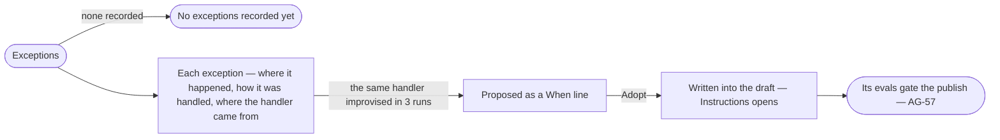

# AG-20 · Adopt what runs improvise into a skill

**As** an agent builder **I want** to read what runs met that a skill's instructions did not cover and how they handled
it, and adopt a handler runs keep improvising as a line of the skill **so that** a skill improves from evidence rather
than from guesses, and every adopted line still passes the evals before it publishes.
*Exceptions propose a line → the builder adopts it.*

Tasks: [task.md](task.md) · Feature: [AG-F04](../../feature.md) · Its evals: [AG-F10](../../../AG-F10-test-an-agent-and-a-skill/feature.md)

## Who can

Adopting a handler is the Modeller's and the Admin's ([the role table](../../../../../../os/access/features/AC-F02-access-policies/feature.md#the-role-table)).

| Lens | Can | Otherwise sees |
|---|---|---|
| Admin | Read every skill's exceptions; adopt a handler into any skill not built in | A built-in skill's exceptions read, with *Copy* in place of *Adopt* |
| Operator | Read every skill's exceptions and usage. A Modeller adopts a handler as an Admin does | *Adopt* disabled, naming the role — *Needs the Modeller role — ask an Admin* |

## Flow

## Acceptance criteria

| # | Given | When | Then |
|---|---|---|---|
| AG-20.19 | Exceptions | it opens | runs · replanned · replans a run p95 · hit the limit over 30 days, then each exception with where it happened, how it was handled, where the handler came from, seen and served after; with none recorded it reads *No exceptions recorded yet* |
| AG-20.20 | The same improvised handler in 3 runs | Exceptions reads it | it proposes it as a *When* line; *Adopt* writes it into the draft and opens Instructions, and the evals gate its publish like any edit (AG-57) |
| AG-20.22 | A skill never run | Usage or Exceptions opens | each reads *Not run yet* with the act that fills it |
| AG-20.23 | An Operator | they open Exceptions | everything reads; *Adopt* is disabled, naming the role — *Needs the Modeller role — ask an Admin* |

## Screens

| Surface | Lens | First use | Empty after a filter | Loading | Has data | Failed | Agent working or proposing | No access |
|---|---|---|---|---|---|---|---|---|
| Exceptions | Admin | agents.skill · No exceptions recorded | — | agents.skill · Loading | agents.skill · Exceptions | agents.skill · Could not load | agents.skill · Adopt | — |
| Exceptions | Operator | agents.skill · No exceptions recorded | — | agents.skill · Loading | agents.skill · Exceptions | agents.skill · Could not load | agents.skill · Exceptions | agents.skill · Exceptions |
