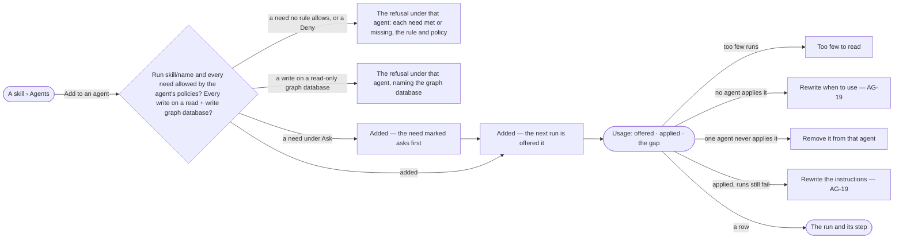

# AG-30 · See which agents a skill is added to and whether they use it

**As** an agent builder **I want** to choose exactly which agents a skill is offered to, and see where it was offered
against where it was applied, and the gap **so that** each agent's context stays small and relevant, a skill never
reaches an agent whose Access Policies do not allow what it needs, and I fix the skills that are ignored instead of
writing more.

Tasks: [task.md](task.md) · Feature: [AG-F04](../../feature.md)

## Who can

Adding a skill to an agent is the Modeller's and the Admin's ([the role table](../../../../../../os/access/features/AC-F02-access-policies/feature.md#the-role-table)).

| Lens | Can | Otherwise sees |
|---|---|---|
| Admin | Add any skill to any agent, remove it, read every count | — |
| Operator | Read which agents it is added to, which are refused and why, what it needs, and every count. A Modeller does what an Admin does | *Add to an agent* and *Remove* disabled, naming the role — *Needs the Modeller role — ask an Admin* |

## Flow

## Acceptance criteria

| # | Given | When | Then |
|---|---|---|---|
| AG-30.1 | A skill's Agents tab | it opens | three sections read — added · refused · not added — each agent with its version and the refusal that stands |
| AG-30.2 | A Modeller or an Admin | they press *Add to an agent* | it is added as it is clicked; the agent's next run is offered the skill's current version, never a pinned one |
| AG-30.3 | A skill whose agent's Access Policies do not allow Run `skill/<name>`, or one of its needs — Run on a function's plugin or tool, Run on a workflow, Read or Write on `data/<graph database>/<kind>` | it is added | it is refused under that agent's row, naming the need, and the rule and policy that refuse it or *no rule allows it* |
| AG-30.5 | Any refusal | it is drawn | it lists every need the skill declares, each met or missing; nothing is refused on a need it did not check |
| AG-30.6 | The same refusal | it is added from the agent's skills (AG-21) | the same card, from the same answer, is drawn beneath that skill's chip — never a toast above the list |
| AG-30.7 | A Modeller or an Admin | they press *Remove* | the agent's next run is not offered it; runs in flight are unaffected; History records who added or removed it, and when |
| AG-30.8 | A skill with only a draft, added to an agent | either side reads it | it stays added and is offered nothing, and both sides say so; adding a draft is allowed |
| AG-30.9 | An agent's skills | they are read | the line reads how many are offered and the size of what they add to every ask in characters — *2 of 3 skills are offered — ~7,412 characters in every ask* — a draft named apart; never tokens |
| AG-30.10 | A helper made inside a run | its skills are read | they are the ones its maker named when it was made, shown on the helper (AG-F05); they are never refused at that point |
| AG-30.11 | A skill added to no agent | Skills reads it | it reads *added to no agent*, so it is not mistaken for working |
| AG-30.12 | A skill's Usage tab | it opens | offered · applied · the gap for the current version, captioned *vN · all time*, then every version with its counts and the date its count started, by agent, and by the run's outcome |
| AG-30.13 | A count below the engine's floor | it is drawn | it reads its counts with the gap as `—` under *too few to read*; never a percentage |
| AG-30.14 | A skill nothing has been offered | Usage opens | it reads `0 · 0 · —` under *No data yet*; never a gap of 0 |
| AG-30.15 | A count above the floor | it is drawn | it reads the engine's share applied — *61% applied*; Studio never divides |
| AG-30.16 | Usage | it is read | it says applied is the model's own report, not proof it was used well |
| AG-30.17 | Usage | it is read | the four readings are drawn, each naming its move — the wrong agents: remove it · the wrong trigger: rewrite *when to use* · the wrong content: rewrite the instructions · it fits: leave it |
| AG-30.18 | Any count's row | the person opens it | it opens the runs behind it, each to the step that was offered the skill — one row per step, so two steps of one run read as two rows; a run whose detail is purged says so, its counts stay, and a step whose run is gone carries no action |
| AG-30.19 | A new version published | Usage opens | its counts start at zero; earlier versions keep theirs, and counts are never summed across versions |
| AG-30.20 | An Operator | they open Agents or Usage | everything reads; *Add to an agent* and *Remove* are disabled, naming the role — *Needs the Modeller role — ask an Admin* |
| AG-30.21 | A guided skill | it is added to an agent | it is refused only when a need in its `metadata:` list is outside what the agent's Access Policies allow, naming it; each call a run makes is checked as it is made |
| AG-30.22 | A skill with only a draft | Usage opens | the version reads `draft`, never `v0`, and the per-version band reads *nothing is published yet — there is no text for these counts to belong to* |
| AG-30.23 | Usage, with an older version picked on the version bar | by agent and by outcome are read | they say *only the current version has a breakdown*, never the current version's counts under the older label |
| AG-30.24 | A skill that needs to write `data/<graph database>/<kind>` on a read-only graph database | it is added | it is refused under that agent's row — *{database} is read-only — {skill} needs to write* |
| AG-30.25 | A need a rule allows only under Ask | it is added | it is added; the need reads *asks first*, and each run checks it again for the person behind it |
| AG-30.26 | An Operator | they open the skill's Agents tab or the agent's skills | everything reads; *Add to an agent* and *Remove* are disabled — *Needs the Modeller role — ask an Admin* |

## Screens

| Surface | Lens | First use | Empty after a filter | Loading | Has data | Failed | Agent working or proposing | No access |
|---|---|---|---|---|---|---|---|---|
| Agents — added · refused · not added | Admin | agents.skill · Added to no agent | — | agents.skill · Loading | agents.skill · Agents | agents.skill · Add refused | — | — |
| Agents — added · refused · not added | Operator | agents.skill · Added to no agent | — | agents.skill · Loading | agents.skill · Agents | agents.skill · Add refused | — | agents.skill · Agents |
| The agent's skills | Admin | agents.agent · No skills yet | — | agents.agent · Loading | agents.agent · Skills offered | agents.agent · Skill refused | — | — |
| The agent's skills | Operator | agents.agent · No skills yet | — | agents.agent · Loading | agents.agent · Read only | agents.agent · Skill refused | — | agents.agent · Read only |
| Usage | Admin | agents.skill · No data yet | — | agents.skill · Loading | agents.skill · Usage | agents.skill · Could not load | — | — |
| Usage | Operator | agents.skill · No data yet | — | agents.skill · Loading | agents.skill · Usage | agents.skill · Could not load | — | agents.skill · Usage |
| A count too few to read | Admin | — | — | — | agents.skill · Too few to read | — | — | — |
| A count too few to read | Operator | — | — | — | agents.skill · Too few to read | — | — | agents.skill · Too few to read |
| Skills — a skill added to no agent | Admin | — | — | agents.skills · Loading | agents.skills · Added to no agent | agents.skills · Could not load | — | — |
| Skills — a skill added to no agent | Operator | — | — | agents.skills · Loading | agents.skills · Added to no agent | agents.skills · Could not load | — | agents.skills · Read only |
| The step a count opens | Admin | — | — | agents.run · Loading | agents.run | agents.run · Failed | — | — |
| The step a count opens | Operator | — | — | agents.run · Loading | agents.run | agents.run · Failed | — | agents.run · Not found |
