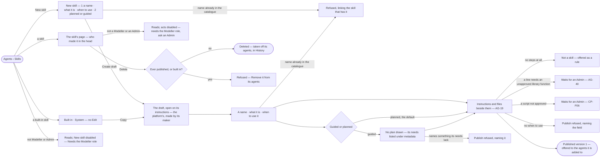

# AG-37 · Build a skill once, for every agent that does the work

**As** an agent builder **I want** to write down once how a piece of work should be done — what it is, when to use it,
its instructions and what it needs — and see the plan and the functions it uses **so that** every agent doing that work
is offered the same tested approach, within what each agent is allowed.

Tasks: [task.md](task.md) · Feature: [AG-F04](../../feature.md)

## Who can

Making and editing a skill is the Modeller's and the Admin's; a skill is the platform's, so making one grants nothing over it ([the role table](../../../../../../os/access/features/AC-F02-access-policies/feature.md#the-role-table)).

| Lens | Can | Otherwise sees |
|---|---|---|
| Admin | Create a skill; on any skill not built in: name it, say what it is and when to use it, choose guided or planned, keep files beside its instructions, delete it while it never published; copy a built-in skill | A built-in skill has no Edit or Delete — *Built in — copy it to change it* |
| Operator | Read every skill, who made it, versions and what it needs. A Modeller does what an Admin does | *New skill*, *Copy* and *Delete* disabled, naming the role — *Needs the Modeller role — ask an Admin* |

## Flow

## Acceptance criteria

| # | Given | When | Then |
|---|---|---|---|
| AG-37.1 | Agents › Skills | it opens | each skill reads its name, *vN* or *draft*, its whole *when to use* sentence, its plan's step count, and *Built in* or who made it |
| AG-37.2 | A Modeller or an Admin | they press *New skill* | the *New skill* modal opens on one page — 1 a name, what it is and when to use it · 2 *Planned* or *Guided*, *Planned* picked — and *Create draft* opens the draft on Instructions holding the four headings — Goal · Arguments · Steps · When things go wrong — with *Nothing needed yet* and *Nothing to draw yet*; the skill is the platform's, made by them |
| AG-37.3 | A draft | a Modeller or an Admin names it | the name is lowercase and hyphenated, up to 64 characters; a name another skill of the deployment has is refused, linking that skill |
| AG-37.4 | A draft with no *when to use* | a Modeller or an Admin publishes | publishing is refused, naming *when to use* |
| AG-37.5 | A skill | it is read | what it is and when to use it read as two fields; *when to use* is the sentence the planner matches on |
| AG-37.6 | A published version | a Modeller or an Admin edits the skill | the edit is a draft of the next version; the published version never changes, and every run that named it still opens it |
| AG-37.7 | A skill with only a draft | an agent it is added to runs | the skill is not offered; the list and the page read *draft* |
| AG-37.8 | A version | it is saved | it is kept whole as a standard skill folder — `SKILL.md` with `name` and `description` in its front matter, Invana's own fields (when to use, how it runs, model version, a guided skill's needs) under `metadata:`, the instructions as its body, and `references/`, `scripts/` and `assets/` beside it; Invana's plan, evals and usage stay beside the folder, never inside it |
| AG-37.9 | A file in `references/` | a step that needs it runs | it is given to that step as context; it is never drawn as a step |
| AG-37.10 | A line that needs a library | the plan is drawn | it maps only to a function an Admin approved (AG-40); until then the line is flagged and publishing waits |
| AG-37.11 | The default skills | Skills opens | each default skill is listed *Built in*, owned by *System*, its plan drawn; it has no Edit or Delete, an edit through the API or the command line is refused — *{skill} is built in — copy it to change it* — and *Copy* makes a custom skill under a new name, owned by the person who copied it and added to no agent |
| AG-37.12 | Instructions that draw no step | the draft is drawn | it says a playbook with no steps is a rule, and offers to move it to the rules (SE-F07) |
| AG-37.13 | A published skill | its page opens | *What it needs* lists every function and workflow its plan calls, with its bound, and every resource it needs — the plugin or tool it runs, the workflow, the kinds it reads or writes and in which graph database — read from the plan |
| AG-37.14 | An Operator | they open Skills or a skill | everything reads; *New skill*, *Copy* and every write are disabled, naming the role — *Needs the Modeller role — ask an Admin*; the API and the command line refuse the same way |
| AG-37.15 | A file in `scripts/` | the draft is saved | it runs unchanged, and only once an Admin approved its exact content (CP-F06); until then it reads *Waiting for an Admin* and a skill that calls it does not publish |
| AG-37.16 | A new skill | it is created | it is *Planned* unless *Guided* was picked in *New skill*; a Modeller or an Admin may switch it later, and the choice is written under `metadata:` in `SKILL.md` |
| AG-37.17 | A plugin that ships skills, switched on | Skills opens | each of its skills is listed *Built in*, owned by *System*, its instructions and plan as the plugin ships them; it cannot be edited or removed, and *Copy* makes one to change |
| AG-37.18 | A skill that never published | a Modeller or an Admin deletes it | the skill, its draft and its plan go, it is taken off every agent it was added to, and History records who deleted it |
| AG-37.19 | A skill with a published version | anyone deletes it | it is refused — runs name its versions — with *Remove it from its agents* opening its Agents tab; nothing is deleted |
| AG-37.20 | An Operator | they open a skill | everything reads; every act is disabled — *Needs the Modeller role — ask an Admin*; the API and the command line refuse the same way |
| AG-37.21 | A guided draft | a Modeller or an Admin publishes | its needs are the `needs` list under `metadata:`, read on *What it needs*; a function or workflow the instructions name that the list lacks refuses the publish, naming it |
| AG-37.22 | Skills in Agents | the list is read | each skill reads *Used by n agents* — the agents it is added to, as the engine counts them |

## Screens

| Surface | Lens | First use | Empty after a filter | Loading | Has data | Failed | Agent working or proposing | No access |
|---|---|---|---|---|---|---|---|---|
| Skills — the list | Admin | agents.skills · Shipped only | — | agents.skills · Loading | agents.skills | agents.skills · Could not load | — | — |
| Skills — the list | Operator | agents.skills · Shipped only | — | agents.skills · Loading | agents.skills · Read only | agents.skills · Could not load | — | agents.skills · Read only |
| New skill · 1 Name, what it is, when to use | Admin | agents.skills · New | — | — | agents.skills · New · Filled | agents.skills · New · Name taken | — | — |
| New skill · 1 Name, what it is, when to use | Operator | — | — | — | — | — | — | agents.skills · Read only |
| New skill · 2 Planned or guided | Admin | agents.skills · New · Planned | — | — | agents.skills · New · Guided | — | — | — |
| New skill · 2 Planned or guided | Operator | — | — | — | — | — | — | agents.skills · Read only |
| New skill · the draft opens | Admin | agents.skills · Detail · New draft | — | agents.skills · Detail · Loading | agents.skills · Detail · Draft | agents.skills · Detail · Could not load | agents.skills · Detail · Drawing | — |
| New skill · the draft opens | Operator | — | — | — | — | — | — | agents.skills · Read only |
| Guided or planned | Admin | agents.skills · Detail · New draft | — | — | agents.skills · Detail · Guided | agents.skills · Detail · Needs missing | agents.skills · Detail · Drawing | — |
| Guided or planned | Operator | agents.skills · Detail · Read only | — | — | agents.skills · Detail · Guided | — | agents.skills · Detail · Drawing | agents.skills · Detail · Read only |
| A skill's head and versions | Admin | agents.skills · Detail · New draft | — | agents.skills · Detail · Loading | agents.skills · Detail | agents.skills · Detail · Could not load | — | — |
| A skill's head and versions | Operator | agents.skills · Detail · Read only | — | agents.skills · Detail · Loading | agents.skills · Detail · Read only | agents.skills · Detail · Could not load | — | agents.skills · Detail · Read only |
| A built-in skill and Copy | Admin | — | — | agents.skills · Detail · Loading | agents.skills · Detail · Built in | agents.skills · Detail · Name taken | — | — |
| A built-in skill and Copy | Operator | — | — | agents.skills · Detail · Loading | agents.skills · Detail · Built in | agents.skills · Detail · Could not load | — | agents.skills · Detail · Built in |
| Delete a skill | Admin | — | — | — | agents.skills · Detail · Delete | agents.skills · Detail · Delete refused | — | — |
| Delete a skill | Operator | — | — | — | — | — | — | agents.skills · Detail · Read only |
| Not a skill — a rule | Admin | — | — | — | agents.skills · Detail · No steps | — | — | — |
| Not a skill — a rule | Operator | — | — | — | agents.skills · Detail · Read only | — | — | agents.skills · Detail · Read only |
