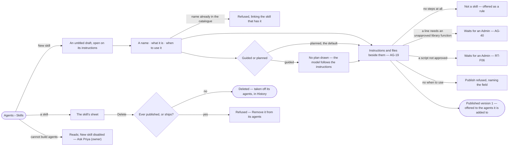

# AG-37 · Build a skill once, for every agent that does the work

**As** an install admin **I want** to write down once how a piece of work should be done — what it is, when to use it
and its instructions — and see the plan and the functions it uses **so that** every agent doing that work is offered
the same tested approach.

Tasks: [task.md](task.md) · Feature: [AG-F04](../../feature.md)

## Who can

| Lens | Can | Otherwise sees |
|---|---|---|
| Admin | Create a skill, name it, say what it is and when to use it, choose guided or planned, keep files beside its instructions, delete a skill that never published | — |
| Operator | Read every skill, its versions and the functions it uses | *New skill* and *Delete* disabled, naming *Can build agents* — *Ask Priya (owner)*. With *Can build agents*: as Admin |

## Flow

## Acceptance criteria

| # | Given | When | Then |
|---|---|---|---|
| AG-37.1 | Agents › Skills | it opens | each skill reads its name, *vN* or *draft*, its whole *when to use* sentence and its plan's step count |
| AG-37.2 | A builder | they press *New skill* | an *untitled* draft opens on Instructions holding the four headings — Goal · Arguments · Steps · When things go wrong — with *No functions yet* and *Nothing to draw yet* |
| AG-37.3 | A draft | the builder names it | the name is lowercase and hyphenated, up to 64 characters; a name another skill of the install has is refused, linking that skill |
| AG-37.4 | A draft with no *when to use* | the builder publishes | publishing is refused, naming *when to use* |
| AG-37.5 | A skill | it is read | what it is and when to use it read as two fields; *when to use* is the sentence the planner matches on |
| AG-37.6 | A published version | anyone edits the skill | the edit is a draft of the next version; the published version never changes, and every run that named it still opens it |
| AG-37.7 | A skill with only a draft | an agent it is added to runs | the skill is not offered; the list and the sheet read *draft* |
| AG-37.8 | A version | it is saved | it is kept whole as a standard skill folder — `SKILL.md` with `name` and `description` in its front matter, Invana's own fields (when to use, how it runs, model version) under `metadata:`, the instructions as its body, and `references/`, `scripts/` and `assets/` beside it; Invana's plan, evals and usage stay beside the folder, never inside it |
| AG-37.9 | A file in `references/` | a step that needs it runs | it is given to that step as context; it is never drawn as a step |
| AG-37.10 | A line that needs a library | the plan is drawn | it maps only to a function an Admin approved (AG-40); until then the line is flagged and publishing waits |
| AG-37.11 | The skills that ship with Invana | Skills opens in any graph | *Answer in natural language* is listed and cannot be removed; a builder may publish a new version over it |
| AG-37.12 | Instructions that draw no step | the draft is drawn | it says a playbook with no steps is a rule, and offers to move it to the graph's rules (SE-F07) |
| AG-37.13 | A published skill | its sheet opens | *Functions it needs* lists every function its plan calls, with its bound, read from the plan |
| AG-37.14 | An Operator without *Can build agents* | they open Skills or a skill | everything reads; *New skill* and every write are disabled, naming *Can build agents*, with *Ask Priya (owner)* |
| AG-37.15 | A file in `scripts/` | the draft is saved | it runs unchanged, and only once an Admin approved its exact content (RT-F06); until then it reads *Waiting for an Admin* and a skill that calls it does not publish |
| AG-37.16 | A new skill | it opens | it is *Planned*; the builder may switch it to *Guided*, and the choice is written under `metadata:` in `SKILL.md` |
| AG-37.17 | A plugin that ships skills | Skills opens in any graph | each of its skills is listed as one that ships with Invana, its instructions as the plugin wrote them and its plan not drawn until a builder draws it; it cannot be removed, and a builder may publish a new version over it |
| AG-37.18 | A skill that never published | the builder deletes it | the skill, its draft and its plan go, it is taken off every agent it was added to, and History records who deleted it |
| AG-37.19 | A skill with a published version, or one that ships | anyone deletes it | it is refused — runs name its versions — with *Remove it from its agents* opening its Agents tab; nothing is deleted |

## Screens

| Surface | Lens | First use | Empty after a filter | Loading | Has data | Failed | Agent working or proposing | No access |
|---|---|---|---|---|---|---|---|---|
| Skills — the list | Admin | agents.skills · Shipped only | — | agents.skills · Loading | agents.skills | agents.skills · Could not load | — | — |
| Skills — the list | Operator | agents.skills · Shipped only | — | agents.skills · Loading | agents.skills · Read only | agents.skills · Could not load | — | agents.skills · Read only |
| A new skill | Admin | agents.skill · New draft | — | agents.skill · Loading | agents.skill · Draft | agents.skill · Name taken | agents.skill · Drawing | — |
| A new skill | Operator | — | — | — | — | — | — | agents.skills · Read only |
| Guided or planned | Admin | agents.skill · New draft | — | — | agents.skill · Guided | — | agents.skill · Drawing | — |
| Guided or planned | Operator | agents.skill · Read only | — | — | agents.skill · Guided | — | agents.skill · Drawing | agents.skill · Read only |
| A skill's head and versions | Admin | agents.skill · New draft | — | agents.skill · Loading | agents.skill | agents.skill · Could not load | — | — |
| A skill's head and versions | Operator | agents.skill · Read only | — | agents.skill · Loading | agents.skill · Read only | agents.skill · Could not load | — | agents.skill · Read only |
| Delete a skill | Admin | — | — | — | agents.skill · Delete | agents.skill · Delete refused | — | — |
| Delete a skill | Operator | — | — | — | — | — | — | agents.skill · Read only |
| Not a skill — a rule | Admin | — | — | — | agents.skill · No steps | — | — | — |
| Not a skill — a rule | Operator | — | — | — | agents.skill · Read only | — | — | agents.skill · Read only |
