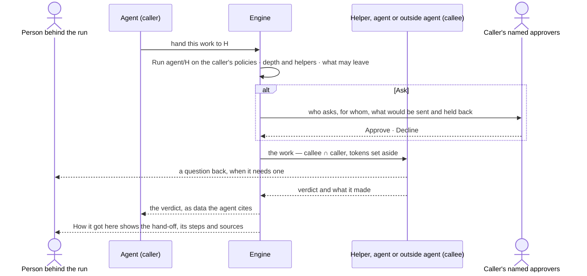
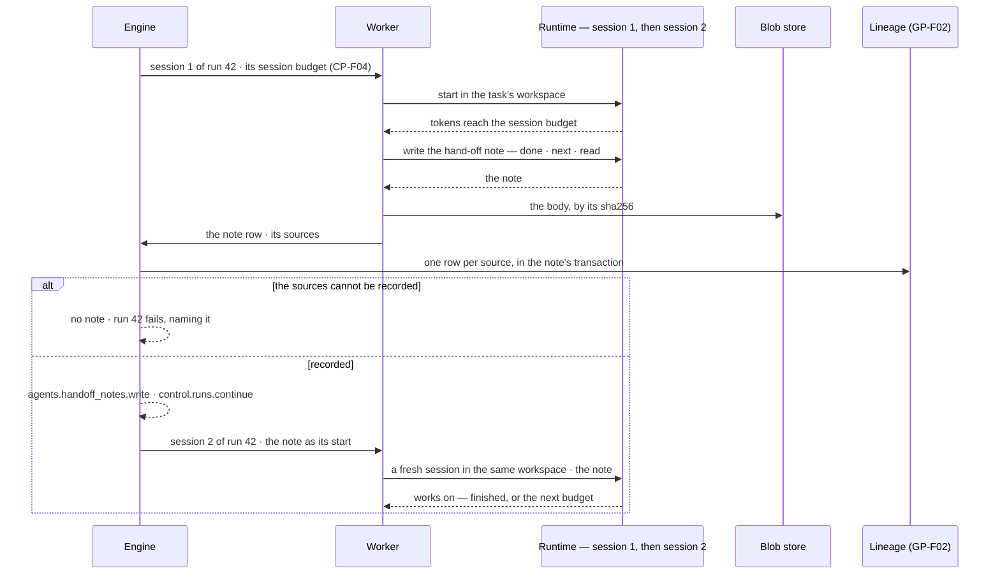

# Delegation and outside agents

> An agent hands work on — to a fresh session of its own run, to a new run, to another agent, to a person or to an
> agent outside Invana. At its session budget a run **continues** in a fresh session from a **hand-off note** — what is
> done, what is next, what it read — the same run, the same number. A **fork** starts a new run from a note. A
> **delegation** hands part of the work to a helper it makes or another agent of the deployment, as a Run on
> `agent/<name>`: the callee runs with its own Access Policies ∩ every caller's, narrowing at every hop, only to agents
> granted to the person behind the run, within the caller's depth and helpers. **Federation** hands a task to an agent
> outside Invana over A2A or MCP. Every hand-off is drawn on the run with who made whom, on whose behalf and what came
> back. The decisions it helps make: *may this agent hand this work on, to whom, and is what came back fit to use?*

## User journey

Journeys this feature is a step of: [J03 · Give an agent work and decide on the result](../../../../journeys/J03-give-an-agent-work-and-decide-on-the-result.md) · [J09 · Audit what an agent touched and what left the platform](../../../../journeys/J09-audit-what-an-agent-touched-and-what-left-the-platform.md)

```mermaid
flowchart TD
  run([An agent mid-run]) --> bud{"Its session reached the session budget?"}
  bud -->|yes| note["AG-62 · Writes a hand-off note: done · next · read"]
  note -->|its sources cannot be recorded| nf(["The run fails, naming it"])
  note --> cont(["AG-62 · Continues in a fresh session — same run, same number"])
  cont -->|stopped between sessions| st(["Stopped · no new session starts"])
  cont --> run
  note -->|a person forks it| fork(["AG-62 · A new run from the note"])
  run -->|needs a person| esc(["An ask, or a question back to the person behind the run — AC-F05"])
  run --> kind{"Hands work to"}
  kind -->|a helper it makes| bound{"Within depth · helpers · tokens a run?"}
  bound -->|no| ref["AG-24 · Refused before it starts, naming the limit and the count"]
  bound -->|at runs at once| q["Queued until a slot frees"]
  bound -->|yes| need{"Making a helper: Run agent/* — Allow · Ask · Deny"}
  kind -->|an agent of the deployment| may{"Run agent/name on the caller's policies: Allow · Ask · Deny"}
  need -->|Deny or no rule| ref
  may -->|Deny or no rule| ref
  may -->|already in the run's chain| loop["Refused — loop"]
  need -->|Ask| ask["Needs you — the caller's named approvers"]
  may -->|Ask| ask
  ask -->|declined or expired| dec["The step ends declined; the agent carries on without it"]
  ask -->|approved| helper
  need -->|Allow| helper["AG-24 · It runs — its policies ∩ every caller's, tokens set aside"]
  may -->|Allow| helper
  helper --> ret["Its answer returns, cited by the agent · unspent tokens go back"]
  ret --> tree(["AG-24 · Who did what: who made whom, on which run, on whose behalf"])
  kind -->|an outside agent| on{"On, and Run agent/name allowed?"}
  on -->|off, or Deny| oref["AG-34 · Refused, naming the switch or the rule"]
  on --> out{"AG-34 · Only what the skill marks to send, no sensitive property?"}
  out -->|no| oref2["Refused before sending, naming the field — nothing leaves"]
  out --> oask["Ask unless a rule names it — what would be sent, what is held back"]
  oask -->|approved| sent["Sent from a worker · working · a ledger row"]
  sent -->|asks back| qq["A question to the person behind the run"] --> sent
  sent --> back(["A verdict and what it returned — a person applies it"])
  admin([Agents › Outside agents]) --> add["AG-33 · Add an outside agent — an A2A card or an outside MCP server — added off"]
  add --> son["Turned on · its approvers · its credential · its limits"]
  son --> on
```

Continuation — one run, two sessions:

| Act | What happens | The run | Who decides | Owner |
|---|---|---|---|---|
| **Continuation** | At its session budget the run writes a hand-off note and goes on in a fresh session from it | The same run, the same number; sessions 1, 2 … | No one — the session budget is reached | This feature (AG-62) · sessions in [CP-F10](../../../../os/control/features/CP-F10-runs-and-how-the-agents-are-doing/feature.md) |
| **Fork** | A person starts a new run from a run's hand-off note | A new run, *started from* the note; the first run is unchanged | The person behind the run, or an Admin who may read the note | This feature (AG-62) |
| **Delegation** | The agent hands part of its work to a helper it makes or another agent of the deployment | A child run, narrowed by every caller | The caller's Access Policies — Allow · Ask · Deny | This feature (AG-24) |
| **Escalation to a person** | The run asks a person — a question back to the person behind it, or an ask to the agent's named approvers | The same run, waiting | The person asked | [AC-F05](../../../../os/access/features/AC-F05-asks-and-approvals/feature.md) |
| **Federation** | The agent hands a task to an agent outside Invana, over A2A or MCP | A task on the run, with a verdict | The caller's Access Policies, Ask by default | This feature (AG-33 · AG-34) |

## Stories

| ID | Story | Status |
|---|---|---|
| AG-24 | [See who made whom, and hand work to a helper within bounds](stories/AG-24-see-who-made-whom-and-hand-work-to-a-helper-within-bounds/story.md) | idea |
| AG-33 | [Add an outside agent by its card or its MCP server](stories/AG-33-add-an-outside-agent-by-its-card/story.md) | idea |
| AG-34 | [Hand a fix to an outside agent and get its result back](stories/AG-34-hand-a-fix-to-an-outside-agent-and-get-its-result-back/story.md) | idea |
| AG-62 | [Continue in a fresh session from a hand-off note](stories/AG-62-continue-in-a-fresh-session-from-a-hand-off-note/story.md) | idea |

## Access

Delegation and outside agents are *Reads* for Operator and *Acts* for Modeller and Admin in [the role table](../../../../os/access/features/AC-F02-access-policies/feature.md#the-role-table).
Who an agent may hand work to is a rule on its Access Policies, which only an Admin changes.

| Act | Role | Everyone else sees |
|---|---|---|
| Read who made whom, every hand-off and what came back on a run | Who may read the run's content — the person behind it and Admins; others see that it ran ([AC-F09](../../../../os/access/features/AC-F09-what-left-the-platform/feature.md)) | Each hand-off reads *ran*, its state and its cost, never its content |
| Allow, Ask or Deny an agent handing work to another — a rule on Run `agent/<name>` | Admin, on an Access Policy ([AC-F02](../../../../os/access/features/AC-F02-access-policies/feature.md)) | The rules read on the agent's Access; changing them reads *Ask an Admin* |
| Approve or decline a hand-off that asks | The caller's named approvers, else the Admins with a *no approver* alert, never the person it benefits ([AC-F05](../../../../os/access/features/AC-F05-asks-and-approvals/feature.md)) | The ask reads, naming who it waits on |
| Answer a helper's or an outside agent's question back | The person behind the run | The question reads, naming who it waits on |
| Read a run's hand-off notes — what is done, what is next, what it read | The person behind the run; anyone else, an Admin included, only when the run belongs to a project and their default agent may read every source of the note ([AC-31](../../../../os/access/features/AC-F09-what-left-the-platform/stories/AC-31-keep-a-runs-content-to-those-who-may-read-it/story.md) · [GP-F02](../../../../os/graph/features/GP-F02-memory/feature.md#rules)) | The note's head — its sessions, when, its size and tokens — with its body *withheld*, naming the first source their agent may not read |
| Fork a new run from a hand-off note | The person behind the run; an Admin who may read the note. Runs — re-run in [the role table](../../../../os/access/features/AC-F02-access-policies/feature.md#the-role-table): *Own* for Operator and Modeller, *Acts* for Admin | *Fork* disabled — *Only the person behind this run or an Admin*; on a note they may not read, *Fork* is not offered |
| Set the session budget at which a run continues | Admin, in the Control Plane ([CP-F04](../../../../os/control/features/CP-F04-limits/feature.md)) | The session budget reads on the run; *Edit in Usage and limits* reads *Ask an Admin* |
| Add an outside agent, turn it on or off, read its card again, set its credential and limits, remove it | Admin, in a session, with the password again for a credential | Outside agents read; each act disabled — *Needs the Admin role* |
| Name an outside agent's approvers | Admin ([AC-F05](../../../../os/access/features/AC-F05-asks-and-approvals/feature.md)) | The approvers read; *Change approvers* reads *Needs the Admin role* |
| Apply what an outside agent returned — merge, publish | A person, outside Invana or in the record's own feature | Invana applies none of it |

## States

| State | What the person sees |
|---|---|
| First use | A run with one agent draws it alone; Outside agents reads what one is, with *Add an outside agent* for an Admin |
| Empty after a filter | *No outside agents match* — the filters named, with *Clear filters* |
| Loading | The run's head drawn at once; who did what loads in place |
| Has data | Who made whom with each helper's state and tokens against what it was given; an outside agent's task with its state, what was sent and held back, and what came back; a run's sessions with the hand-off note between each two |
| Failed | A refused hand-off names the rule, the limit and the count, the switch or the field; a helper's failure is the agent's evidence, never a silent gap; a run whose note could not record its sources reads *Failed*, naming it |
| Agent working or proposing | Helpers running or queued; an outside agent *working*; a hand-off waiting on an ask, drawn dashed; a session writing its hand-off note, then *Continuing in session N* |
| No access | A run whose content the person may not read shows each hand-off as *ran* with its state and cost, and each hand-off note's head with its body *withheld*; outside agents read, every act disabled |

## Rules

| Rule | Detail |
|---|---|
| Five acts, each its own | Continuation, fork, delegation, escalation to a person and federation are distinct (the table under [User journey](#user-journey)); none stands in for another |
| At the session budget a run continues | When a session's tokens reach its session budget ([CP-F04](../../../../os/control/features/CP-F04-limits/feature.md#rules)), the session writes a hand-off note and the run goes on in a fresh session from it — the same run, the same number, the same workspace, runtime, agent version and person behind it. It is never an ask and never an exit reason |
| A hand-off note says three things | What is done, what is next and what it read — the sources, each a resource. The fresh session starts from the note and the run's task, never from the last session's transcript |
| The runtime writes it, else Invana does | The session writes the note when told it reached its budget; a session that ends without one gets one Invana writes from the session's steps and sources — `written_by` says which |
| A note is a copy | Its body is kept in the blob store and its row in Postgres; its sources are lineage rows ([GP-F02](../../../../os/graph/features/GP-F02-memory/feature.md#rules)). It reads only through `may_read_run()` and `lineage.may_see`, like the run's transcript ([AC-31](../../../../os/access/features/AC-F09-what-left-the-platform/stories/AC-31-keep-a-runs-content-to-those-who-may-read-it/story.md)) |
| No sources, no note | A note that cannot record its sources is not written, and the run fails, naming it; a session never continues from a note nobody can trace |
| Continuation stays inside the run's limits | Every session's tokens count to the run's tokens a run, time and steps ([CP-F04](../../../../os/control/features/CP-F04-limits/feature.md#rules)); reaching one of those ends the run for that reason, whatever session it is in |
| Stopping stops continuation | A run stopped while a session writes its note, or between sessions, starts no new session; a note already written is kept |
| A fork is a new run | It starts from a run's hand-off note, with its own number and the person who forked it behind it, *started from* that note; the first run is unchanged. The forker must be able to read the note |
| Escalation is an ask | A run that needs a person asks — a question back to the person behind it, or an ask routed to the agent's named approvers ([AC-F05](../../../../os/access/features/AC-F05-asks-and-approvals/feature.md#rules)); the run waits in its session, it does not continue or fork |
| Federation is outside agents only | Handing a task to an agent outside Invana, over A2A or MCP (AG-33 · AG-34); an agent of the deployment is delegated to, never federated with |
| Handing on is a Run on `agent/<name>` | Delegating to an agent of the deployment or an outside agent is a step that runs `agent/<name>`; the caller's Access Policies Allow, Ask or Deny it like any resource; no rule, no hand-off ([AC-F02](../../../../os/access/features/AC-F02-access-policies/feature.md#rules)) |
| Making a helper needs Run `agent/*` | The function that makes a helper declares the need Run `agent/*` ([declared needs](../../../../os/access/features/AC-F04-what-an-agent-may-touch/feature.md#rules)); the Coordinator's built-in policy allows it, the Assistant's asks first |
| Narrowed at every hop | The callee runs with its own Access Policies ∩ every caller's on the chain, agent to agent only; a step any of them denies is refused, naming the agent in the chain whose rule denied it ([AC-F04](../../../../os/access/features/AC-F04-what-an-agent-may-touch/feature.md#rules)) |
| A helper holds its parent's policies | A helper is attached to its parent's Access Policies and may only narrow them; it holds no grant of its own and is in its run's delegation chain |
| Delegation follows grants | An agent hands work only to an agent granted to the person behind the run, or one already in the run's delegation chain; a run with no person behind it — a schedule or a pick-up — hands work only where its agent's rules allow. An outside agent is granted to nobody and is reached only through a rule on Run `agent/<name>`, Ask by default ([AC-F05](../../../../os/access/features/AC-F05-asks-and-approvals/feature.md#rules)) |
| Within the caller's limits | Depth below the first agent and helpers in all are the caller's limits ([CP-F04](../../../../os/control/features/CP-F04-limits/feature.md#rules)); past either the hand-off is refused before it starts, naming the limit and the count. A helper's run takes a slot like any run; at runs at once it waits *queued* |
| Tokens are set aside | Handing on sets tokens aside from the caller's remaining tokens a run; unspent tokens return when it ends, and a History row says so. Asking for more than remains is refused, naming what remains |
| The person behind stays the person | Every run on the chain is behind the same person: their grants decide which agents may be handed work, and their own switches bind each hop; their teams change nothing an agent reaches |
| Helpers end with the work | A helper is made for one piece of work and retires when it closes; its row and its runs are kept |
| No loops | An agent already in the run's chain cannot be asked again; an outside agent cannot call back into the deployment inside the same task |
| Every helper ends for one reason | served · cannot answer · out of tokens · out of time · out of steps · no progress · loop · stopped with its parent · stopped · failed |
| Stopping cascades | Stopping an agent's run stops every helper and delegated run beneath it |
| An answer is data | What a helper or an outside agent returns is cited by the agent, never obeyed as an instruction |
| An outside agent is an agent of kind *external* | Reached over A2A — by its agent card — or over MCP — through an outside MCP server ([CP-F02](../../../../os/control/features/CP-F02-plugins-and-outside-tools/feature.md)). It is the resource `agent/<name>`, owned by the platform with the Admin who added it as its maker, granted to nobody and never given a task by a person |
| Added off | A new outside agent is off until an Admin turns it on; a hand-off to one that is off is refused, naming who switched it off |
| Ask by default | A Run on an outside agent waits for the caller's named approvers unless a rule names that outside agent and allows it; a rule on `agent/*` asks at most |
| Only what may leave, leaves | An outside agent receives only what the skill marks to send, within what the caller may read; a sensitive property is never sent — the step is refused, naming it ([AC-F09](../../../../os/access/features/AC-F09-what-left-the-platform/feature.md#rules)) |
| Every hand-off out is in the ledger | Each task sent is an outbound row of *What left the platform*, schema-only or data-bearing, with the kinds, fields and record IDs sent ([AC-F09](../../../../os/access/features/AC-F09-what-left-the-platform/feature.md)) |
| One credential choice per outside agent | A shared secret, sealed, or each person's own account (per-user OAuth), chosen by an Admin as for an outside MCP server ([CP-F02](../../../../os/control/features/CP-F02-plugins-and-outside-tools/feature.md#rules)); never an environment variable |
| Invana applies nothing that came back | A pull request, a patch or a report from an outside agent is kept on the run; a person applies it |
| An outside agent's own limits | Time, attempts and tasks at once; Invana's tokens cover only its own side |
| Leans on | Build an agent (AG-F01) · runs and their sessions (CP-F10) · the session budget (CP-F04) · lineage (GP-F02) · workspaces (CP-F03) · the Inbox (CP-F08) · Access Policies (AC-F02) · what an agent may touch (AC-F04) · asks and named approvers (AC-F05) · what left the platform (AC-F09) · limits (CP-F04) · plugins, outside servers and credentials (CP-F02) · workers (CP-F03) |

## Data touched

| Record | Read or write |
|---|---|
| Helper agents — who made them, on which run, retired with the work | Write · read |
| A helper's or delegated run — tokens set aside and returned, why it ended, its caller chain | Write · read |
| Delegation asks and their answers (AC-F05) | Write · read |
| Outside agents — protocol, card or MCP server, skills on the card, credential choice, workers they call from, limits, on or off | Write · read (Admin) |
| An outside task — state, what was sent, what was held back, what came back | Write · read |
| Ledger rows of every task sent (AC-F09) · History rows of every hand-off (AC-F06) | Write · read |
| Hand-off notes — the run, the sessions it joins, why it was written, its body in the blob store, its sources | Write · read |
| A run's sessions (CP-F10) · the session budget (CP-F04) | Read |
| A note's sources — lineage rows (GP-F02) | Write · read |
| A forked run — *started from* its note | Write · read |

## Engine

### Records

| Table | Columns | Notes |
|---|---|---|
| `agents_external_agents` | `agent_id` (its `agents` row, `kind = external`) · `protocol` (`a2a` · `mcp`) · `card_url?` · `card?` (as read) · `card_read_at?` · `a2a_version?` · `mcp_server?` (a `control_mcp_servers` name) · `credential_mode` (`shared` · `per_user`) · `secret_sealed?` · `pool` (the workers it is called from) · `limits` (time, attempts, tasks at once) · `enabled` (default `false`) · `switched_by_id?` · `switched_at?` | One per outside agent. The card is kept as read until an Admin reads it again; an `mcp` agent's skills are its server's frozen tools |
| `agents_external_tasks` | `run_id` · `step_id` · `agent_id` · `skill` · `remote_task_id?` · `state` (`submitted` · `working` · `needs_input` · `done` · `failed` · `cancelled`) · `sent` · `held_back` · `result` · `artifacts` · `ledger_call_id` · `started_at` · `settled_at` | One per task handed out; `result` and `artifacts` are data, never instructions |
| `agents_handoff_notes` | `run_id` · `from_session_seq` · `to_session_seq?` · `reason` (`session_budget` · `fork`) · `forked_run_id?` · `body_uri` (the blob store) · `digest` (sha256) · `size_bytes` · `tokens` · `written_by` (`runtime` · `invana`) · `created_at` | One per note. `to_session_seq` is set when a session starts from it, null when the run stopped first. A fork writes its own row, `reason = fork`, on the run it was forked from — the chosen note's body by the same `digest`, its sources copied, `forked_run_id` the new run — so every fork has one row. The body is a copy — done · next · read — written once, never changed; its sources are `graph_lineage` rows, `copy_kind = note` ([GP-F02](../../../../os/graph/features/GP-F02-memory/feature.md#engine)). The sessions it joins are CP-F10's `control_run_sessions` rows |

### Reads

| Record | Owner |
|---|---|
| The `agents` row — a helper is `kind = helper` with `parent_agent_id` and `spawned_in_run_id`; an outside agent is `kind = external`; `effort` | [AG-F01](../AG-F01-build-an-agent/feature.md#engine) |
| Runs — `parent_run_id`, `escrow_tokens`, `escrow_returned`, `exit_reason`, the caller chain | [CP-F10](../../../../os/control/features/CP-F10-runs-and-how-the-agents-are-doing/feature.md#engine) |
| A run's sessions — `control_run_sessions` (`seq` · `ended_because` · `tokens_in` · `tokens_out` · `handoff_in_id?` · `handoff_out_id?` · `workspace_id?`); a note's route `GET /runs/{id}/handoff-notes/{note_id}`; `control.runs.session_start` · `session_end` · `continue` | [CP-F10](../../../../os/control/features/CP-F10-runs-and-how-the-agents-are-doing/feature.md#engine) |
| The session budget — `control_limits.tokens_per_session` | [CP-F04](../../../../os/control/features/CP-F04-limits/feature.md#engine) |
| The task's workspace a fresh session opens in | [CP-F03](../../../../os/control/features/CP-F03-workers-and-the-queue/feature.md#engine) |
| `graph_lineage` and `lineage.may_see` | [GP-F02](../../../../os/graph/features/GP-F02-memory/feature.md#engine) |
| `may_read_run()` — who reads a run's content | [AC-F09](../../../../os/access/features/AC-F09-what-left-the-platform/feature.md#engine) |
| Access Policies and their attachments; the one evaluator, `decide` | [AC-F02](../../../../os/access/features/AC-F02-access-policies/feature.md#engine) |
| The caller chain and declared needs at each step | [AC-F04](../../../../os/access/features/AC-F04-what-an-agent-may-touch/feature.md#engine) |
| Delegation asks (kind `delegation`), their routing and verdicts | [AC-F05](../../../../os/access/features/AC-F05-asks-and-approvals/feature.md#engine) |
| The ledger row of each task sent | [AC-F09](../../../../os/access/features/AC-F09-what-left-the-platform/feature.md#engine) |
| Depth, helpers, runs at once and tokens a run | [CP-F04](../../../../os/control/features/CP-F04-limits/feature.md#engine) |
| Outside MCP servers, per-user accounts and switches | [CP-F02](../../../../os/control/features/CP-F02-plugins-and-outside-tools/feature.md#engine) |
| Workers a call goes out from | [CP-F03](../../../../os/control/features/CP-F03-workers-and-the-queue/feature.md#engine) |
| The hand-off events *who made whom* reads | [AC-F06](../../../../os/access/features/AC-F06-history/feature.md#engine) |
| Retiring a task's helpers when it closes | [PJ-F01](../../../projects/features/PJ-F01-projects-and-tasks/feature.md#engine) |

### Routes

| Route, after `/api/v1/agents` | Does | Story |
|---|---|---|
| `GET /agents/{name}/helpers?days=7·30·90` | `{agent, nodes[{id, kind (agent · user · task), label, agent_kind?, status?}], edges[{id, source, target, kind, label, event_id?}]}` — the helpers it made in the window | AG-24 |
| `GET /external` · `POST /external` | List (the list contract) · add one — `{name, protocol, card_url? \| mcp_server?, credential_mode, secret?, pool, limits}`; a secret needs the password again | AG-33 |
| `GET /external/{name}` · `PATCH /external/{name}` · `DELETE /external/{name}` | One, with the card as read · change its credential, workers or limits · remove one no run ever reached | AG-33 |
| `POST /external/{name}/on` · `POST /external/{name}/off` · `POST /external/{name}/refresh` | Turn on · off · read the card again | AG-33 |
| `POST /runs/{id}/handoff-notes/{note_id}/fork` | Fork a new run from the note — `201 {run_id, note_id}`; the caller is the person behind the new run. A note is read through CP-F10's route | AG-62 |

### Events

| Event | When |
|---|---|
| `agents.spawn` | A helper's `agents` row is written |
| `agents.runs.delegate` | A step opened a helper's or a delegated agent's run |
| `agents.runs.escrow_return` | A helper's or delegated run ended and its unspent tokens went back |
| `agents.external.create` · `agents.external.update` · `agents.external.switch` · `agents.external.delete` | An outside agent added · changed or its card read again · turned on or off · removed |
| `agents.external.delegate` · `agents.external.input_required` · `agents.external.return` · `agents.external.refuse` | A task handed out · the outside agent asks back · it returned · a hand-off refused before sending |
| `agents.handoff_notes.write` | A hand-off note is written — `run_id` · `note_id` · `from_session_seq` · `reason` · `written_by` · `tokens`; never its body |
| `agents.runs.fork` | A new run is forked from a note — `run_id` · `note_id` · `forked_run_id` · who forked it |

### Refusals

| Status | When | Sentence | Criterion |
|---|---|---|---|
| step refused | The caller's `max_depth` or `max_helpers` reached | *This passes {limit} — {count} of {max}.* | AG-24.2 |
| step refused | Tokens asked above the caller's remaining tokens a run | *{remaining} tokens remain.* | AG-24.4 |
| step refused | No rule allows Run `agent/<name>`, or a Deny rule on the caller's policies | *{caller} may not run {agent} — {rule} on {policy}.* · *{caller} may not run {agent} — no rule allows it.* | AG-24.10 · AG-34.3 |
| step refused | The callee is already in the caller chain | *{agent} is already in this run — loop.* | AG-24.10 |
| step refused | A step denied by any agent's rules along the caller chain | *{agent}'s {rule} denies {verb} {resource}.* | AG-24.18 |
| step refused | An outside agent that is off | *{outside agent} is off — switched off by {person} {when}.* | AG-34.3 |
| step refused | A field the skill does not mark to send, or a sensitive property | *{field} may not leave.* · *{property} is sensitive — it never leaves.* | AG-34.2 |
| step refused | A skill missing from the card as last read | *{outside agent}'s card of {date} has no {skill}.* | AG-33.5 |
| step refused | A `per_user` outside agent the person behind the run has not connected | *Connect your {outside agent} account first.* | AG-34.15 |
| step refused | The outside agent calls back into the deployment inside the same task | *An outside agent cannot call back inside its task.* | AG-34.12 |
| 422 | A document that is not an A2A agent card, or offers no A2A version Invana speaks | *Found {version}; Invana speaks A2A {pinned}.* | AG-33.9 |
| 422 | An `mcp` outside agent naming an outside MCP server that does not exist | *{server} is not an outside MCP server here.* | AG-33.10 |
| 409 | Removing an outside agent a run has reached | *{outside agent} has run — turn it off instead.* | AG-33.11 |
| 403 | Adding, turning on or off, reading again, changing or removing an outside agent without the Admin role | *This needs the Admin role.* | AG-33.8 |
| 401 | Setting an outside agent's secret without the password again | *Enter your password again to do this.* | AG-33.3 |
| run failed | A hand-off note whose sources cannot be recorded as lineage rows — the note is not written | *The hand-off note could not record its sources — {reason}.* | AG-62.6 |
| 403 | Forking by someone who is neither the person behind the run nor an Admin | *Only the person behind this run or an Admin.* | AG-62.11 |
| 404 | Reading or forking a note whose body the caller may not see | *Not found.* | AG-62.11 |

### CLI

| Command | Does |
|---|---|
| `invana agents external add <card-url> --name` · `invana agents external add --mcp <server> --name` | Add an outside agent by its card or its outside MCP server |
| `invana agents external refresh` · `on` · `off` · `list` | Read the card again · turn on · off · list |

### Mechanisms

| Mechanism | How |
|---|---|
| `work.spawn_agent` | A step, side effect `write`, declaring the need Run `agent/*`: writes a `helper` agent attached to its parent's Access Policies, its `soul` and `soul_traits` copied, the platform's, `made_by` the person behind the run; skills named at spawn (AG-F04) |
| `work.delegate` | A step: `decide(caller, person, run, agent/<callee>)` for each agent on the chain — Allow runs; Ask raises an ask of kind `delegation`, routed to the caller's named approvers, and waits on its verdict; Deny, no rule and a loop refuse ([AC-F05 › Mechanisms](../../../../os/access/features/AC-F05-asks-and-approvals/feature.md#mechanisms)) |
| `await_children` | The parent's step waits on its live helpers, delegated runs and outside tasks |
| `work.delegate_external` | A step, side effect `send`: hands a task over A2A, or calls the outside MCP server's tool, from a worker that can reach it, under the outside agent's limits, writing its ledger row first; the parent's step waits on it as on a helper |
| Make a helper, in order | 1 · `decide` the need Run `agent/*` and check depth and helpers against the caller's limits, refusing by the first that fails · 2 · write the helper's `agents` row and its policy attachments · 3 · write the child run and take `escrow_tokens` from the caller's remaining tokens a run · 4 · queue the child run's first step. Spawning is a record; a worker that takes the queued step runs it |
| The caller chain | Each run carries its chain of agents from the root; at every step `decide()` runs once per agent on it, each with the same person, and the strictest effect wins ([AC-F04 › Mechanisms](../../../../os/access/features/AC-F04-what-an-agent-may-touch/feature.md#mechanisms)) |
| Ask by default for outside agents | A rule whose resource is `agent/*` matches an `external` agent at most as Ask; only a rule naming `agent/<name>` may Allow it |
| What is sent | The skill's marked fields, each read under the caller chain's Read rules; each property's sensitive mark is checked first and refuses the step, naming it, before anything is written to the ledger |
| A `per_user` outside agent | Called with the account the person behind the run connected ([CP-F02 › Mechanisms](../../../../os/control/features/CP-F02-plugins-and-outside-tools/feature.md#mechanisms)); with none, the step is refused naming the outside agent |
| Escrow | Unspent `escrow_returned` goes back at settle with `agents.runs.escrow_return` |
| Who made whom | Edges are `parent_agent_id`, `spawned_in_run_id` and the delegation events, each edge naming its event; *on behalf of* is read from the event of each hand-off, never from the agent row |
| Helpers end with the work | A task's close retires the helpers made for it (`retire_ephemeral_for_task`) |
| An outside agent | An `agents` row with `kind = external` and no instructions or soul; its limits are `agents_external_agents.limits`; owned by the system user, `made_by` the Admin who added it |
| The A2A client | The optional extra `invana[a2a]`, speaking A2A 1.0 |
| Continuation, in order | 1 · a session's `tokens_in + tokens_out` reach the run's `tokens_per_session` (CP-F04) · 2 · the worker tells the runtime to write its hand-off note — its tokens count to that session · 3 · the body goes to the blob store by its `digest`, then one transaction writes the `agents_handoff_notes` row and one `graph_lineage` row per source (`copy_kind = note`); a source that cannot be recorded rolls it back and fails the run · 4 · the session ends `ended_because = session_budget` with `handoff_out_id` · 5 · `control.runs.continue` queues session `seq + 1`, `handoff_in_id` the note, in the same workspace (CP-F03) · 6 · the fresh session is given the run's task and the note's body, never the earlier transcript |
| The note's three parts | `done` · `next` · `read[]` — `read` names each source as a resource; the body is Markdown with those three headings, so a person and the next session read the same thing |
| Invana writes when the runtime does not | A session that ends at its budget without a note, or with one missing a part, gets a note from Invana: `done` and `read` from the session's steps and their sources, `next` from the run's task; `written_by = invana` |
| Sources of a note | The resources the session read — each step's sources, each tool call's, each file read in the workspace as `fs/<path>`; a note's level is the highest among them ([GP-F02](../../../../os/graph/features/GP-F02-memory/feature.md#mechanisms)) |
| Reading a note | Through CP-F10's route: `may_read_run()` first, then `lineage.may_see` for the reader's default agent; otherwise the head only — sessions, `created_at`, `size_bytes`, `tokens`, `written_by` — and `withheld` naming the first source |
| Stopping between sessions | A stop sets the run stopping; no session `seq + 1` is queued after it; a note being written is kept if it commits, its `to_session_seq` null |
| A fork | `POST …/fork` checks the caller is the person behind the run or an Admin, then `lineage.may_see` on the note; writes a `reason = fork` note row on the source run, a new run of the same agent behind the caller whose first session starts from that note in a new workspace, and `agents.runs.fork`. The new run is admitted like any run (CP-F04) |

## System impact

| HLD section | Change | NFRs |
|---|---|---|
| § 6 Data and storage | Three tables in Postgres; helpers and outside agents are `agents` rows; a secret sealed with the install key; a hand-off note's body in the blob store, its row and its lineage in Postgres | NFR-SEC-10 · NFR-SEC-11 |
| § 8 APIs and events | The routes, events and CLI above, under `/api/v1/agents` | — |
| § 9 Distributed execution | A helper or delegated run is a queued child run; its tokens are escrowed from the caller's; at its session budget a run continues in a fresh queued session of the same run, from its hand-off note | — |
| § 10 AI and agents | Handing on is a Run on `agent/<name>`; the callee must be granted to the person behind the run or already in its chain, and runs narrowed by every caller; what comes back is data | — |
| § 11 Failure modes and the outside boundary | Outside agents over A2A and MCP, called from workers; only what may leave is sent, every send ledgered | — |
| § 12 Qualities | Security: an outside agent's credential is sealed or per person; a hand-off out asks first unless a rule names it | — |

## Decisions

| Decision | Detail |
|---|---|
| Who made whom is drawn | On the run's *Who did what*: the person or task, the first agent, every helper and delegated agent with its state, its depth and its tokens against what it was given; many helpers under one agent collapse to a count |
| The floor is drawn | Each helper reads its depth; a refusal at a limit is drawn in place, naming it |
| A callee's reach reads beside its caller's | What it may touch and its tokens, the caller's beside the callee's, with the rule that narrowed each |
| On behalf of | Read from the record of each hand-off, never restated by the agent |
| Retired helpers stay drawn | Marked retired, still selectable |
| Depth and helpers are the limits' | Depth is the caller's `max_depth`; helpers in all is its `max_helpers` — its fan-out ([CP-F04](../../../../os/control/features/CP-F04-limits/feature.md)) |
| An ask is routed by the caller | A delegation ask goes to the named approvers of the agent whose rule said Ask — never the callee's approvers, never the person it benefits; a yes is for that hand-off only |
| A lasting yes is an Admin's policy change | An Admin may *Draft a rule* from a delegation ask, which opens a draft for them to save; the ask itself allows only this hand-off |
| An outside agent is added by its A2A card or its MCP server | The A2A agent card — at `/.well-known/agent-card.json` or the address an Admin gives — or an outside MCP server already added in the Control Plane; its name, version, skills, interfaces and how it signs in are kept as they were read; a change on its side reaches nothing until an Admin reads it again. The A2A version Invana speaks is pinned in [System design § 11](../../../../system-design.md#11-failure-modes-and-the-outside-boundary) › *Standards* |
| An outside agent is an agent | Listed in Agents as *Outside*; it shows in Flow, Runs, *Access usage* and *What left the platform* like any agent, and is never given a task by a person |
| MCP carries tools, A2A carries tasks | An A2A task asks back, has states and returns what it made; an MCP outside agent is a server's tools called as one request and one answer each |
| Calls go out from workers | From workers that can reach it; nothing passes through a hosted service |
| A helper lives for the work | It retires when the work closes; a helper makes helpers only when its own policies allow Run `agent/*` |
| An agent's helpers read over a window | Its sheet lists the helpers it made in 7, 30 or 90 days, each with its run; who made whom inside one run is the run's |
| Outside agents live in Agents | *Agents › Outside agents* lists and adds them; it is the board `agents.external` |
| Continuation is the run going on | At its session budget a run continues in a fresh session from a hand-off note — body in the blob store, row in Postgres. It is not an ask, not an exit reason and not a new run; the run's number, agent version, runtime and person behind it stay |
| A note is read on the run | Between two sessions on the run's sheet; its head always reads, its body as far as the reader's agent may see its sources |
| A fork is a person's act | Only a person forks, from a note they may read; an agent never forks its own run |
| Federation means outside agents | Over A2A or MCP only; within the deployment it is delegation |

## Open questions

| Question | Who answers |
|---|---|

## Not building

| Item | Why not |
|---|---|
| Helpers that outlive the work | An agent that outlives its reason accumulates silently |
| A standing list of agents an agent may hand work to | Who an agent may hand work to is a rule on its Access Policies, within the agents granted to the person behind the run |
| A callee wider than its caller | Every hop narrows; nothing handed on does what the root was denied |
| Agents chatting with each other | Delegation is a task with a verdict; an agent asks a person, never another agent |
| Editing who made whom | It is what happened |
| An org chart of agents | Who made whom is causal, not a hierarchy |
| Outside agents delegating into the deployment | An outside agent reaches the deployment over its MCP server, as a connected client or under a key (CP-F02 · AC-F11) |
| An outside agent applying its own result | A person merges or publishes |
| Chatting with an outside agent | A hand-off is a task with a verdict |
| Paying an outside agent from Invana's tokens | Its cost is its own; Invana bounds it by time, attempts and tasks at once |
| An outside agent's credential in an environment variable | Sealed in Postgres or each person's own account |
| Editing a hand-off note | It is what the session wrote; a person who wants another start forks from it and says so in the new run's task |
| Carrying the last session's transcript into the next | A fresh session starts from the note; carrying the transcript would fill the fresh session with what the note already says |
| Continuation without a note | A session that cannot be traced to what it read does not hand on |
