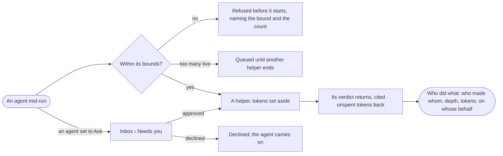

# AG-24 · See who made whom, and hand work to a helper within bounds

**As** an analyst checking a recommendation **I want** an agent to hand a check to a helper inside bounds it cannot
widen, and to see on the run who made whom, on whose behalf, and what each returned **so that** the recommendation
carries a verdict and a chain of who did what, not one agent's confidence.

Tasks: [task.md](task.md) · Feature: [AG-F05](../../feature.md)

## Who can

| Lens | Can | Otherwise sees |
|---|---|---|
| Admin | Read who made whom on any run; set whether an agent may make helpers, its bounds and *May delegate to*; approve a hand-off routed to them | — |
| Operator | Read who made whom on any run they can open | The agent's helper settings read; editing is disabled, naming *Can build agents*. With *Can build agents*: set them as Admin. An ask routed to someone else reads, naming who it waits on |

## Flow

## Acceptance criteria

| # | Given | When | Then |
|---|---|---|---|
| AG-24.1 | An agent that may make helpers | it hands a check to a helper within its bounds | the helper runs inside the agent's run, with tokens set aside from the agent's remaining budget |
| AG-24.2 | A hand-off past depth, helpers per agent or helpers in all | the agent tries it | it is refused before it starts, naming the bound and the count, and is a history row |
| AG-24.3 | A hand-off past helpers live at once | the agent makes it | the helper waits *queued* until another ends; who did what draws it waiting |
| AG-24.4 | A hand-off asking for more tokens than remain | the agent tries it | it is refused, naming what remains |
| AG-24.5 | A helper that ends | its run settles | its unspent tokens return to the agent and a history row says so; it ends for one reason, shown in words |
| AG-24.6 | A helper's verdict | it returns | the agent cites it; *How it got here* shows the hand-off, its steps and sources |
| AG-24.7 | A helper that fails | its run settles | the failure is the agent's evidence, named in its answer, never a silent gap |
| AG-24.8 | A helper that asks a question | it asks | the question reaches whoever started the run, naming the helper |
| AG-24.9 | An agent of the graph set to *Ask* or not listed | the agent delegates to it | an ask waits in *Needs you* for that agent's owner, and the step waits on it |
| AG-24.10 | An agent set to *Deny*, or one already in the run's chain | the agent delegates to it | it is refused before it starts, naming *Deny* or *loop* |
| AG-24.11 | An ask approved with *Allow always* | it is approved | the asker's *May delegate to* reads *Allow* for that agent |
| AG-24.12 | A run with helpers | *Who did what* opens | who made whom is drawn — each helper with its depth, state, tokens against what it was given, and on whose behalf; retired helpers stay drawn, marked |
| AG-24.13 | A helper picked | its card opens | its bounds read beside its parent's — view of the graph, what it may do, tokens — and it is never wider |
| AG-24.14 | Many helpers under one agent | *Who did what* opens | they collapse to a count, opened on a click |
| AG-24.15 | A run stopped | it stops | every helper beneath it ends *stopped with its parent* |
| AG-24.16 | An agent's Flow | it opens | it draws the helpers it may make and the agents it may delegate to — Allow · Ask · Deny |
| AG-24.17 | An Operator without *Can build agents* | they open an agent's helper settings | they read; editing is disabled, naming *Can build agents* |
| AG-24.18 | A helper or a delegated agent | it takes a step | the strictest value along the whole caller chain binds, the root agent's own rule included; work handed on never does what the root agent was denied, and a refusal names the agent in the chain whose line denied it |

## Screens

| Surface | Lens | First use | Empty after a filter | Loading | Has data | Failed | Agent working or proposing | No access |
|---|---|---|---|---|---|---|---|---|
| Who did what on a run | Admin | agents.run · One agent | — | agents.run · Loading | agents.run · Who did what | agents.run · Refused at a bound | agents.run · Helpers running | — |
| Who did what on a run | Operator | agents.run · One agent | — | agents.run · Loading | agents.run · Who did what | agents.run · Refused at a bound | agents.run · Helpers running | agents.run · Not found |
| An agent's helpers and May delegate to | Admin | agents.agent · Untested draft | — | agents.agent · Loading | agents.agent · Flow | agents.agent · Could not load | — | — |
| An agent's helpers and May delegate to | Operator | agents.agent · Untested draft | — | agents.agent · Loading | agents.agent · Read only | agents.agent · Could not load | — | agents.agent · Read only |
| A delegation ask | Admin | — | — | inbox · Loading | inbox · Delegation ask | — | — | — |
| A delegation ask | Operator | — | — | inbox · Loading | inbox · Not yours to answer | — | — | inbox · Not yours to answer |
