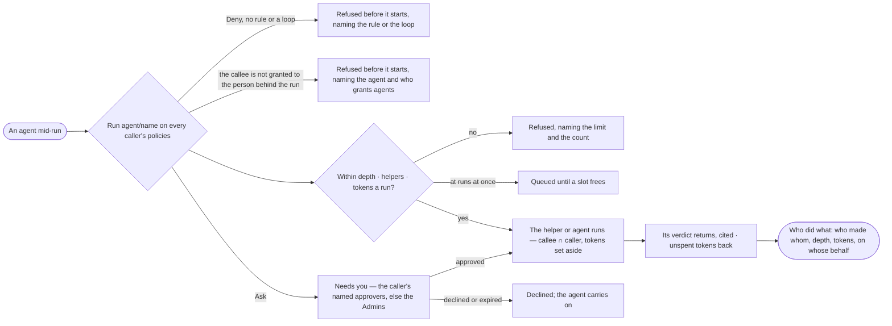

# AG-24 · See who made whom, and hand work to a helper within bounds

**As** an agent builder **I want** an agent to hand part of its work to a helper or another agent — only when its
Access Policies allow it, never wider than itself, within its depth and helpers — and to see who made whom on every run
**so that** work handed on can never do what the first agent was denied, and every answer traces back to who did it.

Tasks: [task.md](task.md) · Feature: [AG-F05](../../feature.md)

## Who can

| Lens | Can | Otherwise sees |
|---|---|---|
| Admin | Read who made whom on any run; write the rules on Run `agent/<name>` that let an agent hand work on; answer a delegation ask that falls or escalates to Admins | — |
| Modeller | Read who made whom on the runs whose content they may read; answer a delegation ask they are a named approver for | The rules read; changing them reads *Ask an Admin*; an ask routed to someone else reads, naming who it waits on |
| Operator | As Modeller | As Modeller |

## Flow

## Acceptance criteria

| # | Given | When | Then |
|---|---|---|---|
| AG-24.1 | An agent whose policies allow Run `agent/*` | it hands a check to a helper within its limits | the helper runs inside the agent's run, attached to the agent's Access Policies, with tokens set aside from the agent's remaining tokens a run |
| AG-24.2 | A hand-off past the caller's depth or helpers | the agent tries it | it is refused before it starts, naming the limit and the count, and is a History row |
| AG-24.3 | A hand-off when the caller, the person, a team or the deployment is at runs at once | the agent makes it | the helper waits *queued* until a slot frees; who did what draws it waiting |
| AG-24.4 | A hand-off asking for more tokens than remain | the agent tries it | it is refused, naming what remains |
| AG-24.5 | A helper that ends | its run settles | its unspent tokens return to the agent and a History row says so; it ends for one reason, shown in words |
| AG-24.6 | A helper's verdict | it returns | the agent cites it; *How it got here* shows the hand-off, its steps and sources |
| AG-24.7 | A helper that fails | its run settles | the failure is the agent's evidence, named in its answer, never a silent gap |
| AG-24.8 | A helper that asks a question | it asks | the question reaches the person behind the run, naming the helper |
| AG-24.9 | A Run `agent/<name>` the caller's rules set to Ask | the agent delegates to it | an ask waits in *Needs you* for the caller's named approvers — else the Admins, with a *no approver* alert — never the person it benefits, and the step waits on it; a yes allows this hand-off only |
| AG-24.10 | No rule allowing Run `agent/<name>`, a Deny rule, or an agent already in the run's chain | the agent delegates to it | it is refused before it starts, naming the rule and policy, *no rule* or *loop* |
| AG-24.11 | A delegation ask | it is decided | only *Allow* — this hand-off — or *Decline* is offered; an Admin may also *Draft a rule* allowing Run `agent/<name>`, which opens a draft on the caller's policy for them to save |
| AG-24.12 | A run with helpers | *Who did what* opens | who made whom is drawn — each helper and delegated agent with its depth, state, tokens against what it was given, and on whose behalf; retired helpers stay drawn, marked |
| AG-24.13 | A helper or delegated agent picked | its card opens | what it may touch and its tokens read beside its caller's, with the rule that narrowed each; it is never wider |
| AG-24.14 | Many helpers under one agent | *Who did what* opens | they collapse to a count, opened on a click |
| AG-24.15 | A run stopped | it stops | every helper and delegated run beneath it ends *stopped with its parent* |
| AG-24.16 | An agent's Flow | it opens | it draws the agents it may hand work to — Allow · Ask · Deny, from its rules on `agent/…` — and whether it may make helpers |
| AG-24.17 | A person who may not read a run's content | they open *Who did what* | each hand-off reads *ran*, its state and its cost; what was asked and returned is not shown |
| AG-24.18 | A helper or a delegated agent | it takes a step | its own policies ∩ every caller's bind, the same whoever is behind the run; work handed on never does what the root agent was denied, and a refusal names the agent in the chain whose rule denied it |
| AG-24.19 | A helper an agent makes | it is made | it lives only for the work, holds no grant of its own, is in its run's delegation chain, and may make helpers only if its policies allow Run `agent/*` |
| AG-24.21 | An agent of the deployment not granted to the person behind the run, and not already in its chain | the agent delegates to it | it is refused before it starts, naming the agent and who grants agents; an outside agent is reached only by a rule on Run `agent/<name>` and is Ask by default |
| AG-24.20 | An agent's sheet | its helpers are read | every helper it made in the last 7, 30 or 90 days lists with the run it was made in, its state and its tokens against what it was given; a retired helper stays listed |

## Screens

| Surface | Lens | First use | Empty after a filter | Loading | Has data | Failed | Agent working or proposing | No access |
|---|---|---|---|---|---|---|---|---|
| Who did what on a run | Admin | agents.run · One agent | — | agents.run · Loading | agents.run · Who did what | agents.run · Refused at a bound | agents.run · Helpers running | — |
| Who did what on a run | Operator | agents.run · One agent | — | agents.run · Loading | agents.run · Who did what | agents.run · Refused at a bound | agents.run · Helpers running | agents.run · Ran, content hidden |
| Who it may hand work to | Admin | agents.agent · Hands work to nobody | — | agents.agent · Loading | agents.agent · Flow | agents.agent · Could not load | — | — |
| Who it may hand work to | Operator | agents.agent · Hands work to nobody | — | agents.agent · Loading | agents.agent · Read only | agents.agent · Could not load | — | agents.agent · Read only |
| A delegation ask | Admin | — | — | inbox · Loading | inbox · Delegation ask | — | — | — |
| A delegation ask | Operator | — | — | inbox · Loading | inbox · Not yours to answer | — | — | inbox · Not yours to answer |
| An agent's helpers over time | Admin | agents.agent · No helpers | agents.agent · No helpers | agents.agent · Loading | agents.agent · Helpers | agents.agent · Could not load | — | — |
| An agent's helpers over time | Operator | agents.agent · No helpers | agents.agent · No helpers | agents.agent · Loading | agents.agent · Helpers | agents.agent · Could not load | — | — |
