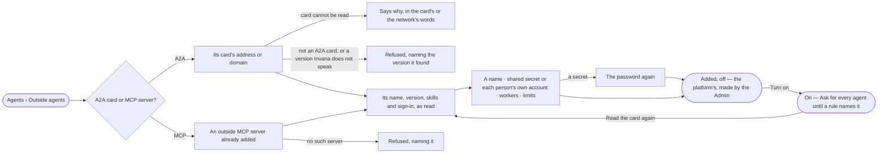

# AG-33 · Add an outside agent by its card or its MCP server

**As** an Admin **I want** to add an agent outside Invana — by its A2A card or through an outside MCP server — with its
credential, its workers and its limits, off until I turn it on **so that** agents can hand work to it under the same
rules as any agent, and nothing reaches it until I chose to let it.

Tasks: [task.md](task.md) · Feature: [AG-F05](../../feature.md)

## Who can

Adding an outside agent is the Admin's ([the role table](../../../../../../os/access/features/AC-F02-access-policies/feature.md#the-role-table)).

| Lens | Can | Otherwise sees |
|---|---|---|
| Admin | Add an outside agent, choose its credential, turn it on or off, read its card again, set its limits, remove one no run reached | — |
| Modeller | Read every outside agent, its skills, who added it and limits, never its secret | *Add an outside agent* and every act disabled — *Needs the Admin role* |
| Operator | As Modeller | As Modeller |

## Flow

## Acceptance criteria

| # | Given | When | Then |
|---|---|---|---|
| AG-33.1 | An Admin | they give an outside agent's A2A card address, or its domain | the card is read — from `/.well-known/agent-card.json` when a domain is given — and its name, version, interfaces, how it signs in and the skills on its card are shown before it is added |
| AG-33.2 | A card that cannot be read | they add it | it says why, and nothing is added |
| AG-33.3 | A card read or an MCP server picked | the Admin names it, chooses a shared secret — with the password again — or each person's own account, and the workers it calls from | it is added *off*, the platform's and made by the Admin, the card kept as it was read |
| AG-33.4 | An outside agent | the Admin turns it on | it can be named in rules on Run `agent/<name>`; with no rule naming it, a hand-off to it asks first |
| AG-33.5 | A card changed on the other side | nothing is done | nothing changes until an Admin presses *Read the card again*; a skill the card has dropped refuses, naming the card's date |
| AG-33.6 | An outside agent | it is read | it shows its protocol, endpoint or server, skills, credential choice (never a secret's value), workers it calls from, limits — time, attempts, tasks at once — who added it, and on or off with who switched it |
| AG-33.7 | An outside agent | it is listed in Agents | it reads *Outside*, is granted to nobody, is never given a task by a person, and holds no limits of Invana's own |
| AG-33.8 | An Operator or Modeller | they open Outside agents | everything reads; *Add an outside agent*, *Turn on*, *Read the card again* and *Remove* are disabled — *Needs the Admin role* |
| AG-33.9 | A document that is not an A2A agent card, or one whose interfaces offer no A2A version Invana speaks | they add it | it is refused, naming the version it found and the one Invana speaks; nothing is added |
| AG-33.10 | An MCP outside agent naming a server not added in the Control Plane | they add it | it is refused, naming the server |
| AG-33.11 | An outside agent a run has reached | an Admin removes it | it is refused — *turn it off instead* — so every run that reached it still resolves |
| AG-33.12 | Filters on Outside agents | none match | it reads *No outside agents match*, naming the filters, with *Clear filters* |

## Screens

| Surface | Lens | First use | Empty after a filter | Loading | Has data | Failed | Agent working or proposing | No access |
|---|---|---|---|---|---|---|---|---|
| Outside agents | Admin | agents.external · No outside agents | agents.external · No outside agents match | agents.external · Loading | agents.external | agents.external · Could not load | — | — |
| Outside agents | Operator | agents.external · No outside agents | agents.external · No outside agents match | agents.external · Loading | agents.external · Read only | agents.external · Could not load | — | agents.external · Read only |
| Add an outside agent | Admin | agents.external · Add an outside agent | — | agents.external · Reading the card | agents.external · Card read | agents.external · Card unreadable | — | — |
| Add an outside agent | Operator | — | — | — | — | — | — | agents.external · Read only |
| A card Invana cannot speak | Admin | — | — | — | — | agents.external · Card version refused | — | — |
| A card Invana cannot speak | Operator | — | — | — | — | — | — | agents.external · Read only |
