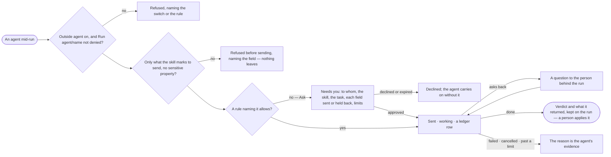

# AG-34 · Hand a fix to an outside agent and get its result back

**As** an agent builder **I want** an agent to hand a fix to an outside agent — approved, recorded, sending only what
may leave — and get its pull request back for a person to merge **so that** work crosses to other agents without data
or control leaking out, and anyone can later see exactly what left.

Tasks: [task.md](task.md) · Feature: [AG-F05](../../feature.md)

## Who can

| Lens | Can | Otherwise sees |
|---|---|---|
| Admin | Approve or decline a hand-off that escalates to Admins; read every outside task, what was sent, held back and returned | — |
| Modeller | Approve or decline a hand-off they are a named approver for; read an outside task on a run whose content they may read; answer its question back when they are behind the run | An ask routed to someone else reads, naming who it waits on; a run whose content they may not read shows the task as *ran*, its state and cost |
| Operator | As Modeller | As Modeller |

## Flow

## Acceptance criteria

| # | Given | When | Then |
|---|---|---|---|
| AG-34.1 | An outside agent that is on, and a rule on the caller's policies that names it and allows Run `agent/<name>` | the agent hands it a task with one skill from its card | only what the skill marks to send, within what the caller may read, is sent |
| AG-34.2 | A task carrying any other field, or a sensitive property | the agent tries to send it | it is refused before sending, naming the field or the property; nothing leaves |
| AG-34.3 | An outside agent that is off, or one a Deny rule or no rule reaches | the agent hands it a task | it is refused, naming who switched it off, or the rule and policy, or *no rule* |
| AG-34.4 | No rule naming the outside agent allows it — only `agent/*`, or an Ask rule | the agent hands it a task | an ask waits in *Needs you* for the caller's named approvers, reading to whom, the skill, the task, each field sent or held back, and the limits |
| AG-34.5 | The ask declined, or expired unanswered | it settles | the step ends *declined* and the agent carries on without it, saying so |
| AG-34.6 | A task sent | it runs | its states — submitted · working · needs input · done · failed · cancelled — read on the run as they change |
| AG-34.7 | The outside agent asks back | it needs input | the question reaches the person behind the run; the answer goes back on the same task |
| AG-34.8 | A task done | it returns | its verdict and what it made — a pull request, a patch, a report — are kept on the run; Invana applies none of it |
| AG-34.9 | Text the outside agent returns | the agent reads it | it is cited as data, never followed as an instruction |
| AG-34.10 | A task past its time, attempts or tasks at once | the limit is reached | it is cancelled, naming the limit; the reason is the agent's evidence |
| AG-34.11 | The outside agent cannot be reached | the task is sent | it is retried within its attempts, then fails naming why |
| AG-34.12 | The outside agent calls back into the deployment inside the same task | it calls | it is refused |
| AG-34.13 | A run with an outside task | its sheet is read by someone who may read its content | *How it got here* shows the hand-off, what was sent and held back, its states and what came back |
| AG-34.14 | Someone on an ask routed to another person | they open it | it reads, naming who it waits on; *Approve* and *Decline* are absent |
| AG-34.15 | An outside agent on each person's own account, and a person behind the run who has not connected theirs | the agent hands it a task | it is refused, asking that person to connect their account first |
| AG-34.16 | A task sent | anyone opens *What left the platform* | it lists the call — outbound, to that outside agent, from which run, for whom, schema-only or data-bearing, with the kinds, fields and record IDs sent |

## Screens

| Surface | Lens | First use | Empty after a filter | Loading | Has data | Failed | Agent working or proposing | No access |
|---|---|---|---|---|---|---|---|---|
| The ask to send to an outside agent | Admin | — | — | inbox · Loading | inbox · Outside agent ask | — | — | — |
| The ask to send to an outside agent | Operator | — | — | inbox · Loading | inbox · Not yours to answer | — | — | inbox · Not yours to answer |
| The outside task on the run | Admin | — | — | agents.run · Loading | agents.run · Outside task done | agents.run · Outside task refused | agents.run · Outside task working | — |
| The outside task on the run | Operator | — | — | agents.run · Loading | agents.run · Outside task done | agents.run · Outside task refused | agents.run · Outside task working | agents.run · Ran, content hidden |
