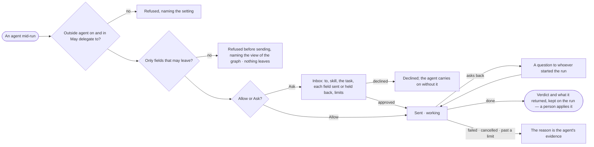

# AG-34 · Hand a fix to an outside agent and get its result back

**As** an agent builder **I want** an agent to hand a fix to an outside agent — approved, traced, sending only what may
leave — and get its pull request back for a person to merge **so that** work crosses to other agents without data or
control leaking out.

Tasks: [task.md](task.md) · Feature: [AG-F05](../../feature.md)

## Who can

| Lens | Can | Otherwise sees |
|---|---|---|
| Admin | Approve or decline a hand-off routed to them; read every outside task, what was sent, held back and returned | — |
| Operator | Read an outside task on a run they can open; answer its question back when they started the run | An ask routed to someone else reads, naming who it waits on; what was sent and returned follows the run's own visibility |

## Flow

## Acceptance criteria

| # | Given | When | Then |
|---|---|---|---|
| AG-34.1 | An agent whose *May delegate to* lists an outside agent that is on | it hands it a task with one skill from its card | only fields the view of the graph lets out and the skill marks to send are sent |
| AG-34.2 | A task carrying any other field | the agent tries to send it | it is refused before sending, naming the view of the graph; nothing leaves |
| AG-34.3 | An outside agent that is off, or not in *May delegate to* | the agent hands it a task | it is refused, naming the setting |
| AG-34.4 | *Ask* | the agent hands it a task | an ask waits in *Needs you* reading to whom, the skill, the task, each field sent or held back, and the limits |
| AG-34.5 | The ask declined | it is declined | the step ends *declined* and the agent carries on without it, saying so |
| AG-34.6 | A task sent | it runs | its states — submitted · working · needs input · done · failed · cancelled — read on the run as they change |
| AG-34.7 | The outside agent asks back | it needs input | the question reaches whoever started the run; the answer goes back on the same task |
| AG-34.8 | A task done | it returns | its verdict and what it made — a pull request, a patch, a report — are kept on the run; Invana applies none of it |
| AG-34.9 | Text the outside agent returns | the agent reads it | it is cited as data, never followed as an instruction |
| AG-34.10 | A task past its time, attempts or tasks at once | the limit is reached | it is cancelled, naming the limit; the reason is the agent's evidence |
| AG-34.11 | The outside agent cannot be reached | the task is sent | it is retried within its attempts, then fails naming why |
| AG-34.12 | The outside agent calls back into this graph inside the same task | it calls | it is refused |
| AG-34.13 | A run with an outside task | its sheet is read | *How it got here* shows the hand-off, what was sent and held back, its states and what came back |
| AG-34.14 | An Operator on an ask routed to someone else | they open it | it reads, naming who it waits on; *Approve* and *Decline* are absent |

## Screens

| Surface | Lens | First use | Empty after a filter | Loading | Has data | Failed | Agent working or proposing | No access |
|---|---|---|---|---|---|---|---|---|
| The ask to send to an outside agent | Admin | — | — | inbox · Loading | inbox · Outside agent ask | — | — | — |
| The ask to send to an outside agent | Operator | — | — | inbox · Loading | inbox · Not yours to answer | — | — | inbox · Not yours to answer |
| The outside task on the run | Admin | — | — | agents.run · Loading | agents.run · Outside task done | agents.run · Outside task refused | agents.run · Outside task working | — |
| The outside task on the run | Operator | — | — | agents.run · Loading | agents.run · Outside task done | agents.run · Outside task refused | agents.run · Outside task working | agents.run · Not found |
