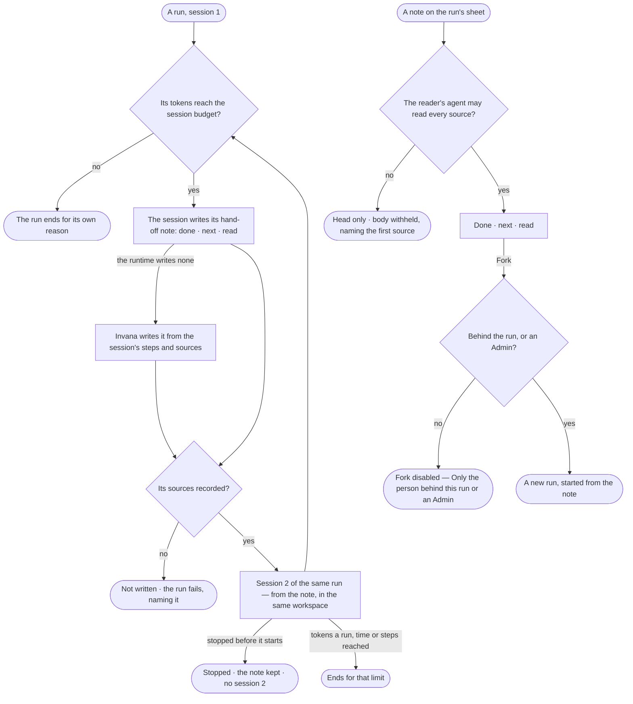

# AG-62 · Continue in a fresh session from a hand-off note

**As** an agent builder **I want** a long run to go on in a fresh session when it reaches its session budget, from a
hand-off note that says what is done, what is next and what it read **so that** the work finishes as one run I can
follow, and I can see exactly what each session started from.

Tasks: [task.md](task.md) · Feature: [AG-F05](../../feature.md)

## Who can

Runs — read, stop and re-run in [the role table](../../../../../../os/access/features/AC-F02-access-policies/feature.md#the-role-table):
*Own* for Operator and Modeller, *Acts* for Admin. A note's body reads only as far as the reader's default agent may
read its sources ([AC-31](../../../../../../os/access/features/AC-F09-what-left-the-platform/stories/AC-31-keep-a-runs-content-to-those-who-may-read-it/story.md)); no role grants content.

| Lens | Can | Otherwise sees |
|---|---|---|
| Admin | Read every run's sessions and each note's head; a note's body as anyone else — when the run belongs to a project and their default agent may read every source; stop any run, between sessions too; fork a run from a note they may read; set the session budget (CP-F04) | A note they may not read: its head, body *withheld*, naming the first source; *Fork* not offered |
| Modeller | As Operator | As Operator |
| Operator | On a run they are behind: read every session and note in full, stop it, fork it from a note. On a project's run they are not behind: read its sessions, and a note's body when their default agent may read every source | A note they may not read: its head, body *withheld*, naming the first source; *Fork* disabled — *Only the person behind this run or an Admin* |

## Flow

## Acceptance criteria

| # | Given | When | Then |
|---|---|---|---|
| AG-62.1 | A run in its first session | its tokens reach the session budget ([CP-F04](../../../../../../os/control/features/CP-F04-limits/feature.md)) | the session writes a hand-off note and the run goes on in *Session 2* — the same run, the same number, never an ask; the run's sheet reads *Continued in session 2* |
| AG-62.2 | A hand-off note | the person behind the run opens it | it reads three parts — what is done, what is next, what it read — with each source named, the session it ends and the one it starts, when it was written, its tokens and whether the runtime or Invana wrote it |
| AG-62.3 | A fresh session | it starts | it starts from the note and the run's task, never the earlier session's transcript, in the same workspace, on the same runtime and agent version, behind the same person |
| AG-62.4 | A run that continued | it ends | its exit reason is its last session's — *Continued* is never an exit reason; its tokens are every session's together, and reaching its tokens a run, time or steps ends it for that limit, whatever session it is in |
| AG-62.5 | A session that reaches its budget without writing a note | it ends | Invana writes the note from the session's steps and sources, marked *Written by Invana*, and the run continues |
| AG-62.6 | A note whose sources cannot be recorded | it is written | it is not written; the run fails, reading *The hand-off note could not record its sources — {reason}*; no fresh session starts |
| AG-62.7 | A run between two sessions, or writing its note | the person behind it or an Admin stops it | no fresh session starts; the run reads *Stopped* after its last session; a note already written is kept, marked *Not continued* |
| AG-62.8 | A project's run someone else is behind | a reader whose default agent may read every source of a note opens it | the note reads in full |
| AG-62.9 | A note one of whose sources the reader's default agent may not read | they open it | its head reads — the sessions, when, its size and tokens — and its body reads *withheld*, naming the first source their agent may not read; its route answers *Not found* |
| AG-62.10 | A note the person behind the run may read | they press *Fork* | a new run of the same agent starts from the note, behind them, with its own number, reading *Started from {run} · note {n}*; the first run is unchanged |
| AG-62.11 | Someone neither behind the run nor an Admin, or anyone on a note they may not read | they reach *Fork* | it is disabled — *Only the person behind this run or an Admin* — and the route refuses it; on a note they may not read it is not offered and the route answers *Not found* |
| AG-62.12 | A run that continued | the person behind it opens *How it got here* | each session reads as its own group — its runtime, model reported, tokens and why it ended — with the hand-off note between each two and the note's sources linked |
| AG-62.13 | A note whose body cannot be read from the blob store | it is opened | it names what could not be read, in the engine's words; its head and the run's sessions still read |

## Screens

| Surface | Lens | First use | Empty after a filter | Loading | Has data | Failed | Agent working or proposing | No access |
|---|---|---|---|---|---|---|---|---|
| The run's sessions and notes | Admin | agents.run · One session | — | agents.run · Loading | agents.run · Sessions | agents.run · Note sources not recorded | agents.run · Continuing | — |
| The run's sessions and notes | Operator | agents.run · One session | — | agents.run · Loading | agents.run · Sessions | agents.run · Note sources not recorded | agents.run · Continuing | agents.run · Content withheld |
| A hand-off note | Admin | — | — | agents.run · Loading | agents.run · Hand-off note | agents.run · Note could not load | agents.run · Writing the note | agents.run · Note withheld |
| A hand-off note | Operator | — | — | agents.run · Loading | agents.run · Hand-off note | agents.run · Note could not load | agents.run · Writing the note | agents.run · Note withheld |
| Stopped between sessions | Admin | — | — | — | agents.run · Stopped between sessions | — | — | — |
| Stopped between sessions | Operator | — | — | — | agents.run · Stopped between sessions | — | — | agents.run · Content withheld |
| Fork from a note | Admin | — | — | agents.run · Loading | agents.run · Forked | agents.run · Could not load | — | agents.run · Note withheld |
| Fork from a note | Operator | — | — | agents.run · Loading | agents.run · Forked | agents.run · Could not load | — | agents.run · Fork disabled |
