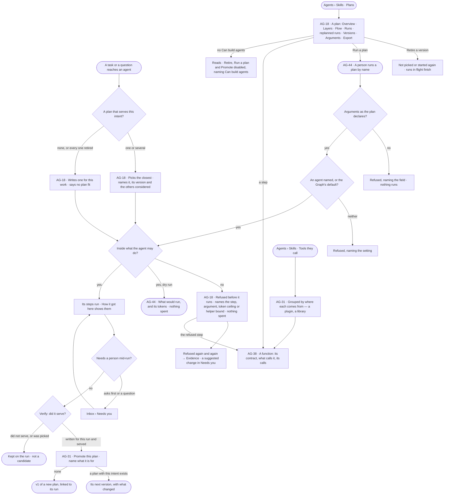
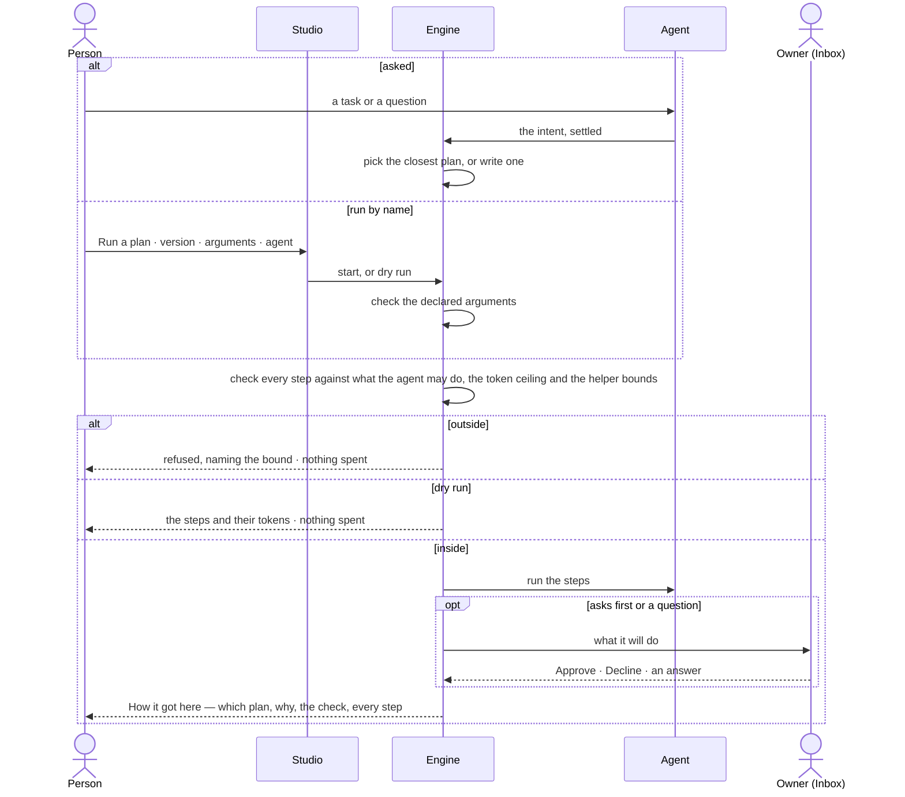

# Plans and functions

> The plans agents carry work out by — picked from the ones that served, written when none fit, checked against what
> the agent may do before anything runs — and the functions every plan is made of, each with its contract and what
> calls it. The decisions it helps make: *which plan should this work run, is it fit to run again or to retire, may
> this agent run it, and what can agents do at all?*

## User journey

## Stories

| ID | Story | Status |
|---|---|---|
| AG-18 | [Find a plan and read how it behaves](stories/AG-18-find-a-plan-and-read-how-it-behaves/story.md) | idea |
| AG-31 | [Keep a plan that served, and see where each plan and function comes from](stories/AG-31-keep-a-plan-that-served-and-see-where-each-comes-from/story.md) | idea |
| AG-38 | [Read every function and what calls it](stories/AG-38-read-every-function-and-what-calls-it/story.md) | idea |
| AG-44 | [Run a plan on demand with today's arguments](stories/AG-44-run-a-plan-on-demand-with-todays-arguments/story.md) | idea |

## Access

| Act | Role (`.claude/team/TEAM.md` §7) | Everyone else sees |
|---|---|---|
| Read plans, a plan's page, its versions and its export | Operator — any member of the Graph | — |
| Read functions, their contracts, calls and what calls them | Operator — any member of the Graph | — |
| Read which plan a run picked, why, and a refusal | Operator — anyone who can open the run | A run they cannot open reads *not found* |
| Retire a plan version | `builder` · shown as *Can build agents* · Admin | *Retire* disabled, naming *Can build agents* |
| Promote a run's plan | `builder` · shown as *Can build agents* · Admin | *Promote this plan* disabled, naming *Can build agents* |
| Run a plan · dry run | `builder` · shown as *Can build agents* · Admin | *Run a plan* disabled, naming *Can build agents* |
| Enable a plugin | Admin, in Settings (RT-F02) | The plugin reads; its switch is disabled, naming the Admin |
| Approve a library's functions | Admin (AG-40) | Proposals read *Waiting for an Admin* |
| Author an answer template | `builder` · shown as *Can build agents* · Admin (EX-03) | Templates read; *+* hidden |
| Decide a suggested change on a plan | `builder` · shown as *Can build agents* · Admin (EX-32) | *Ask Priya (owner)* |

## States

| State | What the person sees |
|---|---|
| First use | Only the plans Invana ships, each *packaged*; a plan never run lists its steps with every measure *—*; a function nothing calls reads *not used yet* |
| Empty after a filter | No plan or function matches the filter or search — the filter named, *Clear* |
| Loading | The list's head and filters drawn at once; rows and a page's numbers load in place |
| Has data | Plans with where each comes from, version, what it touches and who uses it; a plan's page over its window; functions grouped by what they touch |
| Failed | Could not load, with *Try again*; a refused plan names the bound it crossed and spends nothing; a step naming a function the install lacks reads *No such function* |
| Agent working or proposing | A run picking or writing its plan; a plan running from *Run a plan*; a suggested change proposing to promote or retire a plan |
| No access | Everything reads; *Retire*, *Promote this plan* and *Run a plan* are disabled, naming *Can build agents*; a run they cannot open reads *not found* |

## Rules

| Rule | Detail |
|---|---|
| Picked first, written when nothing fits | A run picks the published plan whose intent is closest; it writes a plan for this work only when none fits. Never part of one and part of another |
| Every plan is checked | Picked, written or run by hand, a plan is checked against what the agent may do before its first step: each step allowed · each argument pinned as required · projected tokens within the ceiling · helpers within their bounds. Coming from the plans list is not a pass |
| A refusal is an outcome | Recorded on the run as refused, naming the bound; nothing is spent and no step runs. Never half a plan |
| What it may do changes mid-run | Running steps finish; the next plan is checked against the new bounds |
| Published versions never change | A change is a new version; the old one stays readable, so every run that used it still opens |
| Plans are never drawn by hand | A plan is packaged with Invana or a plugin, written for one piece of work, or promoted from a run that served. There is no *New plan* and no plan editor |
| Only reusable plans are listed | A plan written for one piece of work is read from its run; a skill's own plan is read under its skill; the list holds what can be picked or run again |
| Origin is a badge | *Packaged* · *generated* · *promoted* — three ways a plan got into the list, one filter, never three lists |
| Retire stops picking, never a run | A retired version is not picked or started again; runs in flight finish; past runs still open. Retiring every version takes the plan out of the list, and that intent is written fresh, saying so |
| Promotion is a person's act | Verify judging a run served makes its plan a candidate; only a person promotes it, and the version keeps the run it came from |
| A skill uses a plan by copying it in | A skill that uses a plan carries it as steps of its own, with its own argument values; changing the plan never silently changes a skill |
| A plan declares arguments; a caller tunes them | Two skills or two starts may give the same plan different values; neither is a fork |
| Startable is not editable | *Run a plan* starts a published version with arguments; it never changes its steps |
| One way in | A run by name, a schedule on the plan and the command line open the same kind of run through the same check (AG-F07) |
| Functions are the vocabulary | Every step of every plan calls one function; the set is closed, comes from enabled plugins and approved libraries, and nothing in Studio adds, edits or disables one |
| A function touches one thing | Each function has one bound — what it touches — and what an agent may do grants bounds; a composite is a packaged plan, called like a function |
| Control flow is plan grammar | *if* · *loop* · *map* · *retry* · *stop* belong to a plan, never listed as functions |
| Leans on | Build an agent — what it may do (AG-F01) · the catalogue — libraries and imports (AG-F02) · runs (AG-F03) · skills (AG-F04) · schedules (AG-F07) · suggested changes (EX-F07) · answer templates (EX-F04) · the Inbox (GR-F05) · plugins (RT-F02) |

**The function library** — every function is named `namespace.verb`; the namespace names what it touches.

| Namespace | Functions | What it touches | Plugin |
|---|---|---|---|
| `graph.read` | `query` · `get_neighbors` · `types_count` · `resolve` · `validate` | Reads the graph (`validate` touches nothing) | Core |
| `graph.stitch` | `preview` · `declare` · `commit` · `withdraw` · `run` | `preview` reads the graph; the rest write it | Core |
| `graph.write` | `records` · `bulk` · `edits` | Writes the graph | Core |
| `data` | `bundle.check` · `records.validate` · `snapshot` | Brings data in | Core |
| `model` | `propose` · `understand_ask` · `validate_proposal` · `migrate` | Changes the model | Core |
| `nl` | `understand` · `translate` | Calls a model | Core |
| `plan` | `draft` · `compose` · `replan` · `verify` | Calls a model (`verify` touches nothing) | Core |
| `work` | `spawn_agent` · `delegate` · `create_task` · `await` | Hands out work (`await` touches nothing) | Core |
| `answer` | `shape` | Nothing outside | Core |
| `board` | `open` | Nothing outside | Core |
| `web` | `search` · `read_url` · `download_file` | Reaches outside | Web tools |
| `mail` | `read` · `send` — `send` always asks first | Reaches outside | Mail tools |
| `science` | `pubmed.search` · `uniprot.get` · `pubchem.get` | Reaches outside | Science tools |
| `sim` | `genomic_prediction` | Nothing outside | Genomic simulator |
| `mcp.<server>` | One per tool of an MCP server an Admin added — a read-only tool reads, every other tool sends | Reaches outside | That server |

| Packaged plan | What it does | What it touches |
|---|---|---|
| `nl-single` | One question, one query: translate it, check it is read-only, run it, shape the answer, verify it served | Calls a model · reads the graph |
| `nl-compare` | Two readings of the graph, compared | Calls a model · reads the graph |
| `ql-direct` | A typed query, and every re-run, with no translation | Reads the graph |
| `count-types` · `expand-neighbours` · `resolve-elements` | One act of a board, each a plan of one step | Reads the graph |
| `board-open` | Open one of Studio's lists with the filters an ask names | Nothing outside |
| `stitch-preview` · `stitch-apply` · `stitch-commit` · `stitch-withdraw` | The link-between-models flows | Reads and writes the graph |
| `data-edit` | A board's saved edits, checked against the model | Writes the graph |
| `model-import` · `bulk-load` | Load records into a model · write a folder straight through the connector | Brings data in · writes the graph |
| `modeller-propose` · `model-migration` | Stage a described change on the model draft · preview or publish a breaking change | Changes the model |
| `genomic-prediction` | Predict and rank options against targets | Nothing outside — Genomic simulator |
| `plan-a-todo` | Understand a task and write a plan for it — the planner | Calls a model |
| `check-criteria` | Judge a task's result against its criteria — the evaluator; it recommends, a person accepts | Calls a model |

## Data touched

| Record | Read or write |
|---|---|
| Reusable plans — name, intent, where it comes from, status | Read · write (promote, retire) |
| Plan versions — steps, declared arguments, the run it was promoted from, published, retired | Read · write |
| A run's plan — picked or written, the version, the others considered, the check's result | Write · read |
| Runs of a plan — every run that ran it, by whom, called by, tokens, how it ended | Read |
| Functions — contract, plugin and version, what each touches, summary | Read |
| A function's calls and the plans and skills that call it | Read |
| Suggested changes to promote or retire a plan (EX-F07) | Write · read |
| History rows — promoted, retired, started (AC-F06) | Write · read |

## Engine

The low-level design: what this feature stores, serves and refuses. Conventions — naming, errors, lists, events — are
[system-design.md](../../../../system-design.md) §§ 6–8; this section only fills them in.

### Records

| Table | Columns | Notes |
|---|---|---|
| `agents_plans` | `graph_id` · `key?` · `version` · `name` · `description` · `kind` (`import` · `ask` · `enrich` · `model` · `stitch` · `bulk`) · `origin` (`packaged` · `generated` · `promoted`) · `intent[]` · `todo_id?` · `args_schema` · `uses[]` · `source_skill_version_ids[]` · `reusable` · `status` (`published` · `retired`) · `retired_at?` · `promoted_from_run_id?` · `promotion_edit?` · `created_by_kind` · `created_by_id` · `created_at` | Unique (`graph_id`, `key`, `version`). A version is a row, `key@n`; a published row never changes. `kind` is the subject — planning is never a kind |
| `agents_plan_steps` | `plan_id` · `parent_id?` · `ordinal` · `key` · `form` (`callable` · `composite` · `human`) · `step_key?` (a function) · `role?` (`extract` · `decide` · `judge` · `embed`) · `title` · `body` · `args` · `assignee_kind?` · `assignee_id?` · `depends_on[]` · `when` · `map_over` · `loop` · `approval` · `optional` · `timeout_s` · `retry` · `pool` · `max_parallel` · `on_lane_failure` · `source_span?` · `source_plan_key?` · `source_step_key?` | Unique (`plan_id`, `parent_id`, `key`). `plan_id` is never null — no step lives outside a plan. `role` only on an `llm` function's step; the view's cast resolves it to a model |

### Reads

| Record | Owner |
|---|---|
| Runs — `plan_snapshot` · `plan_revision` · `replans` · `plan_origin`, the step rows a plan's numbers read, an eval run left out | [AG-F03](../AG-F03-runs-and-how-the-agents-are-doing/feature.md#engine) |
| What an agent may do — `envelope` (functions, pinned arguments, the reusable plans it may run), `budget`, `effort.max_replans`, the Graph's default agent | [AG-F01](../AG-F01-build-an-agent/feature.md#engine) |
| Helper bounds the check reads — depth, fan-out | [AG-F05](../AG-F05-delegation-and-outside-agents/feature.md#engine) |
| A skill version's plan, its draw and its clarifications | [AG-F04](../AG-F04-skills/feature.md#engine) |
| The view of the graph a run reads through, and the cast that resolves a step's `role` | [SE-F09](../../../semantics/features/SE-F09-views-of-the-graph/feature.md#engine) |
| The project task a generated plan is written for (`todo_id`) | [PJ-F01](../../../projects/features/PJ-F01-projects-and-tasks/feature.md#engine) |
| Plugins — their functions' manifests and their packaged plans' files | [RT-F02](../../../../os/runtime/features/RT-F02-plugins-and-outside-tools/feature.md#engine) |
| Approved library functions | [AG-F08](../AG-F08-portable-agents-and-skills/feature.md#engine) |
| Suggested changes to promote or retire a plan | [EX-F07](../../../explore/features/EX-F07-memory-what-past-runs-teach/feature.md#engine) |
| History — every event this feature writes | [AC-F06](../../../../os/access/features/AC-F06-history/feature.md#engine) |

### Routes

| Route, after `/api/v1/u/{u}/{g}/agents/plans` | Does | Story |
|---|---|---|
| `GET /` | The reusable plans — `name` · `key` · `version` · `origin` · `status` · `intent` · `layers` · step count · runs · served · last ran · agents that may run it · callers that copy it in — with `total` and `packaged`; filters `origin` · `kind` · `has_skill` | AG-18 |
| `GET /{key}` | One version (the newest unless `version` is named): the row, its steps and edges, `layers`, its callers with the values each gives, `args_schema` | AG-18 |
| `GET /{key}/tasks` | Its steps and the order between them | AG-18 |
| `GET /{key}/diff` | This version against the one before: `summary` · `added` · `removed` · `moved` · `changed` (each field before and after) · `unchanged` · `arguments`; `against_version` null for v1 | AG-18 |
| `GET /{key}/performance?window=7d·30d·90d&version=` | `tiles` · `daily[]` · `publishes[]` · `steps[]` · `failures[]` · `bounds[]` · `slowest` (Mechanisms) | AG-18 |
| `GET /{key}/runs` | Every root run that ran the plan, newest first, filtered by `status` · `called_by` · `agent_id` · `version`, paged by cursor (50, at most 200), with `live` counts | AG-18 |
| `GET /{key}/export` | The version as read-only YAML — `steps` and its declared arguments as top-level `args` | AG-18 |
| `POST /{key}/runs` · `POST /{key}/runs?dry_run=true` | Run a published version by name — `{version?, args, agent_id?, idem_key}` → the run, or the existing run for a repeated `idem_key` · a dry run returns the steps, the resolved arguments and the projected tokens and opens no run | AG-44 |
| `POST /{key}/versions/{v}/retire` | Retire a version | AG-18 |
| `POST /promote` | `{run_id, key?, description, intent[], trim?, pins?}` — a run's plan becomes v1 of a new key or the next version of `key`, `origin: promoted` | AG-31 |
| `POST /discard` | `{run_id}` — the candidate stays a one-off, recorded on the run | AG-31 |

| Route, after `/api/v1/u/{u}/{g}/agents/functions` | Does | Story |
|---|---|---|
| `GET /` | Every function: `step_key` · `bound` · `layer` · `summary` · `args` · `outputs` · `requires` · `plugin` · `used_by` (this Graph's reusable plan keys), ordered by bound then key; search by key and summary, filter by bound | AG-38 · AG-31 |
| `GET /{step_key}` | The function, its manifest (`version` · `side_effect` · `timeout_s` · `retries` · `resources`), `plugin` (`name@version`), the reusable plans naming it, the skills whose current version needs it, and `calls` — calls · p95 · failed, each against the 30 days before | AG-38 |
| `GET /{step_key}/calls` | The run steps that called it, newest first — step · its run · title · status · duration · tokens · queued — filterable by status | AG-38 |

### Events

| Event | When |
|---|---|
| `agents.plans.promote` | A run's plan is published as a version, the edit and the run on the event |
| `agents.plans.discard` | A candidate is discarded |
| `agents.plans.retire` | A version is retired |
| `agents.plans.start` | A person starts a plan by name |
| `agents.plans.refused` | The check refuses a plan — the bound, the step and what was proposed |

### Refusals

| Status | When | Sentence | Criterion |
|---|---|---|---|
| step refused | A step's function is not in what the agent may do | *{function} is not in what {agent} may do.* | AG-18.17 · AG-44.4 |
| step refused | An argument is not pinned as the agent requires | *{argument} must be {pinned} for {agent}.* | AG-18.17 · AG-44.4 |
| step refused | The plan's projected tokens exceed the ceiling | *Projected {n} tokens — the ceiling is {max}.* | AG-18.17 · AG-44.4 |
| step refused | Depth or fan-out past the parent's | *This passes {bound} — {count} of {max}.* | AG-18.17 |
| step refused | What the agent may do narrowed since the plan last passed | *{agent} may not {what changed} now.* | AG-18.18 |
| step refused | A step names a function this install does not have | *No such function: {step_key}.* | AG-38.11 |
| 422 | A start's argument unknown, missing or of the wrong type | *{argument}: {why}.* | AG-44.3 |
| 422 | A start naming no agent in a Graph with no default | *Name an agent — this graph has no default agent.* | AG-44.5 |
| 409 | A start of a retired version | *{key}@{v} is retired — the current version is {key}@{n}.* | AG-44.6 |
| 403 | Retire, promote, discard or start without *Can build agents* | *This needs Can build agents.* | AG-18.14 · AG-31.13 · AG-44.14 |
| 409 | Promoting a run whose plan was picked, did not serve, or is packaged | *Only a plan written for its run that served can be promoted.* | API only — Studio offers *Promote this plan* only on a candidate (AG-31.1) |
| 422 | A reusable plan's step binding `${args.<name>}` it does not declare, or a one-off plan declaring arguments | *{name} is not declared on {key}.* | API only — no person writes a plan |
| 422 | `window` other than `7d` · `30d` · `90d` | *window: one of 7d, 30d, 90d.* | API only — Studio offers the three |
| 404 | An unknown plan, version or function | *Not found.* | API only — Studio links only what exists |

### CLI

| Command | Does |
|---|---|
| `invana plans list` · `invana plans show <key>` | Every plan — id, origin, key and version, name · one plan's steps in order with what each waits on |
| `invana plans run <key> [--version N] [--arg name=value] [--agent] [--dry-run]` | Start a plan by name, through the same check and grant as `POST /{key}/runs` |

### Mechanisms

| Mechanism | How |
|---|---|
| Where a run's plan comes from | **Matched** — a published reusable version whose `intent` fits, picked deterministically, its `key@version` written to the run's `plan_origin` (`template:<key>@<v>`) · **generated** — none fits, so a `role = plan` run of `plan-a-todo` writes an `agents_plans` row, `origin: generated`, `todo_id` set, `plan_origin: generated` · **none** — a person does the task. The Plan step's output records the chosen plan, the others considered and why |
| The planner is a plan | `plan-a-todo` (`nl.understand` → `plan.draft`) and `check-criteria` ship `origin: packaged` and are never generated; the chain is one level deep — packaged writes generated, never generated → generated. There is no planner service |
| Until `plan-a-todo` ships | A planning agent's run opens with *Understand* (`nl.understand`, skipped for a typed query) and *Plan* (`plan.compose`) written before any plan is chosen, so those rows name no plan step |
| The check | A pure function of plan × what the agent may do, run by the runtime before any `role = execute` run opens — on a matched, generated, started or replanned plan alike: each `step_key` allowed · each pinned argument as pinned · projected tokens (recorded history per function) within the ceiling · depth and fan-out within the parent's · every function's `requires` ordered before it. No function approves its own plan; nothing is dispatched on a refusal |
| A refusal is an outcome | The run ends refused with the check's result on its Plan step — which check, which bound, what was proposed — and `agents.plans.refused`; its task reads blocked |
| `requires` is planned, not only checked | A function's `requires` is handed to the planner, which writes the `depends_on` edge; the check enforces the same line. No envelope waives it |
| An envelope pin is a ceiling | A plan may pass an argument the envelope pins; the pin wins. A tuned argument is a request |
| Arguments | `args_schema` is `{"<name>": {type, default, label}}` on a reusable plan, types `str` · `int` · `bool` (`true` is not a number); steps bind `${args.<name>}`. A caller's values are checked and bound before the run opens, so `${args…}` never reaches the runtime; an untuned name takes its default; a declared name with no default that nothing gives is refused by name |
| `uses` | `[{key, version, args}]` — each library plan a plan copied and the values it tuned; each copied step's `source_plan_key` agrees with it. A packaged plan composes another with `ref: task:<key>`, inlined at seed |
| A step's `key` | An identifier `${steps.<key>.<output>}` binds against — never a dot; it defaults to the function with dots as underscores |
| One owner per plan | The library — `reusable`, `key` set, no `todo_id` · a task — `todo_id` set, `origin: generated`, read from its run · a skill version — its plan read under the skill |
| Packaged plans are rows | Each is one file in its plugin's `flows/` folder, seeded at migrate as a reusable, read-only plan; the runtime resolves every plan from rows. A row with a packaged key and no steps is rebuilt from its file; a new Invana version reseeds it, overwriting and rewriting its description. A changed shape is a new version (`nl-single@2` declares `read_only`, bound by its `graph.read.query` step). Promotable from, never to |
| Nothing else holds a plan | A plan constant in a feature package is a defect: one the library cannot resolve is a trace that cannot show what ran |
| Promotion | Only a generated plan whose `plan.verify` step judged it served is a candidate; a person promotes it — `origin: promoted`, `reusable: true`, `todo_id` cleared, `promoted_from_run_id` set, the trim and pins in `promotion_edit`. The next matching task is matched and never plans again |
| Retire | Sets `status: retired` and `retired_at`; matching and starts skip it; runs in flight finish |
| Replan | Only ahead of the cursor: settled and in-flight steps are untouchable; a new step naming a settled predecessor is ready at once; inserting between two settled steps is refused. Each revision overwrites `plan_snapshot`, adds one to `plan_revision` and `replans`, and passes the check in full (cycles, `requires`, the budget re-estimated); at most `effort.max_replans` a run (three by default); never a different view; an ambiguous replan asks. The run's stream says `plan.proposed` for the first revision, `plan.revised` for each after |
| `back(step)` versus replan | `back(id)` reruns `id` and every step after it as a new attempt, unchecked, for a transient failure or a repairable input, bounded by a counter on the envelope; a replan changes what is ahead and is checked |
| Triggers to replan | `plan.verify` finds the plan did not serve · a person edits the plan at a pause · a clarification answer changes the shape |
| Plan grammar | `depends_on` (with `on: success · failure · any_outcome`) · `when` · `map_over` + `max_parallel` + `on_lane_failure` · `loop` (`until` · `max_iterations` · `on_exhausted: continue · fail` · `accumulate` · `verdict`) · `retry` (`max_attempts` · `on`) · `approval` (`required`, or `{when, deadline_s}`) · `stop` (`outcome`, `reason`) · `optional` (its failure marks the step, never the run) · `form: human` (an assignee and criteria). A branch not taken is skipped and never blocks a step with two upstream edges |
| The catalogue | The closed set of functions: one `manifest.toml` per function in a plugin's `tasks/` folder — `key` (`namespace.verb`) · `version` · `summary` · `bound` · `side_effect` (`read` · `write` · `send`) · `requires` · `resources` · `timeout_s` · `retries` · `args` (`{type, required?, default?}`, types `str` · `int` · `float` · `bool` · `list` · `obj`) · `outputs` (name → type). The plugin registry is built once at start and frozen; the route serves the manifests, so no copy of an entry's contract lives in Studio or the docs |
| What earns a function | Observable steps, can fail halfway, worth a trace · typed outputs, the only thing `when`, `until` and `${steps.x.y}` bind · exactly one bound · not control flow. Cut at the bound and the failure mode — query dialect is the connector's, so Cypher and Gremlin share `graph.read.query` |
| Bounds and layers | `graph_read` · `graph_write` · `schema_write` · `ingest` → graph data · `llm` → AI model · `network` → third party · `work_write` · `plan_write` · none → agent · a `form: human` step → human. `cache` is a band no function spends. The engine sends `layer` on every node; Studio never computes it |
| `layers` on a plan | One `{layer, declared, steps, summary}` for each of the five governed bands — graph data · AI model · third party · cache · human — always all five, in that order; a band the plan does not touch is `declared: false`, `summary` `—` |
| Manifest defaults bound a step | `timeout_s` · `retries` · `resources` apply to every step calling the function; a plan step may tighten them, never loosen them |
| Declared outputs only | A step's bindable outputs are what its function declares; a model step's `prompt` and `completion` sit on its output, never among `outputs`, so no plan binds a step's internals. `question` and `options` are declared because a clarification writes them and Studio reads them |
| `nl.translate` may ask | It may answer with a question, fixed options and an `options_query` — a read-only query returning up to 10 distinct labels, shown to the person as choices and never to the model; it runs inside the `llm` step under the view, its touch recorded; a view that refuses it leaves the fixed options |
| A function's numbers | Its steps in this Graph over the last 30 UTC days, eval runs left out: calls count steps whose `task_key` is the function; p95 is queued to finished over settled steps; failed is failed over settled |
| A plan's runs | Roots whose `plan_origin` names it, plus roots of skill runs whose plan copied it in, matched through `source_plan_key`. A row: `run_id` · `status` (`running` · `succeeded` · `failed` · `at a gate` · `cancelled`) · `when` · `asked` · `called_by` `{kind (skill · session · user · schedule · task · delegation), name, person?}` · `agent` · `version` · `elapsed_ms` · tokens · `failed_at` `{step_key, cause, message}` |
| `performance` tiles | `runs` · `served` (served ÷ verified, from `plan.verify`'s `output.served`; null when none verified) · `elapsed_p50_ms` (queued to finished of a settled root) · `work_p50_ms` (the sum of its steps' running time, never waiting) · tokens per run · `failed`, each `{value, prior}` |
| `performance` series | `daily[]` `{date, served, failed, work_p50_ms}` per UTC day, zeros included · `publishes[]` `{version, published_at}` in the window · `slowest` — per step its three slowest reaches `{run_id, ms, when}` |
| `performance` steps | In plan order `{step_key, layer, ran_in, p50_ms, p95_ms, failed, retried, tokens per run, share_of_work, wide, rare}`; the opening steps count toward work and get no row. `retried` — the share of runs where a failed attempt was followed by another, a question's attempt not counted · `wide` — p95 at least 4× p50 · `rare` — reached by under a quarter of runs; the engine holds both thresholds. A gate's wait is no step's estimate |
| `performance` failures and bounds | `failures[]` `{step_key, cause, count, last_run_id}`, largest first, the last attempt only · `bounds[]` `{step_key, bound, limit, used, exhausted}` for `retry` above one and `max_clarifications`, read from the step's own retry, else the function's default |

## System impact

| HLD section | Change | NFRs |
|---|---|---|
| § 6 Data and storage | Two tables in Invana's own store; packaged plans seeded from plugin files | — |
| § 8 APIs and events | The routes, events and CLI above | — |
| § 10 AI and agents | The loop lives outside the model: the model proposes a plan, the runtime checks it against what the agent may do before anything is dispatched; the function set is closed, so the check is a real bound | — |
| § 12 Qualities | Security: a plan outside the bounds spends nothing; promotion and retirement are a person's acts | — |

## Decisions

| Decision | Detail |
|---|---|
| Plans live under Agents › Skills | *Plans* and *Tools they call* are sections of Skills, beside *Answer templates*; a plan opens as its own page, a function as its own page |
| A plan's page answers *how has it behaved* | Overview · Layers · Flow · Runs, over 7 · 30 · 90 days; what it is sits in its head — version, steps, what it matches, what it touches, who may run it, who uses it |
| *Used by* means copied in | The skills that use a plan; an agent that may run it is a permission, read in the plan's head, never in *Used by* |
| What changed is step by step | Each version against the one before: steps added, removed, moved or changed, each changed field before and after; declared arguments too; v1 reads *the first version* |
| Export is for review | A version exports as read-only YAML with *Copy* and *Download*; nothing imports a plan from YAML |
| Every plan names its version | A run, a start and a schedule record the version they ran; a start that names none takes the current one and records which |
| Starting by hand widens nothing | *Run a plan* takes the same check a picked plan does; there is no per-start override of what the agent may do |
| A run needs an agent | Named on the start, or the Graph's default; with neither it is refused, never run as nobody |
| The plan shows before it runs | Its steps, its arguments resolved and its projected tokens, at *Run a plan* and on the run before its first step |
| A dry run spends nothing | It checks, resolves and projects, refuses the same way, and starts no run |
| Run a plan adds no list | It starts from the plan; what it started is in Runs; what it asks is in the Inbox |
| A function's page | Its head names it, what it touches, its side effect and plugin; Contract · Used by · Calls; every number is this Graph's runs, read from the engine |
| A function is read where it is used | Its contract shows beside a run's step, a plan's step and a refusal, each linking to its page |
| Grouped by what it touches | Tools they call groups functions by their bound, never alphabetically — the group a person scans is the one the bound enforces |
| A plan, kept | A run's plan is promoted from the run, or from Plans by picking the run; it can be trimmed or have an argument pinned first, and the edit is recorded |
| A packaged plan keeps its key | It is named `key@version` in kebab case — never a function's dotted name — and keeps that name when a function it calls is renamed, because runs and skills cite it |
| A plan's runs include the skills that copied it in | Every number on a plan's page reads the runs that ran it, whoever called it, a skill that copied it in among them; the engine computes each, Studio formats it |
| *Served* is of verified runs | The share of runs Verify judged, never of all runs: a run never verified is not one that failed |
| A failed step is its last attempt | A retry that recovered is not a failure; a step's failures count only attempts that ended the step |
| Replans are bounded | A running plan may revise itself — an exception no handler fits, unmet criteria, a helper's result, a question only a person can answer — only within the skill's functions, checked before it runs, recorded on the run and never the skill, at most three a run |
| A plan reads as an address | A plan's row is its `key@version` in mono over its intent, with its origin badge; a skill's row is prose (AG-F04). Sans over mono is the tell |
| Plans filter three ways | Where it comes from · kind · has a skill — one list, never one list per origin |
| A plan's page is a report | *Save report* freezes its version, window and tab; Versions, Arguments and Export are records — read, never saved as reports |
| Layers is one drawing in two tenses | A plan declares what it will engage, on an axis of steps in order; a run shows what it did, on an axis of elapsed time. Each band is a row, a step is a bar on the row of the band it spends, and a band the plan does not engage is muted, never dropped |
| Repetition is a bracket; a run unrolls | On a plan, a repeat is a bracket over the steps it repeats, marked by the counter that stops it — ↻ iteration (`max_iterations`) · ⟲ attempt (`retry.max_attempts`) · ⏸ ask (`max_clarifications`, a pause, not a repeat). On a run, iteration 2 draws further right |
| Brackets pack into lines | Widest on top. An attempt repeats one step and a question pauses one, so neither spans; only lane and iteration do — at most two lines over any stretch |
| `back()` is one bracket | `back(id)` reopens `id` and every step after it, so the stretch is contiguous and one bracket draws it |
| A gate is a seam | A rule at a position on the axis, crossing every band — not a column, not a bar (nothing is dispatched), not a row on the human band |
| A verdict trails, an approval leads | A verdict is a seam on the trailing edge, the `back()` bracket hanging off it — declining buys the same pass again; an approval is a seam on the leading edge — declining costs nothing. Position is the price. A question is a mark on its bar |
| An envelope gate is dashed | A gate that holds only under some agents' envelopes draws dashed, and the header names whose reading it is — a strip that says *3 gates* would be lying for one agent of two. A budget running out has no position: a dotted rule along the whole axis |
| A bound labels what it bounds | A spanning bound is its bracket's label; a single-step bound rides that step's bar; every other bound is in the panel |
| The worst case is a product | Lanes × rounds × attempts — *200 × 3 × 3 = 1,800 dispatches* — since `max_parallel` bounds how many at once, not how many |
| Flow marks the loop-back | A loop-back is a dashed edge labelled with the share of runs that take it; a step the engine flags `wide` is ringed and one it flags `rare` is dim ([Engine › Mechanisms](#mechanisms)) |
| One flow drawing for plans and runs | A skill's Flow, a plan's Flow and a run's Flow are one canvas, `TaskFlowCanvas` in `@invana-studio/canvases`. It stays in Studio, not `@invana/canvas-ui`, because its templates speak the plan's words — bounds, step keys, order. Each caller adapts its own record; the canvas fetches nothing |
| Flow is laid out by ELK alone | `layered`, in the direction the skill's Flow reads ([AG-F04](../AG-F04-skills/feature.md#decisions)) — a plan is a DAG and a reader expects it layered. No layout switch and no force layout: force moves the same plan differently each time and has no direction |
| Flow's Detail is *Circles* or *Cards* | Each a template patch of node bindings and the spacing its node size needs; a switch re-runs the layout. It opens on *Circles*; a card prints the step's finer bound or layer |
| Three node kinds, coloured by tone | `task.llm` (bound or layer `llm`) · `task.graph_read` (`graph_read` · `graph_write` · `schema_write` · `ingest`, the layer *graph data*) · `task.none` (every other bound, and the layers *third party* · *cache* · *human* · *agent*). Colour reads the step's tone, never its raw bound or layer — a layer matches no colour and would draw unbordered |
| A plan is coloured by category, a run by status | On a plan a step's colour is its tone; on a run it is the step's status, with its status and duration on its hover card and its edges from the run's `plan_snapshot` |
| A replan is a divider | The steps before and after a replan draw as two segments of one run, never merged |
| Observed figures are a layer, off by default | Medians, tokens and timings sit on a layer a reader turns on; the drawing itself is the structure |
| A run opens on its structure | Flow first; Layers is the second reading of the same trace |
| Two bands open, four folded | On a run's Layers, *graph data* and *model* open; *third party*, *cache*, *human* and *agent* fold, each capping its rows with *+ n more*. A row is a participant, never a quantity — a plan's model rows are roles, a run's are model versions |
| Refused is not unspent | A row whose only step was refused keeps its full weight; only a row nothing spent is muted |
| Flow is read-only | Its header keeps select, fit and lock; undo, edge style, erase and the grid edit or restyle a drawing nobody edits, and leaving them out fits Detail and Settings into a 420 px leftSection |
| The drawing is proven on a stranger | It is done when someone who has never seen the plan answers from it alone what repeats, how many times, who stops it and what declining costs, and tells an approval from a verdict without the legend (AG-18.23) |

## Open questions

| Question | Recommendation | Who answers |
|---|---|---|
| Is the plans list per Graph, or install-wide like agents and skills (AG-F02)? A skill copies a plan in, so an install-wide skill copying a per-Graph plan reads differently in each Graph | Install-wide list, numbers per Graph — the same as skills | Ravi |
| May an Operator run a plan by name? They may ask, which runs plans | *Can build agents* only — a start names its arguments and agent, which asking does not | Ravi |
| *One way in* and AG-44.13 name *a schedule on the plan*; AG-F07 says a schedule carries instructions, never a plan. Which holds? | AG-F07 — a schedule's run plans like any run; drop *a schedule on the plan* from *One way in* and AG-44.13 | Ravi |

## Not building

| Item | Why not |
|---|---|
| Drafting, composing or editing a plan by hand | Plans are packaged, generated or promoted; hand edits bypass the check and the trace |
| Editing a plan before it runs | The check is the gate; *Run a plan* starts it as published |
| Importing a plan from YAML | Promotion from a run that served is how a plan enters the list |
| Promoting automatically above a success rate | Promotion is a judgement about intent, not a threshold |
| Promoting a picked plan | It is already in the list |
| Learning the plan picker from feedback | Picking is deterministic and readable on purpose |
| Racing several plans against each other | Tokens and who did what become unreadable |
| Asking a person to let an out-of-bounds plan run | It turns a bound into a prompt |
| Running the allowed steps of a refused plan | Half a plan is not a plan |
| Trimming a refused plan automatically | The agent may propose it; a person decides |
| Branching plan versions | One line of versions per plan |
| Plans or promotion across Graphs | The Graph is the reasoning boundary |
| Starting a draft, retired or unnamed plan | Only published versions run; a plan no list holds is one no trace resolves |
| Overriding what the agent may do on one start | The bound would become advisory |
| A queue of pending starts | The Graph's runs at once already queue |
| Re-running from Runs by starting a plan | Re-run is AG-32's; *Run a plan* starts fresh with today's arguments |
| Adding, editing or disabling a function | The set is closed and ships with the plugins; a UI that changed it would make every bound advisory |
| Turning a function on or off per Graph | What an agent may do is the knob; two switches give two answers |
| *Try it* on a function | A function runs in a plan, under what an agent may do, with a run behind it |
| Editing what a function must come after | A plan legal in one Graph and refused in the next |
| Access rules on a function's page | Access rules are Settings › People and access |
| `uses` inside a library plan | A library plan is copied, never composed of copies |
| Arguments on a one-off plan | Nothing calls it, so nothing tunes it |
| A layout switch, or a force, radial or tree layout on Flow | ELK `layered` is the one layout |
| A second flow drawing, or Flow widened into the Layers chart | Flow and Layers are two components over one primitive; neither draws the other |
| A visual step-graph editor | A plan is data checked against what the agent may do; drawing from prose and promotion are the ways in |
| Versioned steps | The run freezes what ran; a step version table records it twice |
| Cloning a reusable plan on use | Copies drift, and *which copy is right* becomes a question |
| Generating prose from a plan | Two generators pointing at each other drift, and neither stays authoritative |
| A function that raises a budget | An agent never raises its own budget; there is no `spend_more` function |
