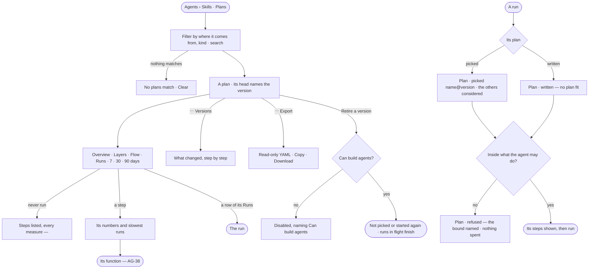

# AG-18 · Find a plan and read how it behaves

**As** an agent builder **I want** every plan the agents may pick as a list I can filter, each opening to its steps as
a flow, how it has behaved and what changed between versions — and every run to say which plan it picked, or why it
wrote one, and whether it was let run **so that** the plan that worked is used again rather than reinvented, and one
that stops serving is retired. *The agent picks or writes a plan → a person reads it, retires it or keeps it.*

Tasks: [task.md](task.md) · Feature: [AG-F06](../../feature.md)

## Who can

| Lens | Can | Otherwise sees |
|---|---|---|
| Admin | Read every plan, its page, versions and export; retire a version; read why any run picked its plan | — |
| Operator | Read every plan, its page, versions and export; read why a run they can open picked its plan | *Retire* disabled, naming *Can build agents*. With *Can build agents*: as Admin |

## Flow

## Acceptance criteria

| # | Given | When | Then |
|---|---|---|---|
| AG-18.1 | Agents › Skills | anyone opens *Plans* | every reusable plan lists with its name, what it is for, where it comes from (*packaged* · *generated* · *promoted*), its version, what it touches, the skills that use it and when it last ran |
| AG-18.2 | Plans | a person filters by where it comes from, kind or whether a skill copies it in, or searches | the list narrows; nothing matching reads *No plans match*, naming the filter, with *Clear* |
| AG-18.3 | A plan written for one piece of work, and a skill's own plan | Plans is read | neither is listed — the first is read from its run, the second under its skill |
| AG-18.4 | A plan in the list | a person opens it | its page's head names the version and says what it is — its steps, what it matches, what it touches, who owns it and the agents that may run it — over tabs *Overview* · *Layers* · *Flow* · *Runs* and a 7 · 30 · 90 day window every tab follows |
| AG-18.5 | A plan that has run | Overview is read | it shows runs, served, elapsed and work medians, tokens per run and failed against the window before; one row per step with how often it ran, its medians, failed and retried; where it fails; and which bounds it reaches |
| AG-18.6 | A plan's step on Overview | a person picks it | it shows that step's numbers, where it is slow and its three slowest runs, each opening its run |
| AG-18.7 | A plan that has never run | its page opens | no tiles and no charts; its steps list with every measure *—*, and *Run a plan* for who may (AG-44) |
| AG-18.8 | A plan | Flow is read | its steps draw as a read-only flow, each carrying its median time; a step whose slow runs are far slower than its median is ringed; one most runs skip is dim; picking a step shows its function's contract (AG-38) |
| AG-18.9 | A plan | its Runs tab is read | every run of it lists newest first — what was asked, called by, agent, how it ended, elapsed, tokens, when — filterable by how it ended, called by, agent and version; a failed row names the step it failed at and why; a row opens the run |
| AG-18.10 | A plan with no run yet | its Runs tab is read | it says who may run it and what would put a row there |
| AG-18.11 | A plan with versions | *⋯ Versions* is opened | each version lists with what changed against the one before — steps added, removed, moved or changed, each changed field before and after, declared arguments too; v1 reads *the first version* |
| AG-18.12 | A published version | anyone reads it | nothing on the page edits it; there is no *New plan*; *⋯ Export* shows it as read-only YAML with *Copy* and *Download* |
| AG-18.13 | A person with *Can build agents* | they retire a version | it is not picked or started again; runs in flight finish; every past run still opens; retiring every version takes the plan out of the list |
| AG-18.14 | An Operator without *Can build agents* | they open a plan | everything reads; *Retire* is disabled, naming *Can build agents* |
| AG-18.15 | A run whose intent matches published plans | its plan is picked | its Plan step reads *Plan · picked* with the plan and version, and lists the others it considered |
| AG-18.16 | A run with no plan that fits, or only retired ones | its plan is written | its Plan step reads *Plan · written — no plan fit*, naming the retired ones when there are, and it is not a failure |
| AG-18.17 | A plan, picked or written | it is checked before its first step | it shows the steps it will run; a step not allowed, an argument not pinned, projected tokens over the ceiling, or helpers past their bounds refuse it — *Plan · refused*, naming the step, argument, ceiling or bound, the projected tokens beside the ceiling, nothing spent, the run reading *refused* and its task blocked |
| AG-18.18 | A plan that passed its last check | what the agent may do narrows | it is refused naming what changed; the plan stays in the list; running steps finish and the next plan is checked against the new bounds |
| AG-18.19 | The same step refused again and again | the threshold is crossed | it is evidence, and a suggested change in *Needs you* proposes widening or tightening what the agent may do; a person decides (EX-31) |
| AG-18.20 | A run that picked, wrote or was refused a plan | a person opens *How it got here* | its steps show why this plan, which others were considered and the check's result, each with its sources |
| AG-18.21 | A plan some of whose runs replanned | a person picks one of those runs on the plan's page | the plan's steps read against what that run ran — *ran* · *added by a replan* · *not run* — with how many times it replanned; a replan never changes the plan |
| AG-18.22 | A plan that declares arguments | *⋯ Arguments* is opened | each argument lists with its type, default and label, and each skill that copies the plan in with the value it gives; none reads *This plan takes no arguments* |
| AG-18.23 | A plan's Layers drawing | a person who has never seen the plan reads it, without the legend | they can say from the drawing alone what repeats, how many times, what stops it and what declining costs, and tell an approval (a seam on the leading edge) from a verdict (a seam on the trailing edge, its `back()` bracket hanging off it); where the drawing and the run's record disagree, the tab says so and draws no further |

## Screens

| Surface | Lens | First use | Empty after a filter | Loading | Has data | Failed | Agent working or proposing | No access |
|---|---|---|---|---|---|---|---|---|
| Plans | Admin | agents.skills · Plans, packaged only | agents.skills · No plans match | agents.skills · Loading | agents.skills · Plans | agents.skills · Could not load | — | — |
| Plans | Operator | agents.skills · Plans, packaged only | agents.skills · No plans match | agents.skills · Loading | agents.skills · Plans | agents.skills · Could not load | — | agents.skills · Plans, read only |
| A plan — Overview and Layers | Admin | agents.skills · A plan, never run | — | agents.skills · Loading | agents.skills · A plan | agents.skills · Could not load | agents.skills · A plan, running | — |
| A plan — Overview and Layers | Operator | agents.skills · A plan, never run | — | agents.skills · Loading | agents.skills · A plan | agents.skills · Could not load | agents.skills · A plan, running | agents.skills · A plan, read only |
| A plan — Flow | Admin | agents.skills · A plan's flow | — | agents.skills · Loading | agents.skills · A plan's flow | agents.skills · Could not load | — | — |
| A plan — Flow | Operator | agents.skills · A plan's flow | — | agents.skills · Loading | agents.skills · A plan's flow | agents.skills · Could not load | — | agents.skills · A plan's flow |
| A plan — Runs | Admin | agents.skills · A plan's runs, no runs | agents.skills · A plan's runs, none match | agents.skills · Loading | agents.skills · A plan's runs | agents.skills · Could not load | agents.skills · A plan's runs | — |
| A plan — Runs | Operator | agents.skills · A plan's runs, no runs | agents.skills · A plan's runs, none match | agents.skills · Loading | agents.skills · A plan's runs | agents.skills · Could not load | agents.skills · A plan's runs | agents.skills · A plan's runs |
| A plan — Versions and Export | Admin | agents.skills · A plan's versions, the first | — | agents.skills · Loading | agents.skills · A plan's versions | agents.skills · Could not load | — | — |
| A plan — Versions and Export | Operator | agents.skills · A plan's versions, the first | — | agents.skills · Loading | agents.skills · A plan's versions | agents.skills · Could not load | — | agents.skills · A plan's versions |
| A plan — Replanned runs | Admin | agents.skills · A plan's replanned runs, none | — | agents.skills · Loading | agents.skills · A plan's replanned runs | agents.skills · Could not load | — | — |
| A plan — Replanned runs | Operator | agents.skills · A plan's replanned runs, none | — | agents.skills · Loading | agents.skills · A plan's replanned runs | agents.skills · Could not load | — | agents.skills · A plan's replanned runs |
| A plan — Arguments | Admin | agents.skills · A plan's arguments, none | — | agents.skills · Loading | agents.skills · A plan's arguments | agents.skills · Could not load | — | — |
| A plan — Arguments | Operator | agents.skills · A plan's arguments, none | — | agents.skills · Loading | agents.skills · A plan's arguments | agents.skills · Could not load | — | agents.skills · A plan's arguments |
| Retire a version | Admin | — | — | — | agents.skills · Retire a version | agents.skills · Could not load | — | — |
| Retire a version | Operator | — | — | — | — | — | — | agents.skills · A plan, read only |
| A skill's own plan | Admin | agents.skill · Flow | — | agents.skill · Loading | agents.skill · Flow | agents.skill · Failed | — | — |
| A skill's own plan | Operator | agents.skill · Flow | — | agents.skill · Loading | agents.skill · Flow | agents.skill · Failed | — | agents.skill · Read only |
| A run's Plan step | Admin | agents.run · Plan written | — | agents.run · Loading | agents.run · Plan picked | agents.run · Plan refused | agents.run · Running | — |
| A run's Plan step | Operator | agents.run · Plan written | — | agents.run · Loading | agents.run · Plan picked | agents.run · Plan refused | agents.run · Running | agents.run · Not found |
| Runs of a plan | Admin | agents.runs · Nothing ran | agents.runs · No runs match | agents.runs · Loading | agents.runs · Filtered | agents.runs · Could not load | agents.runs · Running | — |
| Runs of a plan | Operator | agents.runs · Nothing ran | agents.runs · No runs match | agents.runs · Loading | agents.runs · Filtered | agents.runs · Could not load | agents.runs · Running | agents.runs · Filtered |
| Refused again and again | Admin | — | — | inbox · Loading | inbox · Suggested change | — | inbox · Suggested change | — |
| Refused again and again | Operator | — | — | inbox · Loading | inbox · Suggested change | — | inbox · Suggested change | inbox · Not yours to answer |
