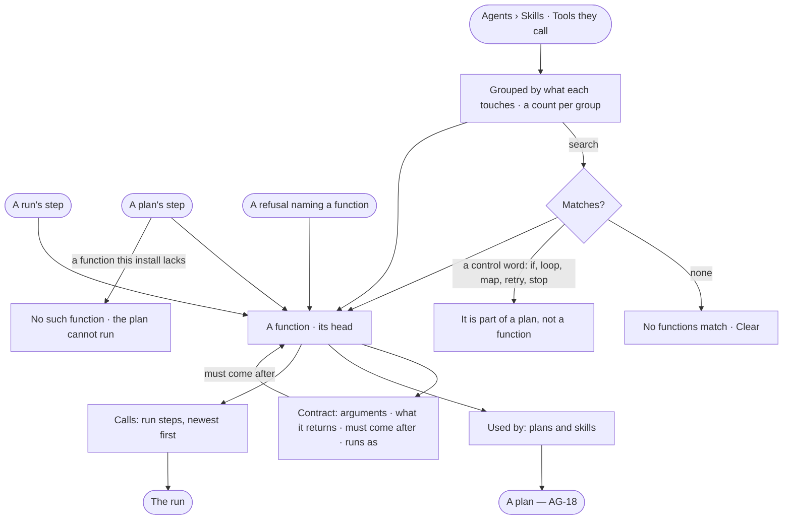

# AG-38 · Read every function and what calls it

**As** an install admin **I want** to read every function the enabled plugins and approved libraries provide — what it
touches, what it takes and returns, what must come before it, and which plans and skills call it **so that** skills
are built from what exists without editing code, and anyone reading a refused or failed step can tell what it was
allowed to do without reading the engine.

Tasks: [task.md](task.md) · Feature: [AG-F06](../../feature.md)

## Who can

| Lens | Can | Otherwise sees |
|---|---|---|
| Admin | Read every function, its contract, its calls and what calls it | — |
| Operator | Read every function, its contract, its calls and what calls it — a contract, not a permission | Nothing on it adds, edits, disables or runs a function, for anyone. No grant adds an act |

## Flow

## Acceptance criteria

| # | Given | When | Then |
|---|---|---|---|
| AG-38.1 | Agents › Skills | anyone opens *Tools they call* | every function lists grouped by what it touches, each group naming it and its count; a row reads its dotted name, one-line summary, and how many plans and skills call it, or *not used yet* |
| AG-38.2 | Tools they call | a person searches by name, summary or what it touches | the list narrows; nothing matching reads *No functions match*, with *Clear* |
| AG-38.3 | A search for *if*, *loop*, *map*, *retry* or *stop* | it runs | it says that is part of a plan, not a function, and where plans are read |
| AG-38.4 | A function | a person opens it | its page's head names it, what it touches, its side effect and its plugin and version, with *Contract* · *Used by* · *Calls* |
| AG-38.5 | A function's Contract | it is read | its arguments, what it returns, and *Must come after* as a sentence linking the function a plan must run first; an output not available outside a repeated step reads *per item only — use it inside the step that repeats* |
| AG-38.6 | A function | its numbers are read | calls, slow-run time and failed over the last 30 days of this Graph's runs, each against the 30 days before, as the engine stores them |
| AG-38.7 | A function | Used by is read | the reusable plans that call it and the skills that need it, each opening its page; none reads *not used yet* |
| AG-38.8 | A function | Calls is read | the run steps that called it, newest first, each with how it ended, its time and tokens, opening its run |
| AG-38.9 | A function | it is read | it names the agents whose *What it may do* grants what it touches; none reads *Nothing here can run it until an agent may* |
| AG-38.10 | A run's step, a plan's step or a refusal | a person picks the function it names | its contract shows beside it, linking to the function's page |
| AG-38.11 | A plan step naming a function this install does not have | the plan is read | the step reads *No such function*; the plan cannot run and its row says why |
| AG-38.12 | Any member, Operator or Admin | they open a function | everything reads the same; there is no *Add*, *Edit*, *Disable* or *Try it* |
| AG-38.13 | A call by an agent's run | a person opens it from *Calls* | the run's *How it got here* shows that step, its arguments and what it returned |

## Screens

| Surface | Lens | First use | Empty after a filter | Loading | Has data | Failed | Agent working or proposing | No access |
|---|---|---|---|---|---|---|---|---|
| Tools they call | Admin | agents.skills · Tools they call, not used yet | agents.skills · No functions match | agents.skills · Loading | agents.skills · Tools they call | agents.skills · Could not load | — | — |
| Tools they call | Operator | agents.skills · Tools they call, not used yet | agents.skills · No functions match | agents.skills · Loading | agents.skills · Tools they call | agents.skills · Could not load | — | agents.skills · Tools they call |
| A function | Admin | agents.skills · A function, not used yet | — | agents.skills · Loading | agents.skills · A function | agents.skills · No such function | — | — |
| A function | Operator | agents.skills · A function, not used yet | — | agents.skills · Loading | agents.skills · A function | agents.skills · No such function | — | agents.skills · A function |
| A function's calls | Admin | agents.skills · A function's calls, none | — | agents.skills · Loading | agents.skills · A function's calls | agents.skills · Could not load | agents.skills · A function's calls | — |
| A function's calls | Operator | agents.skills · A function's calls, none | — | agents.skills · Loading | agents.skills · A function's calls | agents.skills · Could not load | agents.skills · A function's calls | agents.skills · A function's calls |
| A step's contract, on a run | Admin | — | — | agents.run · Loading | agents.run · Step | agents.run · Plan refused | agents.run · Running | — |
| A step's contract, on a run | Operator | — | — | agents.run · Loading | agents.run · Step | agents.run · Plan refused | agents.run · Running | agents.run · Not found |
