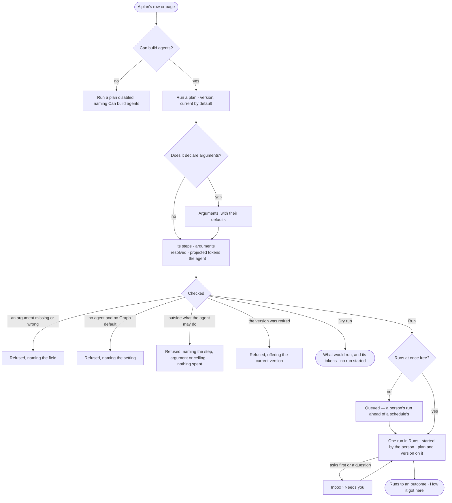

# AG-44 · Run a plan on demand with today's arguments

**As** an agent builder **I want** to run a plan I trust by name, with today's arguments and an agent of my choosing,
seeing its steps and projected tokens before it starts **so that** I do not have to phrase a question and hope the
right plan is picked. *The person starts the plan → the agent runs it inside what it may do.*

Tasks: [task.md](task.md) · Feature: [AG-F06](../../feature.md)

## Who can

| Lens | Can | Otherwise sees |
|---|---|---|
| Admin | Run a published plan version or dry run it, with arguments and an agent; stop the run as any run | — |
| Operator | Read the plan and every run of it they can open | *Run a plan* disabled, naming *Can build agents*. With *Can build agents*: as Admin |

## Flow

## Acceptance criteria

| # | Given | When | Then |
|---|---|---|---|
| AG-44.1 | A published plan version | a person with *Can build agents* presses *Run a plan* on its row or its page | it opens with the version (the current one by default), its declared arguments with their defaults, the agent — named, or the Graph's default — and *Dry run* beside *Run* |
| AG-44.2 | The Run a plan form | its arguments are filled | it shows the steps that will run, the arguments resolved and the projected tokens, before anything starts |
| AG-44.3 | An argument missing or of the wrong type | the person presses *Run* | it is refused naming the field; nothing runs |
| AG-44.4 | A plan outside what the agent may do | the person presses *Run* | it is refused naming the step, argument or token ceiling, as a picked plan would be; nothing is spent and picking it by hand widens nothing |
| AG-44.5 | No agent named and no Graph default | the person presses *Run* | it is refused naming the setting; nothing runs as nobody |
| AG-44.6 | A version retired since the form opened | the person presses *Run* | it is refused naming the version, offering the current one |
| AG-44.7 | A valid start | the person presses *Dry run* | it shows what would run, the resolved arguments and the projected tokens, refuses exactly as a run would, and starts no run |
| AG-44.8 | A valid start | the person presses *Run* | one run opens in Runs, started by them, naming the plan and the version it resolved to; Runs filters to every run of this plan |
| AG-44.9 | *Run* pressed twice | the second press arrives | it opens the first run; there is one |
| AG-44.10 | The Graph at its runs at once | the person presses *Run* | the run waits *queued*, a person's run ahead of a schedule's |
| AG-44.11 | A run that asks first or has a question | it reaches that step | it waits in *Needs you*, naming what it will do or asking with its options |
| AG-44.12 | A running plan | the person stops it | it stops as any run does; this adds no control of its own |
| AG-44.13 | A plan Invana ships | it is run by name, by a schedule (AG-F07) or from the command line | each opens the same kind of run through the same check |
| AG-44.14 | An Operator without *Can build agents* | they open a plan | *Run a plan* is disabled, naming *Can build agents* |
| AG-44.15 | A run started by name | a person opens *How it got here* | its steps show the plan and version, the resolved arguments, who started it and the check's result |

## Screens

| Surface | Lens | First use | Empty after a filter | Loading | Has data | Failed | Agent working or proposing | No access |
|---|---|---|---|---|---|---|---|---|
| Run a plan | Admin | agents.skills · Run a plan, no arguments | — | agents.skills · Run a plan, checking | agents.skills · Run a plan | agents.skills · Run a plan, refused | agents.skills · Run a plan, dry run | — |
| Run a plan | Operator | — | — | — | — | — | — | agents.skills · A plan, read only |
| The run it starts | Admin | — | — | agents.run · Loading | agents.run · Started by name | agents.run · Plan refused | agents.run · Running | — |
| The run it starts | Operator | — | — | agents.run · Loading | agents.run · Started by name | agents.run · Plan refused | agents.run · Running | agents.run · Not found |
| Runs of a plan | Admin | agents.runs · Nothing ran | agents.runs · No runs match | agents.runs · Loading | agents.runs · Filtered | agents.runs · Could not load | agents.runs · Running | — |
| Runs of a plan | Operator | agents.runs · Nothing ran | agents.runs · No runs match | agents.runs · Loading | agents.runs · Filtered | agents.runs · Could not load | agents.runs · Running | agents.runs · Filtered |
| A run's ask | Admin | — | — | inbox · Loading | inbox · Asks first | — | inbox · Asks first | — |
| A run's ask | Operator | — | — | inbox · Loading | inbox · Asks first | — | inbox · Asks first | inbox · Not yours to answer |
