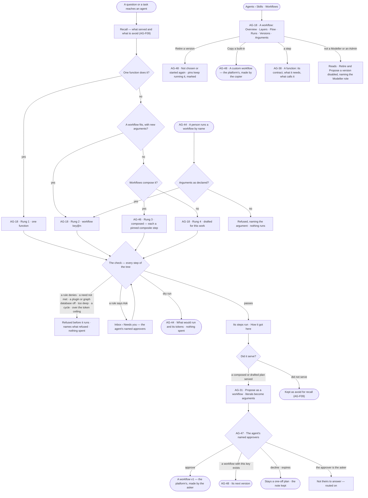
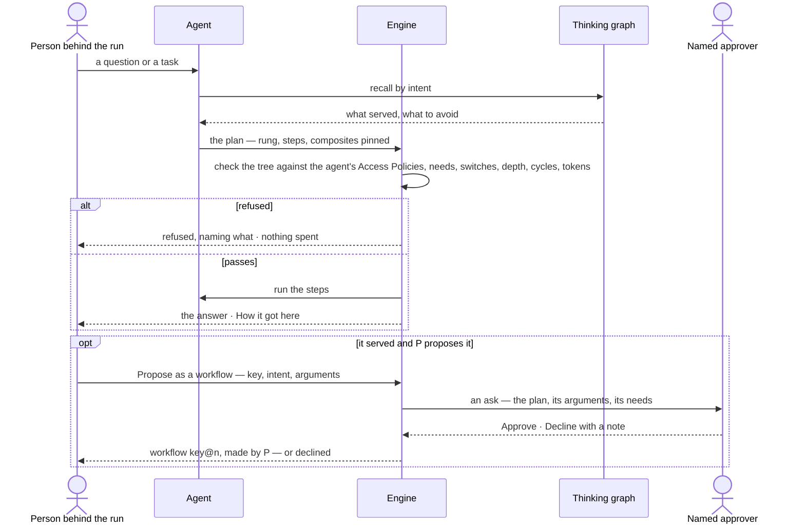

# Plans and workflows

> How an agent carries one piece of work out. It climbs a ladder — one function, a workflow reused with new
> arguments, a plan composed from workflows, a new plan drafted — and every plan is checked against the agent's Access
> Policies before its first step. A plan that served becomes a **workflow** when the agent's named approvers approve
> it: read-only, versioned, owned by the platform, made by the person who asked for it, and reusable by every agent
> allowed to run it. The
> decisions it helps make: *should this plan be kept for reuse, is this workflow still fit to run or should a version
> retire, may this agent run it, and what can agents do at all?*

## User journey

Journeys this feature is a step of: [J04 · Build an agent and improve it from what runs teach](../../../../journeys/J04-build-an-agent-and-improve-it-from-what-runs-teach.md)

## Stories

| ID | Story | Status |
|---|---|---|
| AG-18 | [Find a workflow, and read which rung a run took](stories/AG-18-find-a-plan-and-read-how-it-behaves/story.md) | idea |
| AG-31 | [Propose a plan that served as a workflow, and see where each comes from](stories/AG-31-keep-a-plan-that-served-and-see-where-each-comes-from/story.md) | idea |
| AG-38 | [Read every function and what calls it](stories/AG-38-read-every-function-and-what-calls-it/story.md) | idea |
| AG-44 | [Run a workflow on demand with today's arguments](stories/AG-44-run-a-plan-on-demand-with-todays-arguments/story.md) | idea |
| AG-46 | [Compose a plan from workflows](stories/AG-46-compose-a-plan-from-workflows/story.md) | idea |
| AG-47 | [Approve a plan into a workflow](stories/AG-47-approve-a-plan-into-a-workflow/story.md) | idea |
| AG-48 | [Version a workflow, retire one and move a pin](stories/AG-48-version-a-workflow-retire-one-and-move-a-pin/story.md) | idea |

## Access

Who may do what is the [role table](../../../../os/access/features/AC-F02-access-policies/feature.md#the-role-table):
*Plans and workflows* is *Acts* for Operator, Modeller and Admin — within the agents granted to the person and those
agents' Access Policies. A workflow is the platform's ([AC-F07](../../../../os/access/features/AC-F07-ownership/feature.md)):
making it grants nothing over it.

| Act | Role ([the role table](../../../../os/access/features/AC-F02-access-policies/feature.md#the-role-table)) | Everyone else sees |
|---|---|---|
| Read workflows, a workflow's page, its versions and arguments, and functions | Every signed-in person | — |
| Read a run's plan — its rung, why, the check's result | Whoever may read the run's content — the person behind it, and for a project's run anyone whose default agent may see its sources (run privacy, [AC-F09](../../../../os/access/features/AC-F09-what-left-the-platform/feature.md)) | That it ran, its status and its tokens; the plan reads *Content withheld* |
| Run a workflow by name · dry run | Operator · Modeller · Admin, through an agent granted to them whose Access Policies allow Run `workflow/<key>` | *Run* disabled, naming the rule that denies it and *ask an Admin* |
| Propose a plan that served as a workflow | The person behind the run | *Propose as a workflow* hidden |
| Approve or decline a plan into a workflow | The agent's named approvers — else the other approvers, else the Admins — never the person it benefits ([AC-F05](../../../../os/access/features/AC-F05-asks-and-approvals/feature.md)) | The ask reads; *Approve* and *Decline* absent — *Not yours to answer* |
| Propose a workflow's next version · retire a version · move a pin | Modeller · Admin | Disabled — *Needs the Modeller role — ask an Admin* |
| Copy a built-in workflow | Modeller · Admin ([AC-F07](../../../../os/access/features/AC-F07-ownership/feature.md)) | *Copy* disabled — *Needs the Modeller role — ask an Admin* |
| Switch a plugin on or off | Admin ([CP-F02](../../../../os/control/features/CP-F02-plugins-and-outside-tools/feature.md)) | The plugin reads; its switch disabled, naming *Admin* |
| Approve a library's functions | Admin ([AG-F08](../AG-F08-portable-agents-and-skills/feature.md)) | Proposals read *Waiting for an Admin* |
| Decide a suggested change to a workflow | Modeller · Admin ([AG-52](../AG-F09-learn-from-memory/stories/AG-52-decide-on-a-suggested-change/story.md)) | Read only — *Needs the Modeller role — ask an Admin* |

## States

| State | What the person sees |
|---|---|
| First use | Only the built-in workflows, each *built-in*; a workflow never run lists its steps with every measure *—*; a function nothing calls reads *not used yet* |
| Empty after a filter | No workflow or function matches — the filter named, *Clear* |
| Loading | The list's head and filters drawn at once; rows and a page's numbers load in place |
| Has data | Workflows with where each comes from, version, what it touches, who made it and what composes it; a workflow's page over its window; functions grouped by what they touch |
| Failed | Could not load, with *Try again*; a refused plan names what refused it and spends nothing; a workflow flagged because a plugin or graph database it needs is off names it and who switched it off |
| Agent working or proposing | A run climbing the ladder; a workflow running from *Run*; a proposal waiting on the named approvers; a suggested change to retire a version or move a pin |
| No access | Everything reads; a run's plan whose content the person may not read reads *Content withheld*; acts they may not take are disabled, naming the role or the rule |

## Rules

| Rule | Detail |
|---|---|
| The ladder | For each piece of work an agent tries, in order: **1** one function · **2** a workflow with new arguments · **3** a plan composed from workflows · **4** a new plan drafted. It takes the lowest rung that fits; the run records the rung and why each lower one did not fit |
| Recall comes first | Before choosing a rung, the plan step reads recall from the thinking graph — what served for this intent and what to avoid ([AG-F09](../AG-F09-learn-from-memory/feature.md)) |
| The function catalogue is rung one | Every step of every plan calls one function, or composes one workflow; the functions are a closed set from plugins switched on and approved libraries; nothing in Studio adds, edits or switches one |
| A composite step pins a version | A plan calls a published workflow as a `composite` step naming `key@version`; a new version of that workflow never changes the plan |
| Composites nest, never loop | At most three levels deep; a workflow that would contain itself, at any depth, is refused |
| Every plan is checked, as a tree | Before the first step, every step of the plan and of every workflow it composes is checked: Run on each function's plugin or tool and on each `workflow/<key>` it composes; Read or Write on each `data/<graph database>/<kind>` it touches; each graph database's mode allows it; every plugin and graph database it needs is switched on; projected tokens within the ceiling; depth and helpers within their bounds ([AC-F04](../../../../os/access/features/AC-F04-what-an-agent-may-touch/feature.md)). Coming from the workflows list is not a pass |
| A refusal is an outcome | The run ends refused, naming what refused it; nothing is spent and no step runs. Never half a plan |
| What may run changes mid-run | Running steps finish; the next plan or replan is checked against the new policies |
| A plan holds no data | A drafted plan's literal values are kept on its run; proposing it as a workflow turns every literal into a declared argument. A record ID or a property value never becomes a default; a count, a window or a flag may |
| Approval is for reuse | A one-off plan runs without approval; only making it a workflow waits on the agent's named approvers |
| A workflow is read-only | A change is a new version, approved the same way; a published version never changes, so every run of it still opens |
| The platform's, made by the asker | A workflow is owned by the platform; a new one is made by the person who proposed it, which grants nothing over it ([AC-F07](../../../../os/access/features/AC-F07-ownership/feature.md)) |
| Built-ins are copied, never edited | A built-in workflow is owned by the system user; *Copy* makes a workflow the platform's, made by the copier, under a new key |
| Only workflows are listed | A one-off plan is read from its run; a skill's plan under its skill ([AG-F04](../AG-F04-skills/feature.md)); the list holds what can be chosen or run again |
| Origin is a badge | *Built-in* · *approved* · *copied* — one list, one filter |
| Retire stops choosing, never a pin | A retired version is not chosen on rung 2 or 3 and not started by name; runs in flight finish; a published workflow that pins it keeps running it and reads *pins a retired version*; past runs still open |
| Off means flagged | A workflow needing a plugin or graph database that is switched off is flagged, naming it and who switched it off, and its runs are refused before they start ([CP-F02](../../../../os/control/features/CP-F02-plugins-and-outside-tools/feature.md)) |
| A workflow declares arguments; a caller gives them | Two runs or two composing plans may give different values; neither is a fork |
| Startable is not editable | *Run* starts a published version with arguments; it never changes its steps |
| One way in | A run by name, the command line and a composing plan open the same kind of run through the same check; a schedule carries instructions and its run climbs the ladder like any run ([AG-F07](../AG-F07-schedules/feature.md)) |
| A function touches one thing | Each function has one bound — what it touches — and declares what it needs |
| Control flow is plan grammar | *if* · *loop* · *map* · *retry* · *stop* belong to a plan, never listed as functions |
| A project's tasks are not a plan | A project's task graph is the people's work ([PJ-F01](../../../projects/features/PJ-F01-projects-and-tasks/feature.md)); a run started for a task climbs the ladder like any run |
| Leans on | Build an agent (AG-F01) · the catalogue (AG-F02) · skills (AG-F04) · the thinking graph and recall (AG-F09) · runs (CP-F10) · plugins and switches (CP-F02) · Access Policies (AC-F02) · what an agent may touch (AC-F04) · asks and named approvers (AC-F05) · ownership (AC-F07) · schedules (AG-F07) · answer templates (EX-F04) · the Inbox (CP-F08) |

**The function catalogue** — every function is named `namespace.verb`; the namespace names what it touches and the
plugin it comes from. The default kit's plugins are [CP-F02](../../../../os/control/features/CP-F02-plugins-and-outside-tools/feature.md)'s.

| Namespace | Functions | What it touches | Plugin |
|---|---|---|---|
| `graph.read` | `query` · `get_neighbors` · `types_count` · `resolve` · `validate` | Reads graph databases (`validate` touches nothing) | Core |
| `graph.stitch` | `preview` · `declare` · `commit` · `withdraw` · `run` | `preview` reads; the rest write match rules and identity links | Core |
| `graph.write` | `records` · `bulk` · `edits` | Writes a read + write graph database | Core |
| `data` | `bundle.check` · `records.validate` · `snapshot` | Brings data in | Core |
| `model` | `propose` · `understand_ask` · `validate_proposal` · `migrate` | Changes the model | Core |
| `nl` | `understand` · `translate` | Calls an AI model | Core |
| `plan` | `draft` · `compose` · `replan` · `verify` | Calls an AI model (`verify` touches nothing) | Core |
| `work` | `spawn_agent` · `delegate` · `create_task` · `await` | Hands out work (`await` touches nothing) | Core |
| `answer` | `shape` | Nothing outside | Core |
| `board` | `open` | Nothing outside | Core |
| `thinking` | `recall` · `mark` | Reads and labels the thinking graph | Core |
| `ledger` | `read` | Reads the ledger | Core |
| `web` | `search` · `read_url` · `download_file` | Reaches outside | Web tools |
| `mail` | `read` · `send` | Reaches outside | Mail tools |
| `mcp.<server>` | One per tool of an outside MCP server an Admin added | Reaches outside | That server |

| Built-in workflow | What it does | What it touches |
|---|---|---|
| `nl-single` | One question, one typed query plan: understand it, compile it per graph database, run it, shape the answer, verify it served | Calls an AI model · reads graph databases |
| `nl-compare` | Two readings of the data, compared | Calls an AI model · reads graph databases |
| `ql-direct` | A typed query, and every re-run, with no translation | Reads graph databases |
| `count-types` · `expand-neighbours` · `resolve-elements` | One act of a board, each one step | Reads graph databases |
| `board-open` | Open one of Studio's lists with the filters an ask names | Nothing outside |
| `stitch-preview` · `stitch-apply` · `stitch-commit` · `stitch-withdraw` | Identity match rules, previewed and applied | Reads graph databases · writes identity links |
| `data-edit` | A board's saved edits, checked against the model | Writes a read + write graph database |
| `model-import` · `bulk-load` | Load a dataset into a model · write a folder through the connector | Brings data in · writes a read + write graph database |
| `modeller-propose` · `model-migration` | Stage a described change on the model draft · preview or publish a breaking change | Changes the model |
| `plan-a-todo` | Understand a piece of work and draft a plan for it — rung 4 | Calls an AI model |
| `check-criteria` | Judge a result against its criteria; it recommends, a person accepts | Calls an AI model |

## Data touched

| Record | Read or write |
|---|---|
| Workflows — key, name, intent, origin, current version, flag | Read · write (approve, copy, retire, flag) |
| Plans — every plan: a workflow's version, a one-off drafted or composed for a run, or a skill version's; its steps, rung and declared arguments | Write · read |
| A proposal to make a plan a workflow — the ask, its arguments, the decision | Write · read ([AC-F05](../../../../os/access/features/AC-F05-asks-and-approvals/feature.md) holds the ask) |
| A run's plan — rung, why, the plans recalled and considered, the check's result | Write · read |
| Runs of a workflow — every run that ran or composed it | Read |
| Functions — contract, plugin and version, what each touches and needs | Read |
| Who made a workflow | Read ([AC-F07](../../../../os/access/features/AC-F07-ownership/feature.md)) |
| History rows — proposed, approved, declined, retired, copied, started, flagged | Write · read |

## Engine

The low-level design: what this feature stores, serves and refuses. Conventions — naming, errors, lists, events — are
[system-design.md](../../../../system-design.md); this section only fills them in.

### Records

| Table | Columns | Notes |
|---|---|---|
| `agents_workflows` | `key` · `name` · `description` · `intent[]` · `origin` (`packaged` — built-in · `promoted` — approved · `copied`) · `copied_from_key?` · `current_version` · `flagged?` (`{reason, resource, switched_by_id}`) · `made_by_id` · `made_via_agent_id?` | `key` unique across the deployment, kebab case. A workflow is the platform's — no `access_owners` row ([AC-F07](../../../../os/access/features/AC-F07-ownership/feature.md#engine)); a built-in's `made_by` is the system user |
| `agents_plans` | `workflow_id?` · `version?` · `kind` (`import` · `ask` · `enrich` · `model` · `stitch` · `bulk`) · `rung` (`function` · `workflow` · `composed` · `drafted`) · `args_schema` · `literals?` · `uses[]` · `run_id?` · `skill_version_id?` · `status` (`one_off` · `published` · `retired`) · `retired_at?` · `approved_from_run_id?` · `approval_id?` · `created_by_kind` · `created_by_id` · `behind_user_id?` · `created_at` | A workflow version is a row with `workflow_id` and `version` — `key@n`; a published row never changes. A one-off plan carries its `run_id` and its `literals`; a skill's plan its `skill_version_id`. Exactly one of `workflow_id` · `run_id` · `skill_version_id` |
| `agents_plan_steps` | `plan_id` · `parent_id?` · `ordinal` · `key` · `form` (`callable` · `composite` · `human`) · `step_key?` (a function) · `workflow_key?` · `workflow_version?` · `role?` (`extract` · `decide` · `judge` · `embed`) · `title` · `body` · `args` · `assignee_kind?` · `assignee_id?` · `depends_on[]` · `when` · `map_over` · `loop` · `approval` · `optional` · `timeout_s` · `retry` · `pool` · `max_parallel` · `on_lane_failure` · `source_span?` | Unique (`plan_id`, `parent_id`, `key`). A `composite` step names `workflow_key` and `workflow_version`, never a function; a `callable` step names `step_key` |

### Reads

| Record | Owner |
|---|---|
| Runs — `plan_snapshot` · `plan_revision` · `replans` · `rung`, the step rows a workflow's numbers read, an eval run left out; run privacy | [CP-F10](../../../../os/control/features/CP-F10-runs-and-how-the-agents-are-doing/feature.md#engine) |
| An agent, its budget, `effort.max_replans`; the default agent (the Assistant) | [AG-F01](../AG-F01-build-an-agent/feature.md#engine) |
| Helper bounds — depth, fan-out | [AG-F05](../AG-F05-delegation-and-outside-agents/feature.md#engine) |
| A skill version's plan and its draw | [AG-F04](../AG-F04-skills/feature.md#engine) |
| Recall — what served and what to avoid for an intent; outcome labels | [AG-F09](../AG-F09-learn-from-memory/feature.md#engine) |
| Access Policies and the policy check | [AC-F02](../../../../os/access/features/AC-F02-access-policies/feature.md#engine) · [AC-F04](../../../../os/access/features/AC-F04-what-an-agent-may-touch/feature.md#engine) |
| The ask a proposal raises, its named approvers, reminders and expiry | [AC-F05](../../../../os/access/features/AC-F05-asks-and-approvals/feature.md#engine) |
| Who made a workflow, copying a built-in | [AC-F07](../../../../os/access/features/AC-F07-ownership/feature.md#engine) |
| Plugins, their switches, functions' manifests and built-in workflow files | [CP-F02](../../../../os/control/features/CP-F02-plugins-and-outside-tools/feature.md#engine) |
| Graph databases, their mode and switch | [CP-F05](../../../../os/control/features/CP-F05-graph-databases/feature.md#engine) |
| Approved library functions | [AG-F08](../AG-F08-portable-agents-and-skills/feature.md#engine) |
| Suggested changes to a workflow | [AG-F09](../AG-F09-learn-from-memory/feature.md#engine) |
| History — every event this feature writes | [AC-F06](../../../../os/access/features/AC-F06-history/feature.md#engine) |

### Routes

| Route, after `/api/v1/agents/workflows` | Does | Story |
|---|---|---|
| `GET /` | The workflows — `key` · `name` · `version` · `origin` · `intent` · `layers` · step count · runs · served · last ran · `made_by` · `composed_by` count · `flagged` — with `total` and `packaged`; filters `origin` · `kind` · `made_by` · `flagged` | AG-18 |
| `GET /{key}` | One version (the newest unless `version` is named): the row, its steps and edges, `layers`, `args_schema`, its composite steps with their pins, the workflows that compose it with the version each pins | AG-18 · AG-46 |
| `GET /{key}/versions` · `GET /{key}/diff?version=` | Every version with status · this version against the one before: `summary` · `added` · `removed` · `moved` · `changed` · `unchanged` · `arguments` · `pins`; `against_version` null for v1 | AG-48 |
| `GET /{key}/performance?window=7d·30d·90d&version=` | `tiles` · `daily[]` · `publishes[]` · `steps[]` · `failures[]` · `bounds[]` · `slowest` (Mechanisms) | AG-18 |
| `GET /{key}/runs` | Every root run that ran or composed it, newest first, filtered by `status` · `called_by` · `agent_id` · `version`, paged by cursor (50, at most 200), with `live` counts; content per run privacy | AG-18 |
| `GET /{key}/export` | The version as read-only YAML | AG-18 |
| `POST /{key}/runs` · `POST /{key}/runs?dry_run=true` | Run a published version — `{version?, args, agent_id?, idem_key}` → the run, or the existing run for a repeated `idem_key` · a dry run returns the steps of the tree, the resolved arguments and the projected tokens and opens no run | AG-44 |
| `POST /{key}/versions/{v}/retire` | Retire a version | AG-48 |
| `POST /{key}/copy` | `{key, name}` — a built-in or any workflow copied to a new key, v1, `made_by` the copier | AG-48 |
| `POST /{key}/pins` | `{step_key, version}` — propose the composing workflow's next version with one pin moved; it waits on approval like any version | AG-48 |
| `POST /proposals` | `{run_id, key?, name, description, intent[], args[{literal_path, name, label, default?}]}` — a served one-off plan proposed as v1 of a new key, or as the next version of `key` (a Modeller · Admin only); raises an ask (`kind = workflow`) → `202 {approval_id}` | AG-31 · AG-48 |
| `GET /proposals?run_id=` | The proposal on a run and the state of its ask | AG-31 · AG-47 |

| Route, after `/api/v1/agents` | Does | Story |
|---|---|---|
| `GET /plans/{id}` | A one-off plan, read through its run, under run privacy: rung, why, the plans recalled and considered, steps, composites with their pins, the check's result | AG-18 · AG-46 |
| `GET /functions` | Every function: `step_key` · `bound` · `layer` · `summary` · `args` · `outputs` · `requires` · `needs` · `plugin` · `enabled` · `used_by` (workflow keys), ordered by bound then key; search by key and summary, filter by bound | AG-38 · AG-31 |
| `GET /functions/{step_key}` | The function, its manifest (`version` · `side_effect` · `timeout_s` · `retries` · `resources` · `needs`), `plugin` (`name@version`), the workflows naming it, the skills whose current version needs it, and `calls` — calls · p95 · failed, each against the 30 days before | AG-38 |
| `GET /functions/{step_key}/calls` | The run steps that called it, newest first — step · its run · title · status · duration · tokens · queued — filterable by status; content per run privacy | AG-38 |

Approving or declining a proposal is answering its ask — `POST /api/v1/access/approvals/{id}`
([AC-F05](../../../../os/access/features/AC-F05-asks-and-approvals/feature.md#engine)); on *approve* the engine publishes
the version.

### Events

| Event | When |
|---|---|
| `agents.workflows.propose` | A plan is proposed as a workflow or a next version |
| `agents.workflows.approve` · `agents.workflows.decline` | Its ask is approved — the version publishes, made by the proposer on v1 — or declined or expired |
| `agents.workflows.retire` | A version is retired |
| `agents.workflows.copy` | A workflow is copied to a new key |
| `agents.workflows.flag` · `agents.workflows.unflag` | A plugin or graph database it needs is switched off · back on |
| `agents.workflows.start` | A person starts a workflow by name |
| `agents.plans.refused` | The check refuses a plan — what refused it, the step and what was proposed |

### Refusals

| Status | When | Sentence | Criterion |
|---|---|---|---|
| step refused | No rule of the agent's Access Policies allows Run on a function's plugin or tool, a composed `workflow/<key>`, or Read or Write on a `data/…` it touches | *{agent} may not {verb} {resource} — {rule or "no rule allows it"}.* | AG-18.17 · AG-44.4 · AG-46.5 |
| step refused | A graph database the plan writes is read-only | *{graph database} is read-only.* | AG-18.17 · AG-44.4 |
| step refused | A plugin or graph database the plan needs is switched off | *{name} is off — switched off by {person}.* | AG-44.16 · AG-46.6 |
| step refused | The plan's projected tokens exceed the ceiling | *Projected {n} tokens — the ceiling is {max}.* | AG-18.17 · AG-44.4 |
| step refused | Depth or fan-out past the parent's | *This passes {bound} — {count} of {max}.* | AG-18.17 |
| step refused | Composites nested past three levels | *{key} composes {n} deep — the limit is 3.* | AG-46.7 |
| step refused | A workflow that would contain itself | *{key} would compose itself through {path}.* | AG-46.8 |
| step refused | The agent's policies narrowed since the plan last passed | *{agent} may not {what changed} now.* | AG-18.18 |
| step refused | A step names a function this deployment does not have | *No such function: {step_key}.* | AG-38.11 |
| 422 | A start's argument unknown, missing or of the wrong type | *{argument}: {why}.* | AG-44.3 |
| 409 | A start of a retired version | *{key}@{v} is retired — the current version is {key}@{n}.* | AG-44.6 |
| 403 | A start through an agent the person may not use | *You may not use {agent} — ask an Admin.* | AG-44.14 |
| 409 | Proposing a plan that did not serve, a plan already a workflow, or a run the proposer is not behind | *Only a plan drafted or composed for a run that served can be proposed — by the person behind it.* | AG-31.11 |
| 409 | A proposal naming a key another workflow holds, by someone who is not a Modeller or an Admin | *{key} is taken — propose a new key, or ask an Admin.* | AG-31.12 · AG-47.10 |
| 409 | A proposal while one waits on the same run | *This plan is already waiting on {approvers}.* | AG-31.13 |
| 422 | A proposal keeping a record ID or a property value as a default | *{argument} holds a value from the data — it cannot be a default.* | AG-31.14 |
| 403 | Answering a proposal one is not a named approver of, or one that benefits them | *Not yours to answer — it waits on {approvers}.* | AG-47.6 |
| 403 | Retiring, proposing a version or moving a pin without the Modeller role | *Needs the Modeller role — ask an Admin.* | AG-48.9 |
| 403 | Copying without the Modeller role | *Needs the Modeller role — ask an Admin.* | AG-48.10 |
| 409 | Editing a built-in workflow | *{key} is built in — copy it to change it.* | AG-48.11 |
| 422 | `window` other than `7d` · `30d` · `90d` | *window: one of 7d, 30d, 90d.* | API only — Studio offers the three |
| 404 | An unknown workflow, version, plan or function | *Not found.* | API only — Studio links only what exists |

### CLI

| Command | Does |
|---|---|
| `invana workflows list` · `invana workflows show <key> [--version N]` | Every workflow — origin, key and version, name, made by · one workflow's steps in order, composites with their pins |
| `invana workflows run <key> [--version N] [--arg name=value] [--agent] [--dry-run]` | Start a workflow by name, through the same check as `POST /{key}/runs` |
| `invana workflows retire <key> --version N` · `invana workflows copy <key> --to <new-key>` | Retire a version · copy a workflow |

### Mechanisms

| Mechanism | How |
|---|---|
| Climbing the ladder | The plan step reads recall for the intent ([AG-F09](../AG-F09-learn-from-memory/feature.md#engine)), then tries each rung in order: one function whose contract answers the intent · a published workflow whose `intent` fits, its arguments bound from the ask · a composition of published workflows, each a `composite` step pinned to its current version · `plan-a-todo` drafts a plan. It writes `rung`, the workflows considered, what recall offered and avoided, and why each lower rung did not fit onto the run's Plan step |
| The planner is a workflow | `plan-a-todo` (`nl.understand` → `plan.draft`) and `check-criteria` are built-in workflows; there is no planner service, and a drafted plan never drafts another |
| The check | A pure function of the plan tree × the agent's Access Policies × switches × graph database modes, run before any step is dispatched — on every rung, a start and a replan alike: each `step_key` and each composite's `workflow/<key>` allowed (Run) · each `data/…` touched allowed (Read or Write) and every graph database written in read + write mode · every plugin and graph database needed switched on, at the install and by the person behind the run · composite depth at most 3 and no key twice on any path · projected tokens (recorded history per function) within the ceiling · depth and fan-out within the parent's · every function's `requires` ordered before it. Each composite is expanded at its pinned version, so the check covers the tree. Nothing is dispatched on a refusal |
| An Ask in the check | A rule set to Ask on any step raises one ask for the run before dispatch ([AC-F05](../../../../os/access/features/AC-F05-asks-and-approvals/feature.md#engine)); a yes for the run lets it start, a no refuses it |
| A refusal is an outcome | The run ends refused with the check's result on its Plan step — which check, which resource or bound, what was proposed — and `agents.plans.refused`; recall keeps it as *avoid* |
| Literals to arguments | A drafted or composed plan keeps the values it ran with in `literals` (a path per value). A proposal names each literal's argument; on approval every `literal_path` becomes `${args.<name>}` in the version's steps and the literal is dropped. A record ID or property value is never a default; the engine tells them apart by the step's argument type in the function's manifest (`record_id` · `value` · `count` · `window` · `flag`) |
| Approval publishes | On *approve* the engine writes the `agents_plans` row as `workflow_id`'s next `version` (v1 for a new key, the `agents_workflows` row created), `status: published`, `approved_from_run_id`, `approval_id`; the row is the platform's, `made_by_id` the proposer. On *decline* or expiry the plan stays `one_off` and the note is kept on the run |
| Who answers | The ask is routed to the named approvers of the agent that ran the plan, else the other approvers, else the Admins, with a *no approver* alert; the proposer never answers it ([AC-F05](../../../../os/access/features/AC-F05-asks-and-approvals/feature.md#engine)) |
| Pins | A `composite` step's `workflow_version` is fixed at the draft or the approval. A newer version of a pinned workflow reads *vN exists* on the composing workflow; *Move the pin* proposes the composing workflow's next version with the new pin, approved like any version |
| Retire | Sets `status: retired` and `retired_at`; rungs 2 and 3 and starts skip it; a published workflow pinning it keeps running it, its page marking *pins a retired version*; runs in flight finish |
| Flag | When a plugin or graph database is switched off, every workflow whose tree needs it is flagged with the resource and who switched it; switched back on, the flag clears. Flagged workflows are skipped on rungs 2 and 3 |
| Copy | Writes a new `agents_workflows` row, `origin: copied`, `copied_from_key`, its v1 the copied version's steps; `made_by_id` is the copier. No approval: a copy changes no agent's reach until a policy allows Run on its key |
| Built-in workflows are rows | Each is one file in its plugin's `flows/` folder, seeded at migrate as `origin: packaged`, owned by the system user; a new Invana version reseeds a changed shape as a new version |
| Replan | Only ahead of the cursor: settled and in-flight steps are untouchable; each revision overwrites `plan_snapshot`, adds one to `plan_revision` and `replans`, and passes the check in full; at most `effort.max_replans` a run (three by default); an ambiguous replan asks. The run's stream says `plan.proposed` for the first revision, `plan.revised` for each after |
| `back(step)` versus replan | `back(id)` reruns `id` and every step after it as a new attempt, unchecked, for a transient failure; a replan changes what is ahead and is checked |
| Plan grammar | `depends_on` (with `on: success · failure · any_outcome`) · `when` · `map_over` + `max_parallel` + `on_lane_failure` · `loop` (`until` · `max_iterations` · `on_exhausted` · `accumulate` · `verdict`) · `retry` (`max_attempts` · `on`) · `approval` · `stop` (`outcome`, `reason`) · `optional` · `form: human` (an assignee and criteria) · `form: composite` (a pinned workflow, its arguments bound from the caller) |
| The catalogue | The closed set of functions: one `manifest.toml` per function in a plugin's `tasks/` folder — `key` · `version` · `summary` · `bound` · `side_effect` (`read` · `write` · `send`) · `requires` · `needs` · `resources` · `timeout_s` · `retries` · `args` (`{type, required?, default?}`) · `outputs`. The registry is built at start; the route serves the manifests, so no copy of a contract lives in Studio |
| Bounds and layers | `graph_read` · `graph_write` · `schema_write` · `ingest` → graph data · `llm` → AI model · `network` → third party · `work_write` · `plan_write` · none → agent · a `form: human` step → human. `cache` is a band no function spends. The engine sends `layer` on every node; Studio never computes it |
| `layers` on a workflow | One `{layer, declared, steps, summary}` for each of the five governed bands — graph data · AI model · third party · cache · human — always all five, in that order, a composite counted by its tree |
| Declared outputs only | A step's bindable outputs are what its function declares, a composite's what its workflow's last step declares; no plan binds a step's internals |
| A function's numbers | Its steps over the last 30 UTC days, eval runs left out: calls count steps whose `task_key` is the function; p95 is queued to finished over settled steps; failed is failed over settled |
| A workflow's runs | Roots that ran it by name or on rung 2, plus roots whose plan composed it at any depth. A row: `run_id` · `status` · `when` · `asked` (withheld per run privacy) · `called_by` `{kind, name, person?}` · `agent` · `version` · `elapsed_ms` · tokens · `failed_at` `{step_key, cause}` |
| `performance` | `tiles` — `runs` · `served` (served ÷ verified; null when none verified) · `elapsed_p50_ms` · `work_p50_ms` · tokens per run · `failed`, each `{value, prior}` · `daily[]` · `publishes[]` · `slowest` · `steps[]` with `wide` (p95 at least 4× p50) and `rare` (reached by under a quarter of runs) · `failures[]` · `bounds[]`. The engine stores and serves every number |

## System impact

| HLD section | Change | NFRs |
|---|---|---|
| § 6 Data and storage | Three tables in Postgres; built-in workflows seeded from plugin files; every plan and workflow mirrored as a node of the thinking graph through the outbox ([AG-F09](../AG-F09-learn-from-memory/feature.md)) | NFR-PERF-2 |
| § 8 APIs and events | The routes, events and CLI above, under `agents` | — |
| § 10 AI and agents | The ladder; the model proposes a plan, the engine checks the whole tree against Access Policies, needs and switches before dispatch; approval into a workflow is the named approvers' | NFR-PERF-3 |
| § 12 Qualities | Security: a plan outside its policies spends nothing; a plan holds no data | — |

## Decisions

| Decision | Detail |
|---|---|
| Workflows live under Agents › Skills | *Workflows* and *Functions* are sections of Skills, beside *Answer templates*; a workflow opens as its own page (`agents.workflow`), a function as its own page |
| A workflow's page answers *how has it behaved* | Overview · Layers · Flow · Runs, over 7 · 30 · 90 days; what it is sits in its head — version, steps, intent, what it touches, who made it, what composes it, the agents allowed to run it |
| *Composed by* means pinned | The workflows whose steps compose it, each with the version it pins; an agent allowed to run it is a permission, read in the head |
| What changed is step by step | Each version against the one before: steps added, removed, moved or changed, pins moved, declared arguments; v1 reads *the first version* |
| Export is for review | A version exports as read-only YAML with *Copy* and *Download*; nothing imports a workflow from YAML |
| Every run names its rung and version | A run, a start and a composite record the rung and the `key@version` they ran; a start that names none takes the current version and records which |
| Starting by hand widens nothing | *Run* takes the same check the ladder does; there is no per-start override of an agent's policies |
| A run needs an agent | Named on the start, else the Assistant; never run as nobody |
| The plan shows before it runs | Its steps, composites expanded, its arguments resolved and its projected tokens, at *Run* and on the run before its first step |
| A dry run spends nothing | It checks, resolves and projects, refuses the same way, and starts no run |
| Proposing is one act on the run | *Propose as a workflow* sits on a run whose drafted or composed plan served; it opens a modal: key, name, intent, each literal as an argument with its label |
| Literals become arguments, data never a default | A record ID or a property value is always a required argument; a count, window or flag may keep the run's value as its default |
| The approver reads what they approve | The ask shows the plan's steps, its arguments, its declared needs and the run it came from — content per run privacy, so an approver who may not read the run sees its steps and needs, never its answer |
| Retire keeps pins running | Retiring stops choosing and starting a version; a workflow that pins it keeps running it and says so — breaking an approved workflow silently would be worse |
| Composites are three deep | Deep enough to compose compositions; shallow enough that the check and a reader can hold the tree |
| A built-in keeps its key | Named `key@version` in kebab case — never a function's dotted name; copying is how it changes |
| A workflow's runs include its composers | Every number on its page reads the runs that ran it, by name, on rung 2 or inside a composition; the engine computes each, Studio formats it |
| *Served* is of verified runs | The share of runs Verify judged, never of all runs |
| A failed step is its last attempt | A retry that recovered is not a failure |
| Replans are bounded | A running plan may revise itself only within what the check allows, checked before it runs, recorded on the run, at most three a run |
| A workflow reads as an address | A workflow's row is its `key@version` in mono over its intent, with its origin badge; a skill's row is prose (AG-F04) |
| Layers is one drawing in two tenses | A workflow declares what it will engage, on an axis of steps in order; a run shows what it did, on an axis of elapsed time. Each band is a row, a step is a bar on the row of the band it spends, and a band the plan does not engage is muted, never dropped |
| Repetition is a bracket; a run unrolls | On a workflow, a repeat is a bracket over the steps it repeats, marked by the counter that stops it — ↻ iteration (`max_iterations`) · ⟲ attempt (`retry.max_attempts`) · ⏸ ask (`max_clarifications`). On a run, iteration 2 draws further right |
| A gate is a seam | A rule at a position on the axis, crossing every band. A verdict is a seam on the trailing edge, the `back()` bracket hanging off it; an approval a seam on the leading edge |
| A composite is a box on Flow | A composite step draws as one node labelled `key@version`, opening its workflow; *Expand* draws its steps in place, framed |
| One flow drawing for plans and runs | A skill's Flow, a workflow's Flow and a run's Flow are one canvas, `TaskFlowCanvas` in `@invana-studio/canvases`, laid out by ELK `layered` alone; read-only; *Circles* or *Cards* |
| A plan is coloured by category, a run by status | On a workflow a step's colour is its tone; on a run it is the step's status |
| The drawing is proven on a stranger | It is done when someone who has never seen the workflow answers from it alone what repeats, how many times, who stops it and what declining costs, and tells an approval from a verdict without the legend (AG-18.23) |

## Open questions

| Question | Recommendation | Who answers |
|---|---|---|
| — | — | — |

## Not building

| Item | Why not |
|---|---|
| Drafting, composing or editing a plan by hand | Plans come from the ladder; hand edits bypass the check and the trace |
| A visual step-graph editor | A plan is data checked against policies; the ladder and approval are the ways in |
| Editing a workflow | It is read-only; a change is a new version, approved |
| Importing a workflow from YAML | Approval from a run that served, or a copy, is how a workflow enters the list |
| Approving a workflow automatically above a success rate | Reuse is a judgement the named approvers make |
| Approval to run a one-off plan | The check is the gate for running; approval is for reuse |
| Learning the ladder from feedback by itself | Recall ranks by outcome labels a person can read and change (AG-F09) |
| Racing several plans against each other | Tokens and who did what become unreadable |
| Asking a person to let a refused plan run | It turns a policy into a prompt; a rule set to Ask is how a person decides |
| Running the allowed steps of a refused plan | Half a plan is not a plan |
| Branching workflow versions | One line of versions per workflow |
| Composite pins that float to the latest version | An approved workflow would change behind its approvers' backs |
| Composites deeper than three, or recursive | The check and a reader must hold the whole tree |
| Starting a retired or unpublished version by name | Only published versions start; a pin keeps a retired one running |
| Overriding an agent's policies on one start | The policy would become advisory |
| Re-running from Runs by starting a workflow | Re-run is CP-54's; *Run* starts fresh with today's arguments |
| Adding, editing or switching a function in Studio | The set is closed and ships with the plugins; switches are CP-F02's |
| *Try it* on a function | A function runs in a plan, through an agent, with a run behind it |
| A plan holding data | Values from the data stay on the run; a workflow carries arguments |
| A layout switch, or a force, radial or tree layout on Flow | ELK `layered` is the one layout |
| Generating prose from a plan | Two generators pointing at each other drift |
| A function that raises a budget | An agent never raises its own budget |
