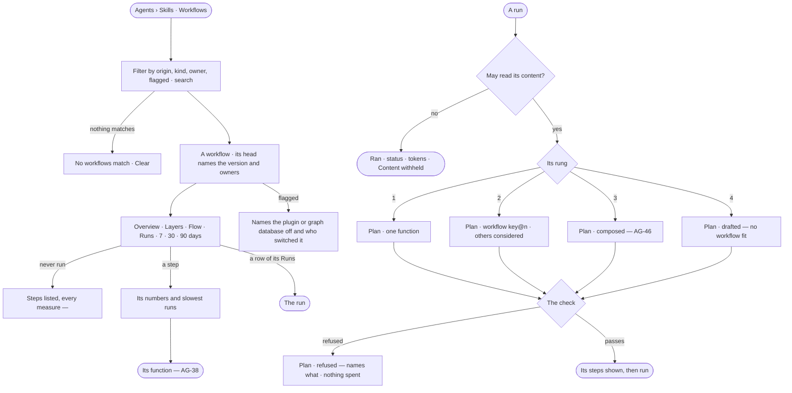

# AG-18 · Find a workflow, and read which rung a run took

**As** an agent builder **I want** every workflow agents may reuse as a list I can filter, each opening to its steps
as a flow, how it has behaved and who owns it — and every run to say which rung of the ladder it took, which
workflows it considered, what recall offered and whether it was let run **so that** a workflow that works is reused
rather than reinvented, and one that stops serving is retired. *The agent climbs the ladder → a person reads why.*

Tasks: [task.md](task.md) · Feature: [AG-F06](../../feature.md)

## Who can

| Lens | Can | Otherwise sees |
|---|---|---|
| Admin | Read every workflow, its page, versions and export; read the plan of any run | — |
| Operator | Read every workflow, its page, versions and export; read the plan of a run they are behind or whose agent they own; a Modeller the same | Another person's run: that it ran, its status and its tokens — the plan reads *Content withheld* |

## Flow

## Acceptance criteria

| # | Given | When | Then |
|---|---|---|---|
| AG-18.1 | Agents › Skills | anyone opens *Workflows* | every workflow lists with its `key@version`, what it is for, its origin (*built-in* · *approved*), what it touches, its owners, how many workflows compose it and when it last ran |
| AG-18.2 | Workflows | a person filters by origin, kind, owner or flagged, or searches | the list narrows; nothing matching reads *No workflows match*, naming the filter, with *Clear* |
| AG-18.3 | A one-off plan and a skill's own plan | Workflows is read | neither is listed — the first is read from its run, the second under its skill |
| AG-18.4 | A workflow in the list | a person opens it | its page's head names the version and says what it is — its steps, its intent, what it touches, its owners, what composes it and the agents allowed to run it — over tabs *Overview* · *Layers* · *Flow* · *Runs* and a 7 · 30 · 90 day window every tab follows |
| AG-18.5 | A workflow that has run | Overview is read | it shows runs, served, elapsed and work medians, tokens per run and failed against the window before; one row per step with how often it ran, its medians, failed and retried; where it fails; and which bounds it reaches |
| AG-18.6 | A workflow's step on Overview | a person picks it | it shows that step's numbers, where it is slow and its three slowest runs, each opening its run |
| AG-18.7 | A workflow that has never run | its page opens | no tiles and no charts; its steps list with every measure *—*, and *Run* for who may (AG-44) |
| AG-18.8 | A workflow | Flow is read | its steps draw as a read-only flow, each carrying its median time; a composite step draws as one node `key@version` opening its workflow; a step whose slow runs are far slower than its median is ringed; one most runs skip is dim; picking a step shows its function's contract (AG-38) |
| AG-18.9 | A workflow | its Runs tab is read | every run that ran or composed it lists newest first — what was asked, called by, agent, how it ended, elapsed, tokens, when — filterable by how it ended, called by, agent and version; a failed row names the step it failed at; a row opens the run |
| AG-18.10 | A workflow with no run yet | its Runs tab is read | it says which agents are allowed to run it and what would put a row there |
| AG-18.11 | A run another person is behind, whose agent the reader does not own | the reader is not an Admin and reads it on Runs or the run | its row and sheet say it ran, its status and its tokens; what was asked and its plan read *Content withheld* |
| AG-18.12 | A published version | anyone reads it | nothing on the page edits it; there is no *New workflow*; *⋯ Export* shows it as read-only YAML with *Copy* and *Download* |
| AG-18.13 | A workflow flagged because a plugin or graph database it needs is off | it is read | the head and its row name what is off and who switched it off, and say its runs are refused until it is back on |
| AG-18.15 | A run whose intent a published workflow fits | its plan is chosen on rung 2 | its Plan step reads *Plan · workflow* with `key@version` and the arguments it gave, and lists the others it considered |
| AG-18.16 | A run that no function or workflow fits | its plan is drafted on rung 4 | its Plan step reads *Plan · drafted — no workflow fit*, naming why each lower rung did not fit and any retired or flagged workflows it skipped, and it is not a failure |
| AG-18.17 | A plan on any rung | it is checked before its first step | it shows the steps it will run; a rule that denies a step, a graph database it writes that is read-only, projected tokens over the ceiling, or helpers past their bounds refuse it — *Plan · refused*, naming the rule, resource or bound, the projected tokens beside the ceiling, nothing spent, the run reading *refused* |
| AG-18.18 | A plan that passed its last check | the agent's policies narrow | it is refused naming what changed; running steps finish and the next plan is checked against the new policies |
| AG-18.19 | The same step refused again and again | the threshold is crossed | it is evidence (AG-49), and an ops alert of repeated denials reaches the agent's owners and the Admins ([CP-59](../../../../../../os/control/features/CP-F11-ops-alerting/stories/CP-59-be-told-when-an-agent-or-the-deployment-needs-someone-to-act/story.md)); only an Admin changes the agent's Access Policies |
| AG-18.20 | A run whose content the reader may read | they open *How it got here* | its steps show the rung and why, what recall offered and what it avoided (AG-53), which workflows were considered and the check's result, each with its sources |
| AG-18.21 | A workflow some of whose runs replanned | a person picks one of those runs on its page | the workflow's steps read against what that run ran — *ran* · *added by a replan* · *not run* — with how many times it replanned; a replan never changes the workflow |
| AG-18.22 | A workflow that declares arguments | *⋯ Arguments* is opened | each argument lists with its type, default and label, and each workflow that composes it with the values it gives; none reads *This workflow takes no arguments* |
| AG-18.23 | A workflow's Layers drawing | a person who has never seen it reads it, without the legend | they can say from the drawing alone what repeats, how many times, what stops it and what declining costs, and tell an approval (a seam on the leading edge) from a verdict (a seam on the trailing edge, its `back()` bracket hanging off it); where the drawing and the run's record disagree, the tab says so and draws no further |
| AG-18.24 | A run on rung 1 | its plan is read | its Plan step reads *Plan · one function*, naming the function and why no workflow was needed |

## Screens

| Surface | Lens | First use | Empty after a filter | Loading | Has data | Failed | Agent working or proposing | No access |
|---|---|---|---|---|---|---|---|---|
| Workflows | Admin | agents.skills · Workflows, built-in only | agents.skills · No workflows match | agents.skills · Loading | agents.skills · Workflows | agents.skills · Could not load | — | — |
| Workflows | Operator | agents.skills · Workflows, built-in only | agents.skills · No workflows match | agents.skills · Loading | agents.skills · Workflows | agents.skills · Could not load | — | — |
| A workflow — Overview and Layers | Admin | agents.workflow · Never run | — | agents.workflow · Loading | agents.workflow · Overview | agents.workflow · Flagged | agents.workflow · Running | — |
| A workflow — Overview and Layers | Operator | agents.workflow · Never run | — | agents.workflow · Loading | agents.workflow · Overview | agents.workflow · Flagged | agents.workflow · Running | — |
| A workflow — Flow | Admin | agents.workflow · Flow | — | agents.workflow · Loading | agents.workflow · Flow | agents.workflow · Could not load | — | — |
| A workflow — Flow | Operator | agents.workflow · Flow | — | agents.workflow · Loading | agents.workflow · Flow | agents.workflow · Could not load | — | — |
| A workflow — Runs | Admin | agents.workflow · Runs, none | agents.workflow · Runs, none match | agents.workflow · Loading | agents.workflow · Runs | agents.workflow · Could not load | agents.workflow · Runs | — |
| A workflow — Runs | Operator | agents.workflow · Runs, none | agents.workflow · Runs, none match | agents.workflow · Loading | agents.workflow · Runs | agents.workflow · Could not load | agents.workflow · Runs | agents.workflow · Runs, content withheld |
| A workflow — Export and Arguments | Admin | agents.workflow · Arguments, none | — | agents.workflow · Loading | agents.workflow · Arguments | agents.workflow · Could not load | — | — |
| A workflow — Export and Arguments | Operator | agents.workflow · Arguments, none | — | agents.workflow · Loading | agents.workflow · Arguments | agents.workflow · Could not load | — | — |
| A workflow — Replanned runs | Admin | agents.workflow · Replanned runs, none | — | agents.workflow · Loading | agents.workflow · Replanned runs | agents.workflow · Could not load | — | — |
| A workflow — Replanned runs | Operator | agents.workflow · Replanned runs, none | — | agents.workflow · Loading | agents.workflow · Replanned runs | agents.workflow · Could not load | — | agents.workflow · Runs, content withheld |
| A run's Plan step | Admin | agents.run · Plan drafted | — | agents.run · Loading | agents.run · Plan workflow | agents.run · Plan refused | agents.run · Running | — |
| A run's Plan step | Operator | agents.run · Plan drafted | — | agents.run · Loading | agents.run · Plan workflow | agents.run · Plan refused | agents.run · Running | agents.run · Content withheld |
| Runs of a workflow | Admin | agents.runs · Nothing ran | agents.runs · No runs match | agents.runs · Loading | agents.runs · Filtered | agents.runs · Could not load | agents.runs · Running | — |
| Runs of a workflow | Operator | agents.runs · Nothing ran | agents.runs · No runs match | agents.runs · Loading | agents.runs · Filtered | agents.runs · Could not load | agents.runs · Running | agents.runs · Content withheld |
| Refused again and again | Admin | — | — | inbox · Loading | inbox · Ops alert | — | — | — |
| Refused again and again | Operator | — | — | inbox · Loading | inbox · Ops alert | — | — | — |
