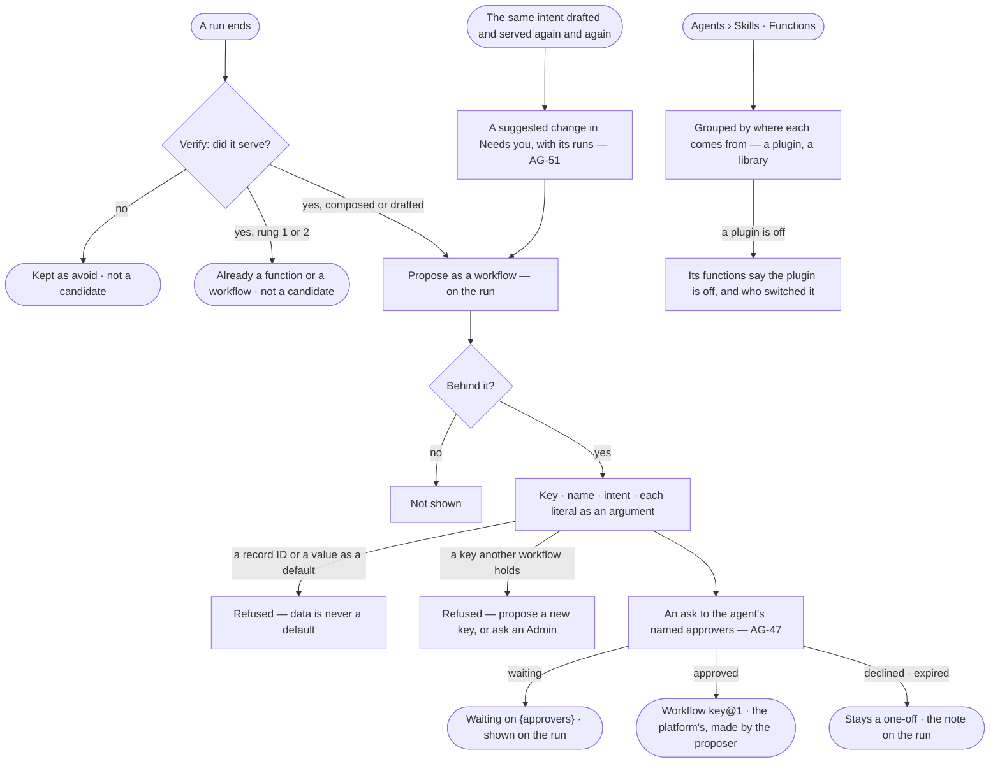

# AG-31 · Propose a plan that served as a workflow, and see where each comes from

**As** the person behind a run **I want** to propose a plan that served — drafted or composed for my work — as a
workflow, its values from the data turned into arguments, and to see where every workflow and function comes from
**so that** the next identical question is answered the same way for a fraction of the tokens, and I can tell what
agents can do and who made it. *Verify judges a run served → the person behind it proposes its plan → the agent's
named approvers decide (AG-47).*

Tasks: [task.md](task.md) · Feature: [AG-F06](../../feature.md)

## Who can

Proposing and reading are every signed-in person's, on a run they are behind ([the role table](../../../../../../os/access/features/AC-F02-access-policies/feature.md#the-role-table)).

| Lens | Can | Otherwise sees |
|---|---|---|
| Admin | Propose the plan of a run they are behind that served; read where every workflow and function comes from | On a run they are not behind: *Propose as a workflow* is not shown |
| Operator | Propose the plan of a run they are behind; read where every workflow and function comes from; a Modeller the same | On a run they are not behind: *Propose as a workflow* is not shown |

## Flow

## Acceptance criteria

| # | Given | When | Then |
|---|---|---|---|
| AG-31.1 | A run whose plan was drafted or composed for it, and Verify judged it served | the person behind it reads the run | it shows *Propose as a workflow*; a run that did not serve, or that took rung 1 or 2, does not |
| AG-31.2 | *Propose as a workflow* | it is opened | a modal asks for a key, a name and the intent future runs are matched on, and lists every literal value the plan ran with as an argument to name and label |
| AG-31.3 | A literal that is a record ID or a property value | the proposer names it | it becomes a required argument; *Use as default* is not offered for it |
| AG-31.4 | A literal that is a count, a window or a flag | the proposer names it | they may keep the run's value as its default |
| AG-31.5 | A complete proposal | it is sent | an ask goes to the agent's named approvers (AG-47); the run reads *Waiting on {approvers}*, with when it reminds and when it expires |
| AG-31.6 | A proposal the approvers approve | the decision lands | the run links the new workflow `key@1`; it is the platform's, made by the proposer; the next run with that intent may choose it on rung 2 |
| AG-31.7 | A proposal declined or expired | the decision lands | the plan stays a one-off; the run shows who declined it and their note, or that it expired |
| AG-31.8 | A plan with the same intent drafted and served again and again | the threshold is crossed | a suggested change in *Needs you* proposes making it a workflow, with the runs that drafted it (AG-51); nothing is proposed until a person does |
| AG-31.9 | Any workflow | it is read | it says where it comes from — *built-in* (with its plugin) · *approved* (linking the run it came from and who approved it) · *copied from* `key@n` |
| AG-31.10 | Functions | anyone opens it | functions group by where they come from — each plugin with its version and whether it is on, each library (AG-40) — and a function from a plugin switched off says so, naming who switched it off |
| AG-31.11 | A run that did not serve, a plan already a workflow, or a run the proposer is not behind | a proposal for it reaches the engine | it is refused: *Only a plan drafted or composed for a run that served can be proposed — by the person behind it.* |
| AG-31.12 | A key another workflow holds | the proposer names it | it is refused: *{key} is taken — propose a new key, or ask an Admin.*; proposing its next version is for a Modeller or an Admin (AG-48) |
| AG-31.13 | A proposal already waiting on the same run | *Propose as a workflow* is pressed again | it reads *This plan is already waiting on {approvers}* and sends nothing |
| AG-31.14 | A proposal that keeps a record ID or property value as a default | it reaches the engine | it is refused: *{argument} holds a value from the data — it cannot be a default.* |
| AG-31.15 | A plugin to switch on or off | a person reads it here | it links to Control Plane › Plugins, where an Admin switches it (CP-F02); nothing here switches it |
| AG-31.16 | Skills | anyone opens *Answer templates* | the templates that shape answers read beside workflows and functions (EX-03 authors them) |
| AG-31.17 | An approved workflow | a person opens *How it got here* on the run it came from | its steps show who proposed it, the arguments its literals became, who approved it and the version it published |

## Screens

| Surface | Lens | First use | Empty after a filter | Loading | Has data | Failed | Agent working or proposing | No access |
|---|---|---|---|---|---|---|---|---|
| Propose as a workflow, on a run | Admin | — | — | agents.run · Loading | agents.run · Propose as a workflow | agents.run · Propose refused | agents.run · Waiting on approvers | — |
| Propose as a workflow, on a run | Operator | — | — | agents.run · Loading | agents.run · Propose as a workflow | agents.run · Propose refused | agents.run · Waiting on approvers | agents.run · Content withheld |
| Where it comes from — workflows and functions | Admin | agents.skills · Workflows, built-in only | agents.skills · No workflows match | agents.skills · Loading | agents.skills · Functions | agents.skills · Could not load | — | — |
| Where it comes from — workflows and functions | Operator | agents.skills · Workflows, built-in only | agents.skills · No workflows match | agents.skills · Loading | agents.skills · Functions | agents.skills · Could not load | — | — |
| Answer templates | Admin | agents.skills · Shipped templates | agents.skills · No template matches | agents.skills · Loading | agents.skills · Answer templates | agents.skills · Could not load | — | — |
| Answer templates | Operator | agents.skills · Shipped templates | agents.skills · No template matches | agents.skills · Loading | agents.skills · Answer templates | agents.skills · Could not load | — | agents.skills · Read only |
| Suggested: make this a workflow | Admin | inbox · Nothing suggested | — | inbox · Loading | inbox · Suggested change | — | inbox · Suggested change | — |
| Suggested: make this a workflow | Operator | inbox · Nothing suggested | — | inbox · Loading | inbox · Suggested change | — | inbox · Suggested change | inbox · Not yours to answer |
