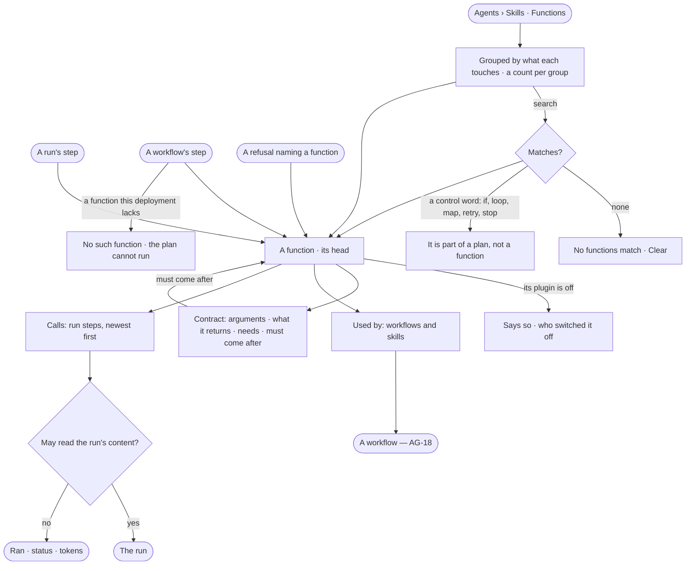

# AG-38 · Read every function and what calls it

**As** an Admin **I want** to read every function the plugins switched on and the approved libraries provide — the
first rung of every plan: what it touches, what it needs, what it takes and returns, what must come before it, and
which workflows and skills call it **so that** skills are built from what exists without editing code, and anyone
reading a refused or failed step can tell what it needed without reading the engine.

Tasks: [task.md](task.md) · Feature: [AG-F06](../../feature.md)

## Who can

| Lens | Can | Otherwise sees |
|---|---|---|
| Admin | Read every function, its contract, its needs, its calls and what calls it | — |
| Operator | Read every function, its contract, its needs and what calls it — a contract, not a permission; read the calls of runs whose content they may read; a Modeller the same | A call from another person's run reads that it ran, its status and its tokens. Nothing on it adds, edits, switches or runs a function, for anyone |

## Flow

## Acceptance criteria

| # | Given | When | Then |
|---|---|---|---|
| AG-38.1 | Agents › Skills | anyone opens *Functions* | every function lists grouped by what it touches, each group naming it and its count; a row reads its dotted name, one-line summary, and how many workflows and skills call it, or *not used yet* |
| AG-38.2 | Functions | a person searches by name, summary or what it touches | the list narrows; nothing matching reads *No functions match*, with *Clear* |
| AG-38.3 | A search for *if*, *loop*, *map*, *retry* or *stop* | it runs | it says that is part of a plan, not a function, and where workflows are read |
| AG-38.4 | A function | a person opens it | its page's head names it, what it touches, its side effect and its plugin and version, with *Contract* · *Used by* · *Calls* |
| AG-38.5 | A function's Contract | it is read | its arguments, what it returns, what it needs — the plugin or tool to run and any `data/…` it reads or writes — and *Must come after* as a sentence linking the function a plan must run first |
| AG-38.6 | A function | its numbers are read | calls, slow-run time and failed over the last 30 days of the deployment's runs, each against the 30 days before, as the engine stores them |
| AG-38.7 | A function | Used by is read | the workflows that call it and the skills that need it, each opening its page; none reads *not used yet* |
| AG-38.8 | A function | Calls is read | the run steps that called it, newest first, each with how it ended, its time and tokens; a step of a run whose content the reader may read opens its run, any other reads *Content withheld* |
| AG-38.9 | A function | it is read | it names the agents whose Access Policies allow Run on its plugin or tool; none reads *No agent may run it yet* |
| AG-38.10 | A run's step, a workflow's step or a refusal | a person picks the function it names | its contract shows beside it, linking to the function's page |
| AG-38.11 | A plan step naming a function this deployment does not have | the plan is read | the step reads *No such function*; the plan cannot run and its row says why |
| AG-38.12 | An Operator, a Modeller or an Admin | they open a function | everything reads the same; there is no *Add*, *Edit*, *Switch off* or *Try it* |
| AG-38.13 | A call by a run whose content the reader may read | they open it from *Calls* | the run's *How it got here* shows that step, its arguments and what it returned |
| AG-38.14 | A function whose plugin is switched off | it is read | its head says the plugin is off, naming who switched it off, and that plans needing it are refused (CP-F02) |

## Screens

| Surface | Lens | First use | Empty after a filter | Loading | Has data | Failed | Agent working or proposing | No access |
|---|---|---|---|---|---|---|---|---|
| Functions | Admin | agents.skills · Functions, not used yet | agents.skills · No functions match | agents.skills · Loading | agents.skills · Functions | agents.skills · Could not load | — | — |
| Functions | Operator | agents.skills · Functions, not used yet | agents.skills · No functions match | agents.skills · Loading | agents.skills · Functions | agents.skills · Could not load | — | — |
| A function | Admin | agents.skills · A function, not used yet | — | agents.skills · Loading | agents.skills · A function | agents.skills · No such function | — | — |
| A function | Operator | agents.skills · A function, not used yet | — | agents.skills · Loading | agents.skills · A function | agents.skills · No such function | — | — |
| A function's calls | Admin | agents.skills · A function's calls, none | — | agents.skills · Loading | agents.skills · A function's calls | agents.skills · Could not load | agents.skills · A function's calls | — |
| A function's calls | Operator | agents.skills · A function's calls, none | — | agents.skills · Loading | agents.skills · A function's calls | agents.skills · Could not load | agents.skills · A function's calls | agents.skills · A function's calls, content withheld |
| A step's contract, on a run | Admin | — | — | agents.run · Loading | agents.run · Step | agents.run · Plan refused | agents.run · Running | — |
| A step's contract, on a run | Operator | — | — | agents.run · Loading | agents.run · Step | agents.run · Plan refused | agents.run · Running | agents.run · Content withheld |
