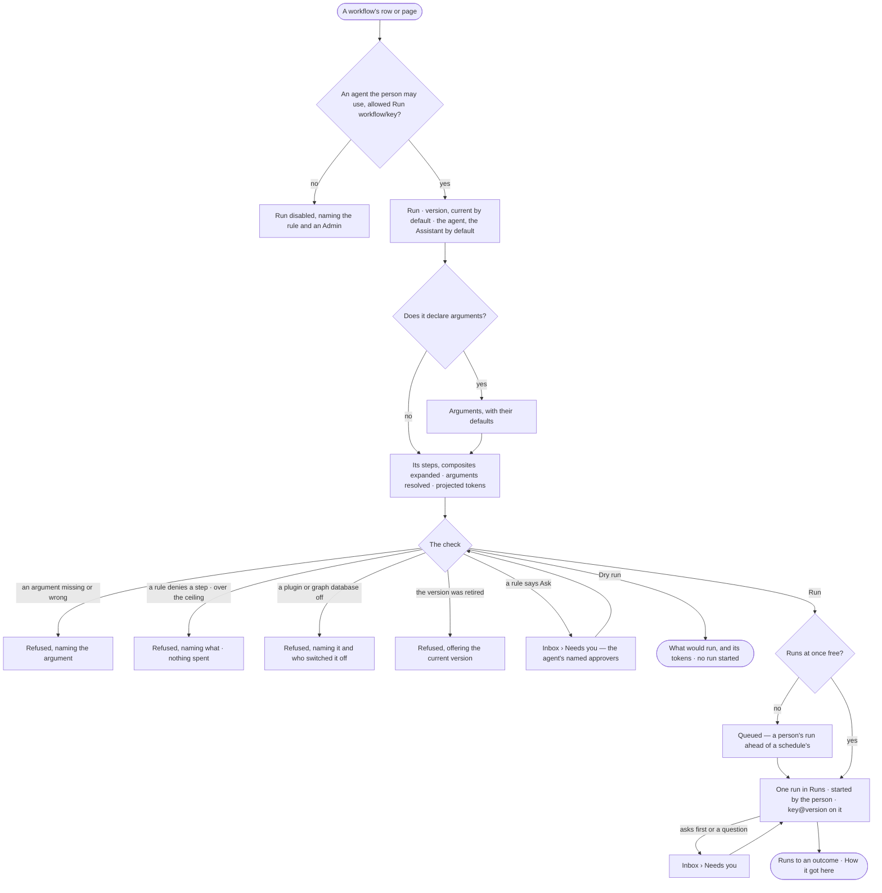

# AG-44 · Run a workflow on demand with today's arguments

**As** an analyst **I want** to run a workflow I trust by name, with today's arguments, through an agent I may use,
seeing its steps and projected tokens before it starts **so that** I do not have to phrase a question and hope the
right workflow is chosen. *The person starts the workflow → the agent runs it inside its Access Policies.*

Tasks: [task.md](task.md) · Feature: [AG-F06](../../feature.md)

## Who can

Starting a workflow is every role's, through the agents granted to the person ([the role table](../../../../../../os/access/features/AC-F02-access-policies/feature.md#the-role-table)).

| Lens | Can | Otherwise sees |
|---|---|---|
| Admin | Run or dry run a published workflow version with arguments, through an agent granted to them whose policies allow Run `workflow/<key>`; stop the run as any run | — |
| Operator | The same; a Modeller the same | No agent granted to them is allowed: *Run* disabled — *No agent you may use may run {key} — ask an Admin* |

## Flow

## Acceptance criteria

| # | Given | When | Then |
|---|---|---|---|
| AG-44.1 | A published workflow version and an agent the person may use whose policies allow Run on it | the person presses *Run* on its row or its page | it opens with the version (the current one by default), its declared arguments with their defaults, the agent — the Assistant by default, any other allowed agent they may use to pick — and *Dry run* beside *Run* |
| AG-44.2 | The Run form | its arguments are filled | it shows the steps that will run, each composite expanded, the arguments resolved and the projected tokens, before anything starts |
| AG-44.3 | An argument missing or of the wrong type | the person presses *Run* | it is refused naming the argument; nothing runs |
| AG-44.4 | A step the agent's policies deny, a graph database it writes that is read-only, or projected tokens over the ceiling | the person presses *Run* | it is refused naming the rule, resource or ceiling, as a plan on the ladder would be; nothing is spent and starting it by hand widens nothing |
| AG-44.6 | A version retired since the form opened | the person presses *Run* | it is refused naming the version, offering the current one |
| AG-44.7 | A valid start | the person presses *Dry run* | it shows what would run, the resolved arguments and the projected tokens, refuses exactly as a run would, and starts no run |
| AG-44.8 | A valid start | the person presses *Run* | one run opens in Runs, the person behind it, naming `key@version`; Runs filters to every run of this workflow |
| AG-44.9 | *Run* pressed twice | the second press arrives | it opens the first run; there is one |
| AG-44.10 | Runs at once at the person's, team's or agent's limit (CP-F04) | the person presses *Run* | the run waits *queued*, a person's run ahead of a schedule's |
| AG-44.11 | A run that asks first or has a question | it reaches that step | it waits in *Needs you* for the agent's named approvers, naming what it will do, or asks the person with its options |
| AG-44.12 | A running workflow | the person stops it | it stops as any run does (CP-58); this adds no control of its own |
| AG-44.13 | A built-in workflow | it is run by name, from the command line, or composed by a plan | each opens the same kind of run through the same check |
| AG-44.14 | No agent the person may use is allowed Run on the workflow | they open it | *Run* is disabled: *No agent you may use may run {key} — ask an Admin*; a start through an agent they may not use is refused: *You may not use {agent} — ask an Admin.* |
| AG-44.15 | A run started by name | a person who may read its content opens *How it got here* | its steps show `key@version`, the resolved arguments, who started it and the check's result |
| AG-44.16 | A workflow needing a plugin or graph database that is switched off, at the install or by the person | the person presses *Run* | it is refused before it starts: *{name} is off — switched off by {person}*; nothing runs |

## Screens

| Surface | Lens | First use | Empty after a filter | Loading | Has data | Failed | Agent working or proposing | No access |
|---|---|---|---|---|---|---|---|---|
| Run a workflow | Admin | agents.workflow · Run, no arguments | — | agents.workflow · Run, checking | agents.workflow · Run | agents.workflow · Run, refused | agents.workflow · Run, dry run | — |
| Run a workflow | Operator | agents.workflow · Run, no arguments | — | agents.workflow · Run, checking | agents.workflow · Run | agents.workflow · Run, refused | agents.workflow · Run, dry run | agents.workflow · Run disabled |
| The run it starts | Admin | — | — | agents.run · Loading | agents.run · Started by name | agents.run · Plan refused | agents.run · Running | — |
| The run it starts | Operator | — | — | agents.run · Loading | agents.run · Started by name | agents.run · Plan refused | agents.run · Running | agents.run · Content withheld |
| Runs of a workflow | Admin | agents.runs · Nothing ran | agents.runs · No runs match | agents.runs · Loading | agents.runs · Filtered | agents.runs · Could not load | agents.runs · Running | — |
| Runs of a workflow | Operator | agents.runs · Nothing ran | agents.runs · No runs match | agents.runs · Loading | agents.runs · Filtered | agents.runs · Could not load | agents.runs · Running | agents.runs · Content withheld |
| A run's ask | Admin | — | — | inbox · Loading | inbox · Asks first | — | inbox · Asks first | — |
| A run's ask | Operator | — | — | inbox · Loading | inbox · Asks first | — | inbox · Asks first | inbox · Not yours to answer |
