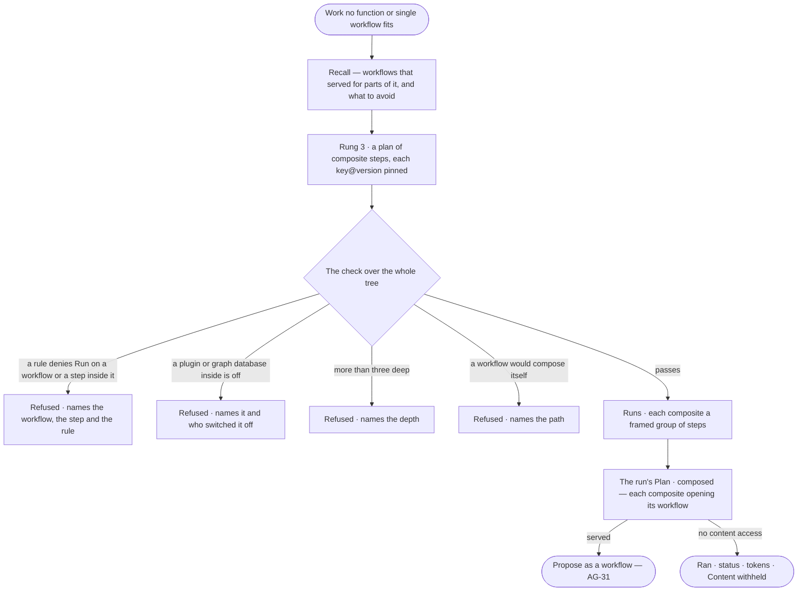

# AG-46 · Compose a plan from workflows

**As** an analyst **I want** an agent that meets work no single workflow fits to compose a plan from workflows that
already served — each pinned to its version, the whole tree checked before anything runs — and to read that plan on
the run **so that** proven pieces are reused instead of a new plan drafted from nothing, and I can see exactly which
versions ran. *The agent composes → the engine checks the tree → the person reads it and may propose it (AG-31).*

Tasks: [task.md](task.md) · Feature: [AG-F06](../../feature.md)

## Who can

Reading is every signed-in person's ([the role table](../../../../../../os/access/features/AC-F02-access-policies/feature.md#the-role-table)).

| Lens | Can | Otherwise sees |
|---|---|---|
| Admin | Read the composed plan of a run they are behind or, for a project's run, whose sources their default agent may see — its composites and their pins, and the check over the tree | Another person's run: that it ran, its status and its tokens — the plan reads *Content withheld* |
| Operator | Read the composed plan of a run they are behind or, for a project's run, whose sources their default agent may see; a Modeller the same | Another person's run: that it ran, its status and its tokens — the plan reads *Content withheld* |

## Flow

## Acceptance criteria

| # | Given | When | Then |
|---|---|---|---|
| AG-46.1 | Work no function and no single workflow fits, and published workflows that cover its parts | the agent plans | it composes a plan on rung 3, each part a composite step naming a workflow at its current published version; the run's Plan step reads *Plan · composed*, listing each `key@version` and why no lower rung fit |
| AG-46.2 | A composed plan | its Flow is read on the run | each composite draws as one node `key@version`, opening its workflow; *Expand* draws its steps in place, framed, with what each ran |
| AG-46.3 | A composite whose workflow publishes a newer version while the run is in flight | the run continues | it runs the pinned version; the newer one changes nothing |
| AG-46.4 | A composite's arguments | the plan is read | each shows the values the plan gave it, bound from the ask or from an earlier step's output |
| AG-46.5 | A composite whose workflow, or a step inside it, the agent's policies deny | the check runs | the plan is refused before any step: *{agent} may not {verb} {resource} — {rule}*, naming the composite and the step inside it; nothing is spent |
| AG-46.6 | A workflow inside the tree that needs a plugin or graph database switched off | the check runs | the plan is refused: *{name} is off — switched off by {person}*; that workflow is skipped on the next run's rung 3 while it is flagged |
| AG-46.7 | Composites nested more than three levels deep | the check runs | the plan is refused: *{key} composes {n} deep — the limit is 3* |
| AG-46.8 | A workflow that would contain itself at any depth | the check runs | the plan is refused: *{key} would compose itself through {path}* |
| AG-46.9 | A composed plan that passes | it runs | the dry-run projection and the run's tokens count every step of the tree; How it got here shows each composite's steps under it |
| AG-46.10 | A composed run the reader may not read the content of | they open it | it reads that it ran, its status and its tokens; the plan reads *Content withheld* |
| AG-46.11 | A composed plan that served | the person behind the run reads it | *Propose as a workflow* is offered (AG-31); approving it keeps every pin as composed |

## Screens

| Surface | Lens | First use | Empty after a filter | Loading | Has data | Failed | Agent working or proposing | No access |
|---|---|---|---|---|---|---|---|---|
| A run's Plan step — composed | Admin | — | — | agents.run · Loading | agents.run · Plan composed | agents.run · Plan refused | agents.run · Composing | — |
| A run's Plan step — composed | Operator | — | — | agents.run · Loading | agents.run · Plan composed | agents.run · Plan refused | agents.run · Composing | agents.run · Content withheld |
| A run's Flow — composites | Admin | — | — | agents.run · Loading | agents.run · Flow, composites expanded | agents.run · Could not load | agents.run · Running | — |
| A run's Flow — composites | Operator | — | — | agents.run · Loading | agents.run · Flow, composites expanded | agents.run · Could not load | agents.run · Running | agents.run · Content withheld |
| A workflow — Composed by | Admin | agents.workflow · Composed by, none | — | agents.workflow · Loading | agents.workflow · Composed by | agents.workflow · Could not load | — | — |
| A workflow — Composed by | Operator | agents.workflow · Composed by, none | — | agents.workflow · Loading | agents.workflow · Composed by | agents.workflow · Could not load | — | — |
