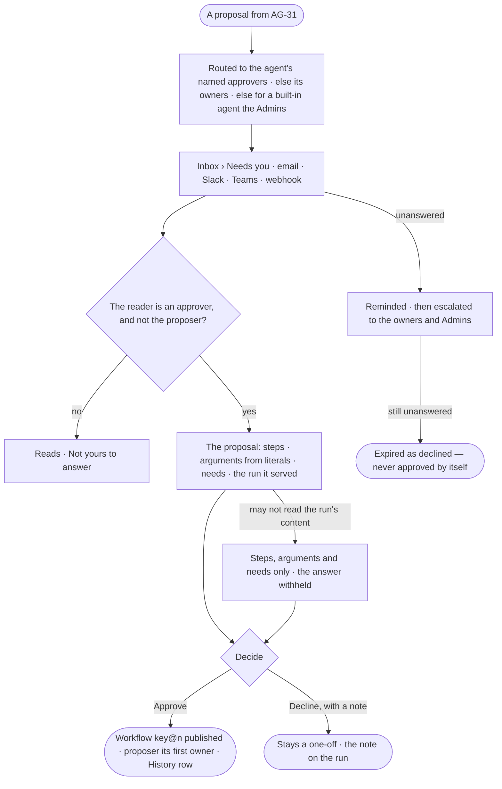

# AG-47 · Approve a plan into a workflow

**As** a named approver of an agent **I want** to read a plan someone proposes for reuse — its steps, the arguments
its values from the data became, what it needs and the run it served — and approve or decline it **so that** only
plans I have read become workflows that every allowed agent may reuse. *The person behind a run proposes → a named
approver decides → the workflow publishes, the proposer its first owner.*

Tasks: [task.md](task.md) · Feature: [AG-F06](../../feature.md)

## Who can

| Lens | Can | Otherwise sees |
|---|---|---|
| Admin | Approve or decline a proposal when named, when the agent has no named approvers and no owners to route to, when it is a built-in agent's, or when it is escalated to them | A proposal they made themselves: *Not yours to answer — it waits on {approvers}* |
| Operator | Approve or decline a proposal for an agent they are a named approver of — or an owner of, when it names none — never one they proposed; a Modeller the same | *Approve* and *Decline* absent: *Not yours to answer — it waits on {approvers}* |

## Flow

## Acceptance criteria

| # | Given | When | Then |
|---|---|---|---|
| AG-47.1 | A proposal (AG-31) | it is sent | an ask reaches the named approvers of the agent that ran the plan — people or a team — else its owners, else for a built-in agent the Admins; in the Inbox and on each channel they set (AC-F05) |
| AG-47.2 | The ask | an approver opens it | it shows the plan's steps with composites and their pins, each literal turned argument with its name, label and default, the plan's declared needs, the run it served with Verify's judgement, who proposed it and the key and version it would publish as |
| AG-47.3 | An approver who may not read the run's content | they open the ask | the steps, arguments and needs read; what was asked and its answer read *Content withheld* |
| AG-47.4 | The ask | an approver presses *Approve* | the version publishes as `key@n` — v1 of a new workflow, the proposer its first owner, or the next version of the proposer's workflow; History holds a row naming both; the run links it |
| AG-47.5 | The ask | an approver presses *Decline* | they must write a note; the plan stays a one-off; the proposer is told in the Inbox, with the note |
| AG-47.6 | The proposer, or anyone who is not an approver of it | they open the ask | *Approve* and *Decline* are absent: *Not yours to answer — it waits on {approvers}*; the route answers 403 with the same sentence |
| AG-47.7 | An ask nobody answers | its deadline passes | it reminds, then escalates to the agent's owners and the Admins, then expires as declined; a plan is never approved by itself |
| AG-47.8 | An approved workflow | it is read | its head names who approved it, when, and the run it came from |
| AG-47.9 | An approval from email, Slack, Teams or a webhook | it lands | it is recorded the same way, its channel on the History row |
| AG-47.10 | A key that another workflow took while the ask waited | an approver presses *Approve* | it is refused: *{key} is {owner}'s — propose a new key, or ask them.*; the proposer is told |

## Screens

| Surface | Lens | First use | Empty after a filter | Loading | Has data | Failed | Agent working or proposing | No access |
|---|---|---|---|---|---|---|---|---|
| The proposal ask | Admin | inbox · Nothing waiting | — | inbox · Loading | inbox · Make this a workflow | inbox · Key taken | inbox · Make this a workflow | inbox · Not yours to answer |
| The proposal ask | Operator | inbox · Nothing waiting | — | inbox · Loading | inbox · Make this a workflow | inbox · Key taken | inbox · Make this a workflow | inbox · Not yours to answer |
| The proposal ask — content withheld | Admin | — | — | — | — | — | — | — |
| The proposal ask — content withheld | Operator | — | — | inbox · Loading | inbox · Make this a workflow, content withheld | — | — | — |
| Declined or expired | Admin | — | — | — | inbox · Proposal declined | inbox · Proposal expired | — | — |
| Declined or expired | Operator | — | — | — | inbox · Proposal declined | inbox · Proposal expired | — | — |
| An approved workflow | Admin | — | — | agents.workflow · Loading | agents.workflow · Approved by | agents.workflow · Could not load | — | — |
| An approved workflow | Operator | — | — | agents.workflow · Loading | agents.workflow · Approved by | agents.workflow · Could not load | — | — |
