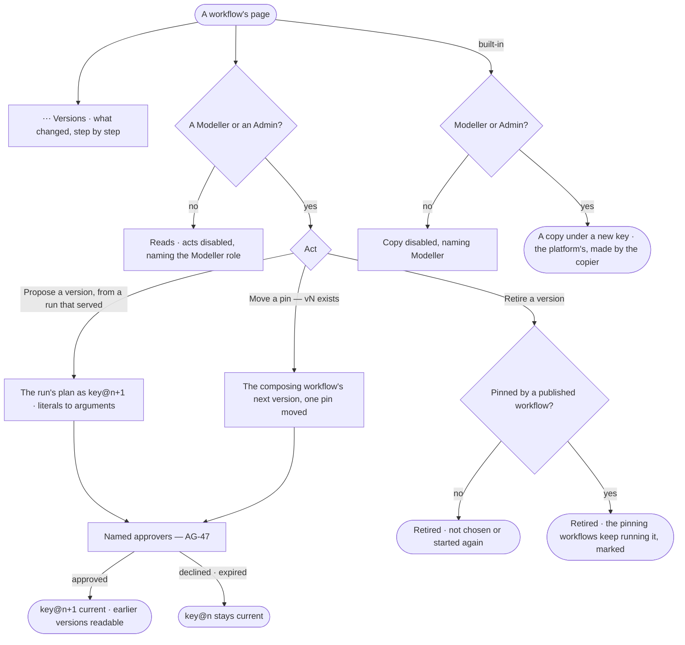

# AG-48 · Version a workflow, retire one and move a pin

**As** a modeller **I want** to publish its next version from a later run that served, read what changed
between versions, retire a version that stopped serving, move the pin of a workflow it composes, and copy a built-in
to change it **so that** a workflow improves without any approved workflow changing behind its approvers' backs.
*A Modeller proposes → the named approvers approve → the next version publishes; pins move only when proposed.*

Tasks: [task.md](task.md) · Feature: [AG-F06](../../feature.md)

## Who can

Versioning, retiring, moving a pin and copying are the Modeller's and the Admin's ([the role table](../../../../../../os/access/features/AC-F02-access-policies/feature.md#the-role-table)); a workflow is the platform's, so making one grants nothing over it.

| Lens | Can | Otherwise sees |
|---|---|---|
| Admin | On any workflow: propose its next version, retire a version, move a pin, copy it | A built-in: *Retire* and *Propose a version* absent — *Copy* to change it |
| Operator | Read every version. A Modeller does what an Admin does | *Copy*, *Retire*, *Propose a version* and *Move the pin* disabled — *Needs the Modeller role — ask an Admin* |

## Flow

## Acceptance criteria

| # | Given | When | Then |
|---|---|---|---|
| AG-48.1 | A workflow with versions | *⋯ Versions* is opened | each version lists with its status, who proposed and approved it, and what changed against the one before — steps added, removed, moved or changed, each changed field before and after, pins moved, declared arguments; v1 reads *the first version* |
| AG-48.2 | A later run of an agent that ran the workflow's intent and served with a drafted or composed plan | a Modeller or an Admin presses *Propose as a version of {key}* on it | it proposes the next version, literals turned arguments as in AG-31, and waits on the named approvers (AG-47) |
| AG-48.3 | A next version approved | it publishes | it becomes current; rung 2 chooses it from the next run; runs in flight finish on the version they started; earlier versions stay readable |
| AG-48.4 | A Modeller or an Admin | they retire a version not pinned by any published workflow | it is not chosen on the ladder and not started by name again; runs in flight finish; every past run still opens; retiring every version takes the workflow out of the list |
| AG-48.5 | A version that published workflows pin | it is retired | each pinning workflow keeps running it and reads *pins a retired version — {key}@{v}*, with *Move the pin* for a Modeller or an Admin |
| AG-48.6 | A composing workflow whose pinned workflow has published a newer version | its page is read | the composite reads *vN exists*; nothing moves by itself |
| AG-48.7 | *Move the pin* | a Modeller or an Admin chooses the newer version | it proposes the composing workflow's next version with that one pin moved, showing what changed in the pinned workflow, and waits on the named approvers |
| AG-48.8 | A built-in workflow | a Modeller or an Admin presses *Copy* | a workflow under a new key, v1 with the built-in's steps, the platform's and made by the copier, *copied from* `key@n`; no approval, and no agent may run it until a policy allows Run on its key |
| AG-48.9 | A person without the Modeller role | they reach *Retire*, *Propose a version* or *Move the pin* | each is disabled: *Needs the Modeller role — ask an Admin*; the route answers 403 with the same sentence |
| AG-48.10 | An Operator | they reach *Copy* | it is disabled: *Needs the Modeller role — ask an Admin* |
| AG-48.11 | A built-in workflow | anyone proposes a version of it, retires it or moves a pin in it | it is refused: *{key} is built in — copy it to change it.* |
| AG-48.12 | A workflow | anyone reads who owns it | it reads *Platform*, with who made it; no person owns it alone, and making it grants nothing over it (AC-F07) |
| AG-48.13 | Any of these acts | it lands | History holds a row naming who, what and the versions |

## Screens

| Surface | Lens | First use | Empty after a filter | Loading | Has data | Failed | Agent working or proposing | No access |
|---|---|---|---|---|---|---|---|---|
| A workflow — Versions | Admin | agents.workflow · Versions, the first | — | agents.workflow · Loading | agents.workflow · Versions | agents.workflow · Could not load | agents.workflow · Version waiting on approvers | — |
| A workflow — Versions | Operator | agents.workflow · Versions, the first | — | agents.workflow · Loading | agents.workflow · Versions | agents.workflow · Could not load | agents.workflow · Version waiting on approvers | agents.workflow · Acts disabled |
| Retire a version | Admin | — | — | — | agents.workflow · Retire a version | agents.workflow · Built in | — | — |
| Retire a version | Operator | — | — | — | agents.workflow · Retire a version | agents.workflow · Built in | — | agents.workflow · Acts disabled |
| Move the pin | Admin | — | — | — | agents.workflow · vN exists | agents.workflow · Pins a retired version | agents.workflow · Version waiting on approvers | — |
| Move the pin | Operator | — | — | — | agents.workflow · vN exists | agents.workflow · Pins a retired version | agents.workflow · Version waiting on approvers | agents.workflow · Acts disabled |
| Copy a workflow | Admin | — | — | — | agents.workflow · Copy | agents.workflow · Could not load | — | — |
| Copy a workflow | Operator | — | — | — | — | — | — | agents.workflow · Copy disabled |
| Propose as a version, on a run | Admin | — | — | agents.run · Loading | agents.run · Propose as a version | agents.run · Propose refused | agents.run · Waiting on approvers | — |
| Propose as a version, on a run | Operator | — | — | agents.run · Loading | agents.run · Propose as a version | agents.run · Propose refused | agents.run · Waiting on approvers | agents.run · Content withheld |
