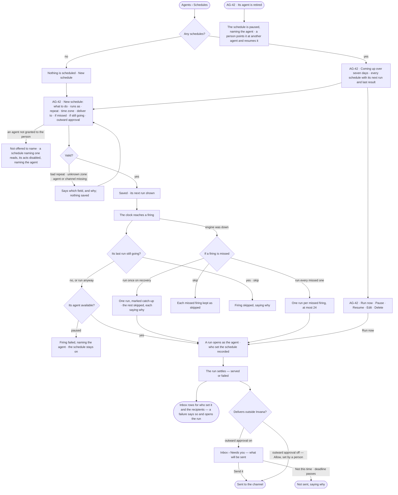
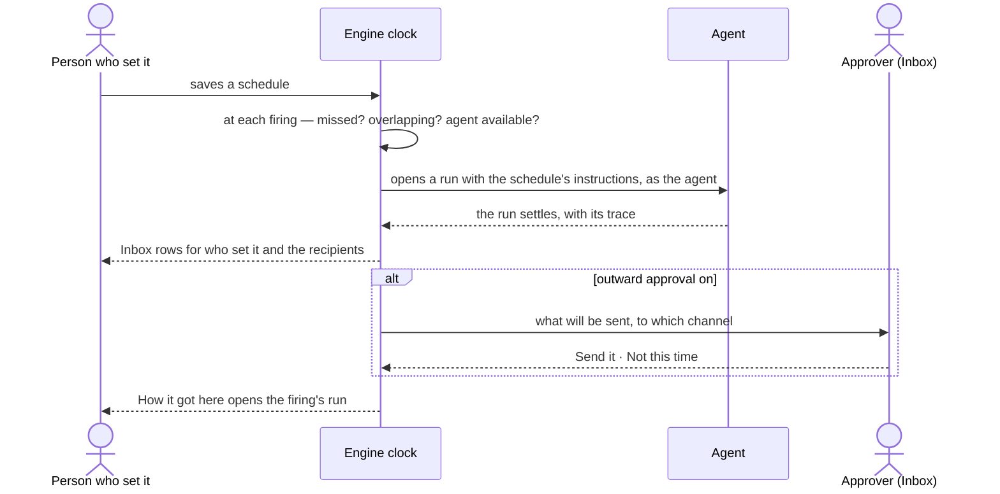

# Schedules

> Routine work — a morning digest, a weekly route report — runs itself on a clock and lands where people read it,
> with no project needed. Every firing is kept, whether it ran or not. The decisions it helps make: *what should run
> without me, when, and who should read it?* — and, when a firing goes outside Invana, *may this be sent?*

## User journey

Journeys this feature is a step of: [J04 · Build an agent and improve it from what runs teach](../../../../journeys/J04-build-an-agent-and-improve-it-from-what-runs-teach.md)

## Stories

| ID | Story | Status |
|---|---|---|
| AG-42 | [Put routine work on a schedule](stories/AG-42-put-routine-work-on-a-schedule/story.md) | idea |

## Access

Schedules are *Acts* for every role in [the role table](../../../../os/access/features/AC-F02-access-policies/feature.md#the-role-table); a schedule is the organisation's, and a person acts on it only through its agent, granted to them ([AC-F03](../../../../os/access/features/AC-F03-directory/feature.md)).

| Act | Role ([the role table](../../../../os/access/features/AC-F02-access-policies/feature.md#the-role-table)) | Everyone else sees |
|---|---|---|
| Read every schedule and its firings | Every signed-in person — Operator, Modeller, Admin | — |
| Read a firing's run | As any run ([AC-F09](../../../../os/access/features/AC-F09-what-left-the-platform/feature.md#rules)) | That it ran, its agent, its status and its tokens |
| Create, edit, pause, resume, run now or delete a schedule | Operator · Modeller · Admin, when the schedule's agent is granted to them | Only granted agents are offered to name; a schedule whose agent is not granted to the reader reads, every act disabled — *Uses {agent}, which is not granted to you* |
| Approve or decline an outward delivery | The agent's named approvers, then the Admins ([AC-F05](../../../../os/access/features/AC-F05-asks-and-approvals/feature.md)) | The ask reads, naming who it waits on |
| Read a delivered result | Who set the schedule and the named recipients, in their Inbox | — |

## States

| State | What the person sees |
|---|---|
| First use | *Nothing is scheduled* — what a schedule does, and *New schedule* |
| Empty after a filter | — |
| Loading | The Schedules tab drawn at once; the rows load in place |
| Has data | *Coming up* over the next seven days; every schedule: what it does, who runs it, when as words, its next run, its last result, on or paused |
| Failed | The list could not load, saying why, with *Try again*; a schedule refused at save names its field; a failed firing names why, and a schedule whose last run failed is marked, with *Open the last run* |
| Agent working or proposing | A firing's run is running — its row reads *running*, and *Open run* follows it; an outward delivery waits in the Inbox |
| No access | Schedules read; a schedule whose agent is not granted to the reader has each act disabled, naming the agent; with no agent granted, *New schedule* is disabled, naming why |

## Rules

| Rule | Detail |
|---|---|
| One kind of schedule | A schedule needs no project. It names an agent and plain instructions; whatever the run produces is delivered. Whether the run creates work is the run's business |
| A firing is a run | A firing opens the same run a task opens, through the named agent, as the agent, and waits behind people's runs by the runs-at-once limits ([CP-F04](../../../../os/control/features/CP-F04-limits/feature.md)) |
| Every firing is kept | Queued · opened · skipped · failed, each with its reason, its run, and whether it was a catch-up or *Run now* |
| Repeat in a time zone | Daily · weekdays · weekly on a day · monthly on a date · a custom cron, at a time, read in the schedule's zone — *08:00 Europe/Berlin* stays 08:00 across a clock change |
| Missed firings | A firing reached more than five minutes late is missed. *Run once on recovery* (the default) runs the latest, marked catch-up, and keeps the rest as skipped · *Run every missed one* runs each, at most 24 · *Skip* runs none |
| If the last run is still going | *Skip* (the default) skips the firing, saying so · *Run anyway* opens it |
| Delivery follows the settled run | Inbox rows to who set it and the recipients, and one delivery per channel. A failed run is delivered as a failure that opens the run, never dropped |
| Outward deliveries ask | A delivery to a channel is Ask: it waits in the Inbox for the agent's named approvers, then the Admins ([AC-F05](../../../../os/access/features/AC-F05-asks-and-approvals/feature.md)), until its deadline (a day by default) — then it is not sent. A person may set it to Allow ([the three modes](../../../../os/access/product.md#decisions)) after seeing what goes where; the schedule records who set it. An edit, or the setter losing the right to set Allow, returns it to Ask (AG-42.19) |
| Pause and resume | Pausing keeps every firing; a run going when paused finishes and is delivered. Resuming fires from now — what fell while paused is not missed, because nobody wanted it |
| Runs as the agent | A firing's run acts as the schedule's agent, its Access Policies alone deciding each step ([the order of checks](../../../../os/access/features/AC-F02-access-policies/feature.md#the-order-of-checks)); no person bounds it. Who set the schedule and who last edited it are recorded, and neither narrows nor widens the run |
| A setter who leaves | The schedule keeps running as its agent; who set it stays recorded ([AC-F07](../../../../os/access/features/AC-F07-ownership/feature.md#slots-and-fallbacks)) |
| A paused agent | Its schedule's firings fail, naming the agent; the schedule stays on |
| A retired agent | Retiring it pauses each schedule that starts it, naming the agent; the schedule fires again only once a person points it at another agent and resumes it (AG-F01) |
| A channel in use | Removing a channel a schedule delivers to is refused, naming the schedule |
| Leans on | Build an agent (AG-F01) · runs (CP-F10) · the Inbox (CP-F08) · channels in Settings › Notifications |

## Data touched

| Record | Read or write |
|---|---|
| Schedules — name, agent, instructions, repeat, zone, on or paused, missed and overlap choices, delivery, outward approval and who set it, who set the schedule and who last edited it, next run | Write · read |
| Firings — when due, outcome, reason, catch-up or run now, the run, when delivered | Write · read |
| The run each firing opens (CP-F10) | Write · read |
| Inbox rows and outward-delivery asks (AC-F05) | Write · read |
| History rows of every create, edit, pause, resume, delete, firing and skip (AC-F06) | Write · read |

## Engine

The low-level design: what this feature stores, serves and refuses. Conventions — naming, errors, lists, events — are
[system-design.md](../../../../system-design.md) §§ 6–8; this section only fills them in.

### Records

| Table | Columns | Notes |
|---|---|---|
| `agents_schedules` | `graph_id` · `name` · `agent_id` · `instructions` · `trigger` (`time` · `event`) · `cron` · `timezone` · `event_pattern?` · `event_scope?` · `status` (`active` · `paused`) · `missed` (`catch_up` · `run_all` · `skip`) · `overlap` (`skip` · `allow`) · `deliver_in_app` · `recipient_ids[]` · `channel_ids[]` · `approve_outward` · `allow_set_by?` · `allow_set_at?` · `approval_deadline_s` (a day) · `next_fire_at` · `made_by` · `updated_by` · `created_at` · `updated_at` | `name` unique in the Graph. Owned by the platform ([AC-F07](../../../../os/access/features/AC-F07-ownership/feature.md#engine)); `made_by` is who set it and never changes; `updated_by` who last edited it. Neither is an identity the run takes |
| `agents_schedule_firings` | `schedule_id` · `graph_id` · `due_at` · `fired_at` · `outcome` (`queued` · `opened` · `skipped` · `failed`) · `catch_up` · `manual` · `run_id?` · `reason` · `delivered_at?` · `actor_id?` | Unique (`schedule_id`, `due_at`), so two engine processes never fire one occurrence twice |

### Reads

| Record | Owner |
|---|---|
| The agent a schedule names, and whether it is paused or retired | [AG-F01](../AG-F01-build-an-agent/feature.md#engine) |
| The run a firing opens | [CP-F10](../../../../os/control/features/CP-F10-runs-and-how-the-agents-are-doing/feature.md#engine) |
| Outward-delivery asks and their verdicts; the strictest line on a send | [AC-F05](../../../../os/access/features/AC-F05-asks-and-approvals/feature.md#engine) · [AC-F02](../../../../os/access/features/AC-F02-access-policies/feature.md#engine) |
| Inbox rows, channels and the delivery to them | [CP-F08](../../../../os/control/features/CP-F08-the-inbox/feature.md#engine) |
| Where a firing's run waits — a schedule's runs are batch | [CP-F03](../../../../os/control/features/CP-F03-workers-and-the-queue/feature.md#engine) |
| History — every event this feature writes | [AC-F06](../../../../os/access/features/AC-F06-history/feature.md#engine) |

### Routes

| Route, after `/api/v1/u/{u}/{g}/agents/schedules` | Does | Story |
|---|---|---|
| `GET /` · `POST /` | List (with the paused count and *Coming up* over seven days) · create | AG-42 |
| `GET /{id}` · `PATCH /{id}` · `DELETE /{id}` | Read · change · delete | AG-42 |
| `POST /{id}/pause` · `POST /{id}/resume` · `POST /{id}/run` | Pause · resume · run now — a firing marked `manual`, 202 | AG-42 |
| `GET /{id}/firings` | Its firings, newest first | AG-42 |

### Events

| Event | When |
|---|---|
| `agents.schedules.create` · `update` · `delete` | A schedule is created · changed · deleted |
| `agents.schedules.pause` · `resume` | Paused — by a person, or because its agent retired, naming the agent · resumed |
| `agents.schedules.fire` · `skip` | A firing opened a run, or failed · a firing skipped, with why |
| `agents.schedules.approval_reset` | Outward approval returned to Ask, naming why |

### Refusals

| Status | When | Sentence | Criterion |
|---|---|---|---|
| 422 | An invalid repeat, an unknown time zone, or a missing agent or channel | *{field}: {why}.* | AG-42.3 |
| 403 | Create, change, pause, resume, run now or delete a schedule whose agent is not granted to the person | *{agent} is not granted to you.* | AG-42.18 |
| 409 | Removing a channel a schedule delivers to — on the channel's delete ([CP-F08](../../../../os/control/features/CP-F08-the-inbox/feature.md#engine)) | *{schedule} delivers to this channel.* | AG-42.17 |
| firing failed | Its agent is paused | *{agent} is paused.* | AG-42.6 |

### CLI

| Command | Does |
|---|---|
| `invana schedules list` · `show` | Every schedule · one with its firings |
| `invana schedules create --file` | Creates the schedule the file names, or changes the one with its name |
| `invana schedules pause` · `resume` · `run-now` · `delete` | As the routes, with the same checks |

### Mechanisms

| Mechanism | How |
|---|---|
| One clock per process | Every `INVANA_CLOCK_INTERVAL_S`, or woken after *Run now*, the loop opens a session, ticks, commits, and only then submits the runs the tick opened — a run starts from committed rows. A failed tick is logged and rolled back |
| A tick | Due schedules — missed? overlapping? agent available? · firings kept and runs opened as the agent · settled runs delivered — Inbox rows and outward asks |
| The clock is shared | A tick also runs work other features own — notification matching and sending (CP-F08), ask reminders and expiry (AC-F05), publish reviews, alert rules and the ledger's verification; each is that feature's |
| Missed | A firing reached more than five minutes late is missed and handled by `missed`; `run_all` replays at most 24 |
| Overlap | `skip` keeps the firing `skipped` while the last run is going; `allow` opens another |
| A paused agent · a retired agent | Paused — the firing is `failed`, naming the agent, the schedule stays active · retired — every active schedule that starts it is paused, the event naming the agent |
| Resume fires from now | `next_fire_at` is computed from now; what fell while paused is not missed |
| As the agent | The run is opened as `agent_id`, with no person behind it to narrow it; `made_by` is recorded on the run as who set the schedule. The agent's Access Policies decide each step; the instructions are read as data |
| Outward approval | `approve_outward` on — a delivery to a channel is an ask routed as [AC-F05](../../../../os/access/features/AC-F05-asks-and-approvals/feature.md#engine) routes any — the agent's named approvers, then the Admins — until `approval_deadline_s`. Off is Allow, set by a person — `allow_set_by` · `allow_set_at`; any edit, or the setter losing the right, returns it to Ask with `agents.schedules.approval_reset`. A Deny on sends in the agent's Access Policies holds whatever the schedule says |
| Delete keeps the runs | The schedule and its firings go; the runs they opened stay |
| Event triggers | `trigger = event` fires on a write matching `event_pattern` in `event_scope`, with the same overlap choice and the same firing record; no cron |

## System impact

| HLD section | Change | NFRs |
|---|---|---|
| § 6 Data and storage | Two tables in Invana's own store | — |
| § 8 APIs and events | The routes, events and CLI above | — |
| § 9 Distributed execution | A clock loop in every engine process; the firing's unique key keeps two processes from firing one occurrence twice | — |
| § 12 Qualities | Security: outward deliveries ask by default, and a run acts as its agent alone | — |

## Decisions

| Decision | Detail |
|---|---|
| Schedules sit in Agents | Agents › Schedules — routine work is an agent's run on a clock; anyone schedules an agent granted to them, from wherever they work |
| A schedule carries instructions, not a plan | The agent plans each firing's run as it plans any run; a schedule never names a plan or a skill |
| The list reads at a glance | What · who runs it · when as words · next run · last result · on — a failed last run is marked |
| No sources, tools or project to pick | Sources are written in the instructions, tools are the agent's, and a schedule needs no project |
| The result opens its run | Every delivered result and every firing opens the run behind it, with *How it got here* one click away |
| Time or a write fires the work | One feature, two trigger kinds: a cron fires on time; an event trigger fires the same work on a write — an action pattern and a scope in place of the cron, the same overlap choice and the same firing record. The record is [Engine › Records](#records) |
| Telling someone is not a schedule | A rule that notifies or calls a webhook on an event is a notification ([CP-F08](../../../../os/control/features/CP-F08-the-inbox/feature.md)); a schedule only opens runs. A missed notice is an annoyance, a missed run is work that silently did not happen — so only runs take the firing record |

## Open questions

| Question | Who answers |
|---|---|
| The Schedules board draws a schedule paused by itself after three failed runs in a row; no rule says a schedule pauses itself. Add it? Recommend: not now — each failed firing already reaches the Inbox of who set it, and a self-pausing schedule hides routine work silently | Ravi |

## Not building

| Item | Why not |
|---|---|
| A schedule naming a skill or a plan | It carries instructions; the agent plans the run |
| Queuing overlapping firings | *Skip* or *Run anyway*; a queue of firings is a backlog nobody asked for |
| Replaying more than 24 missed firings | A day of hourly firings is the most a recovery replays |
| Calendar-aware scheduling | A repeat, a zone and a missed-firing choice are enough |
| Alerting on an answer's value | That is a monitoring product |
| A token budget per schedule | The agent's token budget bounds the run |
| Backfill or polling sensors | A missed firing is handled by its schedule's choice; a run waits on a person or an event, never a spin loop |
