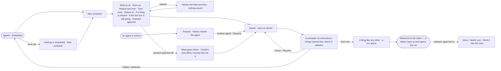

# AG-42 · Put routine work on a schedule

**As** anyone on a Graph who can work on projects **I want** to schedule routine work — a morning digest, a weekly
route report — with no project **so that** it runs itself and lands where I read it.

Tasks: [task.md](task.md) · Feature: [AG-F07](../../feature.md)

## Who can

| Lens | Can | Otherwise sees |
|---|---|---|
| Admin | Create, edit, pause, resume, run now and delete any schedule; read every firing and open its run | — |
| Operator | Read every schedule, its firings and their runs; read results delivered to them | *New schedule*, *Run now*, *Pause*, *Resume*, *Edit* and *Delete* disabled, naming *Can work on projects*. *With Can work on projects: as Admin* |

## Flow

## Acceptance criteria

| # | Given | When | Then |
|---|---|---|---|
| AG-42.1 | A Graph with no schedules | a member opens Agents › Schedules | it reads *Nothing is scheduled* with *New schedule* |
| AG-42.2 | A member who can work on projects | they save a schedule naming what to do, an agent, a repeat, a time zone and where to deliver | it is saved with no project, and its next run reads in their zone |
| AG-42.3 | A new schedule | its repeat is invalid, its time zone unknown, or its agent or a channel is missing | it is refused before saving, the dialog naming the field and why |
| AG-42.4 | A saved schedule | its time comes | a run of the named agent opens with its instructions, on behalf of the schedule's owner, and the firing is kept as *opened* with its run |
| AG-42.5 | A schedule whose last run is still going, *If the last run is still going* = *Skip* | its next firing comes | the firing is kept as *skipped*, saying why; with *Run anyway* a second run opens |
| AG-42.6 | A schedule whose agent is paused | its time comes | the firing is kept as *failed*, naming the agent, and the schedule stays on |
| AG-42.7 | The engine down across several firings, *Run once on recovery* | it comes back | one run opens, marked catch-up, and each other missed firing is kept as *skipped*, saying why |
| AG-42.8 | The same outage, *Run every missed one* · *Skip* | it comes back | one run per missed firing opens, at most 24 · none opens and each is kept as *skipped* |
| AG-42.9 | A firing's run settles | it is delivered | the owner and each recipient have an Inbox row; a failed run is delivered as a failure that opens the run |
| AG-42.10 | A schedule delivering to a channel, outward approval on | its run settles | the delivery waits in the approvers' (else the owner's) *Needs you*, showing what will be sent and where; *Not this time* or the deadline passing sends nothing, saying why |
| AG-42.11 | A member who can work on projects | they switch outward approval off | it shows what goes where — each channel and recipient — and saves only on *Confirm* as Allow, recording who set it and when; once on Allow, a settled run's delivery is sent with no ask, and the schedule names who set it |
| AG-42.12 | A schedule | the member presses *Run now* | a firing marked *run now* is kept and a run opens at once |
| AG-42.13 | A schedule paused, then resumed a day later | it resumes | no firing from the paused day runs; the next firing is the next one from now, and every earlier firing is still listed |
| AG-42.14 | A schedule's page | it is opened | it shows its instructions, where it delivers, and every firing newest first — due time, outcome, reason, *catch-up* or *run now* when so, and *Open run* |
| AG-42.15 | A delivered result or a firing | the person opens its run | *How it got here* shows the run's steps and sources |
| AG-42.16 | A schedule edited by another member | it next fires | it runs on behalf of its original owner, bounded as AG-42.21 says |
| AG-42.17 | A channel a schedule delivers to | an Admin removes the channel | it is refused, naming the schedule |
| AG-42.18 | An Operator | they open Agents › Schedules and a schedule | both read; *New schedule*, *Run now*, *Pause*, *Resume*, *Edit* and *Delete* are disabled, naming *Can work on projects* |
| AG-42.19 | A schedule whose deliveries are on Allow | anyone edits it, or the person who set Allow loses the right to set it | outward approval returns to Ask, naming why, and History records it; until then its runs are bounded by both the person who set Allow and the schedule's owner |
| AG-42.20 | A schedule's outward approval | a delivery is due | it is a line like any other: the strictest of it and every rule for everyone binds, so a *For everyone* Deny on sends holds whatever the schedule says |
| AG-42.21 | A schedule edited by members other than its owner | it fires | its run is bounded by its owner and by every member who edited it since its owner last saved it — the strictest of them binds each step; its text is read as data |
| AG-42.22 | A schedule whose agent is retired | the agent is retired (AG-29.16) | the schedule is paused, History naming the retired agent; it fires again only once a person points it at another agent and resumes it |
| AG-42.23 | A Graph with active schedules | a member opens Agents › Schedules | *Coming up* draws the next seven days, one row per active schedule, its repeat as words, a mark on each day it fires — marked failed when its last firing failed; a paused schedule is left out |

## Screens

| Surface | Lens | First use | Empty after a filter | Loading | Has data | Failed | Agent working or proposing | No access |
|---|---|---|---|---|---|---|---|---|
| Schedules | Admin | agents.schedules · Nothing is scheduled | — | agents.schedules · Loading | agents.schedules | agents.schedules · Could not load | agents.schedules · Running | — |
| Schedules | Operator | agents.schedules · Nothing is scheduled · Read only | — | agents.schedules · Loading | agents.schedules · Read only | agents.schedules · Could not load | agents.schedules · Running | agents.schedules · Read only |
| New schedule | Admin | agents.schedules · New schedule | — | — | agents.schedules · New schedule | agents.schedules · New schedule refused | — | — |
| New schedule | Operator | — | — | — | — | — | — | agents.schedules · Read only |
| Outward approval off | Admin | — | — | — | agents.schedules · Confirm Allow | agents.schedules · New schedule refused | — | — |
| Outward approval off | Operator | — | — | — | agents.schedules · A schedule · Read only | — | — | agents.schedules · Read only |
| A schedule | Admin | agents.schedules · A schedule · No firings yet | — | agents.schedules · A schedule · Loading | agents.schedules · A schedule | agents.schedules · A schedule · Last run failed | agents.schedules · A schedule · Running | — |
| A schedule | Operator | agents.schedules · A schedule · No firings yet | — | agents.schedules · A schedule · Loading | agents.schedules · A schedule · Read only | agents.schedules · A schedule · Last run failed | agents.schedules · A schedule · Running | agents.schedules · A schedule · Read only |
| A delivered result and an outward ask | Admin | — | — | — | inbox · A schedule's result | inbox · A schedule's failed run | inbox · Send this schedule's result? | — |
| A delivered result and an outward ask | Operator | — | — | — | inbox · A schedule's result | inbox · A schedule's failed run | inbox · Send this schedule's result? · Waiting on the approver | — |
