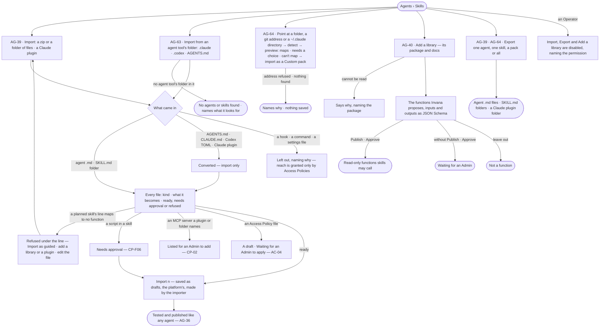
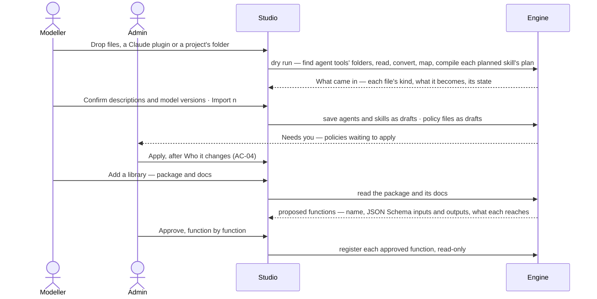

# Portable agents and skills

> Agents and skills come in and go out as the open files other agent tools already use — an agent is a Markdown
> file with front matter, a skill is a `SKILL.md` folder — with Invana's own fields riding in an extension block other tools ignore. A person who builds agents
> brings them in from dropped files, from an agent tool's folder — a project's `.claude/`, `.codex/` or `AGENTS.md` —
> from Claude plugins, from a git address and from a `~/.claude`-style directory, and takes Invana's out again as a Claude plugin. Other formats are read and converted, never written. What a file declares grants nothing:
> its Access Policy files wait for an Admin, and a library becomes functions only once an Admin approves them. The
> decision it helps make: *is this outside agent, skill or library safe to let in, and what will it become here?*

## User journey

## Stories

| ID | Story | Status |
|---|---|---|
| AG-39 | [Bring agents and skills in as standard files, and export them](stories/AG-39-bring-agents-and-skills-in-as-standard-files-and-export-them/story.md) | idea |
| AG-63 | [Bring in agents and skills from an agent tool's folder](stories/AG-63-bring-in-agents-and-skills-from-an-agent-tools-folder/story.md) | idea |
| AG-64 | [Bring my agents over and take Invana's out](stories/AG-64-bring-my-agents-over-and-take-invanas-out/story.md) | idea |
| AG-40 | [Turn a library into functions an Admin approves](stories/AG-40-turn-a-library-into-functions-an-admin-approves/story.md) | idea |

## Access

The permission each act needs is the *Agents* and *Skills* rows of [the permission catalogue](../../../../os/access/features/AC-F02-access-policies/feature.md#the-permission-catalogue) — usually held through the *Build agents* template.

*Admins* are the people who hold Manage on Access ([AC-F02 › Decisions](../../../../os/access/features/AC-F02-access-policies/feature.md#decisions)).

| Act | Permission ([the permission catalogue](../../../../os/access/features/AC-F02-access-policies/feature.md#the-permission-catalogue)) | Everyone else sees |
|---|---|---|
| Import agents and skills — dropped files, a Claude plugin, an agent tool's folder · export them | Create on `agent/*` and `skill/*` | *Import* and *Export* are disabled — *Needs Create on Agents and Skills — ask {who can grant}* |
| Import as a Custom pack · make a pack's export | Create on `setting/team-packs` · Read on the pack | *Import as a Custom pack* is disabled — *Needs Create on Settings — ask {who can grant}* |
| Apply an Access Policy file an import brought | Edit on `access/policies`, as [AC-F02](../../../../os/access/features/AC-F02-access-policies/feature.md#access) | The file reads *Waiting for an Admin to apply* |
| Add a library | Create on `plugin/*` | *Add a library* is disabled, naming the permission |
| Approve the functions a library proposes | Publish · Approve on `skill/<name>` | Proposed functions read *Waiting for an Admin* |
| Approve a skill's script | Publish · Approve on `skill/<name>` ([CP-F06](../../../../os/control/features/CP-F06-skill-scripts/feature.md)) | As CP-F06 |
| Read imported agents, skills and approved functions | Read on `agent/<name>` · `skill/<name>` | — |

## States

| State | What the person sees |
|---|---|
| First use | Import reads *Drop files, a Claude plugin or a project's folder* with the formats it takes; *Tools they call* reads *No libraries* |
| Empty after a filter | — |
| Loading | Import reads *Reading the files…*; a library reads *Reading the package…* |
| Has data | *What came in* with every file's kind, what it becomes and its state, grouped by the agent tool it came from; a library's proposed or approved functions |
| Failed | A refused file or line names why and what would make it map; a folder with no agent tool's folder names what it looks for; a package that cannot be read is named |
| Agent working or proposing | Import finding, mapping and converting the files and compiling each planned skill's plan; Invana proposing a library's functions |
| No access | Import, Export and *Add a library* are disabled for an Operator, naming the permission; everything saved reads |

## Rules

| Rule | Detail |
|---|---|
| An agent is a Markdown file | YAML front matter `name` · `description` · `model` · `tools` · `skills`, the body its instructions — the Claude-style agent file |
| A skill is a `SKILL.md` folder | The Agent Skills folder: `SKILL.md` with `name` and `description` in its front matter, and `references/`, `scripts/`, `assets/` beside it ([AG-F04](../AG-F04-skills/feature.md)) |
| Invana's fields ride in an extension block | Voice, effort, when to use, how a skill runs, model version — every field the open format lacks — sit in one block other tools ignore: `metadata.invana` in `plugin.json`, an `invana:` front-matter key in an agent file, `metadata` in a `SKILL.md`; nothing of Invana's sits outside it, so an Invana pack loads unchanged in Claude Code, and a file without the block still imports |
| An agent tool's folder | The folder an agent tool keeps a project's agents and skills in: `.claude/` — `agents/*.md`, `skills/<slug>/`, `CLAUDE.md` · `.codex/` — TOML agent files, `skills/<slug>/` · `AGENTS.md` at the project's root. Import finds every one a dropped project holds, at any depth, and reads each through the readers below |
| A Claude plugin | A folder with `.claude-plugin/plugin.json`: its `agents/` and `skills/` import; the MCP servers its `.mcp.json` names are listed for an Admin to add ([CP-02](../../../../os/control/features/CP-F02-plugins-and-outside-tools/stories/CP-02-add-an-outside-mcp-server-and-let-agents-call-its-tools/story.md)); Invana's own plugins and Team packs are in this layout ([CP-F02](../../../../os/control/features/CP-F02-plugins-and-outside-tools/feature.md#rules)) |
| Declared, never granted | An agent's `tools`, a skill's needs, a folder's settings and a plugin's manifest declare what they need; they grant nothing. An Access Policy file brought in lands as a draft that decides nothing until an Admin applies it ([AC-F02](../../../../os/access/features/AC-F02-access-policies/feature.md#rules)) |
| What never comes in | Hooks, commands, settings files and output styles are left out, each named: Invana runs no code it did not approve, and reach is granted only by Access Policies |
| Read many, write the Claude formats | `AGENTS.md`, `CLAUDE.md` and Codex TOML agent files are import-only: converted to an agent `.md` and skill folders. Export writes an agent `.md`, a `SKILL.md` folder and a Claude plugin folder, and nothing else |
| A source is a folder or a public git address | A folder, a zip or a `~/.claude`-style directory is dropped and read in the browser; a git address is fetched by a worker over https, from a host an Admin allowed, public, with no credential and no hook ([NFR-SEC-16](../../../../system-design.md#3-non-functional-requirements)). The engine reads no path of its own machine |
| A preview sorts three ways | *Maps* · *Needs a choice* (a model, tools to a draft policy, a name already here, a split description) · *Can't map*, each with why; the person decides before anything is saved |
| Imports are outside text | An imported prompt — an agent's instructions, a skill's text, an `AGENTS.md` — is data until a person tests and publishes it; any model call that reads it to split or map has no tool and no policy to act under, and its output is a proposal ([NFR-SEC-15](../../../../system-design.md#3-non-functional-requirements)) |
| A Custom pack | An Admin imports a source as a Custom pack — off, its agents granted to nobody, its policies drafts ([CP-F02](../../../../os/control/features/CP-F02-plugins-and-outside-tools/feature.md#rules)); a person without Create on `setting/team-packs` imports as drafts |
| The file round-trips | An exported agent, skill or plugin imports back unchanged |
| A dry run first | Every file is found, converted and mapped, every planned skill's plan compiled and every refusal named before anything is saved |
| Imported means draft, the platform's | Imported agents and skills are drafts, owned by the platform and made by the person who imported them ([AC-F07](../../../../os/access/features/AC-F07-ownership/feature.md#rules)), tested and published like any other (AG-36), and granted to nobody until an Admin grants them |
| Code only by approval | A library reaches a plan only as a function an Admin approved, read-only from then; a script runs only once an Admin approved it (CP-F06) |
| A plan is not portable | It is Invana's cache of a skill's text (AG-F04): never exported, compiled again on import |
| Nothing brought in starts | An MCP server a plugin or a folder names is listed for an Admin to add (CP-02); one started as a local process is refused |
| Leans on | The catalogue (AG-F02) · skills (AG-F04) · Access Policies and policy files (AC-F02) · ownership (AC-F07) · plugins and MCP servers (CP-F02) · skill scripts (CP-F06) · AI models (CP-F01) |

## Data touched

| Record | Read or write |
|---|---|
| Agents and skills of the deployment, and their versions | Write on import · read on export |
| Access Policy files an import brought, as drafts (AC-F02) | Write |
| An import's dry run — each file, the agent tool it came from, its kind, what it becomes, its state | Read |
| A library, its proposed functions, their JSON Schema contracts and their approval | Write · read |
| Exported files | Read |

## Engine

### Records

| Table | Columns | Notes |
|---|---|---|
| — | — | An import writes AG-F01's and AG-F04's rows as drafts and AC-F02's policy drafts, and stores nothing of its own; the dry run is returned, never saved. Where a library and its approved functions are kept is an open question below |

### Reads

| Record | Owner |
|---|---|
| Agents and their versions — written as drafts on commit, read on export | [AG-F01](../AG-F01-build-an-agent/feature.md#engine) |
| Skills, their versions, `folder` and `metadata`; the draw that compiles a planned skill | [AG-F04](../AG-F04-skills/feature.md#engine) |
| Access Policies — a policy file written `origin = imported`, `status = draft` | [AC-F02](../../../../os/access/features/AC-F02-access-policies/feature.md#engine) |
| Owners — the platform, made by the importer | [AC-F07](../../../../os/access/features/AC-F07-ownership/feature.md#engine) |
| The function catalogue a plan maps to | [AG-F06](../AG-F06-plans-and-workflows/feature.md#engine) |
| Model versions offered, for an alias | [CP-F01](../../../../os/control/features/CP-F01-ai-models/feature.md#engine) |
| MCP servers an Admin adds · plugins enabled · the plugin layout | [CP-F02](../../../../os/control/features/CP-F02-plugins-and-outside-tools/feature.md#engine) |
| Scripts and their approval | [CP-F06](../../../../os/control/features/CP-F06-skill-scripts/feature.md#engine) |

### Routes

| Route, deployment-wide, after `/api/v1/catalogue` | Does | Story |
|---|---|---|
| `POST /import` | The dry run of dropped files, a Claude plugin, a `~/.claude`-style directory or a project's folder — or `{git_url}`, fetched by a worker and read at `GET /import/{id}`: every agent tool's folder found, every file, its kind, what it becomes, its state (`ready` · `needs approval` · `left out` · `refused`) and each mapped field beside its source; nothing saved | AG-39 · AG-63 |
| `POST /import/commit` | Save every agent and skill of a dry run with nothing refused, as drafts, and every policy file as a draft; `{as: "drafts" · "custom_pack", name?, choices}` — `choices` the person's answers (model, draft policy from tools, rename) | AG-39 · AG-63 · AG-64 |
| `GET /import/{id}` | The dry run of a git address while a worker fetches it, then its preview | AG-64 |
| `GET /agents/{id}/export` · `GET /skills/{id}/export` · `GET /export` | One agent `.md` · one `SKILL.md` folder · a zip of the whole catalogue; `GET /plugins/{name}/export` a pack or a Custom pack, and `?kind=plugin` on the others, as a zip of a Claude plugin folder | AG-39 · AG-64 |
| `POST /libraries` | Read a package and its docs; proposes typed functions | AG-40 |
| `POST /libraries/{id}/functions/{fn}/approve` | Register a proposed function, read-only from then | AG-40 |

### Events

| Event | When |
|---|---|
| `agents.create` · `agents.skills.create` | Each imported agent and skill, as AG-F01 and AG-F04 emit them |
| `access.policies.create` | Each policy file an import brought, as a draft, as AC-F02 emits it |
| `agents.imports.commit` | An import saved — its source (the address and commit, or the files' names), who and the counts |
| `agents.exports.plugin` | A Claude plugin folder written — what, who |

### Refusals

| Status | When | Sentence | Criterion |
|---|---|---|---|
| refused (a row of the dry run) | A planned skill's line no function maps to | *{line} maps to no function — add a library, enable a plugin, or rewrite it.* | AG-39.5 |
| refused (a row of the dry run) | A `references/` file over the size limit | *{file} is over {limit} characters.* | AG-39.9 |
| refused (a row of the dry run) | An MCP server started as a local process | *Invana reaches MCP servers by address.* | AG-39.16 · AG-63.6 |
| left out (a row of the dry run) | A hook, a command, a settings file, an output style or any other file an agent tool or a plugin carries | *{file} is a {kind}; Invana runs no hooks or commands, and only Access Policies grant reach.* | AG-39.17 · AG-63.5 |
| 422 | A git address that is not https, resolves to a refused address, redirects to one, names a host no Admin allowed, or is not public | *{address} is refused — {why}.* | AG-64.2 |
| 403 | *Import as a Custom pack* without Create on `setting/team-packs` | *Needs Create on setting/team-packs — ask {who can grant}.* | AG-64.18 |
| 422 | A dropped folder with no agent tool's folder, plugin, agent file or skill folder in it | *No agents or skills found — Invana looks for .claude/, .codex/, AGENTS.md, a Claude plugin, agent files and SKILL.md folders.* | AG-63.9 |
| 409 | `POST /import/commit` while any row is refused | *Fix or leave out the refused files first.* | AG-39.10 |
| 422 | A package that cannot be found or read | *{package} could not be read: {reason}.* | AG-40.7 |
| step refused | A plan naming a library function no Admin approved | *{function} is not approved.* | AG-40.4 |
| 403 | Import or export without Create on agent/* and skill/*, or add a library without Create on plugin/* | *This needs Create on agent/* and skill/* — ask {who can grant}.* | AG-39.13 · AG-63.10 · AG-40.10 |
| 403 | Approving a library's function without Publish · Approve on the skill | *This needs Publish · Approve on skill/{skill} — ask {who can grant}.* | AG-40.12 |

### CLI

| Command | Does |
|---|---|
| `invana agents import <path or git address> [--as-pack <name>] [--commit]` | The dry run of files, a plugin, a `~/.claude`-style directory or a project's folder — the CLI sends the files — or of a git address; with `--commit`, saves it, as a Custom pack with `--as-pack` |
| `invana agents export [<name>] [--plugin]` | One agent or skill, or the whole catalogue; with `--plugin`, as a Claude plugin folder |
| `invana plugins export <pack>` | A pack or a Custom pack as a Claude plugin folder |

### Mechanisms

| Mechanism | How |
|---|---|
| Read many, write the Claude formats | Agent `.md` files, `SKILL.md` folders and Claude plugins import and export; `AGENTS.md`, `CLAUDE.md` and Codex TOML are converted on import and never written |
| Fetching a git address | A worker in the sandbox, over https, to a host in the Web connector's allowed hosts ([CP-F12](../../../../os/control/features/CP-F12-issue-trackers/feature.md#mechanisms) › *Fetching*): a shallow, single-branch clone of a public repository with no credential, no submodule, no LFS or other filter and no hook; size and time caps; the tree is held in the blob store under the dry run's id for an hour and read by the dry run; History records the address and the commit |
| The preview | Every detected item is mapped to one of three states — *maps*, *needs a choice*, *can't map* — and returned with each mapped field beside its source; a choice has a recommended answer and is saved only when the person confirms |
| A draft policy from tools | When the person chooses it, the agent's `tools` that map to a function or an outside tool become one Access Policy draft for exactly those, `origin = imported`, `status = draft`, written with the commit; a tool with no mapping is named as left out; never applied by the import |
| A Custom pack from an import | Committed `as: custom_pack`, the accepted items are written as a plugin folder in the Claude layout under the deployment's pack store, and installed as `control_plugins` kind `pack`, `custom` true, off, by CP-F02's install; its agents are granted to nobody and its policies are drafts |
| Export as a plugin | Writes `.claude-plugin/plugin.json` with Invana's fields only under `metadata.invana`, `agents/*.md` with an `invana:` key, `skills/<name>/SKILL.md`, `policies/*.yaml`, `project_types/`, `ontology/`, `lenses/` and a `.mcp.json` that keeps its pinned versions; never a secret, a plan, a grant or a person's data |
| Finding agent tools' folders | The dropped tree is walked for `.claude/`, `.codex/`, `AGENTS.md` and `.claude-plugin/plugin.json`; each found is a group of *What came in*, named by its path. A skill two folders hold under one name is offered once, naming both paths |
| An agent's skills | An agent file's `skills` naming a skill in the same import links to it; one naming a skill neither imported nor in the catalogue is named on the agent, which imports without it |
| An agent's tools | An agent file's `tools` become its declared needs, mapped to Invana's resources where a function or tool matches, shown in *What it needs* (AG-F04); one that maps to nothing is named as left out. No rule is written from them |
| Invana's fields | Read from and written in the extension block — `metadata.invana`, an agent's `invana:` key, a skill's `metadata`; a file without them still imports |
| A planned skill on import | Its plan is compiled in the dry run by AG-F04's draw; the plan is never exported |
| A policy file | A `policies/*.yaml` file in a plugin or a folder, in [AC-F02](../../../../os/access/features/AC-F02-access-policies/feature.md#mechanisms)'s format, is written `origin = imported`, `imported_from` the import, `status = draft`, with an Inbox row to every Admin |
| A library | Read from its package and docs; each proposed function declares inputs and outputs as JSON Schema and what it reaches, and the steps record which part of the docs each came from |

## System impact

| HLD section | Change | NFRs |
|---|---|---|
| § 8 APIs and events | Deployment-wide routes under `/api/v1/catalogue` and the CLI above | — |
| § 11 Failure modes and the outside boundary | A git address is fetched by a worker in the sandbox from an allowed host, never cloned with its hooks; outside files, folders and packages are read, never run; a library's code reaches a plan only as an approved function; the Claude plugin layout is read | — |
| § 12 Qualities | Security: no hook, command, settings file or local-process server brought in runs or grants; policy files wait for an Admin; imported prompts are outside text; a git fetch goes only where an Admin allowed | NFR-SEC-15 · NFR-SEC-16 |

The code change is [migrations.md](../../../../migrations.md) M37.

## Decisions

| Decision | Detail |
|---|---|
| Bringing agents in is building agents | Importing is building agents, so it Needs Create on Agents and Skills; what an import may reach is still applied only with Edit on Access |
| Model aliases on import | `sonnet` · `opus` · `inherit` resolve to an exact offered version, shown for the importer to confirm |
| A name already in the catalogue | Offered as a new version of it, or a rename |
| `AGENTS.md` · `CLAUDE.md` | One draft agent, its body the instructions, named after its folder for the importer to confirm |
| Codex TOML | Converted to the agent `.md` shape; every mapped field shown beside its source, an unmapped one named as left out |
| A Claude plugin | Its agents and skills import; its MCP servers are listed for CP-02; its policy files land as drafts; a local-process server is refused; a hook or a command is left out; it exports back as one (AG-64) |
| Onboarding is one preview | A source is detected whole and sorted *maps* · *needs a choice* · *can't map*; the importer chooses, an Admin applies and grants (AG-64) |
| A git address is a fetch Invana makes | Only https, an allowed host and a public repository, by a worker with no hook; nothing else reads a remote |
| A folder's settings are not policies | An agent tool's own permission lists are left out: only an Access Policy grants, so a team writes its reach as a policy file an Admin applies; an agent's `tools` may become a draft policy the importer chose (AG-64.7) |
| A planned skill that will not compile | Refused under the line, with *Import as guided* (AG-F04) beside the refusal |
| Function contracts | A library's proposed functions declare their inputs and outputs as JSON Schema, as every function does (CP-F02) |
| Export | One agent, one skill, a pack or all, as agent files, skill folders or a Claude plugin; the plan, secrets and grants are not exported |
| Versions of each format | [System design § 11](../../../../system-design.md#11-failure-modes-and-the-outside-boundary) › *Standards* |
| Not built yet | Import, export and libraries have no engine yet |

## Open questions

| Question | Who answers |
|---|---|
| `AGENTS.md` imports as one agent (recommended), or as rules of the graph (SE-F07)? | Ravi |
| A planned skill that will not compile on import: offer *Import as guided* (recommended), or refuse until the file is fixed? | Ravi |
| Where a library and its approved functions are kept, when the function catalogue is code (AG-F06) — two tables, `agents_libraries` and `agents_library_functions` (name, JSON Schema contracts, status `proposed · approved`, who approved) (recommended), or a generated plugin package an Admin installs? | Ravi |

## Not building

| Item | Why not |
|---|---|
| Exporting `AGENTS.md`, `CLAUDE.md` or Codex TOML | The Claude formats are the portable ones; every other is read only |
| Running a hook or a command brought in | Invana runs no code it did not approve, and a command is a prompt for a person at a terminal |
| Turning an agent tool's permission lists into rules in force | Only an Access Policy an Admin applied grants; a draft from an agent's tools is a choice the person makes and an Admin applies |
| Adding a plugin's or folder's MCP servers on import | An Admin adds a server deliberately (CP-02) |
| Reading a path of the engine's own machine, or a private repository | A person drops the folder, or gives a public git address on an allowed host; a private one is dropped as a clone |
| A remote catalogue or hub | Later |
| A function editor | Functions are code |
| Code generated per run, or frozen into a plan at publish | Runs must reproduce, and installs on premises run only approved code |
