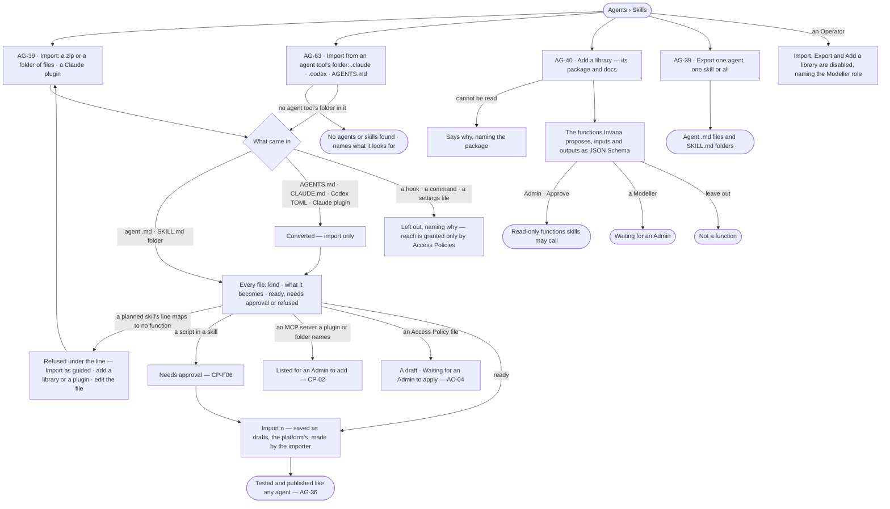
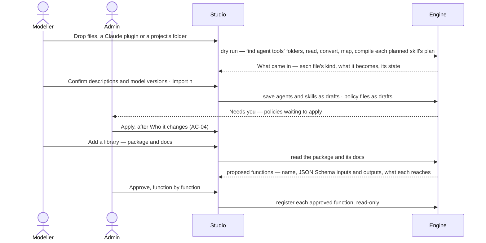

# Portable agents and skills

> Agents and skills come in and go out as the open files other agent tools already use — an agent is a Markdown
> file with front matter, a skill is a `SKILL.md` folder — with Invana's own fields riding under `metadata:`. A Modeller
> brings them in from dropped files, from an agent tool's folder — a project's `.claude/`, `.codex/` or `AGENTS.md` —
> and from Claude plugins. Other formats are read and converted, never written. What a file declares grants nothing:
> its Access Policy files wait for an Admin, and a library becomes functions only once an Admin approves them. The
> decision it helps make: *is this outside agent, skill or library safe to let in, and what will it become here?*

## User journey

## Stories

| ID | Story | Status |
|---|---|---|
| AG-39 | [Bring agents and skills in as standard files, and export them](stories/AG-39-bring-agents-and-skills-in-as-standard-files-and-export-them/story.md) | idea |
| AG-63 | [Bring in agents and skills from an agent tool's folder](stories/AG-63-bring-in-agents-and-skills-from-an-agent-tools-folder/story.md) | idea |
| AG-40 | [Turn a library into functions an Admin approves](stories/AG-40-turn-a-library-into-functions-an-admin-approves/story.md) | idea |

## Access

*Portable — bring in* is the Modeller's and the Admin's in [the role table](../../../../os/access/features/AC-F02-access-policies/feature.md#the-role-table).

| Act | Role | Everyone else sees |
|---|---|---|
| Import agents and skills — dropped files, a Claude plugin, an agent tool's folder · export them | Modeller · Admin | *Import* and *Export* are disabled — *Needs the Modeller role — ask an Admin* |
| Apply an Access Policy file an import brought | Admin, as [AC-F02](../../../../os/access/features/AC-F02-access-policies/feature.md#access) | The file reads *Waiting for an Admin to apply* |
| Add a library | Modeller · Admin | *Add a library* is disabled, naming the Modeller role |
| Approve the functions a library proposes | Admin | Proposed functions read *Waiting for an Admin* |
| Approve a skill's script | Admin ([CP-F06](../../../../os/control/features/CP-F06-skill-scripts/feature.md)) | As CP-F06 |
| Read imported agents, skills and approved functions | Every signed-in person — Operator, Modeller, Admin | — |

## States

| State | What the person sees |
|---|---|
| First use | Import reads *Drop files, a Claude plugin or a project's folder* with the formats it takes; *Tools they call* reads *No libraries* |
| Empty after a filter | — |
| Loading | Import reads *Reading the files…*; a library reads *Reading the package…* |
| Has data | *What came in* with every file's kind, what it becomes and its state, grouped by the agent tool it came from; a library's proposed or approved functions |
| Failed | A refused file or line names why and what would make it map; a folder with no agent tool's folder names what it looks for; a package that cannot be read is named |
| Agent working or proposing | Import finding, mapping and converting the files and compiling each planned skill's plan; Invana proposing a library's functions |
| No access | Import, Export and *Add a library* are disabled for an Operator, naming the Modeller role; everything saved reads |

## Rules

| Rule | Detail |
|---|---|
| An agent is a Markdown file | YAML front matter `name` · `description` · `model` · `tools` · `skills`, the body its instructions — the Claude-style agent file |
| A skill is a `SKILL.md` folder | The Agent Skills folder: `SKILL.md` with `name` and `description` in its front matter, and `references/`, `scripts/`, `assets/` beside it ([AG-F04](../AG-F04-skills/feature.md)) |
| Invana's fields ride under `metadata:` | Voice, effort, when to use, how a skill runs, model version — every field the open format lacks; a file without them still imports |
| An agent tool's folder | The folder an agent tool keeps a project's agents and skills in: `.claude/` — `agents/*.md`, `skills/<slug>/`, `CLAUDE.md` · `.codex/` — TOML agent files, `skills/<slug>/` · `AGENTS.md` at the project's root. Import finds every one a dropped project holds, at any depth, and reads each through the readers below |
| A Claude plugin | A folder with `.claude-plugin/plugin.json`: its `agents/` and `skills/` import; the MCP servers its `.mcp.json` names are listed for an Admin to add ([CP-02](../../../../os/control/features/CP-F02-plugins-and-outside-tools/stories/CP-02-add-an-outside-mcp-server-and-let-agents-call-its-tools/story.md)); Invana's own plugins and Team packs are in this layout ([CP-F02](../../../../os/control/features/CP-F02-plugins-and-outside-tools/feature.md#rules)) |
| Declared, never granted | An agent's `tools`, a skill's needs, a folder's settings and a plugin's manifest declare what they need; they grant nothing. An Access Policy file brought in lands as a draft that decides nothing until an Admin applies it ([AC-F02](../../../../os/access/features/AC-F02-access-policies/feature.md#rules)) |
| What never comes in | Hooks, commands, settings files and output styles are left out, each named: Invana runs no code it did not approve, and reach is granted only by Access Policies |
| Read many, write one | `AGENTS.md`, `CLAUDE.md`, Codex TOML agent files and Claude plugins are import-only: converted to an agent `.md` and skill folders. Export writes only those two |
| The file round-trips | An exported agent or skill imports back unchanged |
| A dry run first | Every file is found, converted and mapped, every planned skill's plan compiled and every refusal named before anything is saved |
| Imported means draft, the platform's | Imported agents and skills are drafts, owned by the platform and made by the person who imported them ([AC-F07](../../../../os/access/features/AC-F07-ownership/feature.md#rules)), tested and published like any other (AG-36), and granted to nobody until an Admin grants them |
| Code only by approval | A library reaches a plan only as a function an Admin approved, read-only from then; a script runs only once an Admin approved it (CP-F06) |
| A plan is not portable | It is Invana's cache of a skill's text (AG-F04): never exported, compiled again on import |
| Nothing brought in starts | An MCP server a plugin or a folder names is listed for an Admin to add (CP-02); one started as a local process is refused |
| Leans on | The catalogue (AG-F02) · skills (AG-F04) · Access Policies and policy files (AC-F02) · ownership (AC-F07) · plugins and MCP servers (CP-F02) · skill scripts (CP-F06) · AI models (CP-F01) |

## Data touched

| Record | Read or write |
|---|---|
| Agents and skills of the deployment, and their versions | Write on import · read on export |
| Access Policy files an import brought, as drafts (AC-F02) | Write |
| An import's dry run — each file, the agent tool it came from, its kind, what it becomes, its state | Read |
| A library, its proposed functions, their JSON Schema contracts and their approval | Write · read |
| Exported files | Read |

## Engine

### Records

| Table | Columns | Notes |
|---|---|---|
| — | — | An import writes AG-F01's and AG-F04's rows as drafts and AC-F02's policy drafts, and stores nothing of its own; the dry run is returned, never saved. Where a library and its approved functions are kept is an open question below |

### Reads

| Record | Owner |
|---|---|
| Agents and their versions — written as drafts on commit, read on export | [AG-F01](../AG-F01-build-an-agent/feature.md#engine) |
| Skills, their versions, `folder` and `metadata`; the draw that compiles a planned skill | [AG-F04](../AG-F04-skills/feature.md#engine) |
| Access Policies — a policy file written `origin = imported`, `status = draft` | [AC-F02](../../../../os/access/features/AC-F02-access-policies/feature.md#engine) |
| Owners — the platform, made by the importer | [AC-F07](../../../../os/access/features/AC-F07-ownership/feature.md#engine) |
| The function catalogue a plan maps to | [AG-F06](../AG-F06-plans-and-workflows/feature.md#engine) |
| Model versions offered, for an alias | [CP-F01](../../../../os/control/features/CP-F01-ai-models/feature.md#engine) |
| MCP servers an Admin adds · plugins enabled · the plugin layout | [CP-F02](../../../../os/control/features/CP-F02-plugins-and-outside-tools/feature.md#engine) |
| Scripts and their approval | [CP-F06](../../../../os/control/features/CP-F06-skill-scripts/feature.md#engine) |

### Routes

| Route, deployment-wide, after `/api/v1/catalogue` | Does | Story |
|---|---|---|
| `POST /import` | The dry run of dropped files, a Claude plugin or a project's folder: every agent tool's folder found, every file, its kind, what it becomes, its state (`ready` · `needs approval` · `left out` · `refused`) and each mapped field beside its source; nothing saved | AG-39 · AG-63 |
| `POST /import/commit` | Save every agent and skill of a dry run with nothing refused, as drafts, and every policy file as a draft | AG-39 · AG-63 |
| `GET /agents/{id}/export` · `GET /skills/{id}/export` · `GET /export` | One agent `.md` · one `SKILL.md` folder · a zip of the whole catalogue | AG-39 |
| `POST /libraries` | Read a package and its docs; proposes typed functions | AG-40 |
| `POST /libraries/{id}/functions/{fn}/approve` | Register a proposed function, read-only from then | AG-40 |

### Events

| Event | When |
|---|---|
| `agents.create` · `agents.skills.create` | Each imported agent and skill, as AG-F01 and AG-F04 emit them |
| `access.policies.create` | Each policy file an import brought, as a draft, as AC-F02 emits it |

### Refusals

| Status | When | Sentence | Criterion |
|---|---|---|---|
| refused (a row of the dry run) | A planned skill's line no function maps to | *{line} maps to no function — add a library, enable a plugin, or rewrite it.* | AG-39.5 |
| refused (a row of the dry run) | A `references/` file over the size limit | *{file} is over {limit} characters.* | AG-39.9 |
| refused (a row of the dry run) | An MCP server started as a local process | *Invana reaches MCP servers by address.* | AG-39.16 · AG-63.6 |
| left out (a row of the dry run) | A hook, a command, a settings file, an output style or any other file an agent tool or a plugin carries | *{file} is a {kind}; Invana runs no hooks or commands, and only Access Policies grant reach.* | AG-39.17 · AG-63.5 |
| 422 | A dropped folder with no agent tool's folder, plugin, agent file or skill folder in it | *No agents or skills found — Invana looks for .claude/, .codex/, AGENTS.md, a Claude plugin, agent files and SKILL.md folders.* | AG-63.9 |
| 409 | `POST /import/commit` while any row is refused | *Fix or leave out the refused files first.* | AG-39.10 |
| 422 | A package that cannot be found or read | *{package} could not be read: {reason}.* | AG-40.7 |
| step refused | A plan naming a library function no Admin approved | *{function} is not approved.* | AG-40.4 |
| 403 | Import, export or add a library without the Modeller or Admin role | *This needs the Modeller role.* | AG-39.13 · AG-63.10 · AG-40.10 |
| 403 | Approving a library's function without the Admin role | *This needs the Admin role.* | AG-40.12 |

### CLI

| Command | Does |
|---|---|
| `invana agents import <path> [--commit]` | The dry run of files, a plugin or a project's folder; with `--commit`, saves it |
| `invana agents export [<name>]` | One agent or skill, or the whole catalogue |

### Mechanisms

| Mechanism | How |
|---|---|
| Read many, write one | Agent `.md` files and `SKILL.md` folders import and export; `AGENTS.md`, `CLAUDE.md`, Codex TOML and Claude plugins are converted on import and never written |
| Finding agent tools' folders | The dropped tree is walked for `.claude/`, `.codex/`, `AGENTS.md` and `.claude-plugin/plugin.json`; each found is a group of *What came in*, named by its path. A skill two folders hold under one name is offered once, naming both paths |
| An agent's skills | An agent file's `skills` naming a skill in the same import links to it; one naming a skill neither imported nor in the catalogue is named on the agent, which imports without it |
| An agent's tools | An agent file's `tools` become its declared needs, mapped to Invana's resources where a function or tool matches, shown in *What it needs* (AG-F04); one that maps to nothing is named as left out. No rule is written from them |
| Invana's fields | Read from and written under `metadata:`; a file without them still imports |
| A planned skill on import | Its plan is compiled in the dry run by AG-F04's draw; the plan is never exported |
| A policy file | A `policies/*.yaml` file in a plugin or a folder, in [AC-F02](../../../../os/access/features/AC-F02-access-policies/feature.md#mechanisms)'s format, is written `origin = imported`, `imported_from` the import, `status = draft`, with an Inbox row to every Admin |
| A library | Read from its package and docs; each proposed function declares inputs and outputs as JSON Schema and what it reaches, and the steps record which part of the docs each came from |

## System impact

| HLD section | Change | NFRs |
|---|---|---|
| § 8 APIs and events | Deployment-wide routes under `/api/v1/catalogue` and the CLI above | — |
| § 11 Failure modes and the outside boundary | Outside files, folders and packages are read, never run; a library's code reaches a plan only as an approved function; the Claude plugin layout is read | — |
| § 12 Qualities | Security: no hook, command, settings file or local-process server brought in runs or grants; policy files wait for an Admin | — |

The code change is [migrations.md](../../../../migrations.md) M37.

## Decisions

| Decision | Detail |
|---|---|
| A Modeller brings agents in | Importing is building agents, so a Modeller or an Admin imports; what an import may reach is still only an Admin's to apply |
| Model aliases on import | `sonnet` · `opus` · `inherit` resolve to an exact offered version, shown for the importer to confirm |
| A name already in the catalogue | Offered as a new version of it, or a rename |
| `AGENTS.md` · `CLAUDE.md` | One draft agent, its body the instructions, named after its folder for the importer to confirm |
| Codex TOML | Converted to the agent `.md` shape; every mapped field shown beside its source, an unmapped one named as left out |
| A Claude plugin | Its agents and skills import; its MCP servers are listed for CP-02; its policy files land as drafts; a local-process server is refused; a hook or a command is left out |
| A folder's settings are not policies | An agent tool's own permission lists are left out: only an Access Policy grants, so a team writes its reach as a policy file an Admin applies |
| A planned skill that will not compile | Refused under the line, with *Import as guided* (AG-F04) beside the refusal |
| Function contracts | A library's proposed functions declare their inputs and outputs as JSON Schema, as every function does (CP-F02) |
| Export | One agent, one skill or all; the plan is not exported |
| Versions of each format | [System design § 11](../../../../system-design.md#11-failure-modes-and-the-outside-boundary) › *Standards* |
| Not built yet | Import, export and libraries have no engine yet |

## Open questions

| Question | Who answers |
|---|---|
| `AGENTS.md` imports as one agent (recommended), or as rules of the graph (SE-F07)? | Ravi |
| A planned skill that will not compile on import: offer *Import as guided* (recommended), or refuse until the file is fixed? | Ravi |
| Where a library and its approved functions are kept, when the function catalogue is code (AG-F06) — two tables, `agents_libraries` and `agents_library_functions` (name, JSON Schema contracts, status `proposed · approved`, who approved) (recommended), or a generated plugin package an Admin installs? | Ravi |

## Not building

| Item | Why not |
|---|---|
| Exporting `AGENTS.md`, `CLAUDE.md`, Codex TOML or Claude plugins | One portable format each for agents and skills; every other one is read only |
| Running a hook or a command brought in | Invana runs no code it did not approve, and a command is a prompt for a person at a terminal |
| Turning an agent tool's permission lists into rules | Only an Access Policy grants; a declaration never does |
| Adding a plugin's or folder's MCP servers on import | An Admin adds a server deliberately (CP-02) |
| Reading a folder from a person's machine or a repository by address | A Modeller drops the folder or a zip of it; Invana reaches no source host on its own |
| A remote catalogue or hub | Later |
| A function editor | Functions are code |
| Code generated per run, or frozen into a plan at publish | Runs must reproduce, and installs on premises run only approved code |
