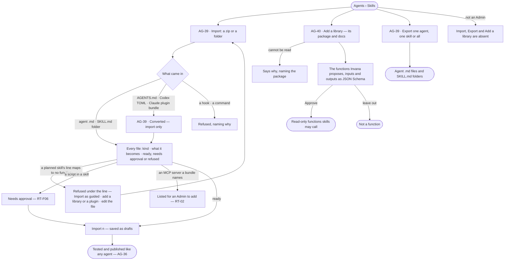
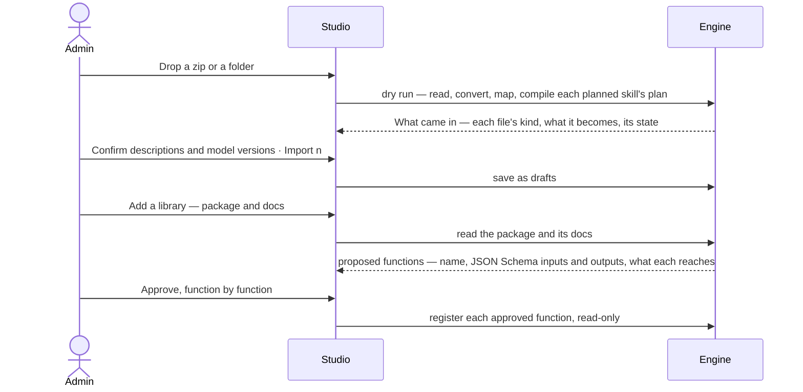

# Portable agents and skills

> Agents and skills come in and go out as the open files other agent systems already use — an agent is a Markdown
> file with front matter, a skill is a `SKILL.md` folder — with Invana's own fields riding under `metadata:`. Other
> formats are read and converted, never written. A library becomes functions only once an Admin approves them. The
> decision it helps make: *is this outside agent, skill or library safe to let in, and what will it become here?*

## User journey

## Stories

| ID | Story | Status |
|---|---|---|
| AG-39 | [Bring agents and skills in as standard files, and export them](stories/AG-39-bring-agents-and-skills-in-as-standard-files-and-export-them/story.md) | idea |
| AG-40 | [Turn a library into functions an Admin approves](stories/AG-40-turn-a-library-into-functions-an-admin-approves/story.md) | idea |

## Access

| Act | Role (`.claude/team/TEAM.md` §7) | Everyone else sees |
|---|---|---|
| Import agents and skills · export them | Admin | *Import* and *Export* are absent |
| Add a library · approve the functions it proposes | Admin | *Add a library* is absent; proposed functions read *Waiting for an Admin* |
| Approve a skill's script | Admin (RT-F06) | As RT-F06 |
| Read imported agents, skills and approved functions | Operator — every member of the install | — |

## States

| State | What the person sees |
|---|---|
| First use | Import reads *Drop a zip or a folder* with the formats it takes; *Tools they call* reads *No libraries* |
| Empty after a filter | — |
| Loading | Import reads *Reading the files…*; a library reads *Reading the package…* |
| Has data | *What came in* with every file's kind, what it becomes and its state; a library's proposed or approved functions |
| Failed | A refused file or line names why and what would make it map; a package that cannot be read is named |
| Agent working or proposing | Import mapping and converting the files and compiling each planned skill's plan; Invana proposing a library's functions |
| No access | Import, Export and *Add a library* are absent; everything saved reads |

## Rules

| Rule | Detail |
|---|---|
| An agent is a Markdown file | YAML front matter `name` · `description` · `model` · `tools` · `skills`, the body its instructions — the Claude-style agent file |
| A skill is a `SKILL.md` folder | The Agent Skills folder: `SKILL.md` with `name` and `description` in its front matter, and `references/`, `scripts/`, `assets/` beside it (AG-F04) |
| Invana's fields ride under `metadata:` | Voice, effort, when to use, how a skill runs, model version — every field the open format lacks; a file without them still imports |
| Read many, write one | `AGENTS.md`, Codex TOML agent files and Claude plugin bundles are import-only: converted to an agent `.md` and skill folders. Export writes only those two |
| The file round-trips | An exported agent or skill imports back unchanged |
| A dry run first | Every file is converted and mapped, every planned skill's plan compiled and every refusal named before anything is saved |
| Imported means draft | Imported agents and skills are drafts, tested and published like any other (AG-36) |
| Code only by approval | A library reaches a plan only as a function an Admin approved, read-only from then; a script runs only once an Admin approved it (RT-F06) |
| A plan is not portable | It is Invana's cache of a skill's text (AG-F04): never exported, compiled again on import |
| Nothing a bundle names starts | An MCP server in a bundle is listed for an Admin to add (RT-02); hooks and commands are refused |
| Leans on | The catalogue (AG-F02) · skills (AG-F04) · plugins and MCP servers (RT-F02) · skill scripts (RT-F06) · AI models (RT-F01) |

## Data touched

| Record | Read or write |
|---|---|
| Agents and skills of the install, and their versions | Write on import · read on export |
| An import's dry run — each file, its kind, what it becomes, its state | Read |
| A library, its proposed functions, their JSON Schema contracts and their approval | Write · read |
| Exported files | Read |

## Decisions

| Decision | Detail |
|---|---|
| Model aliases on import | `sonnet` · `opus` · `inherit` resolve to an exact offered version, shown for the Admin to confirm |
| A name already in the catalogue | Offered as a new version of it, or a rename |
| `AGENTS.md` | One draft agent, its body the instructions, named after its folder for the Admin to confirm |
| Codex TOML | Converted to the agent `.md` shape; every mapped field shown beside its source, an unmapped one named as left out |
| A Claude plugin bundle | Its agents and skills import; its MCP servers are listed for RT-02; a local-process server, a hook or a command is refused |
| A planned skill that will not compile | Refused under the line, with *Import as guided* (AG-F04) beside the refusal |
| Function contracts | A library's proposed functions declare their inputs and outputs as JSON Schema, as every function does (RT-F02) |
| Export | One agent, one skill or all; the plan is not exported |
| Versions of each format | `specs/system-design/integrations.md` › *Standards* |
| Not built yet | Import, export and libraries have no engine yet |

## Open questions

| Question | Who answers |
|---|---|
| `AGENTS.md` imports as one agent (recommended), or as rules of the graph (MO-F06)? | Ravi |
| A planned skill that will not compile on import: offer *Import as guided* (recommended), or refuse until the file is fixed? | Ravi |

## Not building

| Item | Why not |
|---|---|
| Exporting `AGENTS.md`, Codex TOML or plugin bundles | One portable format each for agents and skills; every other one is read only |
| Running a bundle's hooks or commands | Invana runs no code it did not approve, and a command is a prompt for a person at a terminal |
| Adding a bundle's MCP servers on import | An Admin adds a server deliberately (RT-02) |
| A remote catalogue or hub | Later |
| A function editor | Functions are code |
| Code generated per run, or frozen into a plan at publish | Runs must reproduce, and installs on premises run only approved code |
