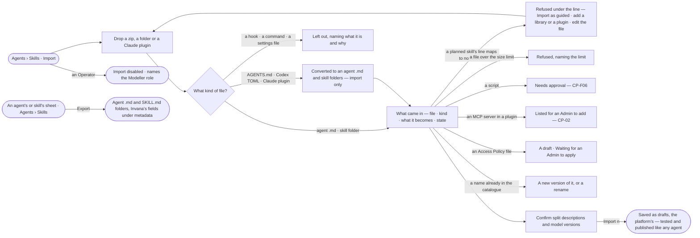

# AG-39 · Bring agents and skills in as standard files, and export them

**As** an agent builder **I want** to bring agents and skills in as the standard files and Claude plugins another
agent tool already uses, see what each becomes before anything is saved, and export them in the open formats
**so that** people move to Invana without rewriting, nothing brought in reaches more than an Admin applies, and what
Invana holds stays portable.

Tasks: [task.md](task.md) · Feature: [AG-F08](../../feature.md)

## Who can

*Portable — bring in* in [the role table](../../../../../../os/access/features/AC-F02-access-policies/feature.md#the-role-table).

| Lens | Can | Otherwise sees |
|---|---|---|
| Admin | All a Modeller can; apply the Access Policy files an import brought (AC-04) | — |
| Modeller | Import a zip, a folder or a Claude plugin, confirm what each file becomes, import; export one agent, one skill or all | A policy file reads *Waiting for an Admin to apply*; *Apply* is disabled, naming the Admin role |
| Operator | Read imported agents and skills once they are saved | *Import* and *Export* are disabled — *Needs the Modeller role — ask an Admin* |

## Flow

## Acceptance criteria

| # | Given | When | Then |
|---|---|---|---|
| AG-39.1 | Agents › Skills | a Modeller presses *Import* | a drop target takes a zip or a folder holding agent files, skill folders, an `AGENTS.md`, Codex TOML agent files or a Claude plugin; nothing is saved until *Import* |
| AG-39.2 | Dropped files | they are read | *What came in* lists every file — its kind, what it becomes and its state: *ready*, *needs approval*, *left out* or *refused* |
| AG-39.3 | An agent file — Markdown with YAML front matter | it is read | its front matter `name` · `description` · `model` · `tools` · `skills` and its body become the agent and its instructions; Invana's own fields — voice, voice dials, effort, its tests — are read from `metadata:` when present |
| AG-39.4 | A skill folder | it is read | `SKILL.md` and its folder become a draft version; Invana's own fields — when to use, how it runs, model version — are read from `metadata:`; without them the `description` is split into what it does and when to use it, shown for the importer to confirm |
| AG-39.5 | A planned skill's instructions | the import is dry run | its plan is compiled; a line that maps to no function is refused under that line, naming what would make it map — a library, a plugin or a rewrite — with *Import as guided* beside it |
| AG-39.6 | A file in a skill's `scripts/` | it is read | it reads *needs approval*; the skill imports, and publishes only once an Admin approved the script (CP-F06) |
| AG-39.7 | A model alias — `sonnet`, `opus`, `inherit` | it is read | it resolves to an exact version offered in Settings › AI and connections, shown for the importer to confirm; one no provider serves imports with no model to think with until a version is picked |
| AG-39.8 | A name already in the catalogue | it is read | it is offered as a new version of that agent or skill, or a rename |
| AG-39.9 | A `references/` file over the size limit | it is read | it is refused, naming the limit in characters |
| AG-39.10 | Nothing refused | the Modeller presses *Import n* | every agent and skill is saved as a draft, owned by the platform and made by the Modeller, granted to nobody; a skill with no tests imports and waits for them before it publishes |
| AG-39.11 | An agent, a skill or the whole catalogue | a Modeller presses *Export* | agent `.md` files and `SKILL.md` folders are written, Invana's fields under `metadata:`; the plan is not exported, and no `AGENTS.md`, TOML or Claude plugin is ever written |
| AG-39.12 | Files being read | the dry run is in progress | it reads *Reading the files…* and each row fills in as it is mapped |
| AG-39.13 | An Operator | they open Agents › Skills or a sheet | *Import* and *Export* are disabled — *Needs the Modeller role — ask an Admin*; the engine refuses the same from the API |
| AG-39.14 | An `AGENTS.md` | it is read | it becomes one draft agent whose instructions are its body, named after the folder it sat in, for the importer to confirm |
| AG-39.15 | A Codex TOML agent file | it is read | it is converted to the agent `.md` shape, each field it maps shown beside its source, and a field with no place named as left out |
| AG-39.16 | A Claude plugin — a folder with `.claude-plugin/plugin.json` | it is read | its agents and skills come in as AG-39.3 and AG-39.4; each MCP server its `.mcp.json` names is listed for an Admin to add in Settings (CP-02), never added by the import; a server started as a local process is refused, naming that Invana reaches servers by address |
| AG-39.17 | A hook, a command, a settings file or any other file a plugin carries | it is read | it is left out, naming what it is, that Invana runs no hooks or commands, and that only Access Policies grant reach |
| AG-39.18 | An Access Policy file in the import | *Import n* saves it | it lands as a draft reading *Waiting for an Admin to apply* and decides nothing; every Admin finds it in *Needs you*; a Modeller's *Apply* is disabled, naming the Admin role (AC-04.17) |
| AG-39.19 | An imported agent | its sheet opens | it reads *Imported*, with who imported it and from which file; *How it got here* on the import shows each mapped field beside its source |

## Screens

| Surface | Lens | First use | Empty after a filter | Loading | Has data | Failed | Agent working or proposing | No access |
|---|---|---|---|---|---|---|---|---|
| Import | Admin | agents.skills · Import | — | agents.skills · Reading the files | agents.skills · What came in | agents.skills · Refused line | agents.skills · Mapping | — |
| Import | Operator | — | — | — | — | — | — | agents.skills · Import disabled |
| A converted file — AGENTS.md, Codex TOML, a Claude plugin | Admin | — | — | agents.skills · Reading the files | agents.skills · Converted | agents.skills · Refused file | agents.skills · Mapping | — |
| A converted file — AGENTS.md, Codex TOML, a Claude plugin | Operator | — | — | — | — | — | — | agents.skills · Import disabled |
| A policy file brought in | Admin | — | — | — | settings.access · Waiting to apply | settings.access · Rule refused | — | — |
| A policy file brought in | Operator | — | — | — | — | — | — | access.locked · Waiting to apply |
| Export — a skill | Admin | — | — | — | agents.skill · Export | agents.skill · Could not export | — | — |
| Export — a skill | Operator | — | — | — | — | — | — | agents.skill |
| Export — an agent | Admin | — | — | — | agents.agent · Export | agents.agent · Could not export | — | — |
| Export — an agent | Operator | — | — | — | — | — | — | agents.agent · Read only |
