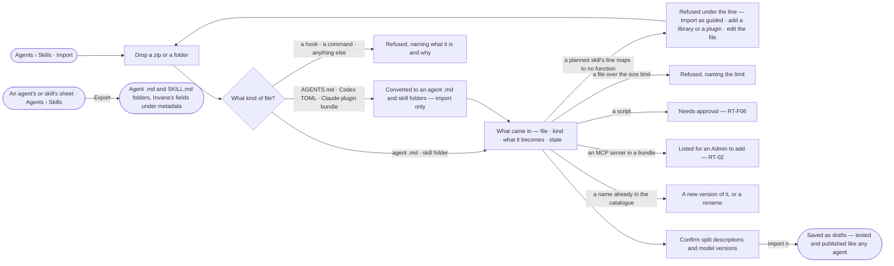

# AG-39 · Bring agents and skills in as standard files, and export them

**As** an install admin **I want** to bring agents and skills in as the standard files another agent system already
uses, see what each becomes before anything is saved, and export them in the open formats **so that** people move to
Invana without rewriting, and what Invana holds stays portable.

Tasks: [task.md](task.md) · Feature: [AG-F08](../../feature.md)

## Who can

| Lens | Can | Otherwise sees |
|---|---|---|
| Admin | Import a zip or a folder, confirm what each file becomes, import; export one agent, one skill or all | — |
| Operator | Read imported agents and skills once they are saved | *Import* and *Export* are absent. No grant adds them: they are an Admin's |

## Flow

## Acceptance criteria

| # | Given | When | Then |
|---|---|---|---|
| AG-39.1 | Agents › Skills | an Admin presses *Import* | a drop target takes a zip or a folder holding agent files, skill folders, an `AGENTS.md`, Codex TOML agent files or a Claude plugin bundle; nothing is saved until *Import* |
| AG-39.2 | Dropped files | they are read | *What came in* lists every file — its kind, what it becomes and its state: *ready*, *needs approval* or *refused* |
| AG-39.3 | An agent file — Markdown with YAML front matter | it is read | its front matter `name` · `description` · `model` · `tools` · `skills` and its body become the agent and its instructions; Invana's own fields — voice, voice dials, effort, its tests — are read from `metadata:` when present |
| AG-39.4 | A skill folder | it is read | `SKILL.md` and its folder become a draft version; Invana's own fields — when to use, how it runs, model version — are read from `metadata:`; without them the `description` is split into what it does and when to use it, shown for the Admin to confirm |
| AG-39.5 | A planned skill's instructions | the import is dry run | its plan is compiled; a line that maps to no function is refused under that line, naming what would make it map — a library, a plugin or a rewrite — with *Import as guided* beside it |
| AG-39.6 | A file in a skill's `scripts/` | it is read | it reads *needs approval*; the skill imports, and publishes only once an Admin approved the script (RT-F06) |
| AG-39.7 | A model alias — `sonnet`, `opus`, `inherit` | it is read | it resolves to an exact version offered in Settings › AI and connections, shown for the Admin to confirm; one no provider serves imports with no model to think with until a version is picked |
| AG-39.8 | A name already in the catalogue | it is read | it is offered as a new version of that agent or skill, or a rename |
| AG-39.9 | A `references/` file over the size limit | it is read | it is refused, naming the limit in characters |
| AG-39.10 | Nothing refused | the Admin presses *Import n* | every agent and skill is saved as a draft; a skill with no tests imports and waits for them before it publishes |
| AG-39.11 | An agent, a skill or the whole catalogue | the Admin presses *Export* | agent `.md` files and `SKILL.md` folders are written, Invana's fields under `metadata:`; the plan is not exported, and no `AGENTS.md`, TOML or plugin bundle is ever written |
| AG-39.12 | Files being read | the dry run is in progress | it reads *Reading the files…* and each row fills in as it is mapped |
| AG-39.13 | A member who is not an Admin | they open Agents › Skills or a sheet | *Import* and *Export* are absent |
| AG-39.14 | An `AGENTS.md` | it is read | it becomes one draft agent whose instructions are its body, named after the folder it sat in, for the Admin to confirm |
| AG-39.15 | A Codex TOML agent file | it is read | it is converted to the agent `.md` shape, each field it maps shown beside its source, and a field with no place named as left out |
| AG-39.16 | A Claude plugin bundle | it is read | its agents and skills come in as AG-39.3 and AG-39.4; each MCP server it names is listed for an Admin to add in Settings (RT-02), never added by the import; a server started as a local process is refused, naming that Invana reaches servers by address |
| AG-39.17 | A hook, a command or any other file a bundle carries | it is read | it is refused, naming what it is and that Invana runs no hooks or commands |

## Screens

| Surface | Lens | First use | Empty after a filter | Loading | Has data | Failed | Agent working or proposing | No access |
|---|---|---|---|---|---|---|---|---|
| Import | Admin | agents.skills · Import | — | agents.skills · Reading the files | agents.skills · What came in | agents.skills · Refused line | agents.skills · Mapping | — |
| Import | Operator | — | — | — | — | — | — | agents.skills |
| A converted file — AGENTS.md, Codex TOML, a plugin bundle | Admin | — | — | agents.skills · Reading the files | agents.skills · Converted | agents.skills · Refused file | agents.skills · Mapping | — |
| A converted file — AGENTS.md, Codex TOML, a plugin bundle | Operator | — | — | — | — | — | — | agents.skills |
| Export — a skill | Admin | — | — | — | agents.skill · Export | agents.skill · Could not export | — | — |
| Export — a skill | Operator | — | — | — | — | — | — | agents.skill |
| Export — an agent | Admin | — | — | — | agents.agent · Export | agents.agent · Could not export | — | — |
| Export — an agent | Operator | — | — | — | — | — | — | agents.agent · Read only |
