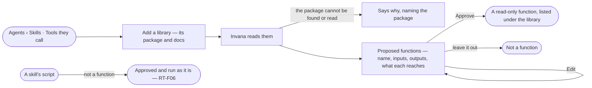

# AG-40 · Turn a library into functions an Admin approves

**As** an install admin **I want** to add a library by its package and docs, and approve each function Invana proposes
from it **so that** skills can use the library without anyone writing a script, and no code reaches a plan that I did
not approve. *Invana proposes → the Admin decides.*

Tasks: [task.md](task.md) · Feature: [AG-F08](../../feature.md)

## Who can

| Lens | Can | Otherwise sees |
|---|---|---|
| Admin | Add a library, read the functions Invana proposes, edit, approve or leave out each | — |
| Operator | Read approved functions, where each comes from and which skills call it | *Add a library* is absent; proposed functions read *Waiting for an Admin*. No grant adds them |

## Flow

## Acceptance criteria

| # | Given | When | Then |
|---|---|---|---|
| AG-40.1 | Agents › Skills | an Admin presses *Add a library* | it asks for the package and its docs |
| AG-40.2 | A package and docs | Invana reads them | it proposes typed functions, each with its name, inputs and outputs as JSON Schema, and what it reaches, with *Approve* and *Edit* per row |
| AG-40.3 | A proposed function | the Admin approves it | it is listed under *Tools they call* by where it comes from, read-only from then, and skills may call it |
| AG-40.4 | A proposed function the Admin leaves out | a skill's plan names it | the plan is refused before it runs, naming the function |
| AG-40.5 | A script in a skill's `scripts/` | Invana reads the skill | it is not proposed as a function; it is approved and run unchanged as a skill script (RT-F06) |
| AG-40.6 | A library being read | the Admin waits | it reads that Invana is reading the package; the rest of Skills stays usable |
| AG-40.7 | A package that cannot be found or read | Invana reads it | it says why, naming the package; nothing is proposed |
| AG-40.8 | Approved functions | anyone opens *Tools they call* | each lists where it comes from and how many skills call it; one nothing calls reads *not used yet*; proposals still open read *n to review* |
| AG-40.9 | A function from a plugin an Admin disabled | it is listed | it says its plugin is disabled |
| AG-40.10 | A member who is not an Admin | they open *Tools they call* | approved functions read; *Add a library* is absent; open proposals read *Waiting for an Admin* |
| AG-40.11 | Proposed functions | the Admin opens *How it got here* | the steps show which parts of the docs each function was read from |

## Screens

| Surface | Lens | First use | Empty after a filter | Loading | Has data | Failed | Agent working or proposing | No access |
|---|---|---|---|---|---|---|---|---|
| Tools they call | Admin | agents.skills · No libraries | — | agents.skills · Loading | agents.skills | agents.skills · Could not load | — | — |
| Tools they call | Operator | agents.skills · No libraries | — | agents.skills · Loading | agents.skills | agents.skills · Could not load | — | agents.skills |
| Add a library | Admin | agents.skills · Add a library | — | agents.skills · Reading the package | agents.skills · Proposed functions | agents.skills · Package not found | agents.skills · Proposing functions | — |
| Add a library | Operator | — | — | — | — | — | — | agents.skills |
