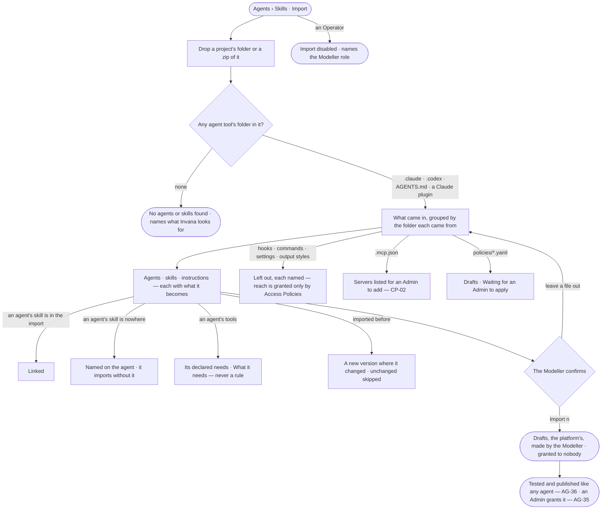

# AG-63 · Bring in agents and skills from an agent tool's folder

**As** an agent builder **I want** to drop a project whose team already works with Claude Code or Codex and have
Invana find the agents, skills and instructions in its `.claude/`, `.codex/` and `AGENTS.md`, and propose what each
becomes **so that** a team keeps the agents it already trusts, and runs them here as the same agents for everyone —
reaching only what an Admin applies. *Invana proposes → the Modeller decides.*

Tasks: [task.md](task.md) · Feature: [AG-F08](../../feature.md)

## Who can

*Portable — bring in* in [the role table](../../../../../../os/access/features/AC-F02-access-policies/feature.md#the-role-table).

| Lens | Can | Otherwise sees |
|---|---|---|
| Admin | All a Modeller can; apply the Access Policy files the folder brought (AC-04); grant the imported agents (AC-22) | — |
| Modeller | Drop a project's folder or a zip of it, read what Invana found in each agent tool's folder, confirm or leave out each file, import | Policy files read *Waiting for an Admin to apply*; *Apply* and *Grant* are disabled, naming the Admin role |
| Operator | Read the imported agents and skills once they are saved | *Import* is disabled — *Needs the Modeller role — ask an Admin* |

## Flow

## Acceptance criteria

| # | Given | When | Then |
|---|---|---|---|
| AG-63.1 | Agents › Skills | a Modeller drops a project's folder or a zip of it on *Import* | Invana finds every agent tool's folder in it at any depth — `.claude/` (`agents/`, `skills/`, `CLAUDE.md`), `.codex/` (TOML agent files, `skills/`), `AGENTS.md`, a Claude plugin — and *What came in* groups every file under the folder it came from |
| AG-63.2 | An agent file, a skill folder, an `AGENTS.md`, a `CLAUDE.md` or a Codex TOML file found | it is read | it is read and converted as AG-39 reads it — AG-39.3, AG-39.4, AG-39.14 and AG-39.15, `CLAUDE.md` as `AGENTS.md` |
| AG-63.3 | An agent whose `skills` name a skill | the dry run maps it | a skill in the same import is linked to it; one neither imported nor in the catalogue is named on the agent, which imports without it |
| AG-63.4 | An agent whose `tools` list tools | the dry run maps it | each becomes a declared need shown in *What it needs*, mapped to Invana's function or tool where one matches, the rest named as left out; no rule is written from them, and the agent reaches nothing until an Access Policy an Admin applied allows it |
| AG-63.5 | A hook, a command, a settings file, an output style or a memory file in a tool's folder | it is read | it is left out, each named with why — Invana runs no hooks or commands, and only Access Policies grant reach |
| AG-63.6 | A folder's `.mcp.json` | it is read | each server is listed for an Admin to add in Settings (CP-02), never added by the import; one started as a local process is refused, naming that Invana reaches servers by address |
| AG-63.7 | An Access Policy file — `policies/*.yaml` — in the folder | *Import n* saves it | it lands as a draft reading *Waiting for an Admin to apply* and decides nothing; every Admin finds it in *Needs you*; only an Admin's *Apply*, after *Who it changes*, puts it in force (AC-04.17) |
| AG-63.8 | A folder imported before | it is dropped again | each agent or skill that changed is offered as a new version, each unchanged one reads *Unchanged* and is skipped, and one gone from the folder is named and left as it is |
| AG-63.9 | A dropped folder with no agent tool's folder, plugin, agent file or skill folder | it is read | it reads *No agents or skills found*, naming what Invana looks for; nothing is saved |
| AG-63.10 | An Operator | they open Agents › Skills | *Import* is disabled — *Needs the Modeller role — ask an Admin*; the engine refuses the same from the API |
| AG-63.11 | The files being read | the dry run is in progress | it reads *Reading the files…*; each folder's group and each row fill in as they are mapped |
| AG-63.12 | Nothing refused | the Modeller presses *Import n* | every agent and skill is saved as a draft, owned by the platform and made by the Modeller, granted to nobody until an Admin grants it; History records the import with the folders it read |
| AG-63.13 | An agent the import made | its sheet opens | it reads *Imported*, naming the folder and file it came from; *How it got here* on the import shows each mapped field beside its source and each file left out with why |

## Screens

| Surface | Lens | First use | Empty after a filter | Loading | Has data | Failed | Agent working or proposing | No access |
|---|---|---|---|---|---|---|---|---|
| Import — a project's folder | Admin | agents.skills · Import | — | agents.skills · Reading the files | agents.skills · Tool folders found | agents.skills · No agents found | agents.skills · Mapping | — |
| Import — a project's folder | Operator | — | — | — | — | — | — | agents.skills · Import disabled |
| An agent's declared needs and skills | Admin | — | — | agents.skills · Reading the files | agents.skills · Needs and skills mapped | agents.skills · Skill not found | agents.skills · Mapping | — |
| An agent's declared needs and skills | Operator | — | — | — | — | — | — | agents.skills · Import disabled |
| Policy files brought in | Admin | — | — | — | settings.access · Waiting to apply | settings.access · Rule refused | — | — |
| Policy files brought in | Operator | — | — | — | — | — | — | settings.access · Waiting to apply |
| An imported agent | Admin | — | — | agents.agent · Loading | agents.agent · Imported | agents.agent · Could not load | — | — |
| An imported agent | Operator | — | — | agents.agent · Loading | agents.agent · Imported | agents.agent · Could not load | — | agents.agent · Read only |
