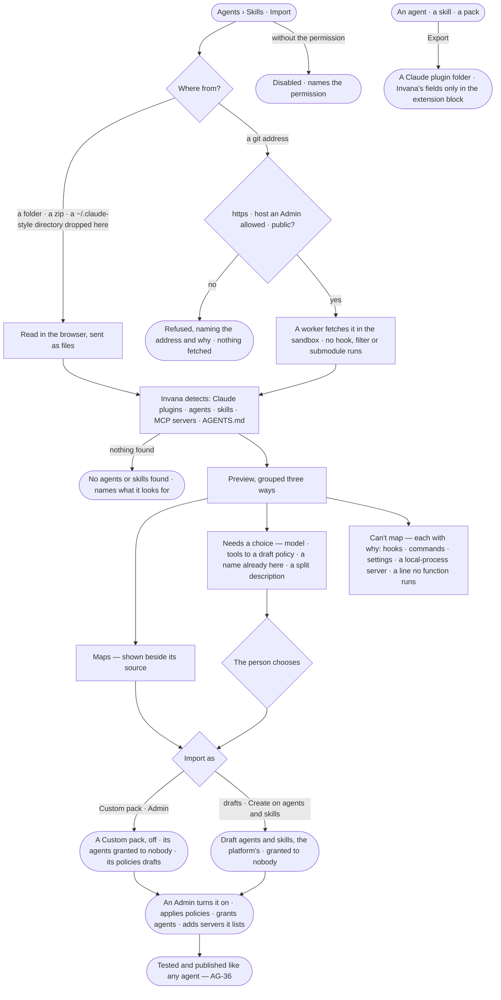

# AG-64 · Bring my agents over and take Invana's out

**As** an agent builder or an Admin **I want** to point Invana at the agents, skills and MCP setup I already use — a folder, a git address or a `~/.claude`-style directory — see what each becomes and what needs my choice, import them as a Custom pack, and export any pack, agent or skill as a Claude plugin **so that** onboarding is one step in, nothing I bring widens anyone's reach, and I can always take what I built here back out to the tools I use. *Invana proposes → the person decides.*

Tasks: [task.md](task.md) · Feature: [AG-F08](../../feature.md)

## Who can

*Portable — bring in* in [the permission catalogue](../../../../../../os/access/features/AC-F02-access-policies/feature.md#the-permission-catalogue); a Custom pack is a pack ([CP-20](../../../../../../os/control/features/CP-F02-plugins-and-outside-tools/stories/CP-20-install-a-team-pack/story.md)).

| Access | Can | Otherwise sees |
|---|---|---|
| Admin | Preview a source; import it as a Custom pack (Create on `setting/team-packs`) or as drafts (Create on `agent/*` and `skill/*`); turn the pack on; apply the draft policies after *Who it changes* (AC-04); grant the agents (AC-22); add the MCP servers it lists (CP-02); export any pack, agent or skill | — |
| Operator | Read what an import brought. With Create on `agent/*` and `skill/*` (usually *Build agents*): preview a source, answer the choices, import as drafts, export agents and skills they may read | *Import as a Custom pack* is disabled — *Needs Create on Settings — ask {who can grant}*; *Import* and *Export* are disabled — *Needs Create on Agents and Skills — ask {who can grant}*; policy drafts read *Waiting for an Admin to apply* |

## Flow

## Acceptance criteria

| # | Given | When | Then |
|---|---|---|---|
| AG-64.1 | Agents › Skills · Import | a person chooses a source | it takes a dropped folder, a zip, a `~/.claude`-style directory dropped as a folder, or a git address; the engine never reads a path of its own machine, and nothing is saved until *Import* |
| AG-64.2 | A git address | it is given | it is fetched only over https from a host an Admin allowed, a public repository, without a credential; a private, unique-local, shared, mapped or metadata address, an un-allowed host or a redirect to one is refused, naming the address and why, and nothing is fetched (NFR-SEC-16) |
| AG-64.3 | A fetched repository | it is read | no git hook, filter, submodule or script runs; the fetch is capped in size and time; History records the address and the commit read |
| AG-64.4 | Any source | it is read | Invana detects and lists, grouped by where each came from, every Claude plugin, agent, skill, MCP server — from `.mcp.json` or a `~/.claude`-style `mcpServers` — and `AGENTS.md`, with counts per kind |
| AG-64.5 | What was detected | the preview opens | every item is in one of three groups — *Maps*, *Needs a choice*, *Can't map* — and each *Can't map* item names why and what would make it map |
| AG-64.6 | An agent whose model is an alias, whose name is already in the catalogue or whose description needs splitting | the preview opens | each is a choice — an exact model version offered here, a new version or a rename, a confirmed split — with a recommended answer shown and nothing saved until the person confirms |
| AG-64.7 | An agent whose `tools` list tools | the preview opens | a choice reads *Write a draft policy from these tools*, off by default; when chosen, one Access Policy draft per agent is written for exactly the tools that map to a function or tool here, and a tool that maps to nothing is named as left out |
| AG-64.8 | An imported agent or skill | it exists | it has no tool, function or data reach beyond the Access Policy an Admin applied; a draft policy decides nothing and the agent reaches nothing until it is applied |
| AG-64.9 | An Admin with Create on `setting/team-packs` | they press *Import as a Custom pack* | a Custom pack is installed — off until an Admin turns it on, its agents granted to nobody, its policy files drafts waiting for an Admin to apply, the MCP servers it names listed for an Admin to add (CP-02); History records the source, who and the counts |
| AG-64.10 | A person with Create on `agent/*` and `skill/*` but not on `setting/team-packs` | they press *Import n* | the agents and skills are saved as drafts, owned by the platform and made by them, granted to nobody, as AG-63.12 |
| AG-64.11 | A skill's `scripts/`, a hook, a command or a settings file in a source | the import runs | nothing is executed at import: a script reads *needs approval* and runs only once an Admin approved it (CP-F06); a hook, a command and a settings file are left out, named |
| AG-64.12 | An agent's instructions, a skill's text or an `AGENTS.md` | it is read or mapped | it is outside text: shown fenced as data in the preview, read by any model call that splits a description or maps a tool as data with no tool and no policy to act under, and never followed; the agent stays a draft until a person tests and publishes it (AG-36) |
| AG-64.13 | A source imported before | it is read again | each changed item is a new version, each unchanged one reads *Unchanged* and is skipped, as AG-63.8 |
| AG-64.14 | A pack, a Custom pack, an agent or a skill | a person with the permission presses *Export* | a Claude plugin folder is written — `.claude-plugin/plugin.json`, `agents/*.md`, `skills/<name>/SKILL.md`, `policies/*.yaml`, `.mcp.json` and the pack's `project_types/`, `ontology/` and `lenses/` — with no secret, no plan and no grant a person made |
| AG-64.15 | An exported plugin | Invana's fields are removed from `metadata.invana` and the `invana:` front-matter key | what remains is a valid Claude plugin with the same agents and skills; no Invana field sits anywhere else, so it loads unchanged in Claude Code |
| AG-64.16 | An exported plugin | it is imported again | it comes back unchanged |
| AG-64.17 | A file with no Invana fields — one made for Claude Code, the Agent Skills standard, `AGENTS.md` or an MCP config | it is read | it imports; the fields Invana needs are choices in the preview |
| AG-64.18 | A person without the permission an act needs | they reach *Import as a Custom pack*, *Import* or *Export* | it is disabled, naming the permission; the engine refuses it the same from the API |
| AG-64.19 | A source with nothing Invana reads | it is read | it reads *No agents or skills found*, naming what Invana looks for; nothing is saved |
| AG-64.20 | A source being fetched or read | the dry run is in progress | it reads *Reading…*; each group fills in as items are detected and mapped |

## Screens

| Surface | Access | First use | Empty after a filter | Loading | Has data | Failed | Agent working or proposing | No access |
|---|---|---|---|---|---|---|---|---|
| Choose a source | Admin | agents.skills · Import · Source | — | agents.skills · Import · Fetching | agents.skills · Import · Source | agents.skills · Import · Address refused | — | — |
| Choose a source | Operator | agents.skills · Import · Source | — | agents.skills · Import · Fetching | agents.skills · Import · Source | agents.skills · Import · Address refused | — | agents.skills · Import disabled |
| The preview | Admin | — | agents.skills · Import · No agents found | agents.skills · Import · Reading the files | agents.skills · Import · Preview | agents.skills · Import · Preview · Can't map | agents.skills · Import · Mapping | — |
| The preview | Operator | — | agents.skills · Import · No agents found | agents.skills · Import · Reading the files | agents.skills · Import · Preview | agents.skills · Import · Preview · Can't map | agents.skills · Import · Mapping | agents.skills · Import disabled |
| The choices | Admin | — | — | — | agents.skills · Import · Choices | agents.skills · Import · Choices · Skill not found | agents.skills · Import · Choices · Proposed | — |
| The choices | Operator | — | — | — | agents.skills · Import · Choices | agents.skills · Import · Choices · Skill not found | agents.skills · Import · Choices · Proposed | agents.skills · Import disabled |
| A Custom pack | Admin | — | — | — | settings.packs · Custom pack | settings.packs · Custom pack · Refused | — | — |
| A Custom pack | Operator | — | — | — | settings.packs · Custom pack · Read only | — | — | settings.packs · Packs · Read only |
| Draft policies and servers it brought | Admin | — | — | — | settings.policies · Waiting to apply | settings.policies · Rule refused | — | — |
| Draft policies and servers it brought | Operator | — | — | — | settings.plugins · Servers to add · Read only | — | — | settings.policies · No access |
| Export | Admin | — | — | agents.skills · Export · Writing | agents.skills · Export | agents.skills · Export · Refused | — | — |
| Export | Operator | — | — | agents.skills · Export · Writing | agents.skills · Export | agents.skills · Export · Refused | — | agents.skills · Export disabled |
