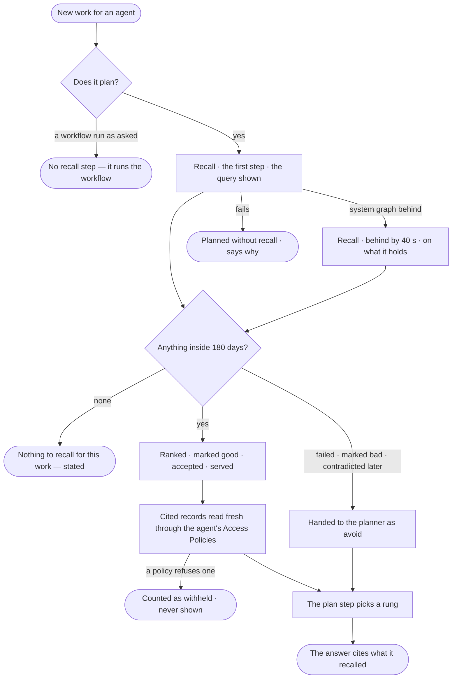

# AG-50 · The next run builds on the last

**As** an analyst whose agents work the same kind of question again and again **I want** each new run to recall what
served before, what was concluded and what failed — and cite it **so that** it builds on past work instead of starting
cold or repeating a mistake, and I can check what it recalled.

Tasks: [task.md](task.md) · Feature: [AG-F09](../../feature.md)

## Who can

| Lens | Can | Otherwise sees |
|---|---|---|
| Admin | Read the recall step of a run they may read — its query, its items, each item's label and why it ranks, and the records it cites | On a run they may not read, the recall step is withheld, naming who may read it |
| Operator | Read the recall step of a run they are behind or, for a project's run, whose sources their default agent may see; a Modeller the same ([the role table](../../../../../../os/access/features/AC-F02-access-policies/feature.md#the-role-table)) | On anyone else's run, the recall step is withheld, naming who may read it ([AC-31](../../../../../../os/access/features/AC-F09-what-left-the-platform/stories/AC-31-keep-a-runs-content-to-those-who-may-read-it/story.md)) |

## Flow

## Acceptance criteria

| # | Given | When | Then |
|---|---|---|---|
| AG-50.1 | New work an agent plans | the run starts | its first step is *Recall*, shown with the plan's steps like any other, before the rung is chosen |
| AG-50.2 | A recall step | it runs | it matches the thinking graph on the work's intent, its agent, the skill applied and the records it names, inside the last 180 days, and the query is shown |
| AG-50.3 | Items found | the step settles | they are ranked *marked good* · *accepted* · *served*, newest first within each, and each names its label and why it ranks |
| AG-50.4 | An item that failed, is *marked bad* or was *contradicted later* | the step settles | it is handed to the planner as *avoid*, never as something to build on, and the plan step names what it avoided |
| AG-50.5 | Recalled findings and decisions | the answer is written | it cites them inline, each opening its node in the thinking graph |
| AG-50.6 | A record a recalled item cites | the step reads it | it reads it fresh through the agent's Access Policies; a record the policies refuse is never shown, and the step says how many were withheld |
| AG-50.7 | Nothing inside the window | the step settles | it states *Nothing to recall for this work*, with the query, and is never skipped silently |
| AG-50.8 | A node older than 180 days | a recall step runs | it is not recalled; it stays readable in the thinking graph |
| AG-50.9 | An item from a run the person behind the new run may not read | it is recalled | it carries only the plan or workflow, its outcome labels and record IDs — never that run's content |
| AG-50.10 | More than 20 items match | the step settles | it hands the first 20, counts the rest and states the limit |
| AG-50.11 | The system graph behind | a recall step runs | it says how far behind it is and recalls what it holds; the run still answers |
| AG-50.12 | A recall step that fails | the plan step runs | the run plans without recall, saying why, and never fails for it |
| AG-50.13 | A workflow run as asked, with its arguments | the run starts | no recall step runs, and nothing is added to the run behind the scenes |
| AG-50.14 | A recall step | the person opens *How it got here* | it shows the query, the items and what the plan step made of them |
| AG-50.15 | A recalled record later corrected | the person opens its citation | it opens the record as it is now, with its own history |
| AG-50.16 | An Operator not behind the run, and not reading a project's run whose sources their default agent may see | they open the run | the recall step is withheld, naming who may read it |

## Screens

| Surface | Lens | First use | Empty after a filter | Loading | Has data | Failed | Agent working or proposing | No access |
|---|---|---|---|---|---|---|---|---|
| The recall step on the answer | Admin | explore.board · Nothing to recall | explore.board · Nothing to recall | explore.board · Recalling | explore.board · Recall | explore.board · Planned without recall | explore.board · Recall behind | — |
| The recall step on the answer | Operator | explore.board · Nothing to recall | explore.board · Nothing to recall | explore.board · Recalling | explore.board · Recall | explore.board · Planned without recall | explore.board · Recall behind | — |
| The recall step in the run's trace | Admin | agents.run.answer · Nothing to recall | — | agents.run.answer · Loading | agents.run.answer · Recall | agents.run.answer · Planned without recall | agents.run.answer · Recalling | — |
| The recall step in the run's trace | Operator | agents.run.answer · Nothing to recall | — | agents.run.answer · Loading | agents.run.answer · Recall | agents.run.answer · Planned without recall | agents.run.answer · Recalling | agents.run.answer · Withheld |
