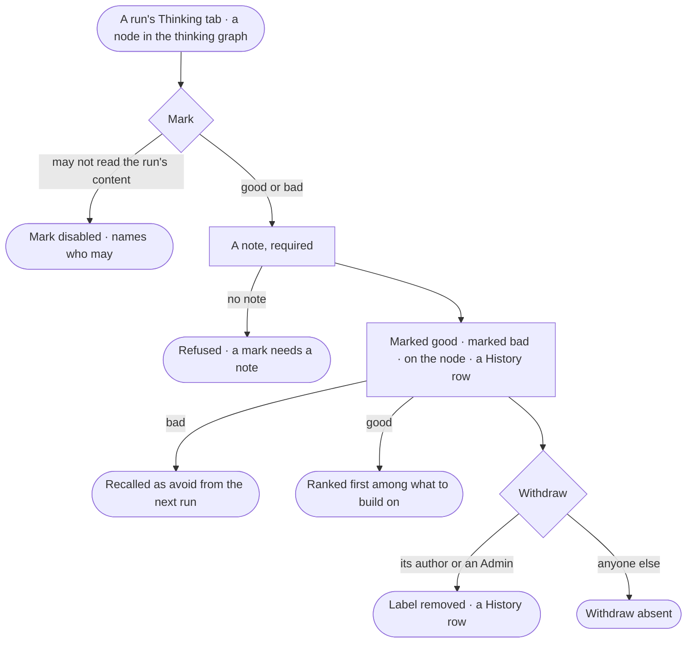

# AG-55 · Mark thinking good or bad

**As** the person behind a run **I want** to mark the run, its plan, its workflow or
something it recalled as good or bad, with a note **so that** the next run builds on what I trust and avoids what I
know is wrong.

Tasks: [task.md](task.md) · Feature: [AG-F09](../../feature.md)

## Who can

| Lens | Can | Otherwise sees |
|---|---|---|
| Admin | Mark a run, plan, workflow or recalled item they may read good or bad; withdraw any mark | *Mark* disabled on a run they may not read, naming who may |
| Operator | An Operator or a Modeller ([the role table](../../../../../../os/access/features/AC-F02-access-policies/feature.md#the-role-table)): mark from a run they are behind or, for a project's run, whose sources their default agent may see; withdraw their own mark | *Mark* disabled, naming who may — whoever may read the run's content; *Withdraw* absent on someone else's mark |

## Flow

## Acceptance criteria

| # | Given | When | Then |
|---|---|---|---|
| AG-55.1 | A run whose content the person may read | they mark it, its plan, its workflow or a recalled item good or bad, with a note | the node reads *marked good* or *marked bad*, with the note and who marked it |
| AG-55.2 | A mark | it is made | a History row records who, which node, from which run, the mark and the note |
| AG-55.3 | A node *marked bad* | the next run recalls it | it is handed to the planner as *avoid* while any bad mark on it stands |
| AG-55.4 | A node *marked good* and no bad mark | the next run recalls it | it ranks first among what to build on |
| AG-55.5 | A mark | its author or an Admin withdraws it | the label is removed, recall stops using it from the next run, and a History row records it; anyone else is refused |
| AG-55.6 | A person who may not read the run's content | they try to mark | *Mark* is disabled, naming who may; through the API it is refused |
| AG-55.7 | A mark with no note | it is sent | it is refused — *A mark needs a note.* |
| AG-55.8 | A recalled item | it is marked | the mark sits on the plan, workflow, finding or decision it recalled, linked to the run it was marked from |
| AG-55.9 | Two people mark the same node differently | the node is read | both marks show, each with its author and note |
| AG-55.10 | The person marks a node again | the new mark is sent | it replaces their earlier mark on that node; History keeps both |

## Screens

| Surface | Lens | First use | Empty after a filter | Loading | Has data | Failed | Agent working or proposing | No access |
|---|---|---|---|---|---|---|---|---|
| Mark on a run's Thinking tab | Admin | agents.run.thinking · Not marked | — | agents.run.thinking · Marking | agents.run.thinking · Marked | agents.run.thinking · Mark needs a note | — | — |
| Mark on a run's Thinking tab | Operator | agents.run.thinking · Not marked | — | agents.run.thinking · Marking | agents.run.thinking · Marked | agents.run.thinking · Mark needs a note | — | agents.run.thinking · Mark disabled |
| Marks on a node | Admin | agents.thinking · Not marked | — | agents.thinking · Node loading | agents.thinking · Node marks | agents.thinking · Mark needs a note | — | — |
| Marks on a node | Operator | agents.thinking · Not marked | — | agents.thinking · Node loading | agents.thinking · Node marks | agents.thinking · Mark needs a note | — | agents.thinking · Mark disabled |
