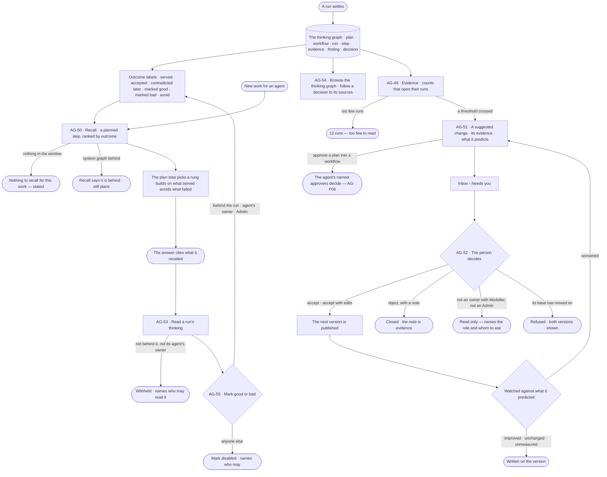
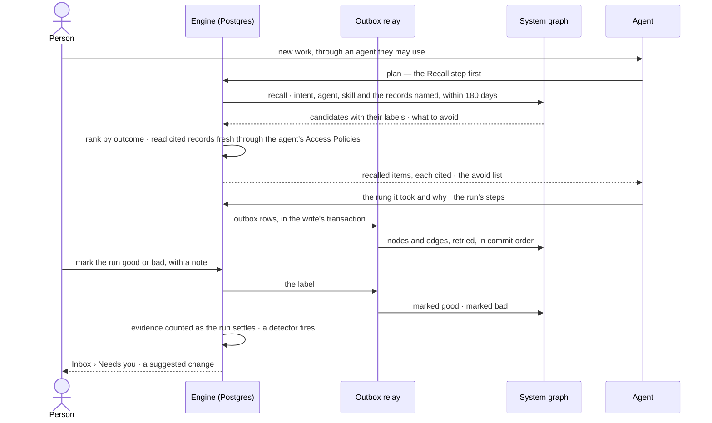

# Thinking graph and memory

> What carries from one run to the next: every plan, workflow, run, step, evidence, finding and decision, kept and
> linked in the thinking graph and labelled by how it fared — so the next plan builds on what served and avoids what
> failed, cited, and a person changes a skill, workflow or rule only on evidence they can open.
> The decision it helps make: *which plan to trust for this work, and which skill, workflow, agent or rule should
> change, given what past runs show?*

## User journey

Journeys this feature is a step of: [J02 · Ask and trust the answer](../../../../journeys/J02-ask-and-trust-the-answer.md) · [J04 · Build an agent and improve it from what runs teach](../../../../journeys/J04-build-an-agent-and-improve-it-from-what-runs-teach.md)

## Stories

| ID | Story | Status |
|---|---|---|
| AG-50 | [The next run builds on the last](stories/AG-50-the-next-run-builds-on-the-last/story.md) | idea |
| AG-53 | [Read a run's thinking](stories/AG-53-read-a-runs-thinking/story.md) | idea |
| AG-55 | [Mark thinking good or bad](stories/AG-55-mark-thinking-good-or-bad/story.md) | idea |
| AG-54 | [Browse the thinking graph](stories/AG-54-browse-the-thinking-graph/story.md) | idea |
| AG-49 | [See what is failing quietly](stories/AG-49-see-what-is-failing-quietly/story.md) | idea |
| AG-51 | [A suggested change, with its evidence](stories/AG-51-a-suggested-change-with-its-evidence/story.md) | idea |
| AG-52 | [Accept, edit or reject a suggested change, then see if it helped](stories/AG-52-decide-on-a-suggested-change/story.md) | idea |

## Access

The role × feature table is [AC-F02 › The role table](../../../../os/access/features/AC-F02-access-policies/feature.md#the-role-table)
(*thinking graph and memory*: Operator Acts · Modeller Acts · Admin Acts); this is what it means here. Who reads a
run's content is [AC-31](../../../../os/access/features/AC-F09-what-left-the-platform/stories/AC-31-keep-a-runs-content-to-those-who-may-read-it/story.md)'s, never restated.

| Act | Role | Everyone else sees |
|---|---|---|
| Read a recall step, a run's thinking and the nodes of its run | The person behind the run · its agent's owners · Admin | That it ran, its status and its tokens; the plan or workflow it used, its outcome labels and the record IDs it cited — content *withheld*, naming who may read it |
| Browse the thinking graph and follow a decision to its sources | Operator · Modeller · Admin | — (nodes of runs they may not read show as above) |
| Mark a run, plan, workflow or recalled item good or bad · withdraw one's own mark | The person behind the run · its agent's owners · Admin | *Mark* disabled, naming who may |
| Read Evidence and every suggested change | Operator · Modeller · Admin | — (the runs a count opens follow run privacy) |
| Decide a suggested change to a skill, a workflow, an agent's skills or an answer template | Its owners holding Modeller ([AC-F07](../../../../os/access/features/AC-F07-ownership/feature.md)) · Admin | Read only — *needs Modeller and ownership*, naming the owners to ask |
| Decide a suggested change to a model rule or meaning | Modeller · Admin, through the model's own review ([SE-F02](../../../semantics/features/SE-F02-change-and-publish-a-model/feature.md)) | Read only — *needs Modeller*, naming an owner or an Admin to ask |
| Decide an index suggestion | Admin | Read only — *only an Admin adds an index*, naming one |
| Approve a plan into a workflow that a suggested change proposes | The agent's named approvers ([AC-F05](../../../../os/access/features/AC-F05-asks-and-approvals/feature.md)) | The ask reads, with who it waits on |

## States

| State | What the person sees |
|---|---|
| First use | No runs yet: the thinking graph and Evidence say they fill as runs settle; recall says *Nothing to recall for this work*; no suggested change waits |
| Empty after a filter | Nothing matches the agent, workflow, label, person or window: the filter named, with *Clear filters*; Evidence with nothing wrong says so in a sentence, never a board of zeroes |
| Loading | The thinking graph and Evidence load with their window named; a recall step reads *Recall ·* its count as it settles |
| Has data | Recalled items ranked by outcome, each with its label and why; a run's rung and what it avoided; the thinking graph drawn on the canvas; counts ranked by the size of the gap; a suggested change with its difference, evidence and prediction |
| Failed | A recall step that failed, named on the step, the plan made without it; the system graph behind or down, said with how far; a suggested change refused because its base moved on, both versions shown |
| Agent working or proposing | A run planning — *Recalling*, then the rung it chose; a suggested change waiting in Inbox › Needs you, from a detector or an agent, named |
| No access | A run's thinking withheld, naming who may read it; *Mark* disabled, naming who may; a suggested change read only, naming the role it needs and whom to ask |

## Rules

| Rule | Detail |
|---|---|
| Memory is the thinking graph | An agent carries nothing from one run to the next by itself. What it knows next time is a node of the thinking graph it recalls with a planned step, or a change a person accepted |
| Every piece of thinking is a node | Every plan, workflow, run, step, evidence, finding and decision is a node in the system graph, linked: a run ran a plan or a workflow · a plan composed workflows · a step found evidence citing records by ID · a finding came from steps · a decision weighed findings · a decision supersedes another · a workflow was approved from a plan |
| Never customer data | The thinking graph holds record IDs and keyed hashes, never a record's values; a person reading a cited record reads it fresh, through the agent's Access Policies ([system-design § 12 › Privacy](../../../../system-design.md#privacy)) |
| Postgres is the truth | Each node mirrors a Postgres record its owner writes; the system graph follows through the outbox, retried, rebuildable from History ([system-design § 6](../../../../system-design.md#6-data-and-storage) · NFR-REL-6) |
| Recall is a planned step | Every run that plans starts with a *Recall* step, before the plan step picks a rung on the ladder ([AG-F06](../AG-F06-plans-and-workflows/feature.md)); it is recorded and cited like any step, and states *Nothing to recall for this work* when there is nothing. A workflow run as asked, with its arguments, does not plan and does not recall |
| Recall matches, it does not guess | Candidates are nodes sharing the work's intent, its agent, the skill applied or the records it names — a query over the thinking graph, explainable item by item |
| Recall ranks by outcome | *Marked good* · *accepted* · *served* rank first, newest first within each; *contradicted later* · *marked bad* · a failure are handed to the planner as *avoid* — what not to repeat — and never built on |
| Any bad mark wins | While any live *marked bad* sits on a node, recall hands it as *avoid*, whatever else is on it |
| History is kept; recall ages out | Every node is kept for as long as its Postgres record; recall reads only the last 180 days. An older node is readable in the thinking graph, never recalled |
| Recall respects run privacy | From a run the person behind the new run may not read, recall carries only the plan or workflow, its outcome labels and record IDs — never the run's content. Every cited record is read fresh through the agent's Access Policies, so recall never shows what the person may not read |
| Behind is said | When the system graph lags, recall and the thinking graph say how far behind; a question still answers |
| A mark has an author and a note | *Marked good* or *marked bad*, by the person behind the run, its agent's owners or an Admin, with a note; withdrawn by its author or an Admin; each a History row |
| Counts, not scores | Evidence is counted and opened, never scored or ranked by agent; every count opens its runs; the window — 7 · 30 · 90 days — is on every figure; *12 runs — too few to read*, never a percentage |
| A gap is read beside what its runs share | *37 of the 40 never matched the trigger* — the count says something is wrong; what the runs share says what to change |
| Improvement is a version a person accepts | Never a weight that shifts; nothing changes itself at any threshold |
| One change, one target | A suggested change is the whole new body of one skill, workflow, agent's skills or answer template, or one change to the model's rules or meaning, against the version it changes — or a plan proposed for approval into a workflow |
| A plan's approval is its approvers' | A suggested change may propose approving a plan into a workflow; it goes to the agent's named approvers as an ask ([AG-F06](../AG-F06-plans-and-workflows/feature.md) · [AC-F05](../../../../os/access/features/AC-F05-asks-and-approvals/feature.md)), never accepted from Needs you |
| The model changes through its own review | A suggested synonym, definition, unit, broader kind, derivation, saved query shape or rule is staged on the model's draft and published through the model's own review — never applied from Agents |
| An index is an Admin's | An index suggestion is applied only by an Admin |
| An agent never widens itself | An agent may suggest removing one of its own skills, never adding one; its Access Policies, limits and budget are never a suggested change's target |
| A rejection carries a note | The note is evidence about what suggested it |
| Accepting predicts | It states what should change, and by how much, so the outcome is judged — improved · unchanged · worsened · unmeasured; a worse outcome is a revert suggested the same way, never a rollback by itself |
| Leans on | Plans, workflows and the ladder (AG-F06) · skills (AG-F04) · an agent's skills (AG-F01) · runs and run privacy (CP-F10 · AC-F09) · findings and decisions (PJ-F03) · the model's draft and review (SE-F02) · answer templates (EX-F04) · Needs you (CP-F08) · asks (AC-F05) · History (AC-F06) · owners (AC-F07) |

## Data touched

| Record | Read or write |
|---|---|
| Runs and their steps — the rung, plans considered, skills offered and applied, rules cited, refusals, failures, outcome | Read |
| Plans and workflows, their versions and approvals | Read |
| Findings and decisions — what they cite, weigh and supersede, who reviewed them | Read |
| The ledger's reads — the record IDs and result hash of each step | Read |
| Recalled items — per recall step, each item, its label, its rank and why | Write (the engine, as the step settles) · read |
| Outcome labels — per node, each with what earned it | Write (the engine, as its fact settles) · read |
| Marks — good or bad, the note, who, from which run | Write (the person behind the run · its agent's owners · Admin) · read |
| Evidence counts — per skill, workflow, plan, rule and refusal, per version and window | Write (the engine, as each run settles) · read |
| A suggested change — target and base version, the new body, the evidence, the prediction, who suggested it, status, the decision and its outcome | Write (a detector or an agent; the decider) · read |
| The thinking graph — nodes and edges in the system graph | Write (the outbox relay) · read |

## Engine

The low-level design: what this feature stores, serves and refuses. Conventions — naming, errors, lists, events — are
[system-design.md](../../../../system-design.md) §§ 6–8; this section only fills them in.

### Records

| Table | Columns | Notes |
|---|---|---|
| `agents_recall_items` | `run_id` (the recall step's row) · `rank` · `node_kind` (`plan` · `workflow` · `run` · `finding` · `decision`) · `node_id` · `node_version?` · `label` (`marked_good` · `accepted` · `served` · `contradicted_later` · `marked_bad` · `avoid` · `none`) · `avoid` · `matched_on[]` (`intent` · `agent` · `skill` · `records`) · `why` (one line) · `node_at` · `content_withheld` · `record_ids[]` · `records_withheld` | Written once, as the step settles; Studio reads `rank` and `why`, never works them out. `content_withheld` is set when the person behind the run may not read the recalled run |
| `agents_outcome_labels` | `node_kind` (`plan` · `workflow` · `run` · `step` · `evidence` · `finding` · `decision`) · `node_id` · `node_version?` · `label` (`served` · `accepted` · `contradicted_later` · `marked_good` · `marked_bad` · `avoid`) · `source_kind` (`run` · `finding` · `decision` · `proposal` · `mark`) · `source_id` · `at` | Written by the engine when the fact that earns it settles; a mark's label is deleted with the mark. Unique (`node_kind`, `node_id`, `label`, `source_kind`, `source_id`) |
| `agents_thinking_marks` | `node_kind` (`run` · `plan` · `workflow` · `recall_item`) · `node_id` · `node_version?` · `from_run_id` · `mark` (`good` · `bad`) · `note` · `marked_by_id` · `marked_at` | One live mark per (`node_kind`, `node_id`, `marked_by_id`); a new one from the same person replaces it. A recalled item's mark sits on the node it recalled. Withdrawing deletes the row; History keeps it |
| `agents_evidence_counts` | `target_kind` (`skill` · `workflow` · `plan` · `rule` · `refusal` · `failure`) · `target_id` · `target_version` · `agent_id?` · `window` (`7d` · `30d` · `90d`) · `offered` · `applied` · `served` · `cited` · `refused` · `failed` · `run_count` | Written by the engine as each run settles, never on read. A new `target_version` starts its own rows |
| `agents_evidence_runs` | `evidence_count_id` · `run_id` | The runs behind a count, so every count opens its runs |
| `agents_suggested_changes` | `target_kind` (`skill` · `workflow` · `plan` · `agent` · `answer_template` · `model`) · `target_id` · `base_version` · `change` (the whole new body; for `model`, the changes to stage; for `plan`, the approval it proposes) · `model_kind?` (`rule` · `meaning` · `broader_kind` · `derivation` · `query_shape` · `index`) · `basis` (window, counts, run ids) · `prediction` (the measure and the threshold) · `suggested_by_kind` (`detector` · `agent`) · `suggested_by_id` · `suggested_in_run_id?` · `approval_id?` (the ask, for `plan`) · `status` (`open` · `accepted` · `rejected` · `superseded`) · `decided_by_id?` · `decided_at?` · `note?` · `edited` · `outcome?` (`improved` · `unchanged` · `worsened` · `unmeasured`) · `measured_before?` · `measured_after?` | One open per target. `measured_before` · `measured_after` hold the prediction's measure over the same window before and after publishing — for `model`, answer accuracy and latency |
| `agents_detectors` | `target_kind` · `measure` · `threshold` · `window` | A declarative threshold over the evidence; each firing is one `agents_suggested_changes` row |

### Reads

| Record | Owner |
|---|---|
| Runs and their steps (`control_runs`) — the rung and the plans considered, skills offered and applied, rules cited, refusals, failures, outcome, `work_ms`, the person behind | [CP-F10](../../../../os/control/features/CP-F10-runs-and-how-the-agents-are-doing/feature.md#engine) |
| Who may read a run's content — `may_read_run()` · the ledger's reads (`access_ledger_calls`) — record IDs and result hash per step | [AC-F09](../../../../os/access/features/AC-F09-what-left-the-platform/feature.md#engine) |
| Plans, workflows, their versions, intent and composite steps (`agents_plans` · `agents_plan_steps` · `agents_workflows`) · approving a plan into a workflow · publishing a workflow's next version | [AG-F06](../AG-F06-plans-and-workflows/feature.md#engine) |
| Skills and an agent's skills (`agents_skills` · `agents_skill_versions` · `agents_skill_bindings`) — publishing a skill's next version, binding and unbinding | [AG-F04](../AG-F04-skills/feature.md#engine) |
| The agent a run ran as (`agents`) | [AG-F01](../AG-F01-build-an-agent/feature.md#engine) |
| Findings and decisions (`projects_findings` · `projects_decisions` · `projects_proposals`) — what they cite, weigh, supersede, and who reviewed them | [PJ-F03](../../../projects/features/PJ-F03-branches-findings-and-decisions/feature.md#engine) |
| Owners of a skill, workflow, agent or answer template (`access_owners`) | [AC-F07](../../../../os/access/features/AC-F07-ownership/feature.md#engine) |
| The ask a plan's approval waits on (`access_approvals`, `kind = workflow`) | [AC-F05](../../../../os/access/features/AC-F05-asks-and-approvals/feature.md#engine) |
| History of every mark and decision (`access_history_rows`) | [AC-F06](../../../../os/access/features/AC-F06-history/feature.md#engine) |
| The model's draft a model suggestion stages on, its review and publish (`model_versions` · `model_publish_reviews`) · kinds, synonyms, definitions, units and broader kinds (`model_node_types` · `model_property_keys`) · indexes (`model_indexes`) — meaning is [SE-F03](../../../semantics/features/SE-F03-meaning/feature.md)'s, broader kinds [SE-F04](../../../semantics/features/SE-F04-taxonomies/feature.md)'s | [SE-F02 › Engine](../../../semantics/features/SE-F02-change-and-publish-a-model/feature.md#engine) |
| Rules and derivations (`model_rules` · `model_rule_versions`) | [SE-F07 › Engine](../../../semantics/features/SE-F07-rules/feature.md#engine) |
| A query shape's latency on the graph database (`model_query_log`) | [SE-F10](../../../semantics/features/SE-F10-health-and-history/feature.md#engine) |
| Answer templates (`explore_projection_templates`) | [EX-F04 › Engine](../../../explore/features/EX-F04-the-answer/feature.md#engine) |

### Routes

| Route, after `/api/v1/agents` | Does | Story |
|---|---|---|
| `GET /thinking/runs/{run}` | A run's thinking: the recalled items (rank, label, why, `content_withheld`), the rung and why, the plans considered, what it avoided and the label that made each *avoid*, the findings and decisions it fed, each with its node id; `withheld` with who may read it when the reader may not read the run · `behind_s` | AG-53 · AG-50 |
| `GET /thinking/graph` | Nodes and edges for `agent` · `workflow` · `label` · `behind` (a user) · `window` (`7d` · `30d` · `90d` · `180d` · `all`) · `around` (a node, and hops); at most 3,000 nodes, with `sample` when cut · `behind_s` · `applied_at` | AG-54 |
| `GET /thinking/nodes/{kind}/{id}` | One node: its kind, labels, marks, edges and content — content withheld for a run the reader may not read; `recallable` (inside 180 days) | AG-54 |
| `GET /thinking/decisions/{id}/sources` | The path from a decision to the findings it weighed, the steps they came from, the evidence and the record IDs it cites; each record read fresh through the agent's Access Policies, `records_withheld` counted | AG-54 |
| `POST /thinking/marks` · `DELETE /thinking/marks/{mark}` | Mark a node good or bad, with a note · withdraw a mark | AG-55 |
| `GET /evidence` · `GET /evidence/{kind}/{id}` | Counts by kind, window and version · one target's counts | AG-49 |
| `GET /suggested-changes` · `GET /suggested-changes/{change}` | The open changes, ranked by the size of their evidence · one, with its difference | AG-51 |
| `POST /suggested-changes/{change}/accept` · `POST /suggested-changes/{change}/reject` | Accept, with an edited body or as suggested · reject, with a note | AG-52 |

### Events

| Event | When |
|---|---|
| `agents.thinking_marks.create` · `delete` | A node is marked good or bad · a mark is withdrawn |
| `agents.outcome_labels.create` · `delete` | A label is earned · a mark's label goes with its mark |
| `agents.recall_items.create` | A recall step settles with its items |
| `agents.suggested_changes.open` · `supersede` · `accept` · `reject` | A suggested change opens · gives way to a newer one on its target · is accepted · is rejected |
| `agents.suggested_changes.outcome` | The window passed and the outcome was written |

### Refusals

| Status | When | Sentence | Criterion |
|---|---|---|---|
| 403 | `POST /thinking/marks` by anyone but the person behind the run, its agent's owners or an Admin | *Only {behind}, {agent}'s owners or an Admin may mark this.* | AG-55.6 |
| 422 | `POST /thinking/marks` with no note | *A mark needs a note.* | AG-55.7 |
| 403 | `DELETE /thinking/marks/{mark}` by anyone but its author or an Admin | *Only {author} or an Admin may withdraw this mark.* | AG-55.5 |
| 422 | A suggested change made without `basis` | *A suggested change needs its evidence.* | AG-51.6 |
| 422 | An agent suggesting a skill for itself, or a change to its own Access Policies, limits or budget | *An agent may not widen what it may do.* | AG-51.8 |
| 409 | `POST /suggested-changes/{change}/accept` whose `base_version` is not the target's current version | *This was made against v{base}; {target} is at v{current}.* | AG-52.4 |
| 403 | Accepting, editing or rejecting a skill, workflow, agent or answer template change without owning it and holding Modeller, and not an Admin | *This needs Modeller and ownership — ask {owner}.* | AG-52.12 |
| 403 | Accepting, editing or rejecting a model change without Modeller | *This needs Modeller — ask {owner} or an Admin.* | AG-52.12 |
| 403 | Accepting an index suggestion by anyone but an Admin | *Only an Admin adds an index — ask {admin}.* | AG-52.15 |
| 409 | `POST /suggested-changes/{change}/accept` on a plan proposed for approval | *Approving a plan into a workflow is for {agent}'s approvers — it waits on {approvers}.* | AG-52.16 |
| 422 | `POST /suggested-changes/{change}/reject` with no note | *A rejection needs a note.* | AG-52.3 |

### CLI

| Command | Does |
|---|---|
| — | No command of its own; rebuilding the system graph from History is the outbox relay's ([system-design § 7](../../../../system-design.md#7-architecture-and-components)) |

### Mechanisms

| Mechanism | How |
|---|---|
| The thinking graph follows Postgres | Each owner writes its record and an outbox row in one transaction; the relay applies nodes and edges to the system graph in commit order, retried, rebuildable from History ([system-design § 6](../../../../system-design.md#6-data-and-storage) · NFR-REL-6). A node carries IDs, versions, labels, times and keyed hashes — never a record's values |
| Node kinds | `Plan` and `Workflow` (each version) ← `agents_plans` · `agents_workflows` (AG-F06) · `Run` and `Step` ← `control_runs` (CP-F10) · `Evidence` — a step's reads: record IDs and result hash ← `access_ledger_calls` (AC-F09) · `Finding` · `Decision` ← `projects_findings` · `projects_decisions` (PJ-F03) · `RecordRef` — a graph database, kind and record ID, nothing else. Every kind and edge is in the read-only, versioned system ontology; `invana migrate` takes it to head |
| Edge kinds | `RAN` Run → Plan or Workflow version · `COMPOSED` Plan → Workflow (a pinned `composite` step) · `APPROVED_FROM` Workflow → Plan · `HAS_STEP` Run → Step · `FOUND` Step → Evidence · `CITES` Evidence → RecordRef · `CAME_FROM` Finding → Step · `WEIGHED` Decision → Finding · `SUPERSEDES` Decision → Decision · `RECALLED` Step → the node it recalled, with rank and label · `AVOIDED` Run → Plan or Workflow version · `FED` Run → Finding or Decision |
| Outcome labels | `served` — a run ended served (CP-F10), on the run and the plan or workflow it ran · `accepted` — a person reviewed a finding, accepted a proposal or a decision weighed it (PJ-F03), on it and the run it came from · `contradicted_later` — a later finding with stance *contradicts* cites the same records, or a decision supersedes the one it fed · `marked_good` · `marked_bad` — a live mark · `avoid` — a run failed, ended not served or its plan was refused by its check |
| A recall step | The first step of every planned run: reads the system graph for nodes matching the work's intent, its agent, the skill applied or the records it names, inside 180 days; ranks *marked good* · *accepted* · *served* · unlabelled, newest first within each, at most 20 items; hands *contradicted later* · *marked bad* · *avoid* (any live bad mark wins) to the planner as what not to repeat; reads each cited record fresh through the agent's Access Policies and counts what they refuse; writes `agents_recall_items`. From a run the person behind may not read (`may_read_run()`), an item keeps only its plan or workflow, labels and record IDs |
| Recall when the system graph lags | The step records `behind_s`; behind or down, it recalls what the system graph holds and says so, or plans without recall, naming why — a run never fails for recall |
| Counted when a run settles | The engine adds the run to each count it touches and links it in `agents_evidence_runs`; Studio reads the stored numbers |
| Detectors | Evaluated on a schedule over the evidence; a crossing opens a suggested change naming the threshold. A skill: offered often and applied rarely, or applied and the run still failed · a plan: the same intent drafted and served again and again — propose approving it into a workflow · a workflow: keeps failing, or its answer template keeps being abandoned · an agent: a skill a peer applied well that it never had · a rule: never cited, or cited in every failure · questions failing on a term the model does not know · a query shape slow on one kind |
| Accepting publishes | Through the target's own publish — a skill AG-F04, a workflow's next version AG-F06, an agent's skills AG-F04's bindings, an answer template EX-F04; a model change is staged on the model's draft and published through its review (SE-F02). `edited` is set when the body differs from the suggestion. A `plan` suggestion opens an `access_approvals` ask of kind `workflow` for the agent's named approvers; its verdict sets the status |
| The outcome | When the window after publishing passes, the engine stores `measured_before` and `measured_after` and writes `outcome`; too few runs is `unmeasured`. For `model`: accuracy is the share of runs on the changed kinds that ended `answered`, latency their median `work_ms`. A `worsened` outcome opens a revert as a new suggested change |

## System impact

| HLD section | Change | NFRs |
|---|---|---|
| § 6 Data and storage | Seven tables in Postgres; the thinking graph's nodes and edges in the system graph, following through the outbox | NFR-REL-6 · NFR-UX-2 |
| § 8 APIs and events | The routes and events above, under `agents` | NFR-PERF-3 |
| § 9 Distributed execution | Detectors run on a schedule; the relay applies thinking rows | NFR-REL-6 |
| § 10 AI and agents | Recall is the first planned step, ranked by outcome; it reads cited records fresh through the agent's Access Policies; an agent never widens itself; nothing changes without a person's accept | NFR-SEC-5 |
| § 11 Failure modes | The system graph behind or down: recall and the thinking graph say so; questions still answer | NFR-REL-6 |
| § 12 Qualities | Privacy: the thinking graph holds record IDs and keyed hashes; a run's content reads only through `may_read_run()`. The thinking graph is drawn on the canvas, at most 3,000 nodes | NFR-SEC-5 · NFR-PERF-4 |

## Decisions

| Decision | Detail |
|---|---|
| Memory is the thinking graph | No separate memory store and no memory kinds in a customer's model; a derived fact written to a customer's graph database is the records' own ([RC-F07](../../../records/features/RC-F07-annotations/feature.md) · [SE-F08](../../../semantics/features/SE-F08-inference/feature.md)), not memory |
| Recall window | 180 days. Older nodes are kept and readable, never recalled |
| Recall by outcome, matched not guessed | Candidates match on intent, agent, skill and the records named, over the thinking graph; ranked *marked good* · *accepted* · *served* · unlabelled, newest first; at most 20 items |
| Failures are kept as *avoid* | A failed or bad thing is handed to the planner as what not to repeat, never dropped |
| Any bad mark wins | One live *marked bad* puts a node in *avoid* until it is withdrawn |
| Recall on every planned run | Recall is the first step of planning, so the rung is chosen on what past runs show; a workflow run as asked does not plan and does not recall |
| A recall failure never fails a run | The plan is made without it, saying why |
| Who marks | The person behind the run, its agent's owners or an Admin; a note is required; the author or an Admin withdraws |
| The engine counts and ranks | Evidence counts, recall ranks and outcome labels are stored by the engine when their facts settle; Studio shows them and never works one out |
| Evidence opens from Agents › Skills | It is read about a skill, workflow, plan or rule, so it opens from the Skills list and from the item itself, with the same numbers on both |
| The thinking graph has a page of its own | Agents › Thinking draws it on the canvas; a run's thinking is a tab of the run |
| Suggested changes wait in Inbox › Needs you | They wait on a person and never block a run; ranked by the size of their evidence, not their age |
| A plan's approval stays with its approvers | A suggested change may propose it; the agent's named approvers decide it as an ask |
| A stale base is refused | A suggested change made against an older version than the current one is refused on accept, with both shown — never merged blind |
| Accepted with edits is recorded | The published body, and that a person changed it |
| Tuning means agents, skills, workflows and the model | What improves is a version a person accepts; no AI model is tuned |

## Open questions

| Question | Who answers |
|---|---|
| Who sets a detector's threshold — only the defaults that ship, or an Admin per deployment? | Ravi |
| Does a suggested change expire if nobody decides, or wait in Needs you? | Ravi |

## Not building

| Item | Why not |
|---|---|
| An agent carrying context from one run to the next | It cannot be audited, and what it recalls cannot be cited |
| Recall by similarity — embeddings over past runs | Recall matches on intent, agent, skill and records over the thinking graph and ranks by outcome, so every item is explainable |
| Customer data in the thinking graph | Record IDs and keyed hashes only; a cited record is read fresh, through the agent's Access Policies |
| Recalling past the window | History is kept; recall reads 180 days so old thinking never steers new work unseen |
| Memory per person | The thinking graph is one for the deployment; run privacy decides what each person reads of it |
| Agents writing their own skills, rules or workflows | A change has an author for a reason |
| Training or fine-tuning on outcomes · scoring agents | What changes must stay readable and editable by a person; a score invites gaming the score |
| Agent leaderboards · predicting quality · alerts on thresholds | A count you can open is the point; alerts belong to operations |
| Changing itself at a threshold · accepting in bulk · accepting low-risk changes unread | A difference nobody read is not a decision; risk is what the person judges |
| A rollback by itself on a worse outcome | Reverting is a change, and changes are reviewed |
| A suggested change to several things at once | A difference a person cannot hold in their head is not reviewable |
| Running two versions live side by side | Its cost and attribution make it unreadable at this scale |
| Editing the thinking graph by hand | It follows Postgres and is rebuilt from History, never repaired |
