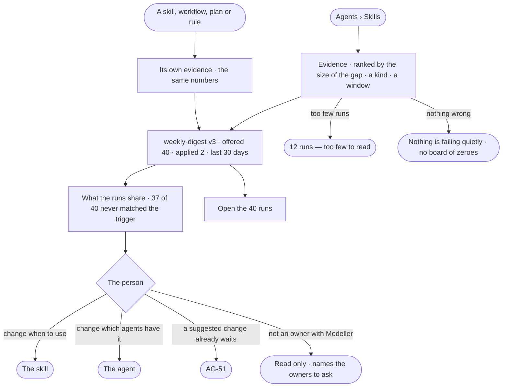

# AG-49 · See what is failing quietly

**As** an agent builder responsible for agents that run by themselves **I want** the counts that say what is failing
quietly — skills offered but not applied, workflows and plans that do not serve, rules nothing cites — each opening
the runs behind it **so that** I fix the right thing.

Tasks: [task.md](task.md) · Feature: [AG-F09](../../feature.md)

## Who can

| Lens | Can | Otherwise sees |
|---|---|---|
| Admin | Read Evidence for every skill, workflow, plan, rule, refusal and failure; open the runs behind each count; act on the item | — |
| Operator | An Operator or a Modeller ([the role table](../../../../../../os/access/features/AC-F02-access-policies/feature.md#the-role-table)): read the same Evidence and open the runs behind it; a run they are not behind and whose agent they do not own opens withheld ([AC-31](../../../../../../os/access/features/AC-F09-what-left-the-platform/stories/AC-31-keep-a-runs-content-to-those-who-may-read-it/story.md)) | Changing the item needs Modeller and ownership of it — read only, naming the owners to ask; a Modeller who owns it changes it as Admin |

## Flow

## Acceptance criteria

| # | Given | When | Then |
|---|---|---|---|
| AG-49.1 | Runs that offered skills | the person opens Evidence from Agents › Skills | each skill shows how often it was offered and reported applied, per version and per agent, ranked by the size of the gap |
| AG-49.2 | Workflows and plans with a check step | the person filters Evidence to workflows or plans | each version shows how often its check said it served |
| AG-49.4 | Rules | the person filters to rules | each shows how often it is cited, and those never cited |
| AG-49.5 | Refusals and failures | the person filters to them | each Access Policy rule that refuses plans, and each step that fails with which diagnosis, shows how often |
| AG-49.6 | Any count | the person opens it | it lists the runs behind it; a run the person may not read lists that it ran, its status and its tokens |
| AG-49.7 | A gap | it is shown | what its runs share is stated beside it — *37 of the 40 never matched the trigger* |
| AG-49.8 | Any figure | it is shown | its window — 7 · 30 · 90 days — is named on it |
| AG-49.9 | Fewer runs than can be read | a figure would show | it says *12 runs — too few to read*, never a percentage |
| AG-49.10 | A new version of a skill or workflow | the person reads its evidence | its counts restart, the previous version's kept beside them |
| AG-49.11 | Runs past their payloads' window | the person opens a count | the count stands, and each run says its payloads are purged |
| AG-49.12 | Nothing failing in the window | the person opens Evidence | it says so in a sentence, not a board of zeroes |
| AG-49.13 | A skill, workflow, plan or rule | the person opens it | the same numbers show on it as in Evidence |
| AG-49.14 | A count | Studio shows it | it is the number the engine stored when the runs settled; Studio does not work it out |
| AG-49.15 | An Operator, or a Modeller who does not own the item | they open Evidence | they read it and open the runs; changing the item is read only, naming Modeller and the owners to ask |

## Screens

| Surface | Lens | First use | Empty after a filter | Loading | Has data | Failed | Agent working or proposing | No access |
|---|---|---|---|---|---|---|---|---|
| Evidence | Admin | agents.skills · Evidence, no runs | agents.skills · Evidence, nothing wrong | agents.skills · Evidence loading | agents.skills · Evidence | agents.skills · Failed | agents.skills · Evidence, suggestion open | — |
| Evidence | Operator | agents.skills · Evidence, no runs | agents.skills · Evidence, nothing wrong | agents.skills · Evidence loading | agents.skills · Evidence | agents.skills · Failed | agents.skills · Evidence, suggestion open | — |
| Evidence on the item | Admin | agents.skill · Evidence, no runs | agents.skill · Evidence, too few | agents.skill · Loading | agents.skill · Evidence | agents.skill · Failed | — | — |
| Evidence on the item | Operator | agents.skill · Evidence, no runs | agents.skill · Evidence, too few | agents.skill · Loading | agents.skill · Evidence | agents.skill · Failed | — | agents.skill · Read only |
