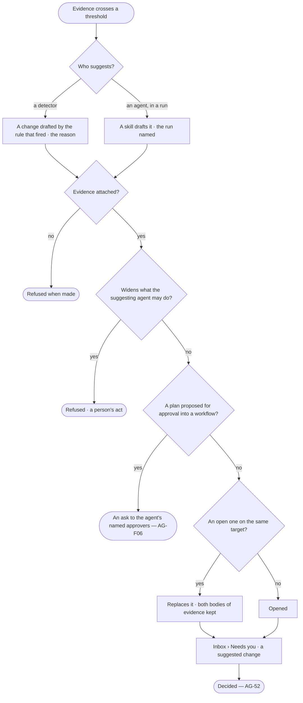

# AG-51 · A suggested change, with its evidence

**As** an agent builder running agents **I want** Invana to tell me which skill, workflow or rule is failing and
propose a change I can accept — its evidence, the difference and what it should improve **so that** my agents improve
from what actually happened rather than from my memory of it.

Tasks: [task.md](task.md) · Feature: [AG-F09](../../feature.md)

## Who can

| Lens | Can | Otherwise sees |
|---|---|---|
| Admin | Read every suggested change, its evidence and its difference; open the runs behind it; decide it (AG-52) | — |
| Operator | An Operator or a Modeller ([the role table](../../../../../../os/access/features/AC-F02-access-policies/feature.md#the-role-table)): read every suggested change, its evidence and its difference; open the runs they may read | Deciding it needs what its target needs — Modeller and ownership for a skill, workflow, agent or answer template, Modeller for the model, Admin for an index — read only, naming whom to ask |

## Flow

## Acceptance criteria

| # | Given | When | Then |
|---|---|---|---|
| AG-51.1 | Evidence crossing a detector's threshold | the detector runs | a suggested change opens, naming the threshold that fired as its reason |
| AG-51.2 | A skill that drafts changes, in a run | it drafts one | a suggested change opens, naming the agent and the run |
| AG-51.3 | A suggested change | the person opens it | it shows the difference, field by field, against the version it changes |
| AG-51.4 | A suggested change | the person opens its evidence | it shows the counts, the window and the runs behind them, each count opening its runs |
| AG-51.5 | A suggested change | the person reads it | it states what accepting should change, and by how much — *applied should exceed 40% within 20 offers* |
| AG-51.6 | A suggested change with no evidence | it is made | it is refused and never shown |
| AG-51.7 | An open suggested change on a target | a newer one is made on it | the newer replaces it, carrying both bodies of evidence |
| AG-51.8 | An agent | it suggests adding a skill to itself, or changing its own Access Policies, limits or budget | it is refused — *An agent may not widen what it may do*; suggesting it drop one of its own skills is allowed |
| AG-51.9 | A suggested change | it is shown | it changes one thing — a skill, a workflow, an agent's skills, an answer template, or one part of the model: a rule, a synonym or definition, a broader kind, a derivation, a saved query shape or an index |
| AG-51.10 | Several suggested changes | the person opens Inbox › Needs you | they are ranked by the size of their evidence, not their age, and never block a run |
| AG-51.11 | Evidence with a suggested change open | the person reads Evidence | the count says a suggested change waits, one click to it |
| AG-51.12 | A suggested change | nothing is decided | nothing changes; no threshold applies it by itself |
| AG-51.13 | A person without what its target needs | they open it | they read it; deciding is read only, naming the role it needs and whom to ask |
| AG-51.14 | A suggested change | the person opens *How it got here* | its steps and sources are shown — the detector or run that made it and the runs its evidence counts |
| AG-51.15 | Questions that keep failing on a term the model does not know | the detector runs | a suggested change opens to the model — a synonym or a definition on the kind — with the failing runs as its evidence |
| AG-51.16 | A query shape that keeps running slow on one kind | the detector runs | an index suggestion opens, with the runs and their latency as evidence; only an Admin may apply it |
| AG-51.17 | A plan with the same intent drafted and served again and again | the detector runs | a suggested change proposes approving it into a workflow, with the runs behind it, and goes to the agent's named approvers as an ask; nothing becomes a workflow until they approve |

## Screens

| Surface | Lens | First use | Empty after a filter | Loading | Has data | Failed | Agent working or proposing | No access |
|---|---|---|---|---|---|---|---|---|
| A suggested change in Needs you | Admin | inbox · Nothing suggested | inbox · Needs you filtered | inbox · Loading | inbox · Suggested change | inbox · Failed | inbox · Suggested by an agent | — |
| A suggested change in Needs you | Operator | inbox · Nothing suggested | inbox · Needs you filtered | inbox · Loading | inbox · Suggested change | inbox · Failed | inbox · Suggested by an agent | inbox · Suggested change, read only |
| Its link from Evidence | Admin | — | — | — | agents.skills · Evidence, suggestion open | — | — | — |
| Its link from Evidence | Operator | — | — | — | agents.skills · Evidence, suggestion open | — | — | — |
