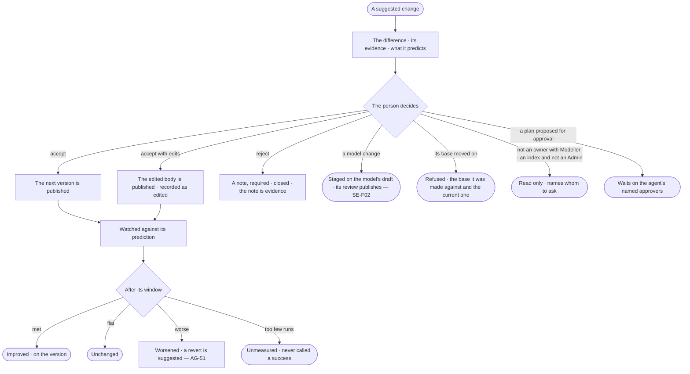

# AG-52 · Accept, edit or reject a suggested change, then see if it helped

**As** the person responsible for an agent, a skill or the model **I want** suggested changes to wait for my decision
with their evidence, and then to see whether each accepted one did what it predicted **so that** improving the agents
is a review, not a project, and nothing changes without me.

Tasks: [task.md](task.md) · Feature: [AG-F09](../../feature.md)

## Who can

| Lens | Can | Otherwise sees |
|---|---|---|
| Admin | Accept, accept with edits, or reject with a note any suggested change; read each version's outcome | — |
| Operator | Read the suggested change and each version's outcome. A Modeller ([the role table](../../../../../../os/access/features/AC-F02-access-policies/feature.md#the-role-table)): decide those on a skill, workflow, agent or answer template they own, and those on the model's rules or meaning through its review | The three acts disabled — *needs Modeller and ownership*, naming the owners to ask; an index needs an Admin, named; a plan proposed for approval waits on the agent's named approvers, named |

## Flow

## Acceptance criteria

| # | Given | When | Then |
|---|---|---|---|
| AG-52.1 | A suggested change and what its target needs | the person accepts | the next version of the target is published through its own publish; runs that used the earlier version still open it |
| AG-52.2 | A suggested change | the person edits the body and accepts | the edited body is published, recorded as edited by that person |
| AG-52.3 | A suggested change | the person rejects it | a note is required; it closes, and the note is kept as evidence |
| AG-52.4 | A suggested change made against an older version than the current one | the person accepts | it is refused, showing the version it was made against and the current one |
| AG-52.5 | An accepted change | its window passes | the outcome is written on the version — improved · unchanged · worsened — against what it predicted |
| AG-52.6 | An accepted change with too few runs in its window | the window passes | it is marked unmeasured, never improved |
| AG-52.7 | A worsened outcome | it is written | a revert opens as an ordinary suggested change; nothing rolls back by itself |
| AG-52.8 | A target's versions | the person opens its history | each version shows what suggested it, who decided, and how it fared |
| AG-52.9 | The same kind of suggestion rejected repeatedly | the person reads Evidence | the repeated rejections and their notes are visible |
| AG-52.10 | Several suggested changes selected | the person looks for an act on all | there is none: each is decided on its own |
| AG-52.11 | A decision | it is made | Inbox › History records who decided, when, and the note |
| AG-52.12 | A person who does not own the skill, workflow, agent or answer template and holds no Modeller, or holds no Modeller for a model change, and is not an Admin | they open a suggested change | accept, edit and reject are disabled, naming the role it needs and whom to ask; through the API it is refused |
| AG-52.13 | A suggested change to the model | a Modeller or an Admin accepts it | it is staged on the model's draft and published through the model's own review (SE-F02); nothing changes the model from Agents |
| AG-52.14 | A published model change | its window passes | the outcome reads the engine's stored answer accuracy and latency for that window before and after it — improved · unchanged · worsened · unmeasured |
| AG-52.15 | An index suggestion | anyone but an Admin accepts it | it is refused, naming an Admin |
| AG-52.16 | A suggested change proposing a plan be approved into a workflow | anyone accepts it from Needs you | it is refused, naming the agent's approvers it waits on; their approval (AG-F06) decides it |

## Screens

| Surface | Lens | First use | Empty after a filter | Loading | Has data | Failed | Agent working or proposing | No access |
|---|---|---|---|---|---|---|---|---|
| Deciding a suggested change | Admin | inbox · Nothing suggested | — | inbox · Publishing | inbox · Suggested change | inbox · Stale base | inbox · Waits on approvers | — |
| Deciding a suggested change | Operator | inbox · Nothing suggested | — | inbox · Loading | inbox · Suggested change | inbox · Stale base | inbox · Waits on approvers | inbox · Suggested change, read only |
| The version's outcome | Admin | agents.skill · History, no outcomes | — | agents.skill · Watching | agents.skill · History | agents.skill · Worsened | agents.skill · Revert suggested | — |
| The version's outcome | Operator | agents.skill · History, no outcomes | — | agents.skill · Watching | agents.skill · History | agents.skill · Worsened | agents.skill · Revert suggested | agents.skill · Read only |
