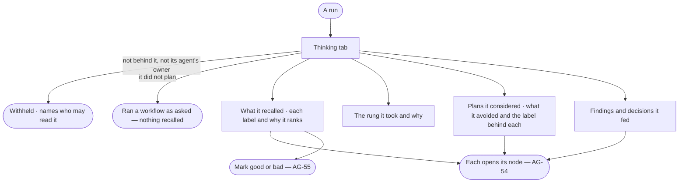

# AG-53 · Read a run's thinking

**As** an agent builder reading a run **I want** to see what it recalled and why, which rung of the ladder it took,
what it considered and avoided, and the findings and decisions it fed **so that** I can tell whether it built on the
right past work before I trust or change it.

Tasks: [task.md](task.md) · Feature: [AG-F09](../../feature.md)

## Who can

| Lens | Can | Otherwise sees |
|---|---|---|
| Admin | Read the *Thinking* tab of any run and open every node it links | — |
| Operator | An Operator or a Modeller ([the role table](../../../../../../os/access/features/AC-F02-access-policies/feature.md#the-role-table)): read the *Thinking* tab of a run they are behind or whose agent they own | On anyone else's run: that it ran, its status and its tokens; the tab withheld, naming who may read it ([AC-31](../../../../../../os/access/features/AC-F09-what-left-the-platform/stories/AC-31-keep-a-runs-content-to-those-who-may-read-it/story.md)) |

## Flow

## Acceptance criteria

| # | Given | When | Then |
|---|---|---|---|
| AG-53.1 | A run the person may read | they open its *Thinking* tab | it shows what the run recalled, the rung it took, the plans it considered and avoided, and the findings and decisions it fed |
| AG-53.2 | A recalled item | it is shown | it names its outcome label, what it matched on and why it ranked where it did — the rank the engine stored |
| AG-53.3 | A run that planned | the person reads its rung | it names the rung — one function · a workflow with new arguments · a plan composed from workflows · a new plan — and the sentence its plan step gave for it |
| AG-53.4 | A plan or workflow the run avoided | it is shown | it names the label that made it *avoid* — failed · marked bad · contradicted later — and the run or finding that earned it |
| AG-53.5 | A finding or decision the run fed | it is shown | it opens in its project; a decision since superseded says so, naming the one that supersedes it |
| AG-53.6 | Any item on the tab | the person opens it | its node opens in the thinking graph |
| AG-53.7 | A recalled item from a run the reader may not read | it is shown | it carries the plan or workflow, its labels and record IDs, with the content withheld |
| AG-53.8 | A workflow run as asked | the person opens the tab | it says *This run did not plan — it ran {workflow} as asked*, with no empty sections |
| AG-53.9 | A run still planning | the person opens the tab | it reads *Recalling*, then the items and the rung as each step settles |
| AG-53.10 | A recall step that failed | the person opens the tab | it names the failure and says the run planned without recall |
| AG-53.11 | The system graph behind | the person opens the tab | what the run recalled and its rung show; a node not yet in the thinking graph says *behind by* how long, not a broken link |
| AG-53.12 | An Operator not behind the run and not an owner of its agent | they open the tab | they see that it ran, its status and its tokens; the thinking is withheld, naming who may read it |

## Screens

| Surface | Lens | First use | Empty after a filter | Loading | Has data | Failed | Agent working or proposing | No access |
|---|---|---|---|---|---|---|---|---|
| The run's Thinking tab | Admin | agents.run.thinking · Did not plan | agents.run.thinking · Nothing recalled | agents.run.thinking · Loading | agents.run.thinking | agents.run.thinking · Recall failed | agents.run.thinking · Recalling | — |
| The run's Thinking tab | Operator | agents.run.thinking · Did not plan | agents.run.thinking · Nothing recalled | agents.run.thinking · Loading | agents.run.thinking | agents.run.thinking · Recall failed | agents.run.thinking · Recalling | agents.run.thinking · Withheld |
