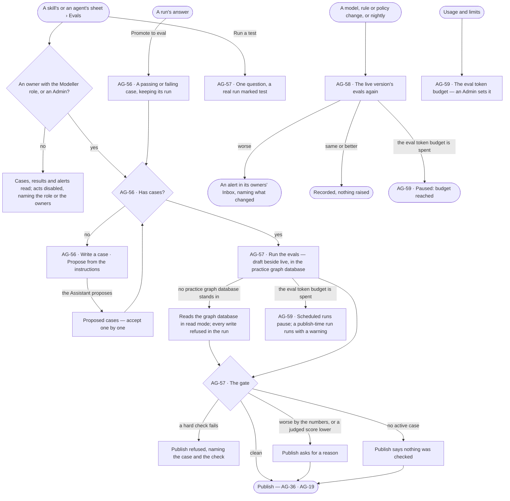
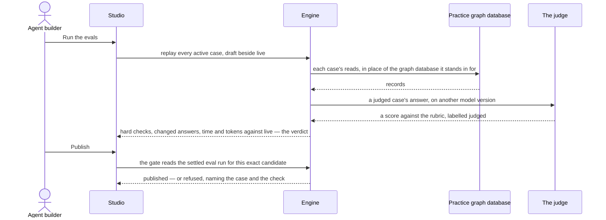

# Test an agent and a skill

> An agent's or a skill's **evals** — fixed questions with checks — replayed in the practice graph database on the
> draft beside the live version before anything publishes, and on the live version again whenever what it depends on
> moves. One eval set per agent or skill, one gate in front of every publish, one token budget for every test and eval
> in the deployment. The decisions it helps make: *is this change safe to publish, and is what is live still as good
> as when it shipped?*

## User journey

Journeys this feature is a step of: [J04 · Build an agent and improve it from what runs teach](../../../../journeys/J04-build-an-agent-and-improve-it-from-what-runs-teach.md)

## Stories

| ID | Story | Status |
|---|---|---|
| AG-56 | [Keep an eval set for an agent or a skill](stories/AG-56-keep-an-eval-set-for-an-agent-or-a-skill/story.md) | idea |
| AG-57 | [Run the evals before a change publishes](stories/AG-57-run-the-evals-before-a-change-publishes/story.md) | idea |
| AG-58 | [Catch an agent or a skill getting worse](stories/AG-58-catch-an-agent-or-a-skill-getting-worse/story.md) | idea |
| AG-59 | [Keep tests and evals within their token budget](stories/AG-59-keep-tests-and-evals-within-their-token-budget/story.md) | idea |

## Access

*Test an agent and a skill* is *Reads* for Operator and *Acts* for Modeller and Admin in [the role table](../../../../os/access/features/AC-F02-access-policies/feature.md#the-role-table);
*Acts* is on the agents and skills a person owns ([AC-F07](../../../../os/access/features/AC-F07-ownership/feature.md)), and an Admin acts on any.

| Act | Role | Everyone else sees |
|---|---|---|
| Read an eval set — cases, checks, judge, rubric — its eval runs, test runs, drift alerts and the eval token budget | Every signed-in person — Operator, Modeller, Admin | — |
| Write, accept or retire a case · set the judge and rubric · ask for proposed cases · run a test · run the evals · run drift now — in Studio or on the command line | An owner of the agent or skill with the Modeller role · Admin. Never on a built-in agent or skill | Each act disabled, naming the role — *Needs the Modeller role — ask an Admin* — or the owners — *Only its owners or an Admin — ask Lee*; a built-in reads its set, with *Copy* |
| Promote a run's answer to a case | An owner of the agent or skill with the Modeller role who may read the run's content ([AC-F04](../../../../os/access/features/AC-F04-what-an-agent-may-touch/feature.md#rules)) · Admin | *Promote to eval* disabled on the run, naming the role or the owners |
| Set the deployment's eval token budget | Admin | The budget and what is spent read; editing disabled — *Needs the Admin role* |
| Name the practice graph database | Admin ([CP-41](../../../../os/control/features/CP-F05-graph-databases/stories/CP-41-name-a-practice-graph-database/story.md)) | Evals read *No practice graph database — reading in read mode* |

## States

| State | What the person sees |
|---|---|
| First use | Evals reads *No eval set — nothing checked*, with *Write a case* and *Propose from the instructions*; Tests reads *Not run yet*; the eval token budget reads *No eval budget* |
| Empty after a filter | — |
| Loading | The tab's tiles hold their shape; cases load in place |
| Has data | The set's cases, each a question with its checks and *passing* or *failing*; the last eval run's tiles — hard checks passed, changed answers, time p95, tokens per case — against live; the test runs, newest first; the spent-of-budget line |
| Failed | The gate's refusal where the act was, naming the case and the check; a read that failed names what, in the engine's words |
| Agent working or proposing | The Assistant proposing cases; an eval run or a test with its cases filling in; drift running |
| No access | Everything reads; every act is disabled, naming the role or the owners |

## Rules

| Rule | Detail |
|---|---|
| One eval set per agent or skill | An agent's tests and a skill's are the same thing: an eval set of cases, each a question with checks, with a judge and a rubric |
| Hard checks block, judged scores warn | A rule check — cites records · says *cannot answer* when it should · a rule held · expected records present · tokens under N · time under N — is hard and counted; a judged score comes from a pinned judge on another model version, is labelled, and never joins the count |
| The judge never grades its own model | A judge set to the model version under test is refused |
| Evals run in the practice graph database | Each read of `data/<graph database>/<kind>` resolves to the practice graph database that stands in for that graph database ([CP-F05](../../../../os/control/features/CP-F05-graph-databases/feature.md#rules)); where none stands in, that graph database is read in its read mode and every write in the run is refused |
| Draft beside live | An eval run replays every active case on the candidate and on the live version, on the same models, and states the candidate against live |
| One gate before every publish | Making an agent live, publishing an agent or skill version, rolling back and moving a model pin pass the gate: a failed hard check refuses; tokens or time more than 20% over live, or a judged score 0.5 below it, warns and asks for a reason; with no active case, publishing says nothing was checked |
| The gate reads, never runs | It reads the newest settled eval run over the candidate's exact text and pin; with none, or one still running, publishing is refused with *Run the evals* |
| A test is a real run marked *test* | One question replayed on the draft as an eval case is; it counts in no agent's numbers |
| Cases are a person's | The Assistant proposes up to five cases; each waits as *proposed* until a person accepts it. Promoting a run's answer is a person's act; an agent never promotes |
| A case outlives its run | A retired case keeps the results it judged; a case whose run is gone keeps its question and checks |
| Drift is checked, not guessed | The live version's evals run again when its model version moves, the model publishes, a rule or an Access Policy it reads changes, and nightly; fewer hard checks passing, or time or tokens past 1.5× the last run, raise an alert to its owners naming what changed |
| Evals spend their own tokens | The deployment's eval token budget, set by an Admin, is apart from the limits per team, user and agent ([CP-F04](../../../../os/control/features/CP-F04-limits/feature.md)); at its ceiling scheduled eval runs and drift pause and say so, and a publish-time run still runs with a warning |
| Every call is in the ledger | Eval, judge and test calls are recorded like any run's ([AC-F09](../../../../os/access/features/AC-F09-what-left-the-platform/feature.md)); a sensitive property never goes to an external judge |
| Tokens, never currency | Every budget and count of spend is in tokens ([glossary › Token budget](../../../../glossary.md#what-may-happen)) |
| The engine counts | Hard checks passed, changed answers, p95, tokens per case, *same as live* and every ratio are the engine's; Studio formats them |
| Leans on | Building an agent (AG-F01) · skills (AG-F04) · runs (CP-F10) · the practice graph database (CP-F05) · AI models (CP-F01) · limits (CP-F04) · the Inbox (CP-F08) · ownership (AC-F07) · History (AC-F06) |

## Data touched

| Record | Read or write |
|---|---|
| Eval set — subject, cases, checks, judge's model version, rubric | Write · read |
| Eval runs and test runs — each case's checks, score, time, tokens, per side | Write · read |
| The deployment's eval token budget and what is spent | Write · read |
| Runs a case was promoted from | Read |
| The practice graph database standing in for each graph database | Read |
| Drift alerts in the owners' Inbox · History rows of every case change and eval run | Write |

## Engine

### Records

| Table | Columns | Notes |
|---|---|---|
| `agents_eval_sets` | `subject_kind` (`skill` · `agent`) · `subject_id` · `judge_model_pin?` · `rubric?` | Unique on (`subject_kind`, `subject_id`) |
| `agents_eval_cases` | `eval_set_id` · `question` · `checks` (a JSON list of `{kind, value}`) · `label` (`passing` · `failing`) · `status` (`proposed` · `active` · `retired`) · `source_run_id?` · `created_by_id` | A removed case is `retired`; the results it judged stay |
| `agents_eval_results` | `eval_run_id` · `eval_case_id` · `case_run_id?` · `side` (`live` · `draft`) · `hard` (each check's verdict) · `judged?` · `tokens` · `latency_ms` · `answer_digest` | One per case and side |
| `agents_eval_budgets` | `monthly_tokens?` · `updated_by_id` · `updated_at` | One row for the deployment: the tokens tests and evals may spend a month |

### Reads

| Record | Owner |
|---|---|
| Runs and steps — an eval run's `params` and `result.eval`; a test run | [CP-F10](../../../../os/control/features/CP-F10-runs-and-how-the-agents-are-doing/feature.md#engine) |
| Agents — their draft instructions and `model_pin` | [AG-F01](../AG-F01-build-an-agent/feature.md#engine) |
| Skills — the draft version, its plan and `model_pin` | [AG-F04](../AG-F04-skills/feature.md#engine) |
| Graph databases and the practice one standing in for each | [CP-F05](../../../../os/control/features/CP-F05-graph-databases/feature.md#engine) |
| AI models offered — the judge's and the subject's pins | [CP-F01](../../../../os/control/features/CP-F01-ai-models/feature.md#engine) |
| Owners of the agent or skill | [AC-F07](../../../../os/access/features/AC-F07-ownership/feature.md#engine) |
| Who may read a run's content | [AC-F04](../../../../os/access/features/AC-F04-what-an-agent-may-touch/feature.md#engine) |
| The ledger of every call | [AC-F09](../../../../os/access/features/AC-F09-what-left-the-platform/feature.md#engine) |
| Inbox rows | [CP-F08](../../../../os/control/features/CP-F08-the-inbox/feature.md#engine) |

### Routes

| Route, after `/api/v1/agents` | Does | Story |
|---|---|---|
| `GET /evals/{kind}/{id}` · `PUT /evals/{kind}/{id}` | A set — judge, rubric, cases · change it | AG-56 |
| `POST /evals/{kind}/{id}/cases` · `PATCH /evals/{kind}/{id}/cases/{case}` · `DELETE /evals/{kind}/{id}/cases/{case}` | Write, accept, retire a case | AG-56 |
| `POST /evals/{kind}/{id}/propose` | The starter set — up to five `proposed` cases | AG-56 |
| `POST /evals/promote` | A run's answer as a `passing` or `failing` case | AG-56 |
| `POST /evals/{kind}/{id}/runs` · `GET /evals/{kind}/{id}/runs` | Run the set — the candidate beside live, or live only · its eval runs, newest first, with the verdict and `versus_live` | AG-57 |
| `GET /{kind}s/{id}/tests` · `POST /{kind}s/{id}/tests` | Test runs, newest first — `id` · `question` · `tokens` · `duration_ms` · `outcome` · `status` · `finished_at` · `{question}` → `202 {run_id, stream_url}` | AG-57 |
| `POST /evals/drift` | Run drift now, naming what moved | AG-58 |
| `GET /evals/budget` · `PUT /evals/budget` | The deployment's eval token budget and what is spent this month · set it (Admin) | AG-59 |

`{kind}` is `agent` or `skill`; `{id}` is the agent's or skill's name.

### Events

| Event | When |
|---|---|
| `agents.eval_sets.update` · `agents.eval_cases.create` · `agents.eval_cases.update` · `agents.eval_cases.delete` | A set or a case changes |
| `agents.evals.run` · `agents.evals.degraded` | An eval run settles · drift found a worse result |
| `agents.eval_budgets.update` | The eval token budget changes |

### Refusals

| Status | When | Sentence | Criterion |
|---|---|---|---|
| 409 `eval_required` | Active cases and no settled eval run whose `params.candidate_digest` matches the candidate | *Run the evals first — {n} cases.* | AG-57.6 |
| 409 `eval_running` | That eval run has not settled | *The evals are still running.* | AG-57.6 |
| 409 `eval_failed` | A hard check failed on the candidate side | *{case} failed {check}.* | AG-57.4 |
| 409 `eval_warned` | It warned and no `why` was given | *This warns — say why to publish.* | AG-57.5 |
| 422 | A judge set to the model version under test | *The judge cannot be the model it grades.* | AG-56.5 |
| 422 | A case, set or run on a built-in agent or skill | *{subject} is built in — copy it to change it.* | AG-56.12 |
| 403 | Promoting a run whose content the caller may not read | *Only who is behind this run, its agent's owners or an Admin read it.* | AG-56.9 |
| 403 | The eval token budget changed by anyone but an Admin | *This needs the Admin role.* | AG-59.3 |
| 403 | A write by someone whose role is not Modeller or Admin | *This needs the Modeller role — ask an Admin.* | AG-56.11 · AG-57.11 |
| 403 | A write by a Modeller who is not one of the subject's owners | *Only its owners or an Admin — ask {owners}.* | AG-56.11 · AG-57.11 |
| run settles `paused: budget` | A scheduled eval run or drift with the eval token budget spent | *The eval token budget is spent for this month.* | AG-59.2 |

### CLI

| Command | Does |
|---|---|
| `invana evals list` · `invana evals run [--draft] [--version N] [--pin <address>]` | Read a set and its runs · run it: live only, or with `--draft` the candidate beside live — a version a roll back would restore, or the address a pin move would set. Exits `1` when the gate blocks, `3` when it warns |
| `invana evals promote <run> --as passing · failing` | A run's answer as a case |
| `invana evals drift [--trigger]` | Run drift now, naming what moved |

### Mechanisms

| Mechanism | How |
|---|---|
| The candidate | The draft, a version a roll back would restore, or the same instructions on a new pin; `candidate_digest` is the sha256 of its text and pin |
| The eval gate | Reads the newest settled eval run whose `params.candidate_digest` matches — an eval run never runs inside the publish request. No active case passes with verdict `unchecked`. It returns `{verdict, eval_run_id, warnings}` to AG-F01's and AG-F04's publish routes |
| An eval run | A root run with `role = evaluate`, `flow_key = eval`, `params.trigger` · `params.candidate` · `params.candidate_digest`, `result.eval` per side and verdict `clean` · `warn` · `blocked`. A skill case replays as an ask offered every published skill with the subject's text swapped for the candidate's and its pin resolved first; an agent case replays as that agent with its draft instructions; nothing is written to a conversation |
| The practice graph database | Each `data/<graph database>/<kind>` the run reads resolves to the practice graph database standing in for it ([CP-F05 › Mechanisms](../../../../os/control/features/CP-F05-graph-databases/feature.md#mechanisms)); where none does, that graph database in its read mode, every write refused inside the run |
| Against live | `versus_live` is written when the run settles — `p95_ms` and `tokens_per_case` (rounded) as a ratio against live, flat within ±2%; a one-sided run carries `versus_live: null` |
| Check kinds | `cites_records` — cites at least one record · `cannot_answer` — ended *cannot answer* · `guardrail_holds` — no refusal overridden, nothing a Deny rule keeps read · `expected_records` — every id in `value` cited · `max_tokens` · `max_latency_ms` — at most `value` |
| The judge | Reads the answer as text — prose verbatim, a table's first rows, a subgraph's counts — capped at 4,000 characters, and scores 0 to 5 against the rubric with one line of why; on the eval budget |
| The starter set | One AI model call on the subject's own pin, else the deployment's default model, writes up to five cases with checks it can state without the data (`cites_records` · `cannot_answer` · `guardrail_holds`); not an eval run, so not on the eval budget |
| A test | A one-question eval replay of the draft, `role = evaluate`, labelled the subject's test |
| Drift | The set runs again on live when its model version moves, the model publishes, a rule or an Access Policy it reads changes, and nightly; a worse result emits `agents.evals.degraded` and an Inbox row for each of the subject's owners |
| The budget | `tokens_in + tokens_out` of every eval, test and judge call this calendar month, against `agents_eval_budgets.monthly_tokens`; a scheduled run or drift past it settles `paused: budget`; a publish-time run runs and carries the warning |

## System impact

| HLD section | Change | NFRs |
|---|---|---|
| § 6 Data and storage | Four tables in Postgres | — |
| § 8 APIs and events | The routes, events and CLI above, under `/api/v1/agents` | — |
| § 9 Distributed execution | Eval runs, tests and drift are queued runs; drift also runs nightly | — |
| § 10 AI and agents | The eval gate guards every agent and skill publish, in the practice graph database; the judge never grades its own model | — |
| § 14 Evaluation | Eval sets, the gate and drift are how an agent or skill change is measured before and after it ships | NFR-COST-1 |

## Decisions

| Decision | Detail |
|---|---|
| Evals is a tab on both sheets | A skill's sheet and an agent's sheet each carry Evals and Tests; the same tiles, cases and gate on both |
| Studio draws the gate's answer | A refused publish, roll back or model move is drawn where the act was, with *Run the evals* when the gate asks for a run; Studio never predicts it |
| A judged score is labelled and kept apart | Its score warns and never blocks, and is never added to a count of hard checks |
| The gate's thresholds | A failed hard check blocks; tokens or time more than 20% over live, or a judged score 0.5 below it, warns with the numbers |
| An edit cannot ship a regression | A case prefers a check the engine runs on the answer's query over a judged score; an answer that claims what it cites no record for fails its case (*cites records*) |
| A sensitive ask is promoted by a person who read it | Promoting is a person's act on a run they may read |
| The eval token budget sits with the limits | It reads on Control Plane › Usage and limits beside the limits per team, user and agent, apart from them |
| No practice graph database is not a refusal | The evals read the real graph database in its read mode, so a publish is never blocked on an Admin naming one; the run says which it read |

## Open questions

| Question | Who answers |
|---|---|

## Not building

| Item | Why not |
|---|---|
| A judge on the model version under test | It would grade its own work |
| Judged scores in the gate | Prose quality warns; only facts block |
| Agents promoting eval cases | A person reads every promoted ask |
| Running the evals inside the publish request | A publish would wait on a run; the gate reads a settled one |
| Evals against the live graph database's writes | A test never changes customer data |
| Currency in eval spend | Tokens only |
| An eval budget per team, user or agent | One budget for the deployment; spend by agents is limited in CP-F04 |
| Traffic splitting or canaries | A version reaches every run that opens after it publishes |
| Previewing writes and sends on a test run | A test replays the ask as an eval case does; a send already asks first |
| A quality score per agent or skill | A score invites optimising the score |
