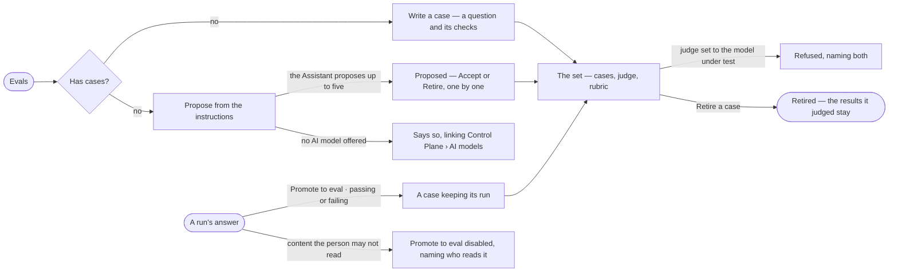

# AG-56 · Keep an eval set for an agent or a skill

**As** an agent builder **I want** to keep fixed questions with checks for each agent and skill I own — written by
hand, proposed by the Assistant from its instructions, or promoted from a run's answer **so that** every change is
measured against the same cases, and what a good answer looks like is written down once.
*The Assistant proposes cases → the builder accepts each.*

Tasks: [task.md](task.md) · Feature: [AG-F10](../../feature.md)

## Who can

| Lens | Can | Otherwise sees |
|---|---|---|
| Admin | On any agent or skill not built in: write, accept and retire cases, set the judge and rubric, ask for proposed cases, promote a run's answer to a case | A built-in's set reads, with *Copy* — *Built in — copy it to change it* |
| Modeller | As Admin, on the agents and skills they own; promote only from a run they may read | On one they do not own, each act is disabled, naming its owners — *Only its owners or an Admin — ask Lee* |
| Operator | Read every eval set, its cases, checks, judge and rubric | *Write a case*, *Propose from the instructions*, *Promote to eval* disabled, naming the role — *Needs the Modeller role — ask an Admin* |

## Flow

## Acceptance criteria

| # | Given | When | Then |
|---|---|---|---|
| AG-56.1 | An agent's or a skill's sheet | Evals opens | the set's cases read, each a question with its checks and *passing* or *failing*; a judged rubric names the model version that judges it |
| AG-56.2 | No case | Evals opens | it reads *No eval set — nothing checked*, with *Write a case* and *Propose from the instructions* |
| AG-56.3 | An owner writing a case | they add checks | each check is hard and counted — cites records · says *cannot answer* when it should · a rule held · expected records present · tokens under N · time under N |
| AG-56.4 | A set | an owner sets a judge model version and a rubric | the judge is offered only from the versions Control Plane › AI models offers, each marked *Local* or *External* |
| AG-56.5 | A judge set to the model version under test | the owner saves the set | it is refused, naming both |
| AG-56.6 | An owner | they press *Propose from the instructions* | the Assistant proposes up to five cases from the instructions, each waiting as *proposed* until a person accepts it; *How it got here* shows what it read and the model version that wrote them |
| AG-56.7 | A proposed case | the owner presses *Accept* or *Retire* | it becomes active or retired; no proposed case is ever replayed |
| AG-56.8 | A run's answer | an owner of the agent or skill who may read the run presses *Promote to eval*, *passing* or *failing* | it becomes a case of that set with the question and checks, keeping its run; an agent never promotes |
| AG-56.9 | A run whose content the person may not read | they look for *Promote to eval* | it is disabled, naming who reads it — the person behind the run, its agent's owners and Admins |
| AG-56.10 | A case whose run is gone, or a retired case | it is read | it keeps its question and checks, and a retired case the results it judged; a gone run's link reads *source gone* |
| AG-56.11 | An Operator, or a Modeller who owns neither the agent nor the skill | they open Evals | everything reads; every act is disabled, naming the role — *Needs the Modeller role — ask an Admin* — or its owners — *Only its owners or an Admin — ask Lee* |
| AG-56.12 | A built-in agent or skill | Evals opens | its set reads, with *Copy* in place of every act; the copy keeps the set's cases, owned by the copier |
| AG-56.13 | A judged check | it is shown | it is labelled *judged* and kept apart from the hard checks |

## Screens

| Surface | Lens | First use | Empty after a filter | Loading | Has data | Failed | Agent working or proposing | No access |
|---|---|---|---|---|---|---|---|---|
| A skill's Evals | Admin | agents.skill · No eval set | — | agents.skill · Loading | agents.skill · Evals | agents.skill · Judge refused | agents.skill · Proposing cases | — |
| A skill's Evals | Operator | agents.skill · No eval set | — | agents.skill · Loading | agents.skill · Evals | agents.skill · Could not load | agents.skill · Proposing cases | agents.skill · Evals |
| An agent's Evals | Admin | agents.agent · No eval set | — | agents.agent · Loading | agents.agent · Evals | agents.agent · Judge refused | agents.agent · Proposing cases | — |
| An agent's Evals | Operator | agents.agent · No eval set | — | agents.agent · Loading | agents.agent · Evals | agents.agent · Could not load | agents.agent · Proposing cases | agents.agent · Evals |
| Promote to eval, on a run | Admin | — | — | agents.run · Loading | agents.run · Promote to eval | agents.run · Failed | — | — |
| Promote to eval, on a run | Operator | — | — | agents.run · Loading | agents.run | agents.run · Failed | — | agents.run |
