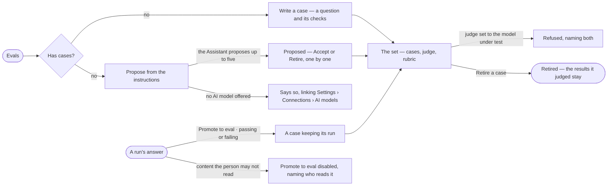

# AG-56 · Keep an eval set for an agent or a skill

**As** an agent builder **I want** to keep fixed questions with checks for each agent and skill — written by
hand, proposed by the Assistant from its instructions, or promoted from a run's answer **so that** every change is
measured against the same cases, and what a good answer looks like is written down once.
*The Assistant proposes cases → the builder accepts each.*

Tasks: [task.md](task.md) · Feature: [AG-F10](../../feature.md)

## Who can

Keeping an eval set needs Edit on `agent/<name>` or `skill/<name>` ([the permission catalogue](../../../../../../os/access/features/AC-F02-access-policies/feature.md#the-permission-catalogue)).

| Access | Can | Otherwise sees |
|---|---|---|
| Admin | On any agent or skill not built in: write, accept and retire cases, set the judge and rubric, ask for proposed cases, promote a run's answer to a case | A built-in's set reads, with *Copy* — *Built in — copy it to change it* |
| Operator | Read every eval set, its cases, checks, judge and rubric. With Edit on the agent or skill, does what an Admin does; promote only from a run they may read | *Write a case*, *Propose from the instructions*, *Promote to eval* disabled, naming the permission — *Needs Edit on the {agent} agent or the {skill} skill — ask {who can grant}* |

## Flow

## Acceptance criteria

| # | Given | When | Then |
|---|---|---|---|
| AG-56.1 | An agent's or a skill's page | Evals opens | the set's cases read, each a question with its checks and *passing* or *failing*; a judged rubric names the model version that judges it |
| AG-56.2 | No case | Evals opens | it reads *No eval set — nothing checked*, with *Write a case* and *Propose from the instructions* |
| AG-56.3 | A person with Edit on the agent or skill writing a case | they add checks | each check is hard and counted — cites records · says *cannot answer* when it should · a rule held · expected records present · tokens under N · time under N |
| AG-56.4 | A set | a person with Edit on the agent or skill sets a judge model version and a rubric | the judge is offered only from the versions Settings › Connections › AI models offers, each marked *Local* or *External* |
| AG-56.5 | A judge set to the model version under test | the editor saves the set | it is refused, naming both |
| AG-56.6 | A person with Edit on the agent or skill | they press *Propose from the instructions* | the Assistant proposes up to five cases from the instructions, each waiting as *proposed* until a person accepts it; *How it got here* shows what it read and the model version that wrote them |
| AG-56.7 | A proposed case | a person with Edit on the agent or skill presses *Accept* or *Retire* | it becomes active or retired; no proposed case is ever replayed |
| AG-56.8 | A run's answer | a person with Edit on the agent or skill who may read the run presses *Promote to eval*, *passing* or *failing* | it becomes a case of that set with the question and checks, keeping its run; an agent never promotes |
| AG-56.9 | A run whose content the person may not read | they look for *Promote to eval* | it is disabled, naming who reads it — the person behind the run and, for a project's run, anyone whose default agent may see its sources |
| AG-56.10 | A case whose run is gone, or a retired case | it is read | it keeps its question and checks, and a retired case the results it judged; a gone run's link reads *source gone* |
| AG-56.11 | An Operator | they open Evals | everything reads; every act is disabled, naming the permission — *Needs Edit on the {agent} agent or the {skill} skill — ask {who can grant}* |
| AG-56.12 | A built-in agent or skill | Evals opens | its set reads, with *Copy* in place of every act; the copy keeps the set's cases, owned by the copier |
| AG-56.13 | A judged check | it is shown | it is labelled *judged* and kept apart from the hard checks |

## Screens

| Surface | Access | First use | Empty after a filter | Loading | Has data | Failed | Agent working or proposing | No access |
|---|---|---|---|---|---|---|---|---|
| A skill's Evals | Admin | agents.skills · Detail · No eval set | — | agents.skills · Detail · Loading | agents.skills · Detail · Evals | agents.skills · Detail · Judge refused | agents.skills · Detail · Proposing cases | — |
| A skill's Evals | Operator | agents.skills · Detail · No eval set | — | agents.skills · Detail · Loading | agents.skills · Detail · Evals | agents.skills · Detail · Could not load | agents.skills · Detail · Proposing cases | agents.skills · Detail · Evals |
| An agent's Evals | Admin | agents.agents · Detail · No eval set | — | agents.agents · Detail · Loading | agents.agents · Detail · Evals | agents.agents · Detail · Judge refused | agents.agents · Detail · Proposing cases | — |
| An agent's Evals | Operator | agents.agents · Detail · No eval set | — | agents.agents · Detail · Loading | agents.agents · Detail · Evals | agents.agents · Detail · Could not load | agents.agents · Detail · Proposing cases | agents.agents · Detail · Evals |
| Promote to eval, on a run | Admin | — | — | agents.runs · Detail · Loading | agents.runs · Detail · Promote to eval | agents.runs · Detail · Failed | — | — |
| Promote to eval, on a run | Operator | — | — | agents.runs · Detail · Loading | agents.runs · Detail | agents.runs · Detail · Failed | — | agents.runs · Detail |
