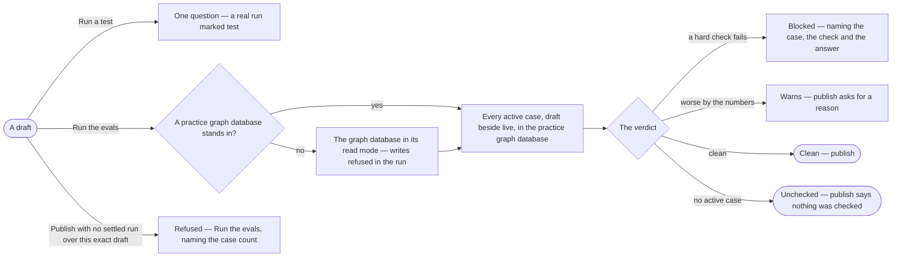

# AG-57 · Run the evals before a change publishes

**As** an agent builder **I want** to try a draft on one question, then replay every case on the draft beside the live
version in the practice graph database, and have publishing refuse what the cases show is worse **so that** a change
that makes an agent or a skill worse is caught before anyone it is granted to meets it, and real data is never changed
by a test.

Tasks: [task.md](task.md) · Feature: [AG-F10](../../feature.md)

## Who can

| Lens | Can | Otherwise sees |
|---|---|---|
| Admin | On any agent or skill not built in: run a test, run the evals | A built-in's eval runs read, with *Copy* |
| Modeller | As Admin, on the agents and skills they own | On one they do not own, *Run a test* and *Run the evals* are disabled, naming its owners — *Only its owners or an Admin — ask Lee* |
| Operator | Read every test run, eval run, its tiles and its verdict | *Run a test* and *Run the evals* disabled, naming the role — *Needs the Modeller role — ask an Admin* |

## Flow

## Acceptance criteria

| # | Given | When | Then |
|---|---|---|---|
| AG-57.1 | A draft | an owner presses *Run a test* with a question | a real run of the draft opens, marked *test*, reading the practice graph database and paid from the eval token budget; it lists in the console and on Tests, counts in no agent's numbers, and opens as a run whose *How it got here* shows its steps and sources |
| AG-57.2 | Active cases | an owner presses *Run the evals* | every case replays on live and on the draft, in the practice graph database; tiles read hard checks passed, changed answers, time p95 and tokens per case, and the draft against live as the engine states it — *▲ 11% vs live* or *same as live* |
| AG-57.3 | No practice graph database stands in for a graph database the subject reads | the evals run | they read that graph database in its read mode, every write in the run refused, and the run says which it read |
| AG-57.4 | A hard check that fails on the draft | the owner publishes | publishing is refused where the act was, naming the case, the check and the answer |
| AG-57.5 | Tokens or time over 20% above live, or a judged score 0.5 below it | the owner publishes | it warns with the numbers and asks for a reason, kept with the version |
| AG-57.6 | No settled eval run over this exact draft and model version, or one still running | the owner publishes, makes live, rolls back or moves a pin | it is refused, naming the case count, with *Run the evals*; Studio never predicts the gate |
| AG-57.7 | No active case | the owner publishes | it publishes, and the gate says *No eval set — nothing checked* |
| AG-57.8 | An eval run or a test in progress | the sheet is open | the cases fill in as each ends; the rest of the sheet stays usable |
| AG-57.9 | A finished eval run | the owner opens a case | it opens the case's run on each side; *How it got here* shows its steps and sources |
| AG-57.10 | A guided skill, a planned skill or an agent | its owner runs the evals or publishes | the same cases, checks and gate apply |
| AG-57.11 | An Operator, or a Modeller who does not own the subject | they open Tests or Evals | everything reads; *Run a test* and *Run the evals* are disabled, naming the role or the owners |
| AG-57.12 | The command line | `invana evals run --draft` runs the set | it exits `1` when the gate blocks and `3` when it warns, and needs the same role and ownership as Studio |
| AG-57.13 | A test or an eval run | it settles | every model, tool and graph database call it made reads in *What left the platform* and *Access usage*, marked as the run's |

## Screens

| Surface | Lens | First use | Empty after a filter | Loading | Has data | Failed | Agent working or proposing | No access |
|---|---|---|---|---|---|---|---|---|
| A skill's Tests — the console and the tab | Admin | agents.skill · Not run yet | — | agents.skill · Loading | agents.skill · Tests | agents.skill · Could not load | agents.skill · Testing | — |
| A skill's Tests — the console and the tab | Operator | agents.skill · Not run yet | — | agents.skill · Loading | agents.skill · Tests | agents.skill · Could not load | agents.skill · Testing | agents.skill · Tests |
| A skill's eval run and gate | Admin | agents.skill · No eval set | — | agents.skill · Loading | agents.skill · Evals | agents.skill · Gate blocked | agents.skill · Eval running | — |
| A skill's eval run and gate | Operator | agents.skill · No eval set | — | agents.skill · Loading | agents.skill · Evals | agents.skill · Gate blocked | agents.skill · Eval running | agents.skill · Evals |
| An agent's Tests | Admin | agents.agent · Not run yet | — | agents.agent · Loading | agents.agent · Tests | agents.agent · Could not load | agents.agent · Testing | — |
| An agent's Tests | Operator | agents.agent · Not run yet | — | agents.agent · Loading | agents.agent · Tests | agents.agent · Could not load | agents.agent · Testing | agents.agent · Tests |
| An agent's eval run and gate | Admin | agents.agent · No eval set | — | agents.agent · Loading | agents.agent · Evals | agents.agent · Gate blocked | agents.agent · Eval running | — |
| An agent's eval run and gate | Operator | agents.agent · No eval set | — | agents.agent · Loading | agents.agent · Evals | agents.agent · Gate blocked | agents.agent · Eval running | agents.agent · Evals |
