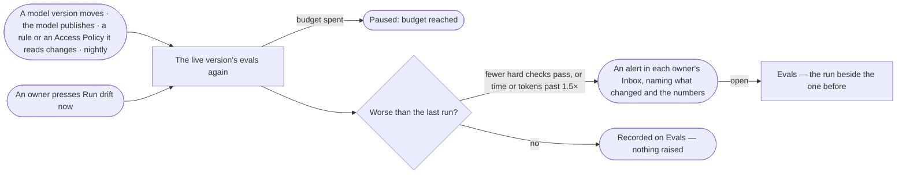

# AG-58 · Catch an agent or a skill getting worse

**As** an agent builder **I want** the live version of each agent and skill I own replayed against its cases whenever
what it depends on moves — its model, the model, a rule or an Access Policy — and every night, with an alert when it
does worse **so that** a change somebody else made is caught the day it lands, not when someone notices.

Tasks: [task.md](task.md) · Feature: [AG-F10](../../feature.md)

## Who can

| Lens | Can | Otherwise sees |
|---|---|---|
| Admin | Read every drift run and alert; run drift now on any agent or skill not built in | — |
| Modeller | Read every drift run; get the alert and run drift now for the agents and skills they own | On one they do not own, *Run drift now* is disabled, naming its owners |
| Operator | Read every drift run and its result | *Run drift now* disabled, naming the role — *Needs the Modeller role — ask an Admin* |

## Flow

## Acceptance criteria

| # | Given | When | Then |
|---|---|---|---|
| AG-58.1 | A live agent or skill with active cases | its model version moves, the model publishes, a rule or an Access Policy it reads changes, or the night comes | its evals run again on live, in the practice graph database, labelled with what triggered them |
| AG-58.2 | A drift run with fewer hard checks passing, or time or tokens past 1.5× the last | it settles | an alert names the agent or skill, what changed and the numbers, in *Needs you* for each of its owners and in History |
| AG-58.3 | A drift run no worse than the last | it settles | it is recorded on Evals and nothing is raised |
| AG-58.4 | An alert | its owner opens it | Evals opens on the drift run beside the run before it, each case's change marked |
| AG-58.5 | An owner | they press *Run drift now* | the live version's evals run at once, naming *Run by hand* as what moved |
| AG-58.6 | No active case | a trigger fires | nothing runs, and Evals reads *No eval set — nothing checked* |
| AG-58.7 | An Operator, or a Modeller who does not own the subject | they open Evals | every drift run reads; *Run drift now* is disabled, naming the role or the owners |
| AG-58.8 | A built-in agent or skill | a trigger fires | its drift runs like any other, and the alert reaches the Admins |

## Screens

| Surface | Lens | First use | Empty after a filter | Loading | Has data | Failed | Agent working or proposing | No access |
|---|---|---|---|---|---|---|---|---|
| Drift on a skill's Evals | Admin | agents.skill · No eval set | — | agents.skill · Loading | agents.skill · Drift | agents.skill · Could not load | agents.skill · Eval running | — |
| Drift on a skill's Evals | Operator | agents.skill · No eval set | — | agents.skill · Loading | agents.skill · Drift | agents.skill · Could not load | agents.skill · Eval running | agents.skill · Drift |
| Drift on an agent's Evals | Admin | agents.agent · No eval set | — | agents.agent · Loading | agents.agent · Drift | agents.agent · Could not load | agents.agent · Eval running | — |
| Drift on an agent's Evals | Operator | agents.agent · No eval set | — | agents.agent · Loading | agents.agent · Drift | agents.agent · Could not load | agents.agent · Eval running | agents.agent · Drift |
| The alert that it got worse | Admin | — | — | inbox · Loading | inbox · Got worse | — | — | — |
| The alert that it got worse | Operator | — | — | inbox · Loading | inbox · Got worse | — | — | inbox · Got worse |
